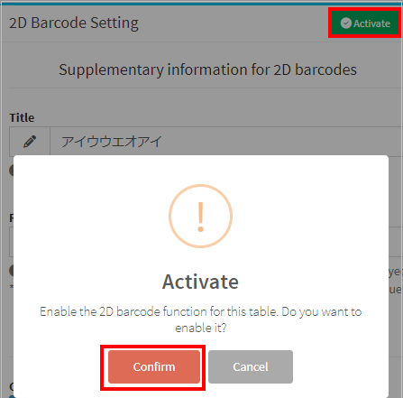
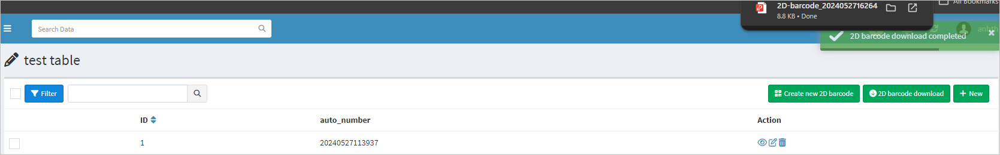

# 2D Barcode settings
This page explains the screen that decides, for each table, how the 2D barcode label looks and what happens when a barcode is read.

The flow until you can use it is as follows.

1. Open the 2D barcode setting screen
2. Set and save
3. Press the "Activate" button
4. Make the PDF of 2D barcodes from the data list

## Overview of the 2D Barcode Functionality
For an overview of the 2D barcode function, see the [official website post](https://exment.net/release_v6-1-0/).

### Required PHP extension (label PDF)
To make the 2D barcode label PDF, PHP's gd extension must be installed with FreeType (`imagettftext` must be available). Without it, making the label PDF gives an error.

- If you use docker-exment: update docker-exment (PR #23 of 2026-11-23 or later) and rebuild the php image (`docker compose build php`, then `docker compose up -d`).
- On other servers: install gd with FreeType (it is usually in the php-gd package of the distribution). You can check whether it is available with the command below. If it prints `bool(true)`, it is available.

```
php -r 'var_dump(function_exists("imagettftext"));'
```

## Page display
- In the custom table list, check the table to set and click "Table Detail Setting" at the top right.  


> Note: you can also go there directly from the data list screen or the data registration screen of that custom table. In that case too, click "Table Detail Setting" at the top right.  


- On the Table Detail Setting screen, click the icon of the 2D Barcode Setting to show the 2D barcode setting screen.  


## 2D Barcode setting items


### Supplementary information for 2D barcodes
Set the information shown on the right side of the 2D barcode.

- #### Title
Enter the fixed words shown on the right side of the 2D barcode.

- #### Represents column
Select the column of the custom data shown on the right side of the 2D barcode.   
You can select the ID column or an auto-number column (it must be unique and required).

### 2D barcode layout size
Set the layout size of the 2D barcode. 
See the table below.

| Case | Cell width | Cell height | Margin right | Margin top | Column per page | Row per page | Column spacing | Row spacing |
| ---- | ---- | ---- | ---- | ---- | ---- | ---- | ---- | ---- |
| 2x5 | 84 | 52 | 17 | 10.5 | 2 | 5 | 8 | 4 |
| 2x6 | 83.8 | 42.3 | 19.3 | 21.5 | 2 | 6 | 3.8 | 0 |
| 2x7 | 83 | 32 | 20 | 24 | 2 | 7 | 4 | 4 |
| 3x6 | 63.5 | 46.5 | 7.2 | 9 | 3 | 6 | 2.55 | 0 |
| 3x7 | 63.5 | 38 | 7.2 | 15.5 | 3 | 7 | 2.55 | 0 |
| 3x8 | 56 | 30 | 17 | 14.5 | 3 | 8 | 4 | 4 |
| 3x9 | 62 | 31 | 9 | 9 | 3 | 9 | 3 | 0 |
| 3x10 | 53.3 | 25.4 | 19 | 21.5 | 3 | 10 | 3.8 | 0 |
| 3x12 | 60 | 20 | 12 | 12 | 3 | 12 | 3 | 3 |
| 4x11 | 48.3 | 25.4 | 8.4 | 8.8 | 4 | 11 | 0 | 0 |


### 2D barcode reading
Set what happens when a 2D barcode is read. 

- #### Form after reading 2D barcode
Select the registration form opened after a 2D barcode is read.  
You can select from the custom forms registered for that table. 

- #### Actions after data registration  
Select the screen shown after the data is registered.  
You can select from the TOP screen, the list screen, the details screen, the edit screen and the camera screen.

After setting, click the "Save" button.  

### Enable 2D barcode settings  
- To make the 2D barcode function usable on that table, you need to "Activate" it. Save once, then click the "Activate" button at the top right of the page.



## Create a new 2D barcode
- When the 2D barcode function is activated, the "Create a new 2D barcode" button is shown in the data list of that table.  
The "2D barcode" part of the button name can be changed with "EXMENT_TEXT_QR_BUTTON_JA/EN" in the .env file.  


- Click "Create a new 2D barcode" to show the screen for creating new 2D barcodes.

- Enter the number of 2D barcodes and save: that many records are created, and the PDF of the 2D barcodes is output too.


## 2D barcode download
- When the 2D barcode function is activated, the "2D barcode download" button is shown in the data list of that table.  
The "2D barcode" part of the button name can be changed with "EXMENT_TEXT_QR_BUTTON_JA/EN" in the .env file.


- Select data and click "2D barcode download": the 2D barcodes of the selected data are output as a PDF.




## Launching the camera screen from Exment
- From the Exment dashboard, you can launch the camera screen for reading 2D barcodes.

- For how to add the item "2D/JAN Barcode" to the dashboard, see [Dashboard](/dashboard).
