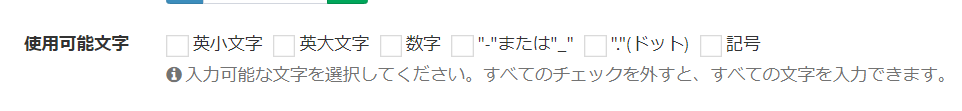

# Add original options to the "Available Characters" setting of the custom column type "One-Line Text"
For the custom column type "One-Line Text", the "Available Characters" setting shows items like the following.



This page describes the steps to add your own items in addition to these.

### Setup steps 

- From the project root folder, open the "app/Exment" folder.

- Then open the "bootstrap.php" file that has been created there.

> If the "app/Exment/bootstrap.php" file does not exist, create the folder and the PHP file manually.

- Add code like the following.

``` php
\Exceedone\Exment\Model\CustomColumn::customAvailableCharacters([
    [
        'key' => 'hiragana', // Key. Alphanumeric characters
        'label' => 'ひらがな', // Text shown on the screen
        'regex' => 'ぁ-ん', // Allowed characters, written as a regular expression
    ],
    [
        'key' => 'katakana',
        'label' => 'カタカナ',
        'regex' => 'ァ-ン',
    ],
]);
```

- This adds options to the Available Characters choices.


- Save the file, and the setup is complete.


[←Back to list of additional settings](/quickstart_more)
