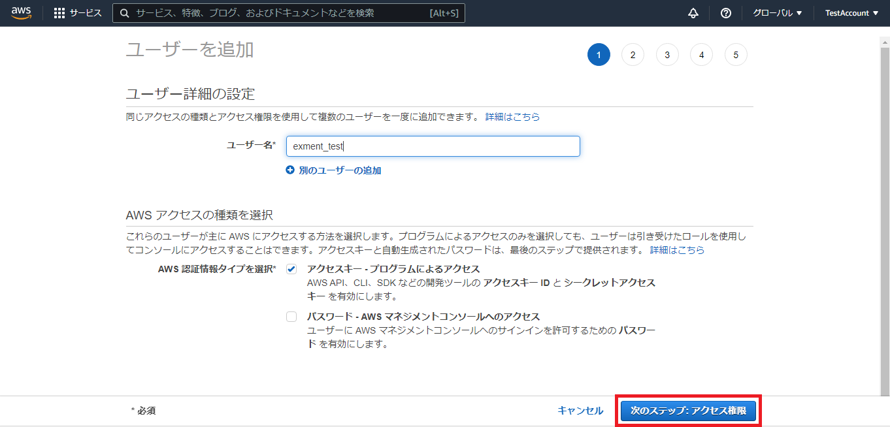
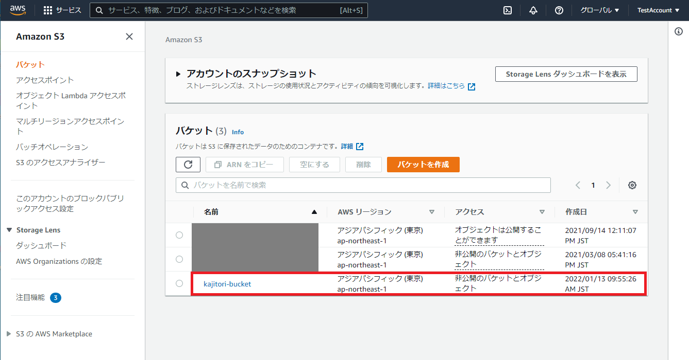
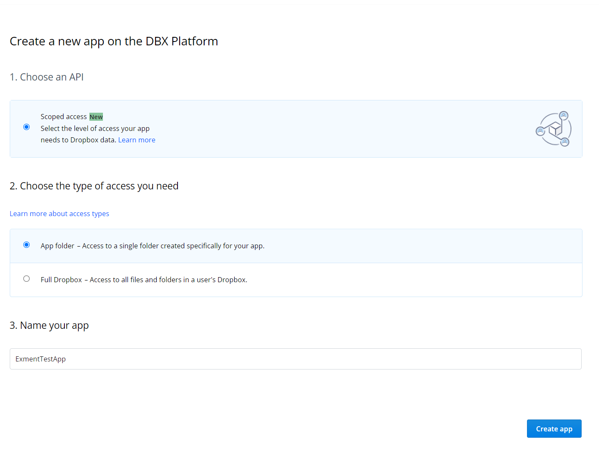
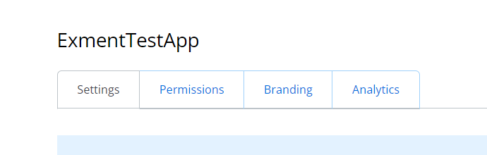

# (For advanced users) Change file save destination
This is the setting for saving files, such as attachments and backups, in a place other than the web server (FTP, Amazon S3, etc.).  
With the standard setting, attachments are saved on the web server. You change the save destination in cases like these.

- Save backup files to FTP
- Save files to AWS S3 for redundancy

Make the settings in this order.

1. Decide the "file type" whose save destination you want to change, and the "upload destination (driver)" you want to use.
2. In the "Common setting", specify the driver for each file type.
3. In the "Settings for each driver", set the information of the connection destination.

## File type
Currently, Exment has the following file types. The save destination can be decided for each type.  
※The key name is used in the settings below.

| File type | Contents | Key name |
| ---- | ---- | ---- |
| **Attachments** | Attachments of data, saved from the screen | exment |
| **Backup** | Backup files of the Exment data, made from the backup screen | backup |
| **Plugin** | Plugin files uploaded as extensions of Exment | plugin |
| **Template** | Setting files of Exment custom tables, custom columns, etc. | template |


## Upload destination (driver) type
Currently, Exment supports the following upload destinations (drivers).  
※The key name is used in the settings below.

| Upload destination (driver) | Where files are saved | Key name |
| ---- | ---- | ---- |
| **Local (default)** | Web server | local |
| **FTP** | FTP | ftp |
| **SFTP** | SFTP | sftp |
| **Amazon S3** | Amazon S3 | s3 |
| **Azure Blob** | Azure Blob | azure |

> From v3.6.2, your own drivers are supported. For details, see "Adding your own driver" at the bottom of this page.

## Setting method

### Common setting
- Open ".env" and specify the driver for each file type you want to change.

~~~
EXMENT_DRIVER_EXMENT=(Key name of the driver you want to use for attachments)
EXMENT_DRIVER_BACKUP=(Key name of the driver you want to use for backup)
EXMENT_DRIVER_TEMPLATE=(Key name of the driver you want to use for templates)
EXMENT_DRIVER_PLUGIN=(Key name of the driver you want to use for plugins)

// Example 1: When you want to use FTP only for the backup destination
EXMENT_DRIVER_BACKUP=ftp

// Example 2: When you want to change all upload destinations to Amazon S3
EXMENT_DRIVER_EXMENT=s3
EXMENT_DRIVER_BACKUP=s3
EXMENT_DRIVER_TEMPLATE=s3
EXMENT_DRIVER_PLUGIN=s3
~~~

### When the first installed version is less than v3.0.8
If the version of Exment that you installed first is lower than v3.0.8, the following change is required.  
(If you do not know which version you installed first, please check it just in case)

- Open "config/exment.php" in the root folder of the project.

- Look for a description like the following.

~~~ php
    /*
    |--------------------------------------------------------------------------
    | driver
    |--------------------------------------------------------------------------
    |
    | file upload driver
    |
    */
    'driver' => [
        'default' => env('EXMENT_DRIVER_DEFAULT', 'local'),
    ],
~~~

- Change this description to the following.

~~~ php
    /*
    |--------------------------------------------------------------------------
    | driver
    |--------------------------------------------------------------------------
    |
    | file upload driver
    |
    */
    'driver' => [
        'exment' => env('EXMENT_DRIVER_EXMENT', 'local'), //Changed
        'backup' => env('EXMENT_DRIVER_BACKUP', 'local'), //Added
        'plugin' => env('EXMENT_DRIVER_PLUGIN', 'local'), //Added
        'template' => env('EXMENT_DRIVER_TEMPLATE', 'local'), //Added
    ],
~~~

### (1 recommended) Settings for each driver-config and .env settings
In this way, you write as little as possible in config, and write the setting values in .env.  
The setting values can be shared between the file types, so it is relatively easy to set.

#### FTP

- Run the following command.

~~~
composer require league/flysystem-ftp ~3.0
~~~

- Open "config/filesystems.php" and check the setting value of "disks.ftp".  
If it does not exist, add the following settings.

~~~php
    'disks' => [
        // Add from here
        'ftp' => [
            'driver'   => 'ftp',
            'host'     => env('FTP_HOST'),
            'username' => env('FTP_USERNAME'),
            'password' => env('FTP_PASSWORD'),
    
            // FTP setting options
            'port'     => env('FTP_PORT', 21),
            'ssl'      => env('FTP_SSL', false),
            'timeout'  => env('FTP_TIMEOUT', 30),
        ],
    ],
~~~

- Open ".env" and add the following.  

~~~
FTP_HOST=(FTP host name)
FTP_USERNAME=(FTP user name)
FTP_PASSWORD=(FTP password)
~~~

- Add the following settings for each file type for which you want to use FTP.

~~~
FTP_ROOT_EXMENT=(FTP root path used for attachments)
FTP_ROOT_BACKUP=(FTP root path used for backup)
FTP_ROOT_TEMPLATE=(FTP root path used for templates)
FTP_ROOT_PLUGIN=(FTP root path used for plugins)

// Example 1: Specify the FTP root path of the backup
FTP_ROOT_BACKUP=/var/foo/exment/ftp/backup

// Example 2: Specify all FTP root paths
FTP_ROOT_EXMENT=/var/foo/exment/ftp/admin
FTP_ROOT_BACKUP=/var/foo/exment/ftp/backup
FTP_ROOT_TEMPLATE=/var/foo/exment/ftp/template
FTP_ROOT_PLUGIN=/var/foo/exment/ftp/plugin
~~~


#### SFTP

- Run the following command.

~~~
composer require league/flysystem-sftp-v3 ~3.0
~~~

- Open "config/filesystems.php" and check the setting value of "disks.sftp".  
If it does not exist, add the following settings.

~~~php
    'disks' => [

        // Add from here
        'sftp' => [
            'driver'   => 'sftp',
            'host'     => env('SFTP_HOST'),
            'username' => env('SFTP_USERNAME'),
            'password' => env('SFTP_PASSWORD'),

            // Settings of SSH key based authentication (write only if needed)
            // 'privateKey' => env('SFTP_PRIVATE_KEY'),
            // 'password' => env('SFTP_PASSWORD'),

            // FTP setting options
            'port' => env('SFTP_PORT', 22),
            'timeout' => env('SFTP_TIMEOUT', 30),
        ],
    ],
~~~

- Open ".env" and add the following.  

~~~
SFTP_HOST=(SFTP host name)
SFTP_USERNAME=(SFTP user name)
SFTP_PASSWORD=(SFTP password)
~~~

- Add the following settings for each file type for which you want to use SFTP.

~~~
SFTP_ROOT_EXMENT=(SFTP root path used for attachments)
SFTP_ROOT_BACKUP=(SFTP root path used for backup)
SFTP_ROOT_TEMPLATE=(SFTP root path used for templates)
SFTP_ROOT_PLUGIN=(SFTP root path used for plugins)

// Example 1: Specify the SFTP root path of the backup
SFTP_ROOT_BACKUP=/var/foo/exment/sftp/backup

// Example 2: Specify all SFTP root paths
SFTP_ROOT_EXMENT=/var/foo/exment/sftp/admin
SFTP_ROOT_BACKUP=/var/foo/exment/sftp/backup
SFTP_ROOT_TEMPLATE=/var/foo/exment/sftp/template
SFTP_ROOT_PLUGIN=/var/foo/exment/sftp/plugin
~~~


#### Amazon S3
- First, [create the AWS S3 bucket and the IAM](/additional_file_saveplace?id=create-an-iam-for-s3).  
※If you want to cover more than one file type, create a separate bucket for each file type

- Run the following command.

~~~
composer require league/flysystem-aws-s3-v3 ~3.0
~~~

- Open "config/filesystems.php" and check the setting value of "disks.s3".  
If it does not exist, add the following settings.

~~~php
    'disks' => [

        // Add from here
        's3' => [
            'driver' => 's3',
            'key' => env('AWS_ACCESS_KEY_ID'),
            'secret' => env('AWS_SECRET_ACCESS_KEY'),
            'region' => env('AWS_DEFAULT_REGION'),

            // Write the following only when you change the endpoint, for example to use PrivateLink
            'endpoint' => env('AWS_ENDPOINT'),
        ],
    ],
~~~

- Add the following to ".env".  

~~~
AWS_ACCESS_KEY_ID=(AWS S3 access key)
AWS_SECRET_ACCESS_KEY=(AWS S3 secret access key)
AWS_DEFAULT_REGION=(AWS S3 region)
#Write the following only when you change the endpoint, for example to use PrivateLink
AWS_ENDPOINT=(AWS S3 endpoint)
~~~

> **To connect with an IAM role, without an access key**
> The access key is used only when both "AWS_ACCESS_KEY_ID" and "AWS_SECRET_ACCESS_KEY" are set.
> If either of them is not set, the credentials are obtained in the default way of the AWS SDK (environment variables, the shared credentials file, the IAM role of the ECS task or of the EC2 instance, and so on).
> If an IAM role is assigned on EC2 or ECS, leave these two out, and Exment connects to S3 without saving an access key. "AWS_DEFAULT_REGION" and the bucket settings are still required.

- Add the following settings for each file type for which you want to use Amazon S3.

~~~
AWS_BUCKET_EXMENT=(AWS S3 bucket used for attachments)
AWS_BUCKET_BACKUP=(AWS S3 bucket used for backup)
AWS_BUCKET_TEMPLATE=(AWS S3 bucket used for templates)
AWS_BUCKET_PLUGIN=(AWS S3 bucket used for plugins)

// Example 1: Specify the AWS S3 bucket of the backup
AWS_BUCKET_BACKUP=exment_backup

// Example 2: Specify all AWS S3 buckets
AWS_BUCKET_EXMENT=exment_default
AWS_BUCKET_BACKUP=exment_backup
AWS_BUCKET_TEMPLATE=exment_template
AWS_BUCKET_PLUGIN=exment_plugin
~~~

- When the save destination of attachments is Amazon S3, downloading an attachment redirects to a temporary URL (signed URL) of Amazon S3. The browser downloads the file directly from Amazon S3, without going through Exment.  
Therefore, the user's browser must be able to connect to Amazon S3 (its endpoint).  
※The validity period (minutes) of the temporary URL can be changed with "EXMENT_FILE_DOWNLOAD_TEMPORARY_URL_MINUTES" in ".env" (the default value is 15). Please check [here](/config?id=validity-period-of-the-temporary-url-when-downloading-a-file) for details.


#### Azure Blob
- Create the Azure Blob.  
※If you want to cover more than one file type, create a separate container for each file type

- Run the following command.

~~~
composer require league/flysystem-azure-blob-storage ~3.0
~~~

- Open "config/filesystems.php" and check the setting value of "disks.azure".  
If it does not exist, add the following settings.

~~~php
    'disks' => [
        // Add from here
        'azure' => [
            'driver' => 'azure',
            'account' => env('AZURE_STORAGE_ACCOUNT'),
            'key' => env('AZURE_STORAGE_KEY'),
        ],
    ],
~~~

- Add the following to ".env".  

~~~
AZURE_STORAGE_ACCOUNT=(Azure Blob account)
AZURE_STORAGE_KEY=(Azure Blob access key)
~~~

- Add the following settings for each file type for which you want to use Azure Blob.

~~~
AZURE_STORAGE_CONTAINER_EXMENT=(Azure Blob container used for attachments)
AZURE_STORAGE_CONTAINER_BACKUP=(Azure Blob container used for backup)
AZURE_STORAGE_CONTAINER_TEMPLATE=(Azure Blob container used for templates)
AZURE_STORAGE_CONTAINER_PLUGIN=(Azure Blob container used for plugins)

// Example 1: Specify the Azure Blob container of the backup
AZURE_STORAGE_CONTAINER_BACKUP=exment_backup

// Example 2: Specify all Azure Blob containers
AZURE_STORAGE_CONTAINER_EXMENT=exment_default
AZURE_STORAGE_CONTAINER_BACKUP=exment_backup
AZURE_STORAGE_CONTAINER_TEMPLATE=exment_template
AZURE_STORAGE_CONTAINER_PLUGIN=exment_plugin
~~~


### (2 not recommended) Settings for each driver-individually specified in config  
In this way, you set the information of each driver in detail in config, for each file type.

#### Example：FTP
- Open "config/filesystems.php" and add the following values.  

~~~php
    'disks' => [
        // If the file type is backup, add from here
        'backup' => [ // Enter the key name of the file type
            'driver'   => 'ftp',
            'host'     => env('FTP_HOST'),
            'username' => env('FTP_USERNAME'),
            'password' => env('FTP_PASSWORD'),
            'root' => env('FTP_ROOT'),
    
            // FTP setting options
            'port'     => env('FTP_PORT', 21),
            'ssl'      => env('FTP_SSL', false),
            'timeout'  => env('FTP_TIMEOUT', 30),
        ],

        // To change the driver of another file type, write the same kind of setting here
    ],
~~~

- Open ".env" and add the setting values written in the "env" functions above.

- To change the driver of another file type, add the settings to the ".env" file.


### Notes
- Depending on the server, files may not be saved.  
Especially on a rental server, **FTP and the like may be restricted by the settings of the provider**. Please note.


## (For advanced users and developers) Adding your own driver
By default, Exment supports drivers such as FTP and Amazon S3.  
This section explains how to use your own driver, one that is not supported by default.  

### Premise
- ※In Exment, the root folder must be separate for each of the "file types (attachments, backup, plugin, template)" described above.  

- If the file system you use has no function to separate root folders, you need to do something such as changing the upload destination or creating an application for each file type.

### Conditions of use
Exment manages your own drivers with the function of the [Laravel file system](https://readouble.com/laravel/12.x/ja/filesystem.html).  
Therefore, the Exment file management supports only services for which a Laravel file system is provided. (Otherwise, you need to prepare the driver yourself.)

### How to develop
As an example, this section explains how to make Dropbox the upload destination of files.  
※For the settings on the Dropbox side, see [Reference: How to get a Dropbox access token](/additional_file_saveplace?id=reference-how-to-get-a-dropbox-access-token).  

#### Getting the required package
Add the package needed to manage Dropbox with Laravel.

```
composer require spatie/flysystem-dropbox=^2.0.5
```

#### Creating and adding to files
Add or add to the following files.

- ##### Adapter
Create a new "app/Exment/Driver" folder, and create the file "ExmentAdapterDropbox.php".

``` php
<?php

namespace App\Exment\Driver;

use Spatie\FlysystemDropbox\DropboxAdapter;

use Exceedone\Exment\Model\File;
use Exceedone\Exment\Enums\Driver;
use Exceedone\Exment\Storage\Adapter\ExmentAdapterInterface2;
use Exceedone\Exment\Storage\Adapter\AdapterTrait;

// (1) Extend DropboxAdapter. ※DropboxAdapter extends \League\Flysystem\Adapter\AbstractAdapter
// (2) Implement ExmentAdapterInterface or ExmentAdapterInterface2
class ExmentAdapterDropbox extends DropboxAdapter implements ExmentAdapterInterface2
{
    //(3) Use AdapterTrait
    use AdapterTrait;
    
    /**
     * (4) Get the URL of the file. Basically, use the process below as it is
     */
    public function getUrl(string $path): string
    {
        return File::getUrl($path);
    }
    
    /**
     * (5) The method called when the adapter is instantiated
     */
    public static function getAdapter($app, $config, $driverKey)
    {
        $mergeConfig = static::getConfig($config);

        $client = new \Spatie\Dropbox\Client(array_get($mergeConfig, 'token'));

        // Let's teach Flysystem to interact with Dropdox,
        // thanks to an adapter made by Spatie as usual.
        $driver = new self($client);
        return $driver;
    }


    /**
     * (6) Merging the setting file
     * @param string $mergeFrom the string 'exment', 'backup', 'plugin' or 'template'
     */
    public static function getMergeConfigKeys(string $mergeFrom, array $options = []) : array{
        return [
            'token' => config('filesystems.disks.dropbox.access_token_' . $mergeFrom),
        ];
    }

    /**
     * (7) Getting the setting information
     * *Required from Exment5.0.0*
     *
     * @param array $config
     * @return array
     */
    public static function getConfig($config) : array
    {
        $mergeFrom = array_get($config, 'mergeFrom');
        $mergeConfig = static::mergeFileConfig('filesystems.disks.dropbox', "filesystems.disks.$mergeFrom", $mergeFrom); // Change only the "dropbox" part to the name of your adapter
        return $mergeConfig;
    }
}

```

```
(1) In the adapter file, extend \League\Flysystem\Adapter\AbstractAdapter.  
For Dropbox, \Spatie\FlysystemDropbox\DropboxAdapter extends that class, so extend it.  

(2) Implement \Exceedone\Exment\Storage\Adapter\ExmentAdapterInterface2 or \Exceedone\Exment\Storage\Adapter\ExmentAdapterInterface.  
※ExmentAdapterInterface and ExmentAdapterInterface2 differ only in whether the argument and the return value of the function getUrl have explicit types.  

(3) Use AdapterTrait.  

(4) Basically, use the process as written.  

(5) This method is called when the adapter is instantiated. Basically, implement it according to how your file service is instantiated.  

(6) Set the pairs of key and value to merge into the setting information, as an associative array.  

(7) Returns the merged setting information. Basically, change only the "dropbox" part to the name of your adapter, and copy and paste the rest as it is.
  ※This item has been required from Exment5.0.0.

※In Exment, the root folder must be separate for each of the "file types (attachments, backup, plugin, template)" described above.  
Dropbox has no function to separate root folders within one app.  
Therefore, you need to create a separate Dropbox app for each file type.  
This merge process assigns the access token created for each file type as a setting value.
```

    
- ##### Hook
Add the following to "bootstrap.php" in the "app/Exment" folder.

``` php
<?php
// Run the \Exceedone\Exment\Enums\Driver::extend method
// First argument: the key name of the adapter
// Second argument: the path of the Adapter you implemented
\Exceedone\Exment\Enums\Driver::extend('dropbox', \App\Exment\Driver\ExmentAdapterDropbox::class);

```

    
- ##### Setting values
Add the following to "filesystems.php" in the "config" folder.  
A separate Dropbox app is needed for each file type, so set a token for each file type.

``` php
    'dropbox' => [
        'driver' => 'dropbox',
        'access_token_exment' => env('DROPBOX_ACCESS_TOKEN_EXMENT'),
        'access_token_backup' => env('DROPBOX_ACCESS_TOKEN_BACKUP'),
        'access_token_plugin' => env('DROPBOX_ACCESS_TOKEN_PLUGIN'),
        'access_token_template' => env('DROPBOX_ACCESS_TOKEN_TEMPLATE'),
    ],
```

    
- ##### .env file
Add the following to ".env" in the root folder.  
※For how to get the access tokens, see "Reference: How to get a Dropbox access token" below.

```
# Add only the ones you need
EXMENT_DRIVER_EXMENT=dropbox
EXMENT_DRIVER_BACKUP=dropbox
EXMENT_DRIVER_TEMPLATE=dropbox
EXMENT_DRIVER_PLUGIN=dropbox

# Add only the ones you need. Write the access tokens
DROPBOX_ACCESS_TOKEN_EXMENT=XXXXXX
DROPBOX_ACCESS_TOKEN_BACKUP=YYYYYY
DROPBOX_ACCESS_TOKEN_TEMPLATE=ZZZZZZ
DROPBOX_ACCESS_TOKEN_PLUGIN=VVVVVV

```

The implementation is now complete.


## Reference: How to create AWS S3
This section briefly explains how to create Amazon Simple Storage Service (Amazon S3).  
※You need to create an AWS account and log in beforehand.

#### Create an IAM for S3
- At the top right of the console screen, click your account to open the submenu. Select "Security credentials".
  

- Select "Users" in the side menu on the left.
  

- Click the "Add users" button.
  

- Enter any name in "User name".
In "Select AWS credential type", check "Access key - Programmatic access" and click the "Next: Permissions" button.
  

- In "Set permissions", click "Attach existing policies directly".
  

- Enter "S3" in "Filter policies" and search. In the list that is displayed, check "AmazonS3FullAccess" and click the "Next: Tags" button.
  

- Click the "Next: Review" button.
  

- The confirmation screen is displayed. Check what you selected, and click the "Create user" button.
  

- When the user is created, the "Access key ID" and the "Secret access key" are displayed.
You will use them later, so be sure to write them down.
  

#### Create a bucket

- After creating the user, create the bucket.  
Click Services at the top left of the console screen and select "Storage" → "S3".
  

- Click the "Create bucket" button.
  

- Enter any name in "Bucket name". For "AWS Region", select "Asia Pacific (Tokyo)".  
※Set the other options as needed.
  

- Click the "Create bucket" button.
  

- Check that the bucket you created has been added to the list.
  


## Reference: How to get a Dropbox access token
- Go to the Dropbox [App Console](https://www.dropbox.com/developers/apps).

- Click "Create App".
  

- Set "2. Choose the type of access you need" to "App folder", enter any name in "3. Name your app", and click "Create app".
  

- The app is created. Next, change the Permissions. Click the Permissions tab.
  

- Check the following items. When the setting is done, click Submit.
    - files.metadata.write
    - files.content.write
    - files.content.read
  

- In the "Generated access token" menu of "OAuth 2" on the Settings tab, click the "Generate" button.
  

- The access token is created. Write this value in the setting file.


[←Back to list of additional settings](/quickstart_more)
