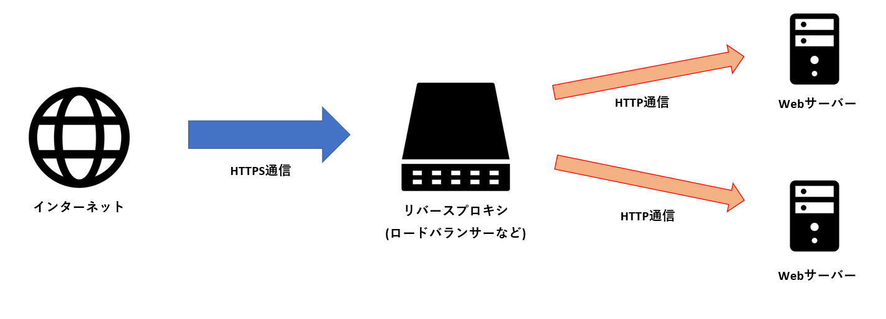
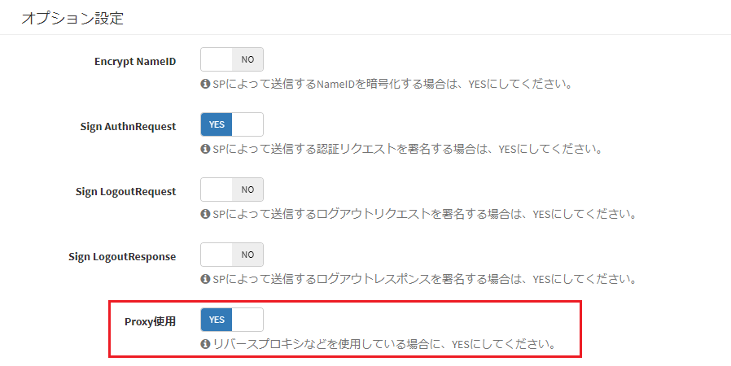

# Settings when using a reverse proxy
This page describes the steps to follow when a reverse proxy is used in the Exment server setup.  

> These steps were partially revised in v3.7.2.

## Introduction
In some cases, the server (or service) that receives Web requests, such as a cloud service load balancer (hereafter, the reverse proxy server), is different from the Web server.  
In particular, the following configuration is sometimes used.  

- Communication from the Internet to the reverse proxy server : HTTPS
- Communication from the reverse proxy server to the Web server : HTTP




These are the additional setup steps for the reverse proxy server and for Exment that are required when building this kind of reverse proxy configuration.  


### Setup steps - Exment

- Edit the .env file.

~~~
# (Add to the existing value) URL up to the reverse proxy server. "admin" is not needed
APP_URL=https://XXXX.com 

# Add this if Internet <-> reverse proxy server uses HTTPS and reverse proxy server <-> Web server uses HTTP
ADMIN_HTTPS=true

# Use the "APP_URL" value above to generate URLs
ADMIN_USE_APP_URL=true

# IP addresses of the reverse proxy servers to trust as proxies. If multiple IP addresses are expected, separate them with commas
# ※If the IP address is not fixed, or if nothing other than the reverse proxy server can access the Web server due to zone settings, you can also specify "*"
ADMIN_TRUST_PROXY_IPS=172.0.1.1,172.0.1.2
#ADMIN_TRUST_PROXY_IPS=*

# For AWS ELB, add the following value
ADMIN_TRUST_PROXY_HEADERS=HEADER_X_FORWARDED_AWS_ELB
~~~

- If you use [SAML authentication](/login_sso?id=saml), set "Use Proxy" to YES in "Option Setting".



### Setup steps - Reverse proxy server

- When the reverse proxy server (load balancer, Nginx, etc.) forwards requests to the Web server, the following header values must be added.  
Please check whether these header values are added.  
※The values below are headers that carry the access information up to the reverse proxy server, and are processed on the Web server side.  
    - X-Forwarded-Host : Host name of the reverse proxy server
    - X-Forwarded-For : IP address of the client
    - X-Forwarded-Proto : http or https
    - X-Forwarded-Port : Port used to access the reverse proxy server

- Example: nginx

```
    location / {
        proxy_set_header X-Forwarded-Host localhost;
        proxy_set_header X-Forwarded-For XXXX;
        proxy_set_header X-Forwarded-Proto https;
        proxy_set_header X-Forwarded-Port 10443;
    }
```

- ※To output the request values and header values for verification, add the following to ".env" in the root folder. They are output to storage/logs/laravel.log.

```
EXMENT_DEBUG_MODE_REQUEST=1
```


[←Back to list of additional settings](/quickstart_more)
