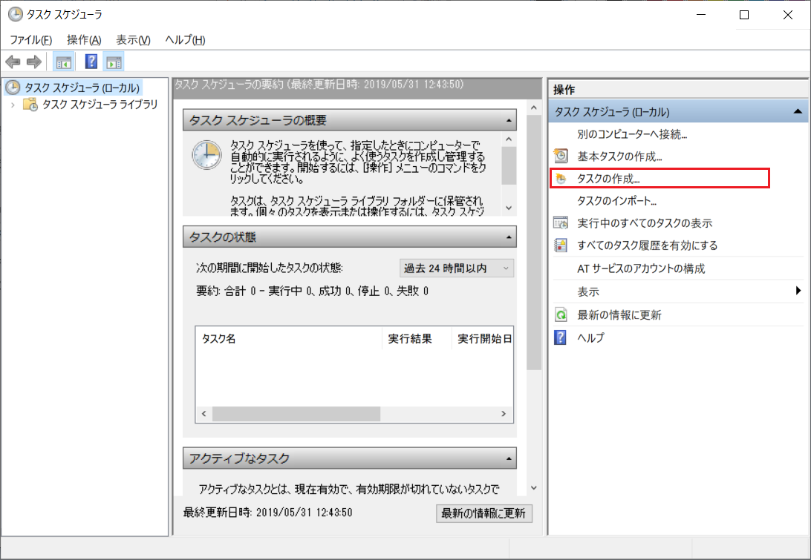
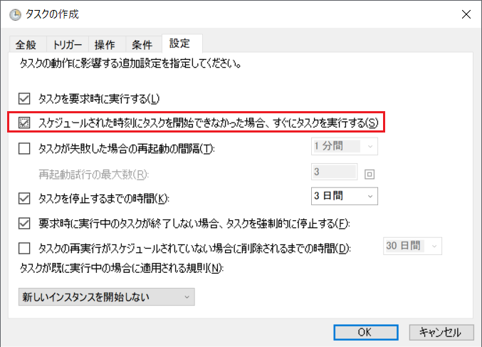

# Task schedule
This setting makes Exment run processes automatically at fixed times (the task schedule).  
It needs additional settings on the server side. The steps differ between Linux and Windows.

The task schedule is used for the following.

- Back up the database and files every day at a fixed time.  
- Following the notification settings, send mail at a fixed time to the people related to the data that matches the conditions.
- Check earthquake information every minute and, if there is an earthquake that matches the conditions, send a [safety check](/safety_check) automatically (the "exment:safetywatch" command).
- When the full-text search engine (Meilisearch) is used, repair the difference between the database and the index automatically once a day (the "exment:meili-reconcile" command).  
Note: It runs at the time of "MEILISEARCH_REPAIR_AT", only when "MEILISEARCH_REPAIR_ENABLED" is true. For details, see [the page of the full-text search engine (Meilisearch)](/additional_meilisearch).

### Setup steps(Linux)
**(1) Run the following command.**

~~~
crontab -e
~~~

**(2) The Cron setting screen appears. Write the following.**

With this, the artisan schedule command runs every minute. After that, Exment runs the tasks at the fixed times.  
Note: The lines below are an example. The way of writing and the settings can differ by OS and service.

~~~
# Ordinary Linux
* * * * * cd /(Exment root directory) && php artisan schedule:run >> /dev/null 2>&1

# Xserver (the same PHP version as the one chosen on the control panel, by its full path; PHP 8.3 here)
* * * * * cd /(Exment root directory) && nice -n 15 /usr/bin/php8.3 artisan schedule:run >> /dev/null 2>&1

# Sakura Internet
* * * * * cd /(Exment root directory); php artisan schedule:run >> /dev/null 2>&1
~~~

> **On a rental server (Xserver, etc.)**: `php` in cron can be the default PHP of the server, not the one chosen on the control panel. Write the full path of the same PHP version as the control panel ([rental server](/install_rental)).

### Setup steps(Windows)
- Run the following command and copy the place (path) of the php.exe file.  

~~~
where php
// C:\xampp\php\php.exe
~~~

- In the Windows menu, enter "task" and start the Task Scheduler.  


- In the Task Scheduler, click "Create Task".


- On the "General" tab, set as follows. ("Name" can be any name you like)


- Click the "Triggers" tab. Create two triggers.  
    (1) Click the "New" button.  
    Then enter the following.  
    - Begin the task: At startup
    - Repeat task every: 1 minute
    - For a duration of: Indefinitely
    - Check "Enabled"  
    Click "OK" when done.  


    (2) Click the "New" button again.  
    Then enter the following.  
    - Begin the task: At task creation/modification
    - Repeat task every: 1 minute
    - For a duration of: Indefinitely
    - Check "Enabled"  
    Click "OK" when done.  


- On the "Actions" tab, click the "New" button.  
Then enter the following.
    - Action: Start a program
    - Program/script: the path to php that you copied earlier
    - Add arguments: (Exment root directory)/artisan schedule:run


- On the "Settings" tab, check "Run task as soon as possible after a scheduled start is missed".


- On a laptop, on the "Conditions" tab, uncheck "Start the task only if the computer is on AC power". 


- When the settings so far are done, click OK.  
A screen to enter the user credentials appears, so enter your password.  


- Finally, in the "Task Scheduler Library", select the task you made and click "Run". 


This completes the settings.


## Checking when it does not work (v4.0.6 or later)
When it does not work, find where the cause is by the following two ways.

| Way | What you learn |
| ---- | ---- |
| Log output | Whether the schedule is called from cron or the Task Scheduler |
| Run the command directly | Whether the notification and backup settings themselves are correct |

### Log output
We recommend checking while writing logs.  
v4.0.6 added debug logs for the schedule run. Check by the following steps.

#### How to set the log output
- Add the following to the .env file and save it.

~~~
EXMENT_DEBUG_MODE_SCHEDULE=true
~~~

- With this, logs are written to /storage/logs/laravel.log when the schedule is defined and when it runs.  
If the task schedule is set correctly, a log is written every minute.


#### Contents of the logs

- Exment schedule debug defined.  
→ This log is written when the output of the logs below and the setting of the schedule are finished.  
→ If this log is not written, the definition or the call of the schedule may not have finished correctly. Review the cron settings or the Task Scheduler settings.

- Exment schedule debug everyMinute called.  
→ This log is written every minute. If the definition of the schedule finished correctly, it is written every minute.  
→ If this log is not written, the definition or the call of the schedule may not have finished correctly. Review the cron settings or the Task Scheduler settings.

- Exment schedule debug hourly called.  
→ This log is written at minute 0 of every hour. If the definition of the schedule finished correctly, it is written every hour.  
It has the same definition as the real schedule command of Exment. First check whether this log is written.

- Exment schedule command called.  
→ This log is written when the schedule command of Exment starts to run. If this log is written, at least the schedule command runs correctly.  
If this log is written but notifications or backups do not run as you expect, review the setting values.


#### Notes
This log cannot tell "a run from the schedule" from "a run of an ordinary command". A log is also written when you run an ordinary command.  
Remove the setting value EXMENT_DEBUG_MODE_SCHEDULE except when you are checking the schedule.


### Run the command directly
When notifications or backups do not work correctly, you can also run the schedule command of Exment yourself to check.  
Run the following command.

```
php artisan exment:schedule
```

This command does the following. Normally both run only at minute 00, but when you run the command directly, they run at once.

- Runs the notifications (The Passage of Time) whose "Notification Time" matches.
- Runs the auto backup when "Auto Backup Start Time(hour)" matches.

If it works as you expect with this command, the schedule (cron or the Task Scheduler) may not be working correctly for some reason.  
Use this when you look for the cause.


[←Back to list of additional settings](/quickstart_more)
