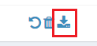

# Backup and Restore
How to take a "backup", which saves the data of Exment, and how to "restore", which brings the data back from a saved backup.

| What you want to do | Where to look |
|---|---|
| Take a backup right now | Perform manual backup |
| Take backups automatically at a fixed time, such as every day | Automatic backup execution |
| Bring the data back from a backup | Restore |
| Do it by command | (Advanced) Command backup, (Advanced) Restore by command |

## Overview
Backup and restore are used in cases such as the following.

- Take a backup before a large data update, and go back when it does not go well.
- Take a backup every day to prepare for unexpected trouble.
- Move all data from the current environment to another environment. (Be sure to check that it works before doing it.)

The following are backed up.
- Database
- Plugin files
- Attached files
- Log files
- Config files

## Caution
- When you move to another environment, it may not complete correctly, depending on the environment.  
In particular, when you move to another OS (Windows or Linux), another kind of database (MySQL or MariaDB) or another version of the database, it may not complete correctly for various reasons.  
Be sure to check beforehand.

- As a check beforehand, we mainly recommend the following.
    - Do the move in a development environment or the like as the destination.
    - Try the move at the stage where only the table definitions have been created.
    - Use the same kind and the same version of database.

- At present, automatic backup and restore are not supported on SQL Server.  
Please back up and restore by hand with the steps of [Backup and restore (SQL Server)](/backup_sqlserver).

## screen
- Select "Admin Setting > Backup" in the left menu.  
Or open the following URL.  
http(s)://(URL of Exment)/backup  
The backup screen is displayed.

> Note: the URL is for the default setting without "/admin" (a site newly installed with v7.2.1 or later). If `ADMIN_ROUTE_PREFIX` in `.env` has a value (a site installed with an older version has "admin"), add that value after the URL of the site (e.g. `http(s)://(URL of Exment)/admin/backup`). For details, see [Change / delete "admin" included in URL](/additional_prefix).

## Backup
There are two ways to back up: "manual" and "automatic".

### Perform manual backup
The steps to take a backup by hand whenever you like.

- Click the [Backup] button at the top right of the page.  
  

- A confirmation dialog is displayed. Click [Confirm] and wait.  
**Note: a backup takes a very long time. Wait without operating.**
  

- When it is completed, a message is displayed.  
A file whose creation date and time is the time of execution appears in the backup list.
  
  

- The backup file that was made can be downloaded.  
Click the [Download] link in the row of the backup.  
  

- The file name of the backup that was made can be changed.  
Click the [Edit File Name] link in the row of the backup.  
Note: a name that contains half-width kana or symbols cannot be set.
  
- After entering the file name, click the [Submit] button.
  

- When it is completed, a message is displayed, and the file name in the backup list changes.
  

  

### Automatic backup execution
Backups can be taken automatically at a fixed time.  
When backups are taken regularly, the data can be restored even when, for example, it was updated in a badly wrong way.  
**Note: the [task schedule](/additional_task_schedule) must be set beforehand.**

As an example, here is how to set backups "at 3 at night", "every day", keeping "7 generations of backups".

- In "Backup Setting", set "Auto Backup" to "YES".
  

- Change the option settings.
  

- Then click the [Save] button at the bottom of the page.

<h3 id="backup_command"><a href="#/backup?id=backup_command" data-id="backup_command" class="anchor">(Advanced) Command backup</a></h3>

You can also back up by command. Run the following command in the root directory of the project.

~~~
php artisan exment:backup
~~~

- When "--target=" is not given, all targets (database, plugin files, attached files, log files, config files) are backed up.
- To narrow down the targets, give the following keys to "--target=", separated by commas.
    - database : database
    - plugin : plugin files
    - attachment : attached files
    - log : log files
    - config : config files

~~~
# Example: back up only the database and the attached files
php artisan exment:backup --target=database,attachment
~~~

## Restore
There are two ways to restore the data: "select from the backup list" and "upload".

### Notes on Restoration
- When the version of Exment at the time of the backup differs from the version of Exment installed now, the database must be brought up to date after the restore.  
Example:
    - Version at the time of the backup: v1.1.6
    - Current version: v1.2.0  
    → The database must be brought up to date
    
In that case, run the following command after the restore.

~~~
php artisan exment:update
~~~

- After the restore, you are signed out automatically. Log in with the ID and password of a user that was backed up.

- From v4.1.0, Exment is in maintenance mode while a restore is running.  
When the restore ends, maintenance mode is released automatically. If maintenance mode is not released for some reason, release it with the steps of [Canceling maintenance mode](/troubleshooting?id=canceling-maintenance-mode).

### Select from backup list
The way to restore the data by selecting the file to restore from the list of backups taken in the past.

- In the backup list, click the [Restore] link.  
  

- A confirmation dialog is displayed. Click [Confirm] and wait.  
**Note: a restore takes a very long time. Wait without operating.**
  

- When the completion message is displayed, the environment is back to the time of the backup.  
You are moved to the login page automatically.  
  

### Upload
The way to restore the data by uploading a backup saved at hand (locally) to Exment.  
**Note: when the uploaded file is too large, it may not complete correctly.** In that case, see [When uploading is not possible due to large capacity](#when-uploading-is-not-possible-due-to-large-capacity) below.

- Click the [Restore] button at the top right of the page.  
  

- A file upload dialog is displayed. Select the backup file downloaded locally and click "Submit".  
  

- After clicking the "Submit" button, wait.  
**Note: a restore takes a very long time. Wait without operating.**

- When the completion message is displayed, the environment is back to the time of the backup.
  

### When uploading is not possible due to large capacity
When you restore by "upload", the restore may fail if the backup file is too large.  
In that case, restore with one of the following steps.

#### (1) Change the upload limit

- Change the upload size limit with the steps of [Changing PHP settings](/additional_php_ini).

#### (2) Put the backup file directly on the server

- Put the downloaded backup file in the following path on the server.

~~~
(root directory of the project)/storage/app/backup/list
~~~

- Reload the backup screen.

- The backup file you put there has been added to the backup list. Restore with the steps of "Select from backup list" above.

### When an error is shown on the backup screen or by the command
A message like the following may be shown on the backup screen or by the command.

  

When this error appears, the settings needed for backup and restore may not have been made on the server.  
Check [Troubleshooting](/troubleshooting?id=backup-restore-fails) and change the server settings.

### When you initialize custom data and so on after a restore
After a restore, you can refresh the saved custom data and so on of Exment and create the data from scratch.  
For details, see [Refreshing custom data](/refresh_data).

### When you use SQL Server
When you use SQL Server, Exment does not currently support backup and restore from the screen. You need to do the work by hand.  
For details, see [Backup and restore (SQL Server)](/backup_sqlserver).

<h3 id="restore_command"><a href="#/backup?id=restore_command" data-id="restore_command" class="anchor">(Advanced) Restore by command</a></h3>

You can also restore by command.

- Put the downloaded backup file in the following path on the server.

~~~
(root directory of the project)/storage/app/backup/list
~~~

- Run the following command in the root directory of the project.

~~~
php artisan exment:restore (zip file name)
~~~

- When the zip file name is omitted, the backup list is shown. Select the file to restore.
- A confirmation message is shown before execution. To run without the confirmation message, give "--yes".

~~~
# Example: restore without the confirmation message
php artisan exment:restore (zip file name) --yes
~~~

<h3 id="change_backup_target"><a href="#/backup?id=change_backup_target" data-id="change_backup_target" class="anchor">(For advanced users) Change backup destination</a></h3>

Usually, the backup files are put inside the web server.  
The backup files can also be put in another place. When they are in another place, even if the web server breaks down and cannot start, you can download the backup files from that place and restore Exment.

Note: the setting steps have moved to [Changing the file save place](/additional_file_saveplace).

### Notes
- On some servers, the backup destination cannot be changed.  
Especially on rental servers, **FTP and so on may be restricted by the settings of the provider**. Please understand this beforehand.
