# Backup and Restore (SQL Server)
This page explains how users of SQL Server manually back up and restore Exment data.  

## Overview
If you are using SQL Server, you cannot run backup and restore from the Exment screen. Please back up and restore the database manually using Microsoft SQL Server Management Studio (SSMS).  

Also, save the following files, folder by folder, to another location using Explorer or similar, and restore them as necessary.
- Plugin files
- Attachments
- Log files
- Setting files

## Database backup
This is the procedure for backing up SQL Server.  
You can run it at any time.  

- Start Microsoft SQL Server Management Studio (SSMS).  
**※Be sure to log in as a member of the sysadmin server role, or of the db_owner or db_backupoperator database role.**
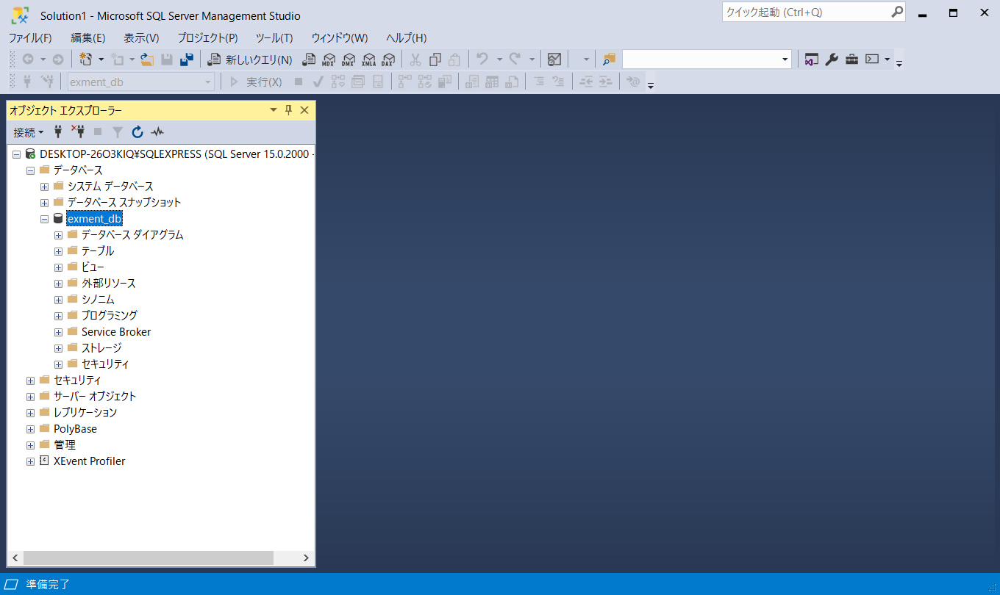  

- Right-click the database to back up and select Tasks → Back Up.  
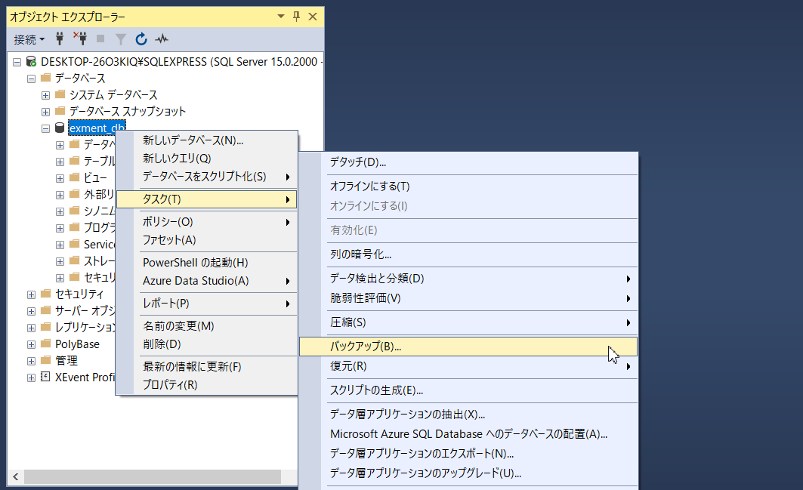  

- On the Back Up Database screen, select "Backup type: Full" and click Add for the backup destination.  
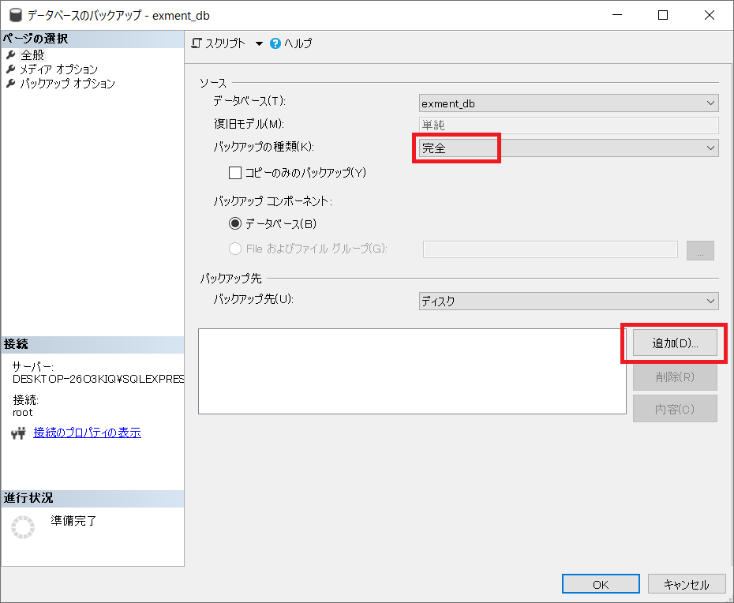  

- The Select Backup Destination dialog is displayed. Specify any folder and file name and click the OK button.  
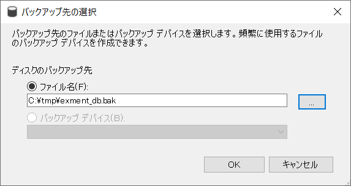  

- Return to the Back Up Database screen and click the OK button. The backup is executed. When it is complete, a message is displayed.   
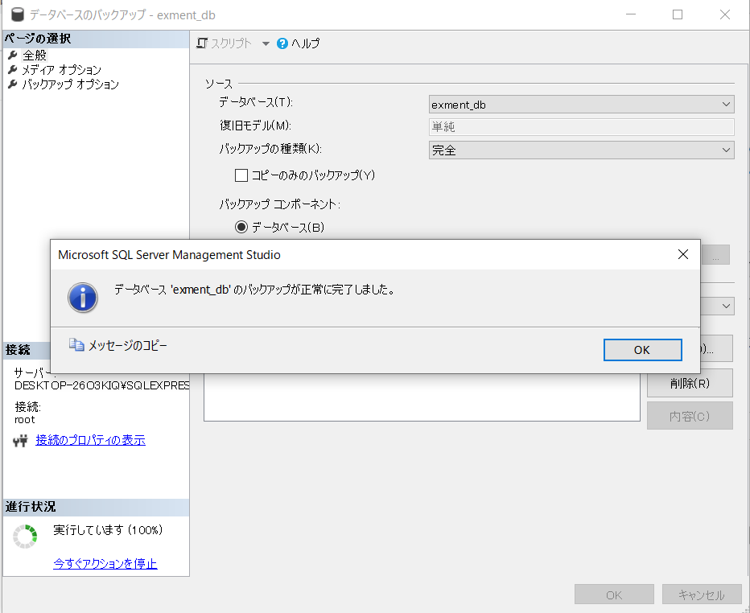  

- Confirm that a backup file (.bak) has been created in the specified backup destination.

## Backup of various files
The following files are located in designated folders on the server. Using Explorer or similar, save each folder to another folder or to external media.
  
~~~
Plugin files     : (Project root directory)/storage/app/plugins
Attachments      : (Project root directory)/storage/app/admin
Log files        : (Project root directory)/storage/logs
Setting files    : (Project root directory)/config
.env file        : (Project root directory)/.env
~~~
    
**※The .env file stores important Laravel settings. We recommend backing it up, but do not replace it directly when restoring.**

## Database restore
This is the procedure for restoring a SQL Server backup.  
Be sure to confirm that no users are using Exment before performing this process.  

- Start Microsoft SQL Server Management Studio (SSMS).  
**※Be sure to log in as a member of the sysadmin or dbcreator server role, or as the database owner (dbo).**
  

- Right-click the database to restore and select Tasks → Restore → Database.  
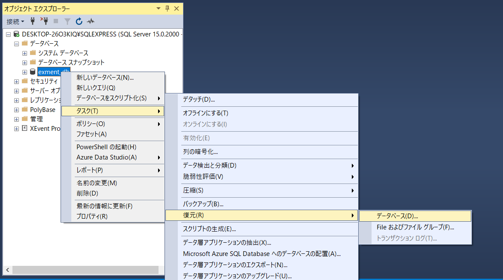  

- On the Restore Database screen, select "Source: Device" and click "..." to display the Select backup devices dialog.  
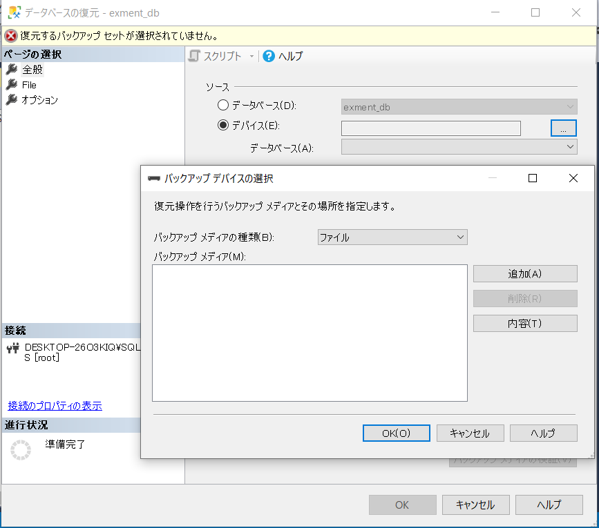  

- Click the Add button. The Locate Backup File dialog is displayed. Select the backup file you want to restore and click OK.  
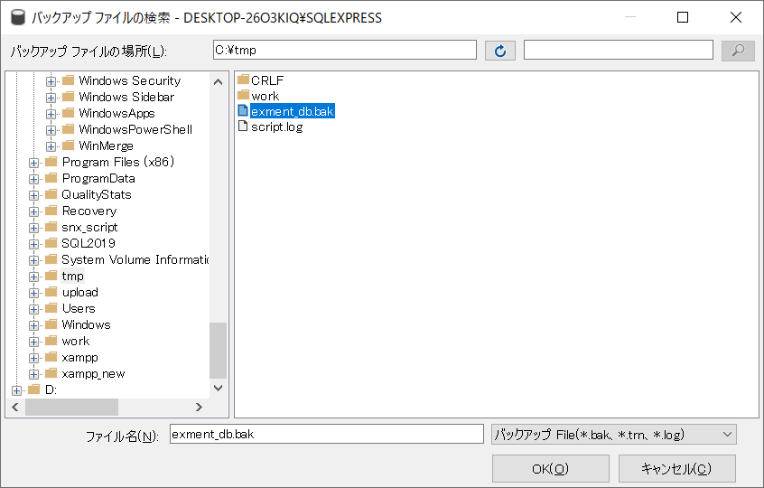  

- Confirm that the selected file has been added to the Select backup devices dialog, and click OK again.  
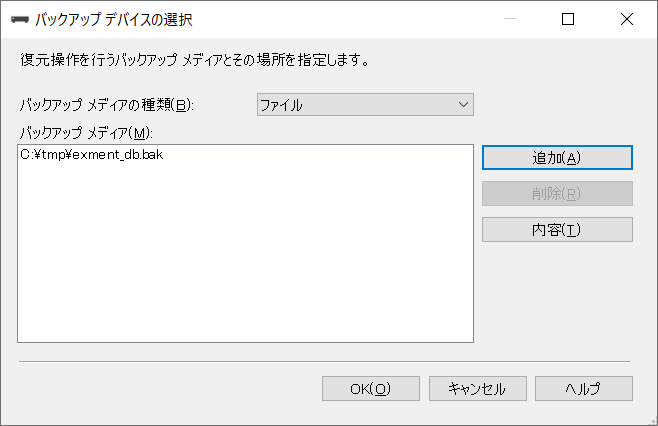  

- You return to the Restore Database screen. Select "Select a page: Options" to display the Options tab. Check "Restore options: Overwrite the existing database" and "Server connections: Close existing connections to destination database", and click OK.  
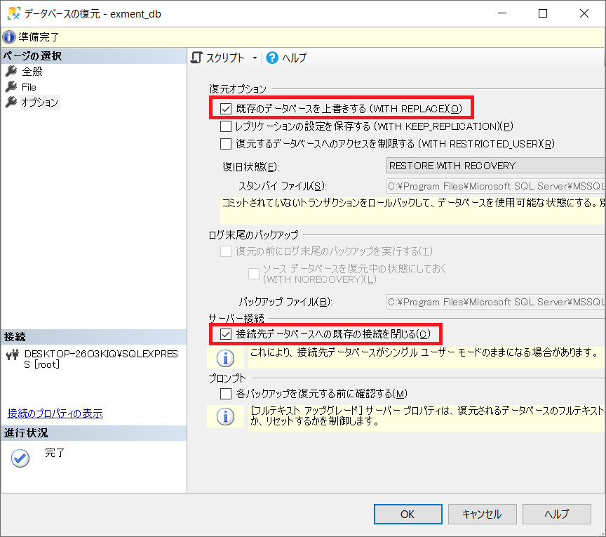  

- When the restore is complete, a message is displayed.  
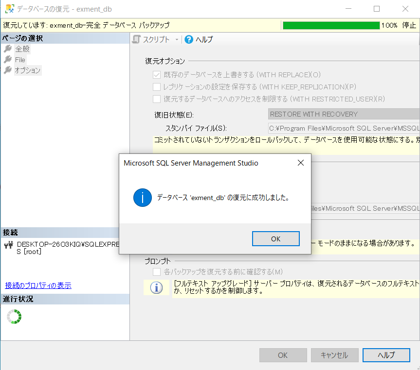  

### Notes on Restoration
- If the version of Exment at the time of backup and the version of Exment currently installed are different, it is necessary to update the database after restoration.  
Example： Version at the time of backup: v1.1.6 Current version: v1.2.0 → Database needs to be updated.
In this case, execute the following command after restoration.  

~~~
php artisan exment:update
~~~
    
**※A database backed up with a newer version of Exment cannot be restored to an older version of Exment.**

## Restore of various files
Using Explorer or similar, put the saved files back folder by folder.  
Plugin files and attachments are linked with the data in the database, so you must restore data that was backed up at the same time together.  
Also, we recommend that you do not overwrite log files directly, but save them with a different name in the same folder.
  
~~~
Plugin files     : (Project root directory)/storage/app/plugins
Attachments      : (Project root directory)/storage/app/admin
Log files        : (Project root directory)/storage/logs
Setting files    : (Project root directory)/config
~~~
