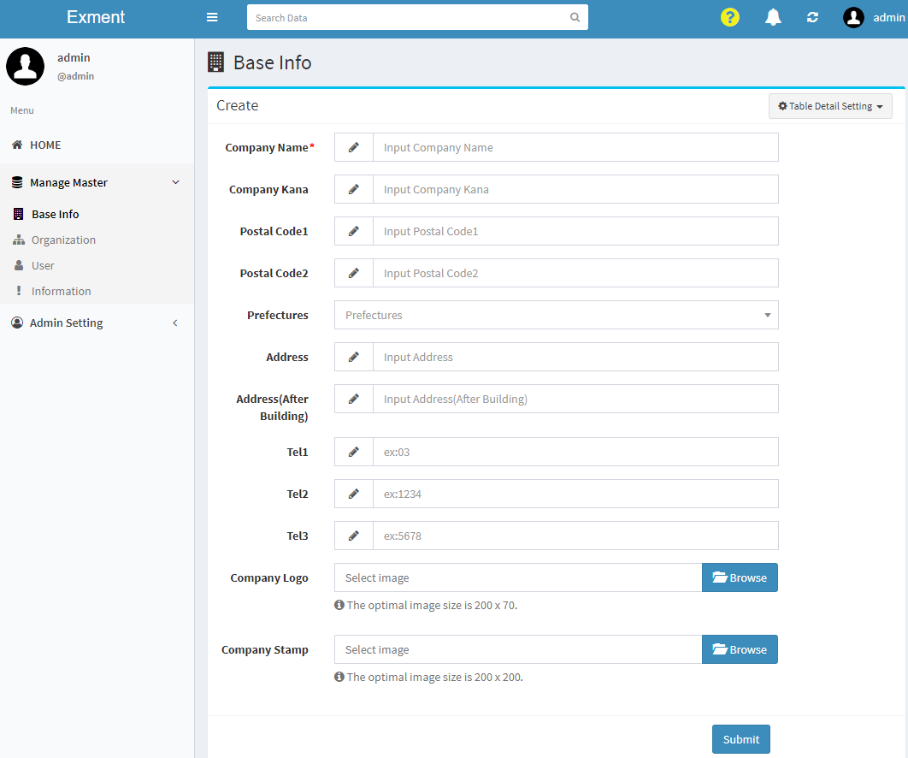

# Basic information
Manage the basic information of the company that uses this system.  
Manage company name, address, logo, etc.

## Screen display
Click "Basic Information" from the left menu.  
Or access the following URL.  
http(s)://(Exment URL)/admin/data/base_info  
Information registered in the system is displayed.  

> Note: "admin" in the URLs is the default setting. If you have changed or removed it with `ADMIN_ROUTE_PREFIX` in `.env`, replace "admin" with that value (if removed, omit "/admin", e.g. `http(s)://(Exment URL)/oauth/token`). For details, see [Change / delete "admin" included in URL](/additional_prefix).

## Edit
Enter the settings and save.
