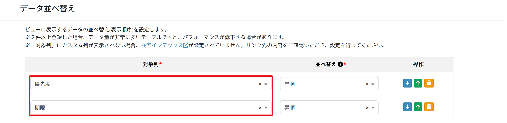
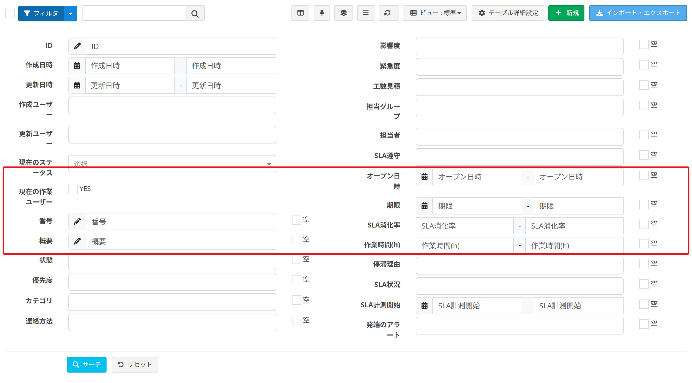
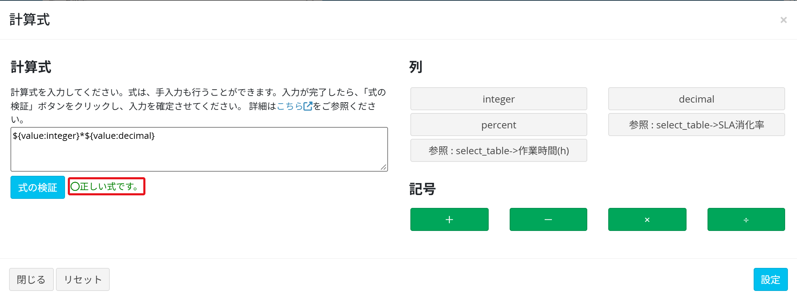
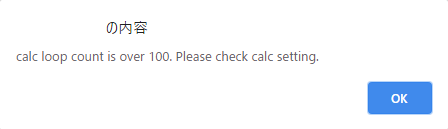

# Custom column management
This page is for making, changing and deleting the columns of a custom table ("custom columns"). A column is one item of the data, such as "Customer name", "Zip code" or "Address".  

- How to make a column: read "Settings screen" → "Add new column" → "Save" below, in this order.
- What types of columns there are: see "Column type" below.
- The explanation of each item: see "Entry details (common)" and "Detailed explanation of entry items (by column type)" below.  

## Settings screen
- In the custom table list, check one table you want to set, and press "Table Detail Setting" at the top right.  

- Or, after selecting the table you want to set from the menu, press "Table Detail Setting" at the top right in the same way.  
Note: the setting that shows the table in the menu is needed beforehand.  

- On the Table Detail Setting screen that appears, press the icon of the custom columns.

- Now the list of the columns of that custom table appears.  

## Add new column
- On the "Column Detail Setting" screen, press the [New] button at the top right of the page.

- The screen for adding a new custom column appears. Enter the necessary items.

## Save
After entering the settings, press [Submit].

## Edit
When you want to change a column, press the [Edit] link of its row.  

## Delete
When you want to delete a column, press the [Delete] link of its row.  

**Note: however, the columns installed by the system cannot be deleted.**

## Entry details (common)
- Column Name (alphanumeric): the name of the column used in the system. Enter it with alphanumeric characters, "-" or "\_". It can be set only once and cannot be changed.  
**Note: the following names cannot be used.**  
id,suuid,parent_id,parent_type,created_at,updated_at,deleted_at,created_user,updated_user,deleted_user

### Column View Name
The name of the column shown on the screen.

## Column type
The type of the column. The type chosen here decides the shape of the input field when data is entered.

> For the detailed system specification of each custom column, see the [Custom column reference](/column_reference).

#### One-Line Text
One-line text (a text box).  

#### Multiple-Line Text
Multiple-line text (a text area).  

#### Text Editor
Data can be entered with a text editor.

#### URL
A form where a URL can be entered.  

#### Email
A form where an email address can be entered.  

#### Integer
A form where only integers can be entered. Also, when data is entered, [+] and [-] buttons can be shown on the left and right of the item, and clicking them moves the value up and down.  

#### Decimal
A form where only decimals can be entered. When "Show as Percent" is YES, the data is shown with %.  

#### Currency
A form where a currency amount can be entered. The display format can be chosen from four types (￥, 円, ＄, €).

#### Date
A date form. When data is entered, the date can be changed from a calendar.  

#### Time
A time form. When data is entered, the time can be changed from a clock.  

#### Date and Time
A date and time form. When data is entered, the date and time can be changed from a calendar and a clock.  

#### Select (From Static Value)
A form of options. It is a list of options whose value and label are the same.  

#### Select (Save Value and Label)
A form of options. It is a list of options whose value and label are different.  

#### Select (From Table)
A form of options. It makes options that are the items of another table.  

#### YES/NO
Makes a switch between "YES" and "NO". When data is saved, YES is saved as 1 and NO as 0.  

#### Select 2-value
Makes a switch between two values. The values saved with the data can also be changed.  

#### Auto Number
Makes a value such as a UUID or a random string when the data is created.  

#### Image
A form for uploading an image.  
Note: on the data list screen and the data detail screen, an image is shown with a link. The link (a tag) has the class "image-link", so with a [plugin (script)](/plugin_quickstart_script) or a [plugin (style)](/plugin_quickstart_style) you can change the behavior or the look of the image links only.

#### File
A form for uploading a file.  

#### User
Options for selecting a user of the system.  

#### Organization
Options for selecting an organization of the system.  

## Entry details (common)
- ##### Column Name (alphanumeric)
The name of the column used in the system. Enter it with alphanumeric characters, "-" or "_". It can be set only once and cannot be changed.  
**Note: the following names cannot be used.**  
id,suuid,parent_id,parent_type,created_at,updated_at,deleted_at,created_user,updated_user,deleted_user

- ##### Column View Name
The name of the column shown on the screen.

- ##### Column Type
From the [list of column types](/column?id=column-type), select the column used for entering data.

- ##### Required
Choose whether this column is required. When YES, it is a required item on the data entry screen, and an error appears if it is not entered.  

- ##### Index Enabled
See "[Search index](/column?id=search-index)" below.  

- ##### Freeword Search Target
Shown when Index Enabled is YES.  
See "[Freeword Search Target](/column?id=freeword-search-target-detail)" below.  

- ##### Unique
When YES, a value that is the same as another data cannot be saved when data is saved. When you want to prevent duplicates by a combination of several columns, see [Composite unique key setting](/table?id=composite-unique-key-setting).  

- ##### Input Only Once
When YES, the column can be entered only when the data is newly added. When the data is edited, it is only shown.

- ##### Default Value
The value put in the input field from the start.  

- ##### PlaceHolder
The text shown in pale letters while the input field is empty (the placeholder).  

- ##### Help
The content shown under the input field as an explanation.

- ##### Order
Sets the display order on the list screen of the custom columns.

- ##### Add to the default form and view
When YES, the column is also added to the default form and view when the column is newly made. It can be set only when the column is newly made. To change it later, change it on the [form screen](/form) and the [view screen](/view).

- ##### Add to the Table Label
The custom column you make can be added to the heading columns.  
Note: this setting appears only when the custom column is newly made. To change it later, change it in the [Heading display column setting](/table?id=heading-display-column-setting).

- ##### Cell appearance
Sets with what look (color, tag, badge and so on) the value of this column is shown in the data list.  
Select from "Appearance preset". See [Cell style presets](/cell_style_preset) for details.

## Detailed explanation of entry items (by column type)
- ##### Max Length (One-Line Text, Multiple-Line Text)
The upper limit of the number of characters that can be entered. Over it, there is an error.  

- ##### Available Characters (One-Line Text)
Only the types of characters you check can be entered.
When none is checked, all types of characters can be entered.

- ##### Suggest Input (One-Line Text)
From the values already saved in the same custom column, the ones that fit what was entered are shown as input candidates.

- ##### Regular expression (One-Line Text)
What was entered can be checked with a regular expression (a way of writing a rule for the order of characters). See [Regular expression](/column?id=regular-expression) for details.

- ##### Min Number (Integer, Decimal)
The minimum value that can be entered. When a smaller value is sent, there is an error. When empty, the minimum is not checked.  

- ##### Max Number (Integer, Decimal)
The maximum value that can be entered. When a larger value is sent, there is an error. When empty, the maximum is not checked.  

- ##### Calc Formula (Integer, Decimal, Currency)
See [Calc formula](/column?id=calc-formula) below for details.

- ##### Select Choice (Select (From Static Value), Select (Save Value and Label))
Register the options shown as candidates in the input field. Register one per line, separated by line breaks.  
When the column type is "Select (Save Value and Label)", separate with a comma and write the value in the first column and the label in the second.  

↓  
  
When data is saved in the form, the value of the first column is saved in the database.  

- #####  Displayed in radio button / check box format (YES/NO, Select (From Static Value), Select (Save Value and Label))
For a Select (From Static Value) or Select (Save Value and Label) column where multiple select is NO, it can be shown in the form in radio button format.
 

For a YES/NO column, or for a Select (From Static Value) or Select (Save Value and Label) column where multiple select is YES, it can be shown in the form in check box format.

- ##### Make it freely input (Select (From Static Value))
When YES, options that are not registered in the column settings can also be entered freely and saved.  

>When [Displayed in radio button / check box format](/column?id=radio_buttom) is YES, this setting cannot be used.

- ##### Initial value type (Date, Time, Date and Time, User)
You can decide the type of the initial value when data is newly added.  
- For Date, Time, and Date and Time columns, [Specified date and time] or [the date and time of the data entry] can be set as the initial value.  
- For User columns, [Specified user] or [Login user] can be set as the initial value.

- ##### Select Target Table (Select (From Table))
Decide the table shown as the candidates of the options.  

>The text shown in the list as an option can be changed in the [Heading display column setting](/table?id=heading-display-column-setting).

- ##### Narrow down the choices (Select (From Table), User, Organization)
Usually, the options on the data edit screen show all the candidates in a list when the screen is loaded.  

When this setting is YES, the options are not loaded at first; the data is searched with what the user enters, and the candidates are narrowed down.  

When text is entered in the input form, the data is searched on the server and the results are shown as candidates.

> Regardless of this setting, when the total number of data is 100 or more, the narrowing down is used, for better performance.  
This upper limit can be changed by a [setting value](/config?id=custom-data).  

- ##### Auto Number Type (Auto Number)
Select the type of numbering done when data is saved.
- Format  
The number is saved in the format given by the user.
- Random(25-Length)    
A random string of 25 characters, 5 characters x 5, is saved.
- Random(UUID)  
A random string of 32 digits in total is saved.

- ##### Auto Number Length (Auto Number)
The number of digits saved as data at auto numbering. The missing digits are filled with 0.  

- ##### Display users/organizations without permission (User, Organization)
Decide whether to show only the users and organizations that have access permission to the table, or all users and organizations.

- ##### Show an "assign to me" button (User)
When YES, the [Assign to me] button is shown next to this column on the data create and edit screens. Clicking the button selects the logged-in user.  
Note: when "Approval Multiple Select" is YES, the logged-in user is added to the users already selected.

- ##### Accept images pasted from the clipboard (Image, File)
When YES, an image (a screenshot and so on) pasted with Ctrl+V on the data create and edit screens is added as a file of this column. The file name is "paste-(date)-(time)-(sequence number)".  
Note: when "Approval Multiple Select" is YES, it is added to the files already selected. When NO, it is replaced by the pasted image.  
Note: when pasted inside a text editor, it goes into the text as before. Also, text pasted into a text box is not added as a file.  
Note: when the screen has several columns with this setting YES, it is added to the first column.

- ##### Approval Multiple Select
Set it to YES when you want several to be selectable in items of images, files and the option types.  

## Automatic numbering format rules
When the column type is "Auto Number" and the Auto Number Type (Auto Number) is "Format", numbers can be given automatically by a rule you decide.  

See the following page for the parameter variables that can be set.  
[Parameter variables](/params)

## Search index
A "search index" is something set in the database in advance to make data search faster.  
In Exment, some features can be used only on columns whose Index Enabled is YES.
    

When YES, the following features work.  
- It is shown in "Target column" of the "Conditions" setting of a [custom view](/view)  
    

- It is shown in "Target column" of the "Sort" setting of a [custom view](/view)  
    

- It is shown in the items of the "Filter" setting of the [data list](/data_grid)  
    

- The icon for "sorting" in the [data list](/data_grid) is shown
    

- When a user enters a word in the search bar at the top of the page, the column is a target of the data search. Set it to YES for columns you want searched on the search screen, such as codes and names.  

- **Freeword Search Target** can be set.  
When YES, the column is a search target when text is entered in the search bar and a search is done.

Note: when very many "search indexes" are set on one table, creating and updating data can become slow.  
The "search indexes" that can be set on one table are up to 10 as a recommendation and up to 20 as the maximum.  
Note: the upper limit of search indexes can be changed by a [setting value](/config?id=number-of-search-indexes).

## Store encrypted (7.3.0)

A one-line text, multi-line text, email or URL column can keep its values encrypted in the database. The database or a backup file alone cannot read them.

### Before you use it
1. Run `php artisan exment:data-key generate` on the server and put the line it prints in `DATA_ENCRYPTION_KEYS` of `.env`.
    - The key is not in the database and not in a backup. **If the key is lost, the encrypted values cannot be read again.** Keep a copy of it in a safe place apart from the server.
2. Turn on "Encrypted columns" in Feature management (off at first).
3. Set "Store encrypted" of the column to YES. The values already there are encrypted in the background (to do it at once: `php artisan exment:encrypt-column table_name column_name`). NO converts them back.

### What it cannot do
An encrypted column cannot be used for a partial search, sorting, totals, charts, formulas or the full-text search, and cannot be used with "Search index", "Unique" or "Multiple".

### How it is shown
- Lists, the detail page, revisions, the API, AI (MCP), notifications and exports show it masked, as `****1234` (0 to 4 last characters, a setting of the column).
- A user with the role group permission "Show encrypted values" gets an eye button that shows the real value for a while. Each time is recorded in the data access log. The API has `GET api/data/{table}/{id}/reveal/{column}` (the same permission and log).
- The edit form never shows the real value. Left empty, the value stays as it is.

### Export and import
- An exported file has the masked values (`****1234`). **Importing it again changes nothing** (a masked value equal to the masked form of the value there now is taken as "not changed").
- **To change a value, enter the whole new value.** A masked value that is not the masked form of the value there now (such as `****0000`) makes that row an error.

### Rotating the key
Make a new key with `exment:data-key generate`, put it first in `DATA_ENCRYPTION_KEYS`, and run `php artisan exment:data-key rotate`: the values of the old keys are encrypted again with it. `php artisan exment:data-key status` shows how many values each key has. Remove an old key only when it has 0.

### Where the keys are
Besides `.env`, the keys can be kept in AWS KMS, Secrets Manager or HashiCorp Vault, so the files of the server alone do not give them. See "[Where the encryption keys are](/data_key_provider)".

## Use in labels
> In v1.3.0, this setting method was changed to the [extended settings of the custom table](/table?id=heading-display-column-setting).

## Regular expression
> This setting appears only if you have enabled [expert mode](/additional_expert).

When the custom column type is "One-Line Text", what is entered can be checked with a regular expression.  

  

#### Regular expression example
~~~
# Phone number  
^0\d{2,3}-\d{1,4}-\d{4}$

# Postal code  
^\d{3}-\d{4}$

# Hiragana only
^[ぁ-ん]+$

# Katakana only
^[ァ-ヴ]+$
~~~

#### Other
- When a regular expression is set, "Available Characters" is not used.  
- The check of regular expressions uses a PHP function. When you look for examples of regular expressions, look for PHP regular expressions.  
- The "/" put at the beginning and the end, and the "u" at the end, are not needed.  
- The content of regular expressions is outside our inquiries. Thank you for your understanding.

## Calc formula
When the custom column type is "Integer", "Decimal" or "Currency", a calc formula can be set.  
When items are entered on the data entry screen, the value is calculated automatically by the formula you set.  

### Setting method
- When the custom column type is "Integer", "Decimal" or "Currency", the "Calc Formula" item is shown. Click it.  
    

- The dialog for the calc formula appears.  
  

- Enter the formula. Enter it by pressing the buttons in the right column, or by hand.
Note: the variables that can be entered are described later.
  

- When you have finished entering, press the "Validate Formula" button to confirm the input.
  

- Note: when the formula you entered has a mistake, an error appears and it cannot be set.
  

- After entering a correct formula, press the "Setting" button. The dialog closes and the formula is set.
  

- After the setting, the formula runs on the data entry screen. (In the example below, column 1 × column 2 is set on column 3)
  

### Formulas and variables that can be used

#### Ordinary operators
- +, -, *, /  
Note: enter them in half-width characters. Take care that multiplication is not "×" and division is not "÷".

- Parentheses ()

#### Variables
Note: we recommend putting in variables with the buttons in the right column of the "Calc Formula" dialog.

- The value of another column
- A column value of the referenced table
- A column value of the parent table
- The total of a column of the child table
- The number of data of the child table

| Item | Example | Explanation |
| ---- | ---- | ---- |
| ${value:(column name)} | ${value:mitsumori_zeigaku} | Another value in the same table is set. (Example: when the quotation amount ${value:mitsumori_zeigaku} is written for the quotation detail table, the value entered in the item "Quotation amount" is set)  |
| ${select_table:(column name).(column name of the referenced table)} | ${select_table:client.client_shikiri} | For the column types "Select (From Table)", "User" and "Organization" in the same table, the value of a column of the referenced data is set. (Example: when the "Contract information (contract)" table has a "Customer (client)" column that refers to the "Customer information (client)" table, with ${select_table:client.client_shikiri} the value entered in the customer wholesale rate (client_shikiri) of the "Customer information (client)" table is set)  |
| ${parent:(column name)} | ${parent:mitsumori_value} | Another value of the parent table is set. (Example: when the quotation table and the quotation detail table have a 1:n relation, and the quotation amount of the parent table column ${parent:mitsumori_value} is written for a column of the quotation detail table, the value of the column "Quotation amount" entered in the parent data "Quotation amount" is set)  |
| ${sum:(child table name).(column name of the child table)} | ${sum:mitsumori_detail.mitsumori_zeigaku} | When there is a 1:n relation and the form enters parent and child data at the same time, the total of the values of the given column of the child table is set. (Example: when the quotation table and the quotation detail table have a 1:n relation, and the quotation detail amount of the child table column ${sum:mitsumori_detail:mitsumori_zeigaku} is written for a column of the quotation table, the total of the values entered in the child data "Quotation amount" over all data is set)  |
| ${count:(child table name)} | ${count:mitsumori_detail} | When there is a 1:n relation and the form enters parent and child data at the same time, the number of data of the child table is set. (Example: when the quotation table and the quotation detail table have a 1:n relation, the number of data of the child table is set)  |

### When the formulas are circular
With settings like the following, the calculation never ends.    

- Column calc1: formula "${value:calc2} + 2"
- Column calc2: formula "${value:calc1} + 2"

"Enter the value of column calc1" → "the value of calc1 + 2 is put in column calc2" → "the value of calc2 + 2 is put in column calc1" → "the value of calc1 + 2 is put in column calc2" ... and the calculation does not finish.  

When such formulas are set and a value is entered on the data entry screen, an alert like the following appears.  
In that case, review the settings of the formulas.
  

### When division by zero happens
Depending on the formula, division by zero can happen.  
In that case, the result item is left empty.

### Other
The calc formula logic works when data is entered on the screen.  
At present it does not work when data is saved by features such as the API and plugins. Thank you for your understanding.
