# Dashboard
This screen is displayed when you log in to Exment or when you click "HOME" or "site name displayed in the upper left".  
By freely customizing the display method, information managed by Exment can be displayed in various formats.  
### Dashboard display example

## Creating a new dashboard
- Click "Create New Dashboard" at the top right of the dashboard screen.  

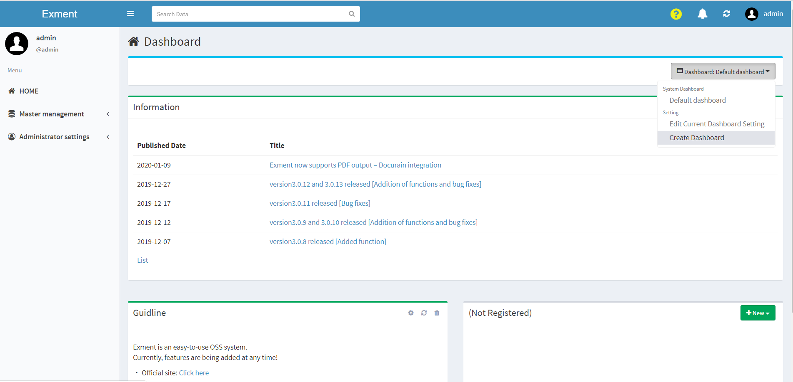
  
- Set the necessary items on the dashboard.  

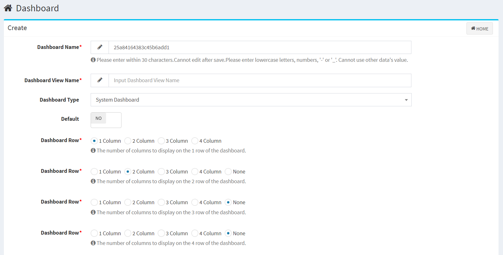

## Dashboard settings
#### Dashboard name (alphanumeric)
Indicates the name of the dashboard.
It cannot be changed after saving.

#### Dashboard display name
The name to display on the screen when selecting a dashboard.  
Japanese settings are available and can be changed after saving.  

#### Dashboard type
Select either "System Dashboard" or "User Dashboard".  

"System Dashboard":  
Only the system administrator can make settings.  
The dashboard will be available to all users.  
  
"User Dashboard":  
Dashboard settings that can be set by anyone other than the system administrator.  
The dashboard will only be available to the user who created it.    

※"System Dashboard" cannot be changed to "User Dashboard" later.  

**"User Dashboard" created by the system administrator** can be changed to "System Dashboard" later.  
※By setting [Disable User Dashboard](/config.md?id=user-dashboard-disabled),general users cannot create dashboards.

#### default
Select either "YES" or "NO".  
If you have created multiple dashboards, the dashboard displayed when you open the dashboard will be the dashboard set to "YES".  
※By selecting from the list, the dashboard set to "NO" can also be displayed.  
※"Default" can be set to "YES" only for one dashboard.  
If "YES" is specified for two or more dashboards, the dashboard will be changed to "NO" except for the dashboard that was last set to "YES".

#### Select number of columns
Select the number of columns to display in each row of the dashboard.  
Up to 4 columns can be displayed per line. 
※The number of columns and the display area per one are inversely proportional.  

### Example of displaying four columns in one line
  

## Dashboard filter settings
In the dashboard settings, a "filter bar" can be shown at the top of the dashboard to filter all charts at once.  
Instead of creating a view for every condition (region, product, sales rep...), one dashboard lets you switch the condition and see the results.  
※See [Filtering with the filter bar](#filtering-with-the-filter-bar) for how to use it.

#### Filter source table
Select the table the filter choices are taken from.  
When left empty, the filter bar is not shown.

#### Filter items
Set the items shown on the filter bar, one per row. Add rows with "New".

| Setting | Description |
|---|---|
| Column | The column of the filter source table used for filtering. |
| Display name | The name shown on the filter bar. The column name is used when empty. |
| Default value | The value selected when the dashboard opens. For an item selected from a list, enter stored values separated by commas; for an item specified as a "from" / "to" range, enter "min~max" (either side may be left empty). Nothing is selected when empty. |
| Target boxes | The charts this filter applies to. When empty, every chart whose table has a column of the same name is filtered. Only saved charts are listed, so add the charts first and then select them on the settings screen. |

> Only charts whose table has **a column with the same name as the filter item** are filtered.  
> Other charts show "Not affected by filters".

> For a smooth experience on large tables, enable "Index Enabled" in [custom column settings](/column.md?id=search-index) for the columns used as filter items.

> When a dashboard is exported / imported with a [template](/template.md), its filter bar settings (target boxes included) are carried over as they are.

# Select items to display
You can select the item you want to display from these four types,
"Data List", "System", "Chart", "Calendar" in the upper right "New" of each column of the created dashboard.  

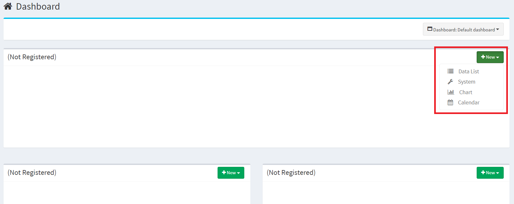  

Next, set the specific display contents for each item.

## List of data
A data list can be displayed on the dashboard by specifying any table or view from the information managed by Exment.

### Display example of data list

### Data list setting items

#### Item display name
Enter the name of the item to be displayed on the screen.  

#### display
Select how many data to display at one time.  

#### Target table
Select the target to be displayed from the created tables in [Custom table settings](/table.md).

#### Target view
Select the target to be displayed from [View](/view.md) in the selected target table.  
※Calendar views, kanban views, Gantt chart views and filter views cannot be selected. For a system dashboard, only system views can be selected.  

## system
You can display system-related information on the dashboard.  
※ Currently, you can display "Guidelines," "List of latest Exment information," "Editor," "HTML," "Notifications list," and "2D/JAN barcode"

### System settings
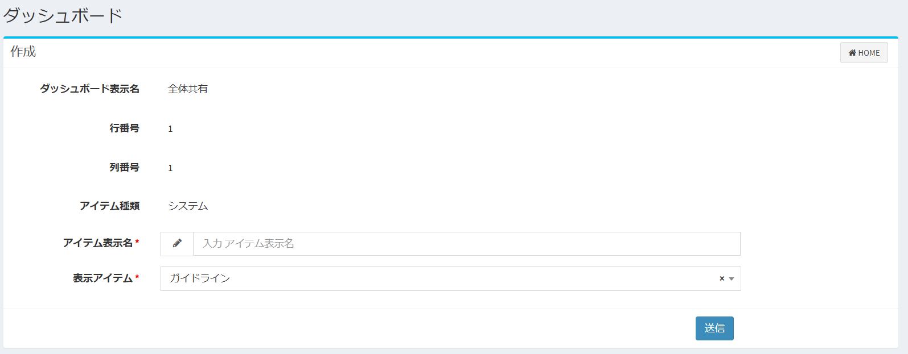

#### Item display name
Enter the name of the item to be displayed on the screen. 

#### Display Items
Select the items you want to view.

- ##### Guidelines
It can display information about the system.  
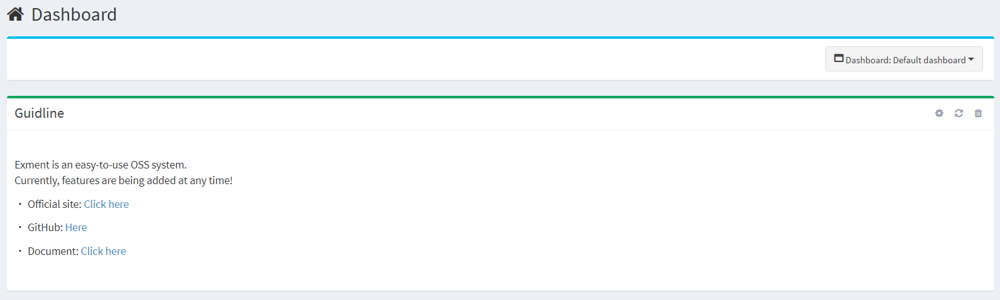

- ##### Exment Latest News List
The latest information is obtained and displayed from the Exment official website.

- ##### Editor
Enter the text freely and display it on the screen.

- ##### HTML
Enter the content in HTML format and display it on the screen. *Scripts will also be executed.

- ##### 2D/JAN Barcode  
Displays the button for 2D/JAN barcode scanning.  
The display name of the "2D/JAN Barcode Scan" button can be customized in the `.env` file by modifying the `EXMENT_TEXT_SCAN_BUTTON_JA/EN` variable.  

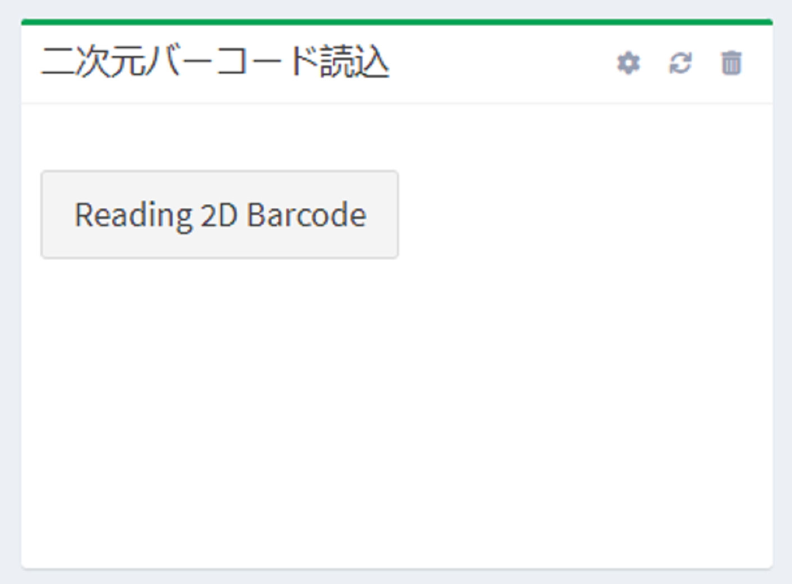

## chart
Data managed by Exment views (normal views, all-data views, summary views, etc.) can be displayed on the dashboard as one of 18 chart types, including bar, line and pie charts.  
A displayed chart can be filtered, switched to another chart type and sorted on screen (see [Using the dashboard](#using-the-dashboard)).  
※See [Chart settings details](#chart-settings-details) for details.

### Bar graph display example

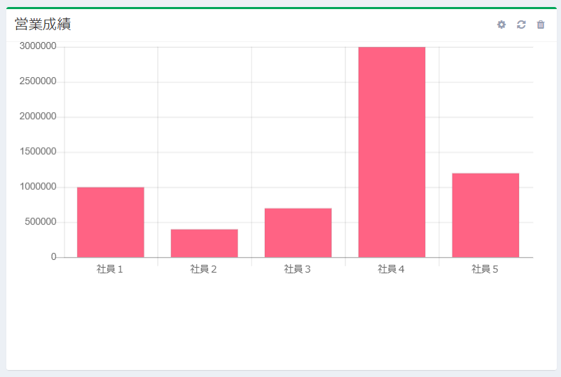

### Display example of line graph
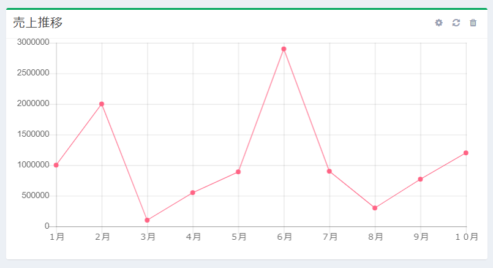

### Display example of pie chart
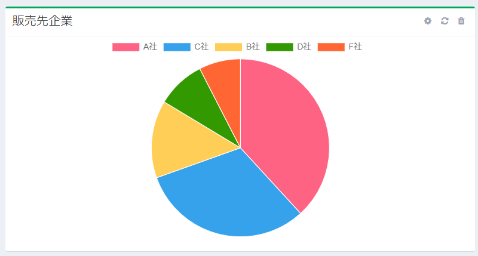

### Chart setting items

#### Item display name
Enter the name of the item to be displayed on the screen.

#### Chart type
Select one of the following 18 chart types.

| Category | Chart types |
|---|---|
| Basic | Bar, Line, Pie |
| Single series | Horizontal bar, Area chart, Doughnut chart, Radar chart, Funnel chart, Gauge, Scatter |
| Multi-series | Grouped bar, Stacked bar, Multi-line, Heatmap, Stacked area, Treemap, Sunburst, Boxplot |

A multi-series chart displays multiple data series for each category on the horizontal axis (for example, monthly sales by product).

To use a multi-series chart, the summary view must be grouped by two or more columns. Among the group columns, the column selected in [Series column](#series-column-multi-series) (the second column by default) defines the series, and the first of the other columns defines the horizontal axis.

Horizontal bar

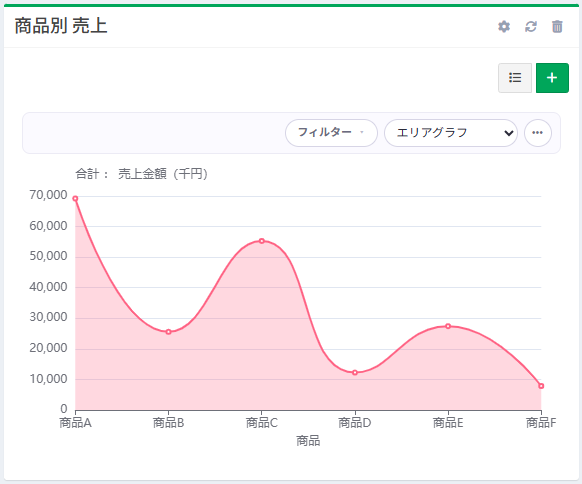

Area chart

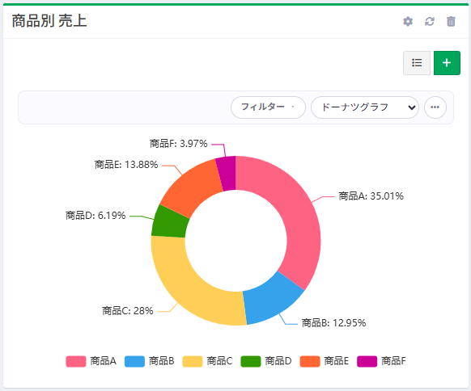

Doughnut chart

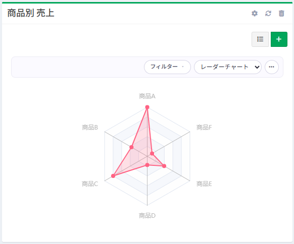

Radar chart

Funnel chart

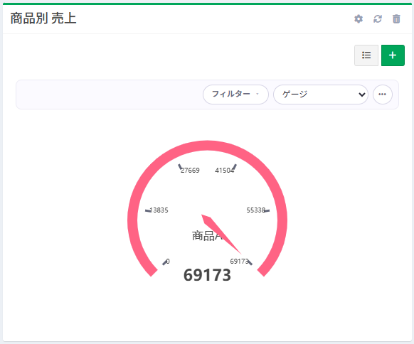

Gauge

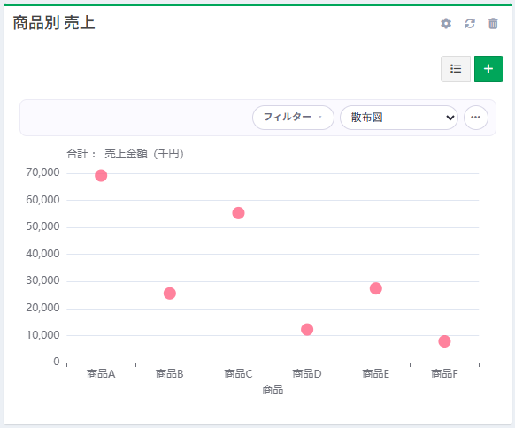

Scatter

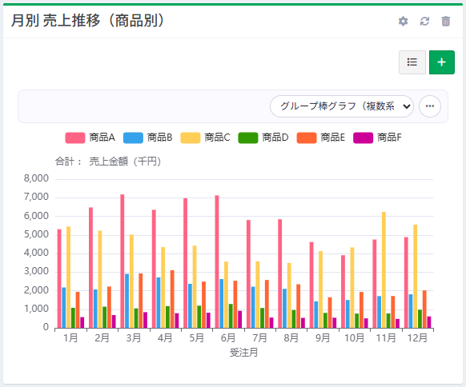

Grouped bar

Stacked bar

Multi-line

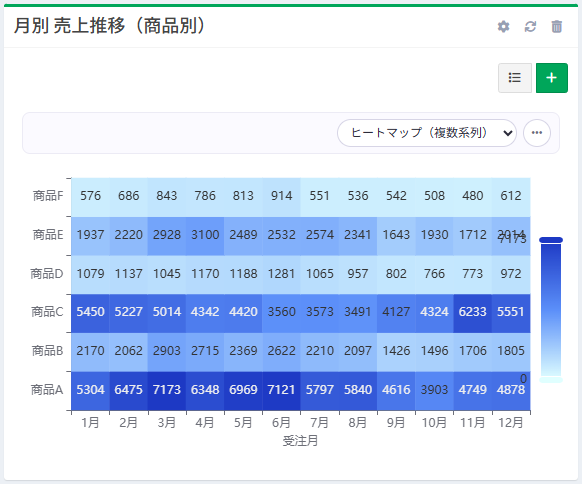

Heatmap

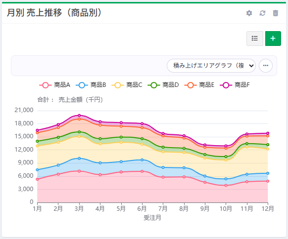

Stacked area

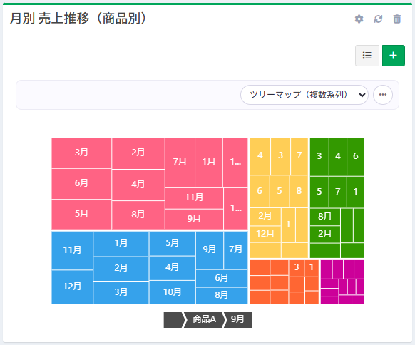

Treemap

Sunburst

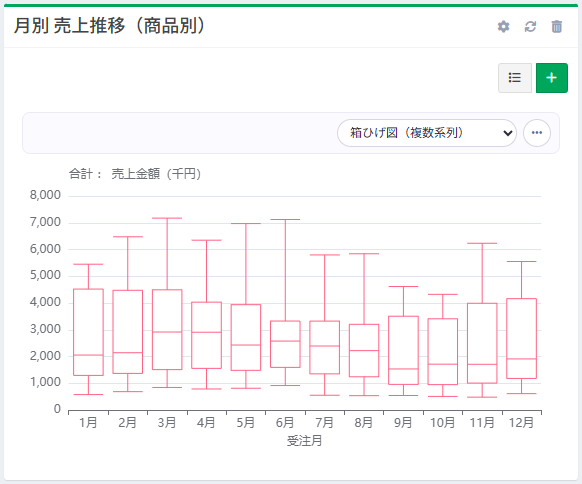

Boxplot

#### Target table
Select the target to be displayed from the created tables in [Custom table settings](/table.md).  
※Tables you have permission to view are shown as options.

#### Target view
Select the target to be displayed from the views (List views, All data views, Summary views, etc.) in the selected target table.  
※Calendar views, kanban views, Gantt chart views and filter views cannot be selected. For a system dashboard, only system views can be selected.  
※To use a multi-series chart, select a summary view.  

#### X-axis item
Select the X axis (horizontal axis) to be displayed as a graph.  
※See [Chart settings details](#chart-settings-details) for details.  

#### Y-axis items
Select the Y axis (vertical axis) to be displayed as a graph.  
※See [Chart settings details](#chart-settings-details) for details.  

#### Series column (multi-series)

This setting is shown only when a multi-series chart type is selected.

Select the column to use for the series from the group columns of the summary view. If none is selected, the second group column is used as the series.

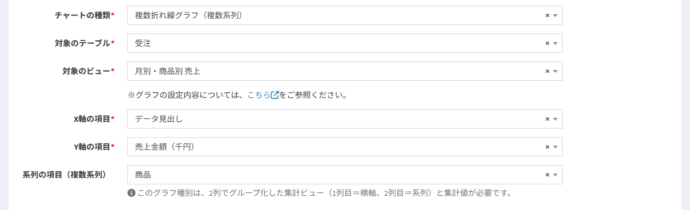

#### Chart filter fields

Select the columns to use as filters for this chart only. Multiple columns can be selected.

The selected columns appear under the chart's **Filter** button (see [Filtering one chart](#filtering-one-chart)).

If no columns are selected, the **Filter** button is not displayed.

#### Other chart-specific options

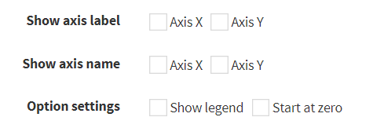

The selected options are applied to the chart.

※ **Show axis label**, **Show axis name**, and **Start at zero** are available only for Bar and Line charts.

## Calendar
Data managed by Exment's calendar view can be displayed on the dashboard in any of two types of display formats,
"monthly" and "list".
>The displayed text can be changed in [Heading display column setting](/table.md?id=heading-display-column-setting).

### Monthly display example
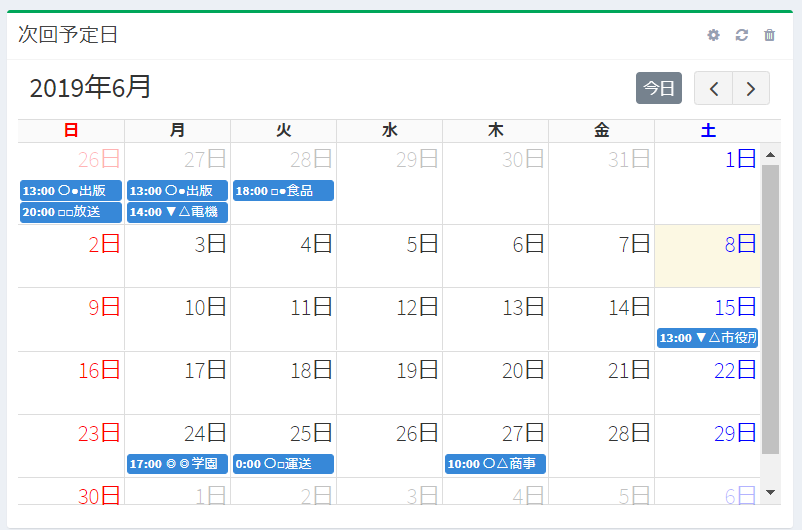  

### List display example
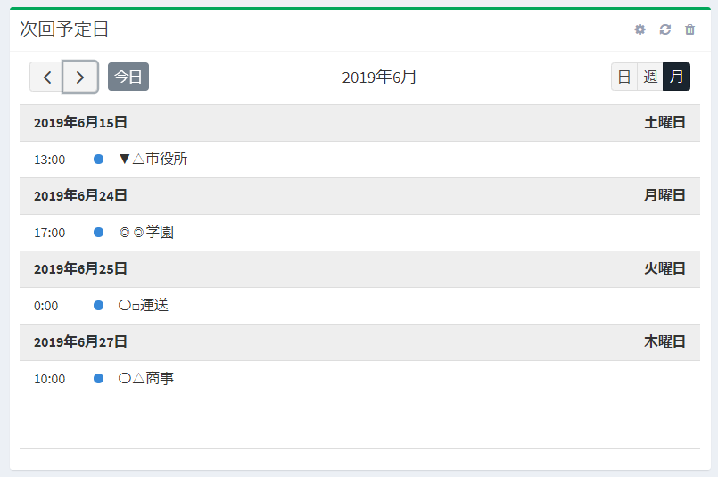  

### Calendar settings
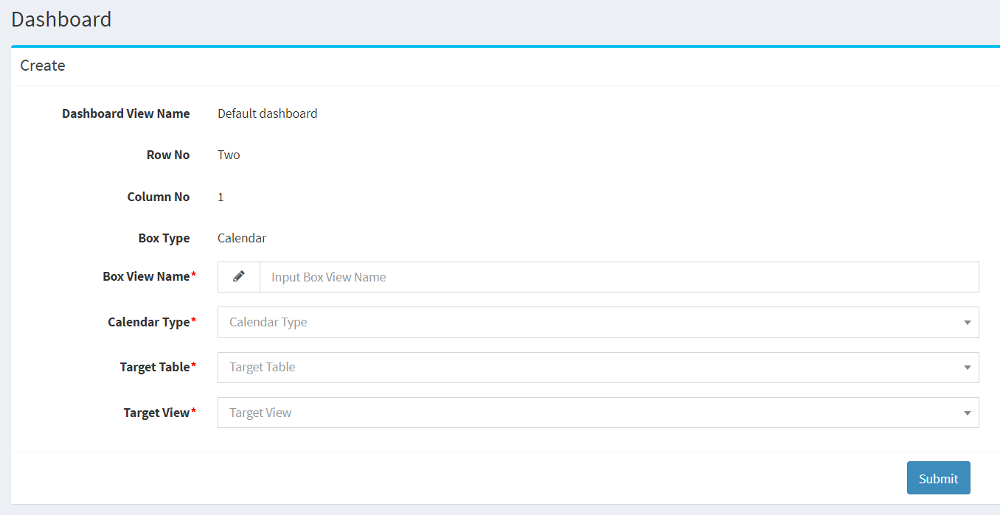  

#### Item display name
Enter the name of the item to be displayed on the screen.

#### Calendar type
"Monthly" "List"  
Select the calendar you want to display from these two types.  

#### Target table
Select the target to be displayed from the created tables in [Custom table settings](/table.md).
※Only the tables for which the calendar view is set are displayed as options.

#### Target view
Select the target to be displayed from the calendar views in the selected target table.  

## Chart settings details
The X-axis and Y-axis items set for a chart (graph) depend on the target view.  

### When the target view is an all-data view or a normal view

#### X-axis item
The following 2 kinds of choices are shown for the X axis. Select one of them.

- The "Data heading" item.  
  

When selected, the [heading display column setting of the custom table](/table.md?id=heading-display-column-setting) is shown on the X axis.  

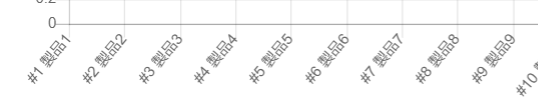  

- The items shown in ["Display column selection" of the custom view settings](/view.md?id=display-column-selection). When selected, the values of the selected column are shown on the X axis.  
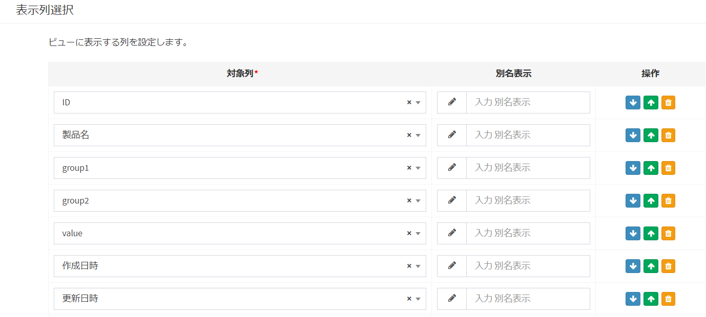  

#### Y-axis items
Only the following choice is shown for the Y axis.

- Among the items shown in ["Display column selection" of the custom view settings](/view.md?id=display-column-selection), the columns of the following types. When selected, the values of the selected column are shown on the Y axis.
    - Integer
    - Decimal
    - Currency

### When the target view is a summary view

#### X-axis item
Only the following choice is shown for the X axis.

- The "Data heading" item.  
  

When selected, the values set in ["Group column selection" of the custom view settings](/view.md?id=group-column-selection) are shown on the X axis.  
  
  

#### Y-axis items
The following 2 kinds of choices are shown for the Y axis. Select one of them.

- Among the items shown in ["Group column selection" of the custom view settings](/view.md?id=group-column-selection), the columns of the following types. When selected, the values of the selected column are shown on the Y axis.
    - Integer
    - Decimal
    - Currency

  

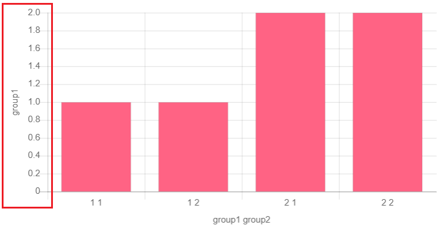  

- The items shown in ["Calculation column selection" of the custom view settings](/view.md?id=calculation-column-selection). When selected, the values of the selected column are shown on the Y axis.

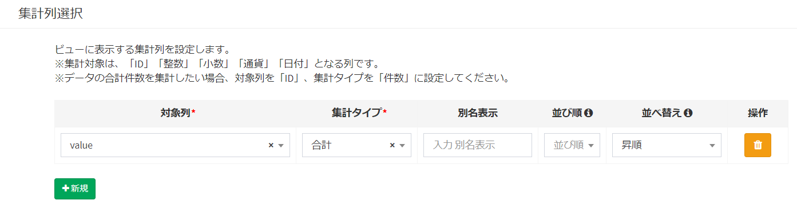  

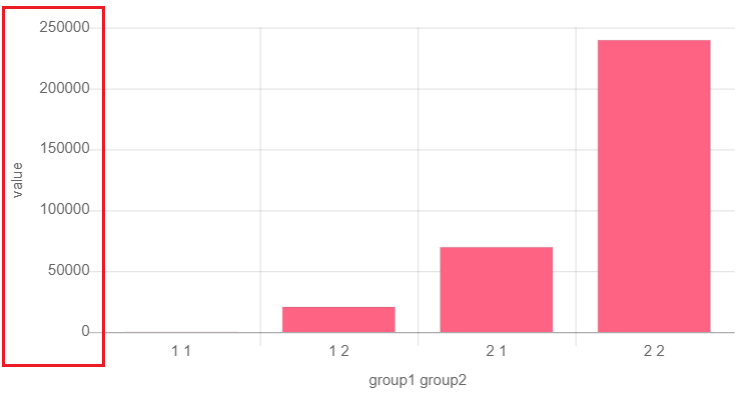  

## Sharing the dashboard
Share a dashboard you created with other users and organizations.  
※Only "User Dashboard" can be shared. ("System Dashboard" is open to all users from the start.)  

#### How to share
- Click the "Share" button shown on the dashboard settings screen.  
※This button is not shown when creating a new dashboard.
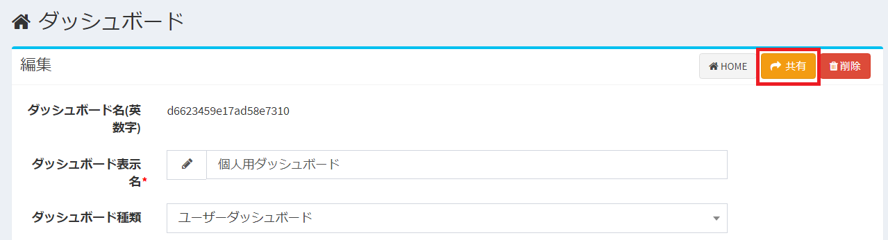  

- The dashboard sharing dialog is displayed.
  

- Add the users or organizations to share with, and click "Send" to complete the sharing.  
  

# Using the dashboard

You can filter charts, switch between chart types, and sort chart data directly on the dashboard. Except for changing colors, these operations do not change the dashboard settings, chart settings, or underlying data.

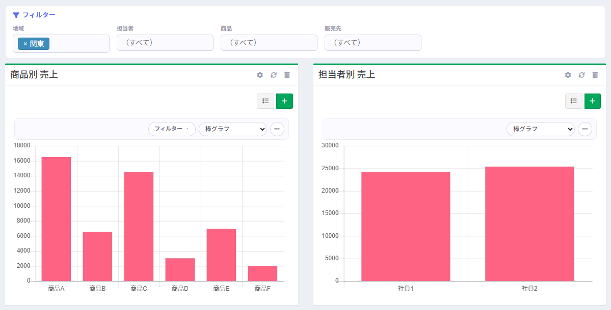

| Operation | What it does | Scope |
|---|---|---|
| [Filter bar](#filtering-with-the-filter-bar) | Applies filters to charts across the dashboard | Whole dashboard |
| [Clicking a chart](#filtering-by-clicking-a-chart) | Selects a value in the filter bar | Whole dashboard |
| [Chart filter](#filtering-one-chart) | Filters a single chart | One chart |
| [Chart type switch](#switching-the-chart-type) | Displays the same data using a different chart type | One chart |
| [Options menu (⋯)](#options-menu) | Sorts data, displays data labels, and exports data | One chart |
| [Colors](#changing-chart-colors) | Changes the colors of bars, slices, and other chart elements | One chart |

## Filtering with the filter bar

When [dashboard filter settings](#dashboard-filter-settings) are configured, a filter bar appears at the top of the dashboard.

Selecting a value in the filter bar applies the corresponding condition to every chart targeted by that filter.

※The filter bar is not shown to users who do not have view permission on the filter source table.

#### Selecting values

Click a filter item and select a value from the list. You can select multiple values.

Once a value is selected in another filter, the list shows only values that have data matching it. For example, after selecting the region "Kanto", the sales representative filter lists only representatives associated with that region.

Date and datetime columns are specified as a "from" / "to" range instead of a list. Number columns also switch to a range when they have too many values to list.

> If a filter contains too many values to display, narrow down the results by selecting a value in another filter first.

#### Clearing the filter

Click "Reset" to restore the [default filter values](#filter-items).

If no default values are configured, all filters are cleared.

#### Charts not affected by the filter

Charts that are not affected by the filter bar display "Not affected by filters". Charts to which some filter items do not apply display "Filters not applied here".

These messages help you understand how the selected filters affect the displayed data.

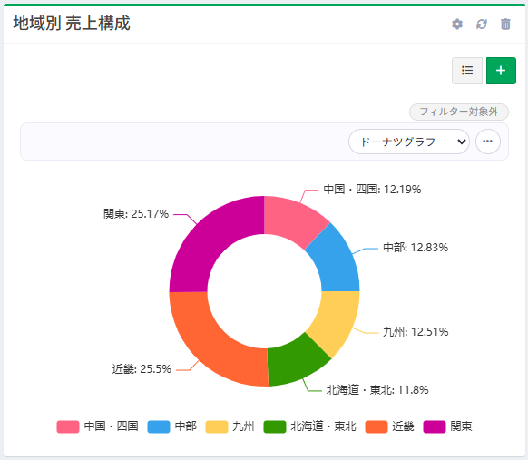

> The filter conditions are stored in the URL. You can use the browser's Back and Forward buttons to return to previous filter conditions. Sharing the URL allows others to view the dashboard with the same filter conditions.

> The last selected conditions are remembered for each user and restored the next time the dashboard is opened.

## Filtering by clicking a chart

Clicking a bar, slice, or other chart element selects the corresponding value in the filter bar and filters the other charts accordingly.

The clicked chart continues to display all values. The selected value is highlighted in full color, while the other values appear faded.

| Action | Result |
|---|---|
| Click a value | Selects only that value. |
| Click the selected value again (when it is the only selected value) | Clears the selection. |
| Ctrl + click (⌘ + click on Mac) | Adds the value to the selection. If the value is already selected, clicking it again removes only that value from the selection. |

**Notes:**

- This feature is available when the chart's horizontal-axis column is included in the filter bar.
- Available only for charts of a summary view. Not available when the horizontal-axis column is an item specified as a "from" / "to" range (such as a date column) or a multiple-value column.
- This feature is not available for Radar chart, Gauge, Treemap, Sunburst and Boxplot.
- When a value is selected in the filter bar, a chart whose horizontal axis corresponds to that filter item is not filtered by that selection. Instead, the selected value is highlighted.

## Filtering one chart

The chart filter applies only to the current chart. Other charts are not affected.

When [chart filter fields](#chart-filter-fields) are configured for a chart, a "Filter" button appears in the top-right corner of the chart.

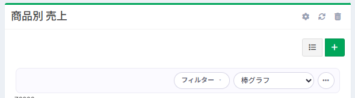

Click "Filter" and select the values you want to display.

The button indicates the number of active filter fields. Click "Reset" to clear the chart filter conditions.

If a field contains more than 8 values, a search box appears above the list to help you find the values you need.

Date and datetime columns are specified as a "from" / "to" range instead of a list. Number columns also switch to a range when they have too many values to list.

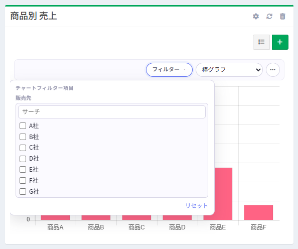

**Notes:**

- Chart filters can be used together with the filter bar. In this case, both sets of filter conditions are applied.
- Chart filter selections are cleared when you reload the page (F5).

## Switching the chart type

Use the chart type selector in the top-right corner of a chart to display the same data using a different chart type.

The selected chart type is remembered for each user and is used the next time that user opens the dashboard.

Selecting the original chart type clears the chart type switch and restores the original type.

**Note:** Single-series charts can only be switched to other single-series chart types, and multi-series charts only to other multi-series chart types. For example, a bar chart can be switched to a doughnut chart or a scatter chart, but not to a stacked bar chart (multi-series).

## Options menu

Click "⋯" in the top-right corner of a chart to open the options menu.

| Menu | Description |
|---|---|
| Sort by | Sorts data by a horizontal-axis item or by value, in ascending or descending order. |
| Data labels | Displays values on each bar, point, or other supported chart element. Shown only for Bar, Line, Pie, Horizontal bar, Area chart, Scatter, Grouped bar, Stacked bar, Multi-line and Stacked area. |
| Export data | Downloads the displayed data as a CSV file. |
| Reset colors | Restores the original colors. Shown only to users who can change colors, and only when colors have been changed. |
| Reset | Restores the default sorting and data label settings. |

**Notes:**

- Sorting and data label settings are remembered for each user.
- "⋯" is not shown on a chart that has no menu items available.

## Changing chart colors

Users with dashboard editing permissions can right-click a bar, slice, or other supported chart element to change its color.

Choose a color from "Theme colors" or "Standard colors", select "More colors..." to choose a custom color, or select "Automatic" to restore the original color.

For bar charts, pie charts, and similar chart types, colors can be changed for individual bars or slices. For single-color chart types, such as line and area charts, and for multi-series charts, colors can be changed for each series.

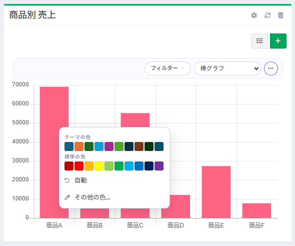

Selecting "More colors..." opens a color palette where you can choose a custom color.

Click a color in the palette or enter RGB values. Use the ↕ control to switch between HSL and HEX formats, then click "OK" to apply the color.

**Notes:**

- Changed colors are saved in the chart settings and are visible to all users.
- Users with view-only permissions cannot change chart colors.
- Heatmap and Boxplot charts do not support color changes.
