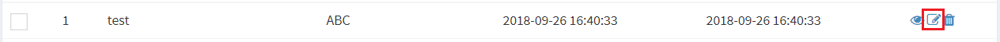
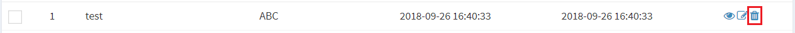
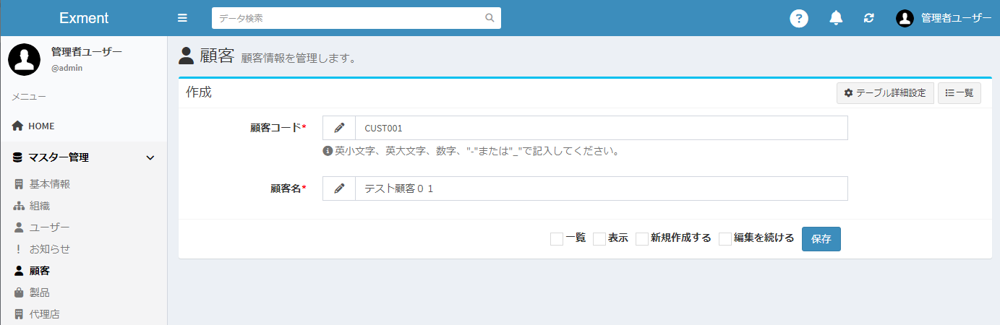

# Data
This page explains the screens for seeing the data of a table as a list, adding new data, editing, showing and deleting it.  
Tables are made by the system administrator. Users enter values in those tables and save them.

| What you want to do | Where to look |
|---|---|
| See the data as a list | [List of data](/data?id=list-of-data) |
| Add data | [Add new data](/data?id=add-new-data) |
| Correct data | [Editing data](/data?id=editing-data) |
| See the contents of data | [View data](/data?id=view-data) |
| Delete data | [Deleting data](/data?id=deleting-data) |
| Make data by copying | [Copy data](/data?id=copy-data) |

## List of data
The list of the data saved in that table.  
The list shows the data you created and the data you have been given permission for.

Note: when the "permission to edit and view all data" is registered for a user or an organization, all data is shown, regardless of the condition above.  
  
  
For a detailed explanation of the list screen, see [List of data](/data_grid).  

## Add new data
1. Click the [New] link at the top right of the page.  

Note: this button is not shown when the logged-in user does not have the "Edit" permission of that table.  
For how to assign permissions, see [Role group / Authority setting](/role_group) in the left menu.  

2. The screen for creating new data is shown.  

  
For a detailed explanation of the screen for adding new data, see [Data form](/data_form).  

### Checking the contents before saving (preview)
Click the [Preview] button at the top right of the new data creation screen to check what you are entering in a separate window, without saving it.  
It is shown as a list of item names and values, for each block of the form.

- The [Preview] button is shown only on the new data creation screen. It is not shown on the edit screen.  
- The preview does not save the data. To refresh the display after changing the input, click the [Preview] button again on the original screen.  
- Child table blocks are not shown in the preview.

## Editing data
1. Click the [Edit] link of the row you want to edit.  

Note: this link is not shown when the logged-in user does not have the "Edit" permission of that table.  
For how to assign permissions, see [Role group / Authority setting](/role_group) in the left menu.  

2. The data edit screen is shown.  

  
For a detailed explanation of the edit screen, see [Data form](/data_form).  

> When you update data and another user has already updated the same data, the following error message is shown.

## View data
1. Click the [View] link of the row you want to show.  

2. The data display screen is shown.  

  
For a detailed explanation of the display screen, see [Data details](/data_details).  

## Deleting data
- Click the [Delete] link of the row you want to delete.  

## Copy data
Note: to show the [Copy] link, a setting value must be changed. See [Display custom data copy link](/config?id=display-custom-data-copy-link).  

1. Click the [Copy] link of the row you want to copy.  

2. The edit screen is shown, filled with the contents of the selected data.  

3. Correct what you need, and save.  

What is copied and what is not:

- Only the items on the form are copied.  
- Auto numbers, files, images and so on are not copied.  
