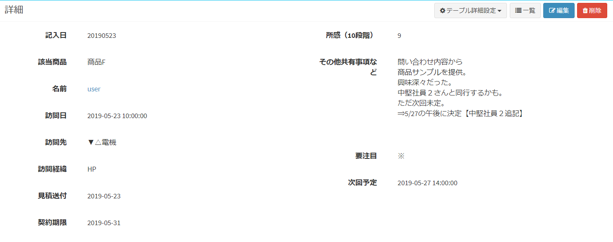
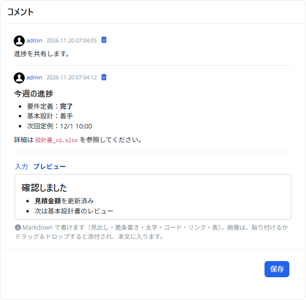

# Data details
This page explains the screen that shows the contents of one record. It opens when you click the data you want to see in the [list of data](/data_grid).  

- The data list shows what is specified in [Display column selection](/view?id=display-column-selection) of the view setting.  
- The data details show the items of the form that matched, following the priority order of the [Form priority settings](/form?id=form-priority-settings).  

The data details screen shows the following four kinds of information.  

- Details of contents  
- Attachments  
- Comments  
- Change log  

## Details of contents

- Shows in detail what is registered as the data.

## Back to the list
On the data details and edit screens, a [← Back to the list] button is shown at the right of the heading (table name) row. Click it to go back to the data list of that table (the same destination as the [List] button at the top right).

Note: available from v7.1.0. The button is blue in the "Classic" design, and the accent color of the [Site skin](/system_setting?id=site-skin) in the "Modern" design.

## Attachment
  

Files can be attached on the data details screen.  

1. Click the [Browse] button and select the file you want to attach.  
2. Click the [Upload] button.  

An attached file can be deleted with the [Delete] button.

#### Replace and older versions (v7.2.0 or later)
Press [Replace] next to an attached file and select a file: the attachment is replaced with the new file.  
The previous file remains as an "older version". Press the label such as "Version 2" shown next to the replaced file to see the list of older versions; you can open them from there.  

- Up to 10 older versions remain for one attachment. Beyond that, the oldest ones are removed. The number can be changed with `EXMENT_DOCUMENT_VERSION_LIMIT` in `.env`.  
- When an attachment is deleted, its older versions are removed with it.  

## comment
  

- Enter a comment and click the [Submit] button to add a comment to the data.
- The date and time of the comment and the user name are entered automatically.
- A comment can be deleted with the [Delete] button.  

Note: you can delete only the comments of the logged-in user (yourself).  
In the example of the image, the user is logged in as "user", so the [Delete] button is not shown on the comment of "admin".

#### Markdown and images (from v7.1.0)
Comments can be written in Markdown. Headings, lists, bold, code, links and tables (GitHub Flavored Markdown) can be used. A line break is shown as a line break.

- With [Write] and [Preview] of the comment box, you can check how it looks before sending.
- Paste an image (PNG, JPEG, GIF, WebP) into the comment box, or drag and drop it: it is uploaded as an attachment of the data and put in the comment as ``. The size limit is 10MB by default (it can be changed with a [setting value](/config?id=maximum-size-of-an-image-pasted-into-a-comment)).
- An image written as `)` in a body (custom column "Editor") is also shown as an image on the data details screen (in the list it stays as text, as before). It is also shown when you write the url returned by "Create a document (attachment)" of the API as it is.

Note: **comments written before the update to v7.1.0 are shown as plain text, as before** (they are not read as Markdown). Comments written after the update are shown as Markdown.  
Note: HTML written in a comment is not output as HTML; it is shown as text. Links to external sites open in a new tab.  
Note: an image is shown only to users who are logged in and can see the data the file is attached to. SVG images and images of other sites are not shown as images in comments; they are shown as links.  
Note: comments can also be listed, added and deleted with the API. See the [API reference](https://exment.net/reference/en/webapi.html) for details.

#### Mentions (notify a member with @)
You can name a user in a comment and notify that user.

- Type "@" (the full-width "＠" also works) in the comment box, and candidate users are shown.  
Keep typing to narrow the candidates down. Click a candidate (or choose one with the ↑↓ keys and press Enter), and "@user code" is entered.  
- When the comment is sent, the named user receives an in-system alert (the notification icon at the top right of the page) saying "You were mentioned in a comment: (heading of the data)". The body of the notification shows the contents of the comment.

Note: the candidates are shown when "@" is typed at the beginning of a line or right after a space.  
Note: only users whose user code is registered are shown as candidates. Up to 20 candidates are shown at a time (following the setting value `EXMENT_API_DEFAULT_DATA_COUNT`).  
Note: the notification is sent only to users who have permission to view the data. Naming yourself sends no notification.

## Change log

  

- The change log is shown when [Use data change history](/table?id=use-data-change-history) of the table setting is YES.
- When data is edited, the date and time of the edit and the user name are entered automatically.
- Click the date and time of a change log entry to go to the revision screen.

#### Revision
  
- In "Select Revision", choose from the history the data you want to compare.
- The "selected history data" is shown on the left and the "latest data" on the right. Items whose contents differ get a background color.
- Click the [Restore This Revision] button at the bottom of the page to go back to the contents of the selected history.

  

## Data sharing

> For the data sharing setting, first read the page [Overview of roles and authorities](/permission).

Share saved data with other users and organizations.  
Note: it can be used only when you have the "Data sharing" permission in the [role group setting](/role_group).

#### Sharing method
1. Click the [Share] button on the data details screen.
  

2. The data sharing dialog is shown.
  

3. Add the users you want to share with, and click [Submit]. The data is now shared.  
  

Note: when the system administrator sets a notification of "data creation, update, sharing and comment" in the [notification setting](/notify), the users the data was shared with can be notified.
