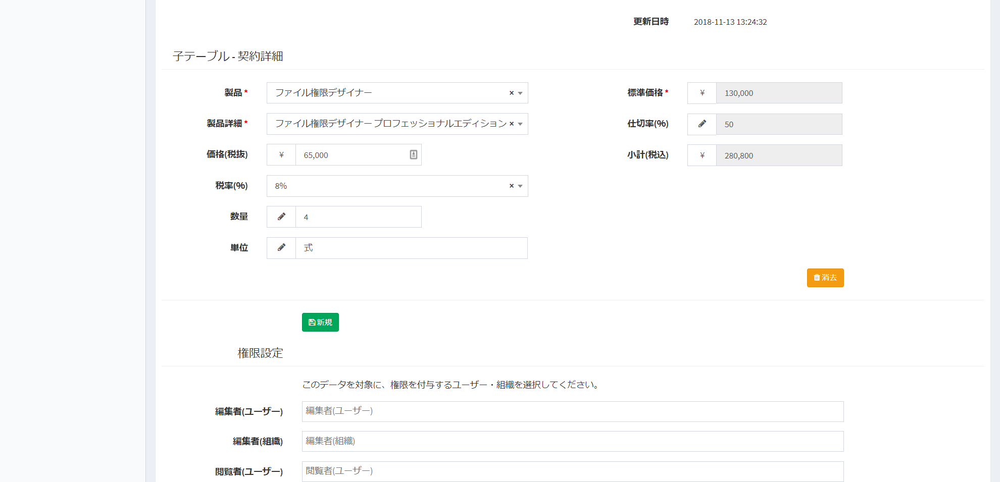

# Data registration
This page explains the form screen used when creating new data and when editing data.

- The items shown on the form are decided by the settings of the [custom column setting](/column), the custom form and the [related tables](/relation).  
- When they are not shown as you expect, correct the settings on the pages above.  

## Functions list
  

##### [Move to page] button  
Switches to the screens for changing the settings of the custom table now shown.

##### [List] button
Switches to the data list screen.  
Note: from v7.1.0, you can also go back with the [← Back to the list] button at the right of the heading row. See [Back to the list](/data_details?id=back-to-the-list) for details.

##### [View] button  
Switches to the screen for viewing the data.

##### [Delete] button
Deletes the data shown.  
Note: deleted data can be restored from [Deleted data](/deleted_data).

##### Form items  
Change the values of the data.  
The items shown are decided by the settings of the [custom column setting](/column), the custom form and the [related tables](/relation).  
When they are not shown as you expect, correct the settings on the pages above.  

##### Child table  
When 1:n or n:n is set in the [related tables](/relation), the data of the table set as the related table can be added and changed together. See "Child table" below for details.

## detail of function

### Child table
When 1:n or n:n is set in the [related tables](/relation), the data of the table set as the related table can be added and changed together.  
Example: when the table shown is "Contract" and the child table is "Contract details", the detail data of the contract can be added and changed at the same time as the billing date and the customer information are registered.  
  
  
Note: there are two ways to show the data of a child table: the "normal form format" and the "table format".  
The format is switched on the custom form screen.  
  
##### [New] button  
Adds one record of the child table.  
  
##### [Delete] button  
Deletes the selected record of the child table.  

### Data Submit Redirect
  
Checkboxes are shown to the left of the save button.  
Checking one changes the screen opened after the data is saved.

| Check | Screen opened after saving |
|---|---|
| List | The list screen of that data (the list screen too when nothing is checked) |
| View | The details screen of that data |
| Continue creating | The screen for creating new data of that table |
| Continue editing | The edit screen of that data (it is shown again) |

- After saving with "Continue creating" or "Continue editing" checked, "Continue creating" or "Continue editing" is already checked the next time the form is shown.  
- From v3.9.1, the default value of the checks can be specified. See [Data Submit Redirect](/system_setting?id=data-submit-redirect) for details.
