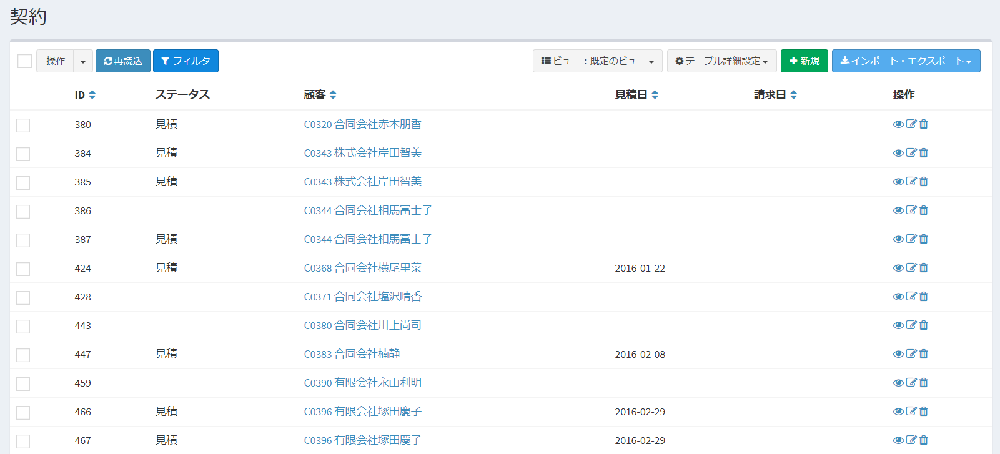
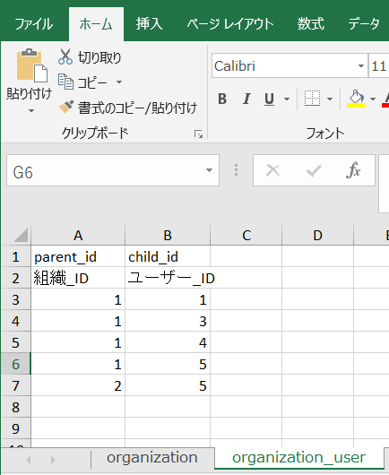
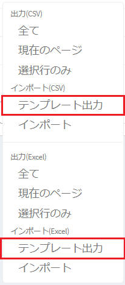
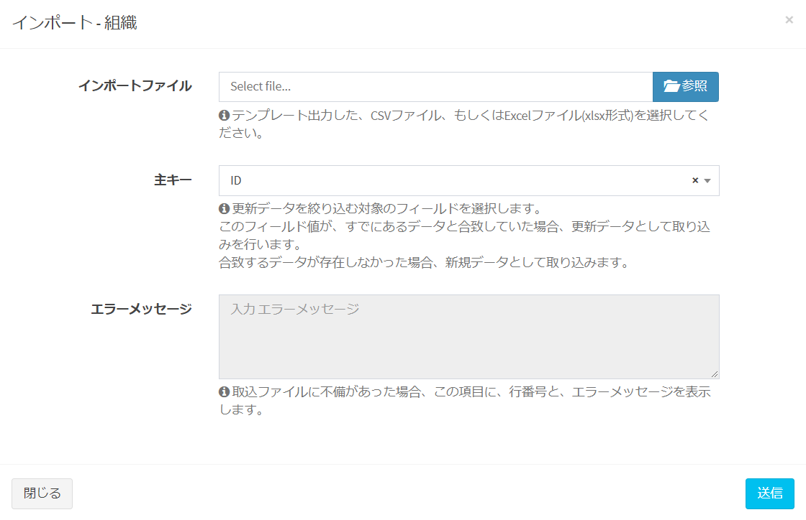
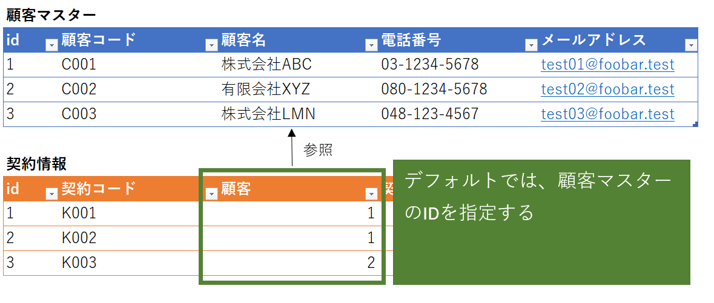

# Data import / export  
This page explains the screens for putting the data of a table out to a file (csv, xlsx) (export) and for putting data in from a file (import).

| What you want to do | Where to look |
|---|---|
| Put data out to a file (all columns) | [Data export](/data_import_export?id=data-export) |
| Put data out to a file in the shape of the view you are looking at | "Data export (view)" |
| Put data in from a file | "Data import" |
| Import and export by command | [Data import / export by command](/data_cmd_import_export) |
| Put in a large amount of data at once by command | [Bulk data insert](/data_bulk_insert) |

## Types of data export / import functions
- Currently, the export and import functions are of the following kinds.
    - Export  
    Exports (outputs) the data of the saved table, for all columns.  

    - Export (view)  
    Exports (outputs) the data of the table in the shape of the view now shown.  

    - Import  
    Imports (inputs) the data of a table from a csv or xlsx file.  

- Click the [Import/Export] button on the data list screen of a table to show the following menu.
  

>Items you do not use can be hidden with the [setting values](/config?id=import-export).

## Data export
Exports (outputs) the data of a table to a file.  
The file format is csv or xlsx (recommended).  

### Method of operation
- Show the data list screen.
  

- The [Import/Export] button is shown at the top right of the page. Click it.  
  

- A menu is shown. Select the item you want to output.  
  
    - All  
    Outputs all the data of that table.  
    Note: however, **data the logged-in user has no permission for is not output.**  
    
    - Current page  
    Outputs the data list of the page now open.

    - All (with comments)  
    Outputs all the data of that table and the comments of each record.  
    The comments are output to the sheet "comment" in the Excel format, and to the file "comment" in the CSV format.  
    Note: shown only for tables where "Use Comment" of the custom table setting is YES.  
    Note: the comment output is for reading. On import, the "comment" sheet (file) is not taken in.

- Click the [CSV] or [Excel] button to download the data as a file.  

### Output item list
##### ID  
A positive integer numbered automatically in sequence when the data is registered.

##### System ID (20 digits)
20 alphanumeric characters given automatically when the data is registered. It is seldom shown on the screen. It is used for data migration and so on.  

##### Parent Data ID  
The id of the parent table, when that table is registered as the n of a "1:n" relation setting. Blank when there is no relation setting.  

##### Parent Data Table Name  
The parent table name (alphanumeric), when that table is registered as the n of a "1:n" relation setting. Blank when there is no relation setting.  

##### Custom columns  
The values registered as custom columns are output, column by column.  

##### Created date, updated date, deleted date  
The date and time the data was created, updated and deleted are each output.  

### Export 1: n relation  
- When you export data on a table registered as the "1" of a "1:n" relation setting, **the data list of the related "n" is exported at the same time.**  

Example: a relation setting is saved with "Contract information" as 1 and "Contract detail information" as n  
  
- When the data export is run on the "Contract information" screen (note: the "customers" in the image are test data)  
  
- The data of both "Contract information" and "Contract detail information" is output.
  
  
- "Parent Data ID" and "Parent Data Table Name" of the "n" data list hold the ID and the table name of the related parent table.

### Export n: n relation
- When you export data on a table registered as the original n of an "n:n" relation setting, **the link information with the related "n" is exported at the same time.**  

Example: a relation setting is saved with "Organization information" and "User information" as n:n  
  
- When the data export is run on the "Organization information" screen,  
  
- the data of "Organization information" is output. In addition, the data that links "User information" and "Organization information" is output.
  
  
- "parent_id" holds the ID of the parent organization information, and "child_id" the ID of the child user information.  

### other noteworthy things
- In both the CSV format and the Excel format, the first row is the column name (alphanumeric) and the second row is the column display name. Please note that the CSV format also has two header rows.  
- A file output in the CSV format has the character code UTF-8, the line break code LF, and no BOM.  
- When several sets of data are output because of relation settings, the Excel format has several sheets, and the CSV format puts several csv files into a zip.  

### Changing output values when exporting
On export, the columns "Parent Data ID", "Select (From Table)", "User" and "Organization" usually hold the ID of the data of the referenced table. This can be **changed to the value of a custom column of the referenced table.**  
The steps are written below.  

#### For parent_id (Parent Data ID)
1. Open the relation setting screen.

2. In "Key column when exporting", set the custom column you want to output on export, and save.  

3. When you export data after that, the output value is the value of the selected custom column instead of the id. 

Usually:
  
  
With "Key column when exporting" specified:
  

#### For "Select (From Table)", "User" and "Organization"
1. Open the custom column setting screen of that column.

2. In "Key column when exporting", set the custom column you want to output on export, and save.  

3. When you export data on the referring table after that, the output value is the value of the selected custom column instead of the id. 

Usually:
  
  
With "Key column when exporting" specified:
  

## Data export (view)
Exports (outputs) the data of a table to a file, in the shape of the view now shown.  
The file format is csv or xlsx (recommended).  

### Method of operation
- Show the data list screen.
  

- The [Import/Export] button is shown at the top right of the page. Click it.  
  

- A menu is shown. Select the item you want to output.
  
    - All  
    Outputs all the data of that table.  
    Note: however, **data the logged-in user has no permission for is not output.**  

    - Current page  
    Outputs the data list of the page now open.

- Click the [CSV] or [Excel] button to download the data as a file. The items of the view now shown are output as they are.  

## Data import
Imports (inputs) the data of a table from a file.  
The file format is csv or xlsx (recommended). The data must be prepared beforehand in the format Exment defines.

The flow is as follows.

1. Output the template ("Template output")  
2. Write the data you want to take in into the template ("List of import items")  
3. Run the import ("Execute data import")

> Currently, for performance reasons, up to 5000 records can be imported at a time.  
To register more than 5000 records at a time, consider the [bulk data insert](/data_bulk_insert).

### Method of operation

#### Template output
Output the template file for taking data in.

- Show the data list screen.
  

- The [Import/Export] button is shown at the top right of the page. Click it.  
  

- Under the template output of the import, click [CSV] or [Excel].
  

- The CSV or Excel file for taking data in is downloaded.  
  
Note: the file format is the same as when output with "Export".  
The template is output with 0 records.

- Write the data you want to take in into the output template.

### List of import items
##### ID  
A positive integer numbered automatically in sequence when the data is registered.  
Write it only when you want to decide this ID yourself on import.  
When you do not need to decide it, leave it blank. The system enters a value automatically on import.  

##### System ID (20 digits)  
20 alphanumeric characters given automatically when the data is registered. It is seldom shown on the screen.  
Write it only when you want to decide this system ID yourself on import.  
When you do not need to decide it, leave it blank. The system enters a value automatically.  

##### Parent Data ID  
Usually, leave it blank.  
When the table to import is registered as the n of a "1:n" relation setting, enter the id of the parent table.  
  
Note: by default the ID of the data of the parent table is specified, but **a custom column can also be specified for the import**. See "[Changing the method of specifying parent table data](#changing-the-method-of-specifying-parent-table-data)" for details.  

##### Parent Data Table Name  
Usually, leave it blank.  
When that table is registered as the n of a "1:n" relation setting, enter the parent table name (alphanumeric).  
  

##### Custom columns  
Write the values to register as custom columns.  
Note: how to write a value differs with the column type. Check "[Custom column input method when importing](#custom-column-input-method-when-importing)" below.

##### Created date, updated date, deleted date  
Usually, leave them blank.  
Write them only when you want to decide the date and time the data was created, updated and deleted yourself.  
When blank, the system enters the values automatically on import.

### Execute data import
Run the import from the screen.

- Show the data list screen.
  

- The [Import/Export] button is shown at the top right of the page. Click it.  
  

- Under "Import (CSV)" or "Import (Excel)", click "Import".
  

- The import dialog is shown.  
  

- In "Import File", select the import template file in which you wrote the data.  

- In "Promary Key" (primary key), select the primary key used to tell new data from updated data on import.  
For details, check "Primary key type" below.

- When the settings are done, click [Submit] of the dialog.

- When there is a problem in the import data, "Error Message" shows the row number after the header and the contents of the error.

Note: the import does not succeed when an item set as "[Required](/column?id=entry-details-common)" in the custom column setting has no value. Check that nothing is missing in the import template file.
- When the import ends correctly, the dialog closes and the data is loaded again.

### Judgment method for newly added data and updated data
On import, each row is judged to be data to add newly or data that updates existing data.  
This is how it is judged.

- On the import screen, specify the "primary key" column used for the judgment. (Here it is "ID".)  
Note: the primary key is selected at import. See "Primary key type" below.

- On import, the system looks at the value of the ID column of the import data.
  

    - When the ID of the import data is blank, it is treated as data to add newly.
  

    - When the ID of the import data has a value, the system looks for data with the same ID among the data already registered.  
  
    If there is data with the same ID, that data is updated with the contents of the import data.  
    If there is none, the import data is added newly. Its ID is then the ID of the import data.  

### Primary key type

- ##### ID (recommended)  
An integer the system gives automatically. It is also used for relations with other tables and so on.  
It is easy to use, and easy to fill in beforehand. However, because it is numbered automatically in sequence, unexpected gaps can appear when migrating from one environment to another.

- ##### System ID (20 digits)  
20 alphanumeric characters the system gives automatically when the data is saved.  
When migrating from one environment to another, we recommend using this system ID, to make clear which data is updated.  

- ##### Unique column  
A column set as "Unique" in the custom column setting can be selected as the primary key. (Example: e-mail address, user code)    

### Custom column input method when importing
How to write a value on import differs with the kind of the custom column.  
Check the contents below.

##### Select (Save Value and Label)  
Enter the "value" registered in the database, or the "label" shown on the screen.  

##### Select (From Table), User, Organization  
Enter the **ID of the referenced table**.  
  
Note: by default the ID of the data of the referenced table is specified, but **a custom column can also be specified for the import**. See "[Changing the method of specifying parent table data](#changing-the-method-of-specifying-parent-table-data)" for details.  

##### YES/NO  
Enter "YES" or "NO", or "1" or "0".  

##### Select 2-value  
Enter the display text or the value of the "Select 2-value" entered on the custom column screen.  
  

##### Others  
Enter the value to register as it is.  

### Changing the method of specifying parent table data
On import, the columns "Parent Data ID", "Select (From Table)", "User" and "Organization" usually hold the ID of the data of the referenced table. This can be **specified by the value of a custom column instead.**  
The steps are written below.  

#### If parent_id (parent data ID)
1. Open the relation setting screen.

2. In "Key column when importing", set the custom column used to look up the value on import, and save.  
Note: only columns specified as "Index Enabled" (search index) in the custom column setting can be specified.  

3. After that, download the Excel file for import on the child table. The "##setting##" sheet holds the child table name, "parent_id", and the custom column name of the parent table you specified.  
  

4. Without changing the contents of this sheet, write the import data in the sheet of the child table.  
In the "parent_id" column, write the value of the custom column registered in **Key column when importing**.  
In the example below, the value of "Contract code" of the parent table "Contract information" is entered.
  
  

5. After that, run the import.

#### For "Choices (select from a list of values ​​in another table)", "User", or "Organization"
1. Open the custom column setting screen of that column.

2. In "Key column when importing", set the custom column used to look up the value on import, and save.  
Note: only columns specified as "Index Enabled" (search index) in the custom column setting can be specified.  

3. After that, download the Excel file for import on the referring table. The "##setting##" sheet holds the referring table name, "value." + the custom column name of the referring table, and the custom column name of the referenced table.  
  

4. Without changing the contents of this sheet, write the import data in the sheet of the referring table.  
In the custom column of the referring table, write the value of the custom column of the referenced table registered in **Key column when importing**.  
In the example below, the value of "Customer code" of the referenced table "Customer master" is entered.
  
  

5. After that, run the import.

#### important point
- Only import in the Excel format is supported. The CSV format is not supported at present.
