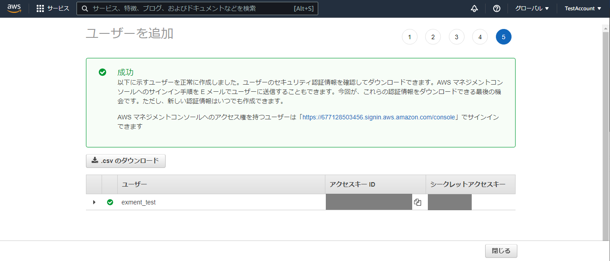
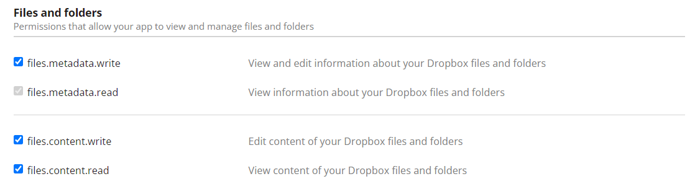

# (Für Fortgeschrittene) Speicherort der Dateien ändern
Mit dieser Einstellung speichern Sie Dateien wie Anhänge und Sicherungen an einem anderen Ort als dem Webserver (zum Beispiel FTP oder Amazon S3).  
In der Standardeinstellung werden Anhänge auf dem Webserver gespeichert. Den Speicherort ändern Sie zum Beispiel in den folgenden Fällen.

- Sicherungsdateien auf FTP speichern
- Dateien für eine redundante Auslegung in AWS S3 speichern

Die Einstellung nehmen Sie in dieser Reihenfolge vor.

1. Legen Sie fest, für welche „Dateiart“ Sie den Speicherort ändern und welches „Upload-Ziel (Treiber)“ Sie verwenden möchten.
2. Geben Sie unter „Gemeinsame Einstellung“ für jede Dateiart den Treiber an.
3. Stellen Sie unter „Einstellungen je Treiber“ die Verbindungsdaten ein.

## Dateiarten
Zurzeit gibt es in Exment die folgenden Dateiarten. Den Speicherort können Sie für jede Art festlegen.  
※Den Schlüsselnamen verwenden Sie in den Einstellungen weiter unten.

| Dateiart | Inhalt | Schlüsselname |
| ---- | ---- | ---- |
| **Anhänge** | Anhänge von Daten, die über den Bildschirm gespeichert werden | exment |
| **Sicherung** | Sicherungsdateien der Exment-Daten, die über die Sicherungsseite erstellt werden | backup |
| **Plugins** | Plugin-Dateien, die als Erweiterung von Exment hochgeladen wurden | plugin |
| **Vorlagen** | Einstellungsdateien von Exment, zum Beispiel für benutzerdefinierte Tabellen und benutzerdefinierte Spalten | template |


## Arten von Upload-Zielen (Treibern)
Zurzeit unterstützt Exment die folgenden Upload-Ziele (Treiber).  
※Den Schlüsselnamen verwenden Sie in den Einstellungen weiter unten.

| Upload-Ziel (Treiber) | Speicherort | Schlüsselname |
| ---- | ---- | ---- |
| **Lokal (Standard)** | Webserver | local |
| **FTP** | FTP | ftp |
| **SFTP** | SFTP | sftp |
| **Amazon S3** | Amazon S3 | s3 |
| **Azure Blob** | Azure Blob | azure |

> Seit v3.6.2 werden eigene Treiber unterstützt. Einzelheiten finden Sie unten auf dieser Seite unter „Eigenen Treiber hinzufügen“.

## Einstellung

### Gemeinsame Einstellung
- Öffnen Sie ".env" und geben Sie für jede Dateiart, die Sie ändern möchten, den Treiber an.

~~~
EXMENT_DRIVER_EXMENT=(Schlüsselname des Treibers, den Sie für Anhänge verwenden möchten)
EXMENT_DRIVER_BACKUP=(Schlüsselname des Treibers, den Sie für die Sicherung verwenden möchten)
EXMENT_DRIVER_TEMPLATE=(Schlüsselname des Treibers, den Sie für Vorlagen verwenden möchten)
EXMENT_DRIVER_PLUGIN=(Schlüsselname des Treibers, den Sie für Plugins verwenden möchten)

// Beispiel 1: nur das Sicherungsziel auf FTP stellen
EXMENT_DRIVER_BACKUP=ftp

// Beispiel 2: alle Upload-Ziele auf Amazon S3 ändern
EXMENT_DRIVER_EXMENT=s3
EXMENT_DRIVER_BACKUP=s3
EXMENT_DRIVER_TEMPLATE=s3
EXMENT_DRIVER_PLUGIN=s3
~~~

### Wenn die zuerst installierte Version älter als v3.0.8 ist
Wenn die Version, mit der Sie Exment zum ersten Mal installiert haben, älter als v3.0.8 ist, ist die folgende Änderung nötig.  
(Wenn Sie die zuerst installierte Version nicht kennen, prüfen Sie dies bitte zur Sicherheit.)

- Öffnen Sie „config/exment.php“ im Stammordner des Projekts.

- Suchen Sie einen Eintrag wie den folgenden.

~~~ php
    /*
    |--------------------------------------------------------------------------
    | driver
    |--------------------------------------------------------------------------
    |
    | file upload driver
    |
    */
    'driver' => [
        'default' => env('EXMENT_DRIVER_DEFAULT', 'local'),
    ],
~~~

- Ändern Sie diesen Eintrag wie folgt.

~~~ php
    /*
    |--------------------------------------------------------------------------
    | driver
    |--------------------------------------------------------------------------
    |
    | file upload driver
    |
    */
    'driver' => [
        'exment' => env('EXMENT_DRIVER_EXMENT', 'local'), //geändert
        'backup' => env('EXMENT_DRIVER_BACKUP', 'local'), //hinzugefügt
        'plugin' => env('EXMENT_DRIVER_PLUGIN', 'local'), //hinzugefügt
        'template' => env('EXMENT_DRIVER_TEMPLATE', 'local'), //hinzugefügt
    ],
~~~

### (1 empfohlen) Einstellungen je Treiber - Einstellung in config und .env
Bei dieser Methode schreiben Sie in config nur das Nötigste und tragen die Einstellungswerte in .env ein.  
Die Einstellungswerte lassen sich für mehrere Dateiarten wiederverwenden. Die Einstellung ist deshalb vergleichsweise einfach.

#### FTP

- Führen Sie den folgenden Befehl aus.

~~~
composer require league/flysystem-ftp ~3.0
~~~

- Öffnen Sie "config/filesystems.php" und prüfen Sie den Einstellungswert "disks.ftp".  
Wenn er nicht vorhanden ist, fügen Sie die folgende Einstellung hinzu.

~~~php
    'disks' => [
        // Ab hier hinzufügen
        'ftp' => [
            'driver'   => 'ftp',
            'host'     => env('FTP_HOST'),
            'username' => env('FTP_USERNAME'),
            'password' => env('FTP_PASSWORD'),
    
            // Optionen der FTP-Einstellung
            'port'     => env('FTP_PORT', 21),
            'ssl'      => env('FTP_SSL', false),
            'timeout'  => env('FTP_TIMEOUT', 30),
        ],
    ],
~~~

- Öffnen Sie ".env" und fügen Sie den folgenden Inhalt hinzu.  

~~~
FTP_HOST=(Hostname des FTP)
FTP_USERNAME=(Benutzername des FTP)
FTP_PASSWORD=(Passwort des FTP)
~~~

- Fügen Sie für jede Dateiart, für die Sie FTP verwenden möchten, die folgende Einstellung hinzu.

~~~
FTP_ROOT_EXMENT=(Stammpfad des FTP für Anhänge)
FTP_ROOT_BACKUP=(Stammpfad des FTP für die Sicherung)
FTP_ROOT_TEMPLATE=(Stammpfad des FTP für Vorlagen)
FTP_ROOT_PLUGIN=(Stammpfad des FTP für Plugins)

// Beispiel 1: den Stammpfad des FTP für die Sicherung angeben
FTP_ROOT_BACKUP=/var/foo/exment/ftp/backup

// Beispiel 2: alle Stammpfade des FTP angeben
FTP_ROOT_EXMENT=/var/foo/exment/ftp/admin
FTP_ROOT_BACKUP=/var/foo/exment/ftp/backup
FTP_ROOT_TEMPLATE=/var/foo/exment/ftp/template
FTP_ROOT_PLUGIN=/var/foo/exment/ftp/plugin
~~~


#### SFTP

- Führen Sie den folgenden Befehl aus.

~~~
composer require league/flysystem-sftp-v3 ~3.0
~~~

- Öffnen Sie "config/filesystems.php" und prüfen Sie den Einstellungswert "disks.sftp".  
Wenn er nicht vorhanden ist, fügen Sie die folgende Einstellung hinzu.

~~~php
    'disks' => [

        // Ab hier hinzufügen
        'sftp' => [
            'driver'   => 'sftp',
            'host'     => env('SFTP_HOST'),
            'username' => env('SFTP_USERNAME'),
            'password' => env('SFTP_PASSWORD'),

            // Einstellung für die Authentifizierung mit SSH key (nur bei Bedarf eintragen)
            // 'privateKey' => env('SFTP_PRIVATE_KEY'),
            // 'password' => env('SFTP_PASSWORD'),

            // Optionen der FTP-Einstellung
            'port' => env('SFTP_PORT', 22),
            'timeout' => env('SFTP_TIMEOUT', 30),
        ],
    ],
~~~

- Öffnen Sie ".env" und fügen Sie den folgenden Inhalt hinzu.  

~~~
SFTP_HOST=(Hostname des SFTP)
SFTP_USERNAME=(Benutzername des SFTP)
SFTP_PASSWORD=(Passwort des SFTP)
~~~

- Fügen Sie für jede Dateiart, für die Sie SFTP verwenden möchten, die folgende Einstellung hinzu.

~~~
SFTP_ROOT_EXMENT=(Stammpfad des SFTP für Anhänge)
SFTP_ROOT_BACKUP=(Stammpfad des SFTP für die Sicherung)
SFTP_ROOT_TEMPLATE=(Stammpfad des SFTP für Vorlagen)
SFTP_ROOT_PLUGIN=(Stammpfad des SFTP für Plugins)

// Beispiel 1: den Stammpfad des SFTP für die Sicherung angeben
SFTP_ROOT_BACKUP=/var/foo/exment/sftp/backup

// Beispiel 2: alle Stammpfade des SFTP angeben
SFTP_ROOT_EXMENT=/var/foo/exment/sftp/admin
SFTP_ROOT_BACKUP=/var/foo/exment/sftp/backup
SFTP_ROOT_TEMPLATE=/var/foo/exment/sftp/template
SFTP_ROOT_PLUGIN=/var/foo/exment/sftp/plugin
~~~


#### Amazon S3
- Legen Sie vorher [den Bucket von AWS S3 und das IAM an](/de/additional_file_saveplace?id=IAM-für-S3-anlegen).  
※Wenn Sie mehrere Dateiarten einrichten, legen Sie für jede Dateiart einen eigenen Bucket an.

- Führen Sie den folgenden Befehl aus.

~~~
composer require league/flysystem-aws-s3-v3 ~3.0
~~~

- Öffnen Sie "config/filesystems.php" und prüfen Sie den Einstellungswert "disks.s3".  
Wenn er nicht vorhanden ist, fügen Sie die folgende Einstellung hinzu.

~~~php
    'disks' => [

        // Ab hier hinzufügen
        's3' => [
            'driver' => 's3',
            'key' => env('AWS_ACCESS_KEY_ID'),
            'secret' => env('AWS_SECRET_ACCESS_KEY'),
            'region' => env('AWS_DEFAULT_REGION'),

            // Das Folgende nur eintragen, wenn Sie den Endpunkt ändern, zum Beispiel für PrivateLink
            'endpoint' => env('AWS_ENDPOINT'),
        ],
    ],
~~~

- Fügen Sie den folgenden Inhalt in ".env" hinzu.  

~~~
AWS_ACCESS_KEY_ID=(Zugriffsschlüssel von AWS S3)
AWS_SECRET_ACCESS_KEY=(geheimer Zugriffsschlüssel von AWS S3)
AWS_DEFAULT_REGION=(Region von AWS S3)
#Das Folgende nur eintragen, wenn Sie den Endpunkt ändern, zum Beispiel für PrivateLink
AWS_ENDPOINT=(Endpunkt von AWS S3)
~~~

> **Wenn Sie ohne Zugriffsschlüssel mit einer IAM-Rolle verbinden**
> Nur wenn sowohl „AWS_ACCESS_KEY_ID“ als auch „AWS_SECRET_ACCESS_KEY“ eingestellt sind, wird mit diesem Zugriffsschlüssel verbunden.
> Wenn einer der beiden Werte fehlt, werden die Anmeldeinformationen auf dem Standardweg des AWS SDK ermittelt (Umgebungsvariablen, gemeinsame Datei mit Anmeldeinformationen, IAM-Rolle der ECS-Task oder der EC2-Instanz usw.).
> Wenn Sie in EC2 oder ECS eine IAM-Rolle zugewiesen haben, können Sie diese 2 Werte weglassen und sich so mit S3 verbinden, ohne einen Zugriffsschlüssel zu speichern. „AWS_DEFAULT_REGION“ und die Einstellung des Buckets sind nötig.

- Fügen Sie für jede Dateiart, für die Sie Amazon S3 verwenden möchten, die folgende Einstellung hinzu.

~~~
AWS_BUCKET_EXMENT=(Bucket von AWS S3 für Anhänge)
AWS_BUCKET_BACKUP=(Bucket von AWS S3 für die Sicherung)
AWS_BUCKET_TEMPLATE=(Bucket von AWS S3 für Vorlagen)
AWS_BUCKET_PLUGIN=(Bucket von AWS S3 für Plugins)

// Beispiel 1: den Bucket von AWS S3 für die Sicherung angeben
AWS_BUCKET_BACKUP=exment_backup

// Beispiel 2: alle Buckets von AWS S3 angeben
AWS_BUCKET_EXMENT=exment_default
AWS_BUCKET_BACKUP=exment_backup
AWS_BUCKET_TEMPLATE=exment_template
AWS_BUCKET_PLUGIN=exment_plugin
~~~

- Wenn der Speicherort der Anhänge Amazon S3 ist, wird beim Herunterladen eines Anhangs auf eine temporäre URL (signierte URL) von Amazon S3 weitergeleitet. Der Browser lädt die Datei direkt von Amazon S3 herunter, ohne den Weg über Exment.  
Deshalb muss der Browser des Benutzers eine Verbindung zu Amazon S3 (zu dessen Endpunkt) herstellen können.  
※Die Gültigkeitsdauer (Minuten) der temporären URL können Sie mit „EXMENT_FILE_DOWNLOAD_TEMPORARY_URL_MINUTES“ in ".env" ändern (der Standardwert ist 15). Einzelheiten finden Sie [hier](/de/config).


#### Azure Blob
- Legen Sie den Blob von Azure an.  
※Wenn Sie mehrere Dateiarten einrichten, legen Sie für jede Dateiart einen eigenen Container an.

- Führen Sie den folgenden Befehl aus.

~~~
composer require league/flysystem-azure-blob-storage ~3.0
~~~

- Öffnen Sie "config/filesystems.php" und prüfen Sie den Einstellungswert "disks.azure".  
Wenn er nicht vorhanden ist, fügen Sie die folgende Einstellung hinzu.

~~~php
    'disks' => [
        // Ab hier hinzufügen
        'azure' => [
            'driver' => 'azure',
            'account' => env('AZURE_STORAGE_ACCOUNT'),
            'key' => env('AZURE_STORAGE_KEY'),
        ],
    ],
~~~

- Fügen Sie den folgenden Inhalt in ".env" hinzu.  

~~~
AZURE_STORAGE_ACCOUNT=(Konto von Azure Blob)
AZURE_STORAGE_KEY=(Zugriffsschlüssel von Azure Blob)
~~~

- Fügen Sie für jede Dateiart, für die Sie Azure Blob verwenden möchten, die folgende Einstellung hinzu.

~~~
AZURE_STORAGE_CONTAINER_EXMENT=(Container von Azure Blob für Anhänge)
AZURE_STORAGE_CONTAINER_BACKUP=(Container von Azure Blob für die Sicherung)
AZURE_STORAGE_CONTAINER_TEMPLATE=(Container von Azure Blob für Vorlagen)
AZURE_STORAGE_CONTAINER_PLUGIN=(Container von Azure Blob für Plugins)

// Beispiel 1: den Container von Azure Blob für die Sicherung angeben
AZURE_STORAGE_CONTAINER_BACKUP=exment_backup

// Beispiel 2: alle Container von Azure Blob angeben
AZURE_STORAGE_CONTAINER_EXMENT=exment_default
AZURE_STORAGE_CONTAINER_BACKUP=exment_backup
AZURE_STORAGE_CONTAINER_TEMPLATE=exment_template
AZURE_STORAGE_CONTAINER_PLUGIN=exment_plugin
~~~


### (2 nicht empfohlen) Einstellungen je Treiber - einzeln in config angeben
Bei dieser Methode stellen Sie für jede Dateiart die Angaben des jeweiligen Treibers im Einzelnen in config ein.

#### Beispiel: FTP
- Öffnen Sie "config/filesystems.php" und fügen Sie die folgenden Werte hinzu.  

~~~php
    'disks' => [
        // Wenn die Dateiart die Sicherung ist, ab hier hinzufügen
        'backup' => [ // Schlüsselname der Dateiart eintragen
            'driver'   => 'ftp',
            'host'     => env('FTP_HOST'),
            'username' => env('FTP_USERNAME'),
            'password' => env('FTP_PASSWORD'),
            'root' => env('FTP_ROOT'),
    
            // Optionen der FTP-Einstellung
            'port'     => env('FTP_PORT', 21),
            'ssl'      => env('FTP_SSL', false),
            'timeout'  => env('FTP_TIMEOUT', 30),
        ],

        // Wenn Sie den Treiber einer anderen Dateiart ändern, tragen Sie hier die gleiche Einstellung ein
    ],
~~~

- Öffnen Sie ".env" und fügen Sie die Einstellungswerte hinzu, die oben in der Funktion „env“ stehen.

- Wenn Sie den Treiber einer anderen Dateiart ändern, fügen Sie die Einstellung in der Datei ".env" hinzu.


### Hinweise
- Je nach Server können Dateien möglicherweise nicht gespeichert werden.  
Vor allem auf Mietservern **kann FTP usw. durch die Einstellungen des Anbieters eingeschränkt sein**. Bitte beachten Sie das im Voraus.


## (Für Fortgeschrittene und Entwickler) Eigenen Treiber hinzufügen
Exment unterstützt standardmäßig Treiber wie FTP und Amazon S3.  
Hier wird erklärt, wie Sie einen eigenen Treiber verwenden, der standardmäßig nicht unterstützt wird.  

### Voraussetzung
- ※In Exment muss der Stammordner für jede der oben genannten „Dateiarten (Anhänge, Sicherung, Plugins, Vorlagen)“ getrennt sein.  

- Wenn das verwendete Dateisystem keine Funktion hat, um Stammordner zu trennen, sind Maßnahmen nötig, zum Beispiel das Upload-Ziel ändern oder für jede Dateiart eine eigene Anwendung anlegen.

### Nutzungsbedingungen
Exment verwaltet eigene Treiber mit der Funktion des [Dateisystems von Laravel](https://readouble.com/laravel/12.x/ja/filesystem.html).  
Deshalb unterstützt die Dateiverwaltung von Exment nur Dienste, für die es ein Dateisystem von Laravel gibt. (Oder Sie müssen den Treiber selbst bereitstellen.)

### Entwicklung
Als Beispiel wird hier erklärt, wie Sie Dropbox als Upload-Ziel der Dateien einrichten.  
※Zu den Einstellungen auf der Seite von Dropbox siehe [Referenz: So erhalten Sie das Zugriffstoken von Dropbox](/de/additional_file_saveplace?id=Referenz:-So-erhalten-Sie-das-Zugriffstoken-von-Dropbox).  

#### Die nötigen Pakete holen
Fügen Sie das Paket hinzu, das nötig ist, um Dropbox mit Laravel zu verwalten.

```
composer require spatie/flysystem-dropbox=^2.0.5
```

#### Dateien anlegen und ergänzen
Legen Sie die folgenden Dateien an oder ergänzen Sie sie.

- ##### Adapter
Legen Sie den Ordner "app/Exment/Driver" neu an und erstellen Sie die Datei "ExmentAdapterDropbox.php".

``` php
<?php

namespace App\Exment\Driver;

use Spatie\FlysystemDropbox\DropboxAdapter;

use Exceedone\Exment\Model\File;
use Exceedone\Exment\Enums\Driver;
use Exceedone\Exment\Storage\Adapter\ExmentAdapterInterface2;
use Exceedone\Exment\Storage\Adapter\AdapterTrait;

// (1) Von DropboxAdapter erben. ※DropboxAdapter erbt von \League\Flysystem\Adapter\AbstractAdapter
// (2) ExmentAdapterInterface oder ExmentAdapterInterface2 implementieren
class ExmentAdapterDropbox extends DropboxAdapter implements ExmentAdapterInterface2
{
    //(3) AdapterTrait mit use einbinden
    use AdapterTrait;
    
    /**
     * (4) Die URL der Datei holen. Verwenden Sie grundsätzlich die folgende Verarbeitung unverändert
     */
    public function getUrl(string $path): string
    {
        return File::getUrl($path);
    }
    
    /**
     * (5) Methode, die beim Instanziieren des Adapters aufgerufen wird
     */
    public static function getAdapter($app, $config, $driverKey)
    {
        $mergeConfig = static::getConfig($config);

        $client = new \Spatie\Dropbox\Client(array_get($mergeConfig, 'token'));

        // Let's teach Flysystem to interact with Dropdox,
        // thanks to an adapter made by Spatie as usual.
        $driver = new self($client);
        return $driver;
    }


    /**
     * (6) Zusammenführen der Konfiguration
     * @param string $mergeFrom Zeichenkette 'exment', 'backup', 'plugin', 'template'
     */
    public static function getMergeConfigKeys(string $mergeFrom, array $options = []) : array{
        return [
            'token' => config('filesystems.disks.dropbox.access_token_' . $mergeFrom),
        ];
    }

    /**
     * (7) Die Konfiguration holen
     * *Ab Exment5.0.0 nötig*
     *
     * @param array $config
     * @return array
     */
    public static function getConfig($config) : array
    {
        $mergeFrom = array_get($config, 'mergeFrom');
        $mergeConfig = static::mergeFileConfig('filesystems.disks.dropbox', "filesystems.disks.$mergeFrom", $mergeFrom); // Ändern Sie nur den Teil "dropbox" in den Namen Ihres Adapters
        return $mergeConfig;
    }
}

```

```
(1) Die Adapterdatei muss von \League\Flysystem\Adapter\AbstractAdapter erben.  
Bei Dropbox erbt \Spatie\FlysystemDropbox\DropboxAdapter von dieser Klasse. Erben Sie deshalb von dieser.  

(2) Implementieren Sie \Exceedone\Exment\Storage\Adapter\ExmentAdapterInterface2 oder \Exceedone\Exment\Storage\Adapter\ExmentAdapterInterface.  
※ExmentAdapterInterface und ExmentAdapterInterface2 unterscheiden sich nur darin, ob bei den Argumenten und beim Rückgabewert der Funktion getUrl die Typen ausdrücklich angegeben sind.  

(3) Binden Sie AdapterTrait mit use ein.  

(4) Verwenden Sie grundsätzlich die angegebene Verarbeitung unverändert.  

(5) Diese Methode wird beim Instanziieren des Adapters aufgerufen. Implementieren Sie sie grundsätzlich so, wie Ihr Dateidienst instanziiert wird.    

(6) Hier legen Sie die Paare aus Schlüssel und Wert, die in die Konfiguration zusammengeführt werden, als assoziatives Array fest.  

(7) Gibt die zusammengeführte Konfiguration zurück. Ändern Sie grundsätzlich nur den Teil "dropbox" in den Namen Ihres Adapters und kopieren Sie den Rest unverändert.
  ※Dieser Punkt ist ab Exment5.0.0 nötig.

※In Exment muss der Stammordner für jede der oben genannten „Dateiarten (Anhänge, Sicherung, Plugins, Vorlagen)“ getrennt sein.  
Bei Dropbox gibt es keine Funktion, um innerhalb derselben App die Stammordner zu trennen.  
Deshalb müssen Sie für jede Dateiart eine eigene Dropbox-App anlegen.  
Diese Zusammenführung dient dazu, die Zugriffstoken, die für jede Dateiart einzeln erstellt werden, als Einstellungswerte zuzuordnen.
```

    
- ##### Hook
Ergänzen Sie in "bootstrap.php" im Ordner "app/Exment" Folgendes.

``` php
<?php
// Die Methode \Exceedone\Exment\Enums\Driver::extend ausführen
// Erstes Argument: Schlüsselname des Adapters
// Zweites Argument: Pfad des implementierten Adapters
\Exceedone\Exment\Enums\Driver::extend('dropbox', \App\Exment\Driver\ExmentAdapterDropbox::class);

```

    
- ##### Einstellungswerte
Ergänzen Sie in "filesystems.php" im Ordner "config" Folgendes.  
Für jede Dateiart ist eine eigene Dropbox-App nötig. Stellen Sie deshalb für jede Dateiart ein Token ein.

``` php
    'dropbox' => [
        'driver' => 'dropbox',
        'access_token_exment' => env('DROPBOX_ACCESS_TOKEN_EXMENT'),
        'access_token_backup' => env('DROPBOX_ACCESS_TOKEN_BACKUP'),
        'access_token_plugin' => env('DROPBOX_ACCESS_TOKEN_PLUGIN'),
        'access_token_template' => env('DROPBOX_ACCESS_TOKEN_TEMPLATE'),
    ],
```

    
- ##### .env-Datei
Ergänzen Sie in ".env" im Stammordner Folgendes.  
※Wie Sie das Zugriffstoken erhalten, lesen Sie unten unter „Referenz: So erhalten Sie das Zugriffstoken von Dropbox“.

```
# Im Folgenden nur das Nötige ergänzen
EXMENT_DRIVER_EXMENT=dropbox
EXMENT_DRIVER_BACKUP=dropbox
EXMENT_DRIVER_TEMPLATE=dropbox
EXMENT_DRIVER_PLUGIN=dropbox

# Im Folgenden nur das Nötige ergänzen. Die Zugriffstoken eintragen
DROPBOX_ACCESS_TOKEN_EXMENT=XXXXXX
DROPBOX_ACCESS_TOKEN_BACKUP=YYYYYY
DROPBOX_ACCESS_TOKEN_TEMPLATE=ZZZZZZ
DROPBOX_ACCESS_TOKEN_PLUGIN=VVVVVV

```

Damit ist die Implementierung abgeschlossen.


## Referenz: So legen Sie AWS S3 an
Hier wird kurz erklärt, wie Sie Amazon Simple Storage Service (Amazon S3) anlegen.  
※Sie müssen vorher ein AWS-Konto anlegen und sich anmelden.

#### IAM für S3 anlegen
- Klicken Sie oben rechts in der Konsole auf Ihr Konto, um das Untermenü zu öffnen. Wählen Sie „Sicherheitsanmeldeinformationen“.
  

- Wählen Sie im Seitenmenü links „Benutzer“.
  

- Klicken Sie auf die Schaltfläche „Benutzer hinzufügen“.
  

- Geben Sie bei „Benutzername“ einen beliebigen Namen ein.
Aktivieren Sie bei „AWS-Anmeldeinformationstyp auswählen“ die Option „Zugriffsschlüssel – Programmgesteuerter Zugriff“ und klicken Sie auf die Schaltfläche „Weiter: Berechtigungen“.
  

- Klicken Sie bei „Berechtigungen festlegen“ auf „Vorhandene Richtlinien direkt anfügen“.
  

- Geben Sie bei „Richtlinien filtern“ "S3" ein und suchen Sie. Aktivieren Sie in der angezeigten Liste „AmazonS3FullAccess“ und klicken Sie auf die Schaltfläche „Weiter: Tags“.
  

- Klicken Sie auf die Schaltfläche „Weiter: Prüfen“.
  

- Die Bestätigungsseite wird angezeigt. Prüfen Sie Ihre Auswahl und klicken Sie dann auf die Schaltfläche „Benutzer erstellen“.
  

- Wenn der Benutzer erfolgreich erstellt wurde, werden die „Zugriffsschlüssel-ID“ und der „Geheime Zugriffsschlüssel“ angezeigt.
Sie brauchen beide später. Notieren Sie sie unbedingt.
  

#### Bucket anlegen

- Nachdem Sie den Benutzer erstellt haben, legen Sie den Bucket an.  
Klicken Sie oben links in der Konsole auf Services und wählen Sie „Speicher“ → „S3“.
  

- Klicken Sie auf die Schaltfläche „Bucket erstellen“.
  

- Geben Sie bei „Bucket-Name“ einen beliebigen Namen ein. Wählen Sie bei „AWS-Region“ die Option „Asien-Pazifik (Tokio)“.  
※Stellen Sie die übrigen Optionen nach Bedarf ein.
  

- Klicken Sie auf die Schaltfläche „Bucket erstellen“.
  

- Prüfen Sie, ob der angelegte Bucket in der Liste erscheint.
  


## Referenz: So erhalten Sie das Zugriffstoken von Dropbox
- Rufen Sie die [App Console](https://www.dropbox.com/developers/apps) von Dropbox auf.

- Klicken Sie auf „Create App“.
  

- Stellen Sie „2. Choose the type of access you need“ auf „App folder“, geben Sie bei „3. Name your app“ einen beliebigen Namen ein und klicken Sie auf „Create app“.
  

- Die App wird neu angelegt. Ändern Sie danach die Berechtigungen (Permissions). Klicken Sie auf den Tab Permissions.
  

- Aktivieren Sie die folgenden Punkte. Klicken Sie nach der Einstellung auf Submit.
    - files.metadata.write
    - files.content.write
    - files.content.read
  

- Klicken Sie im Tab Settings unter „OAuth 2“ im Menü „Generated access token“ auf die Schaltfläche „Generate“.
  

- Das Zugriffstoken wird neu erstellt. Tragen Sie diesen Wert in die Konfigurationsdatei ein.
  


[←Zurück zur Liste der zusätzlichen Einstellungen](/de/quickstart_more)
