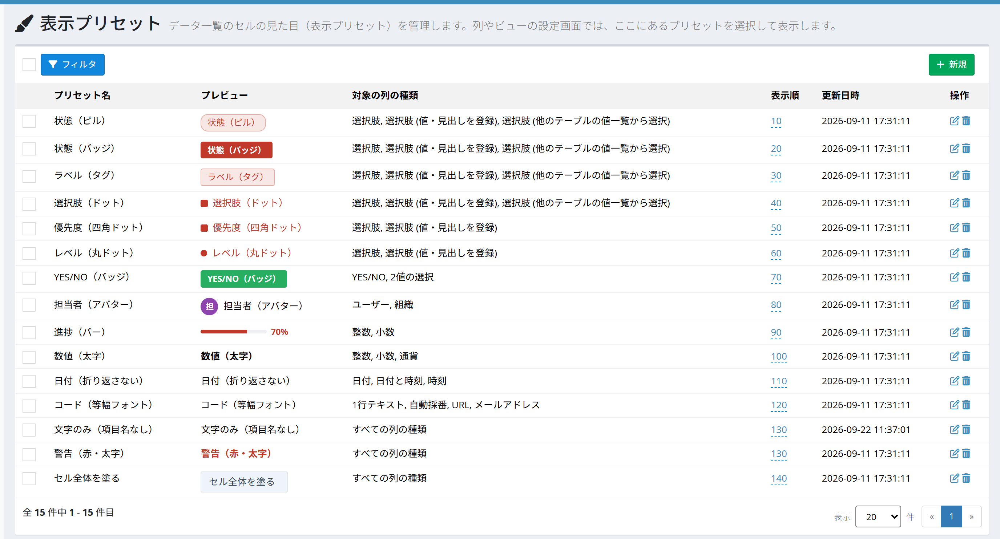
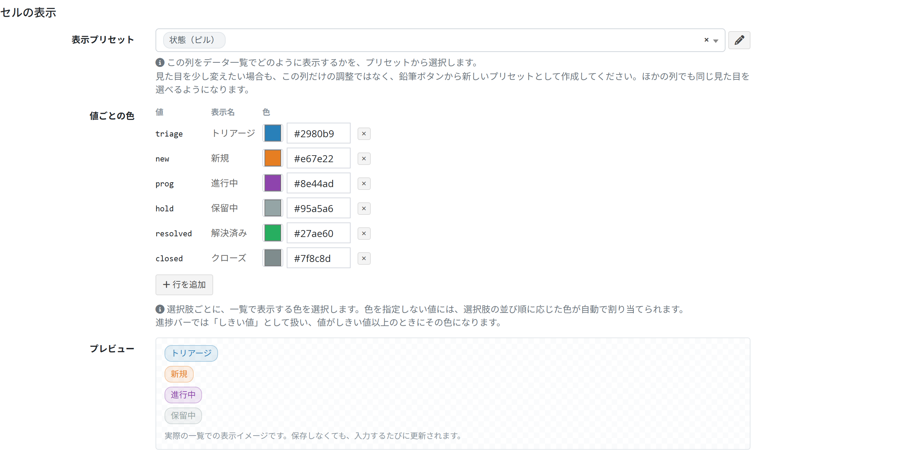
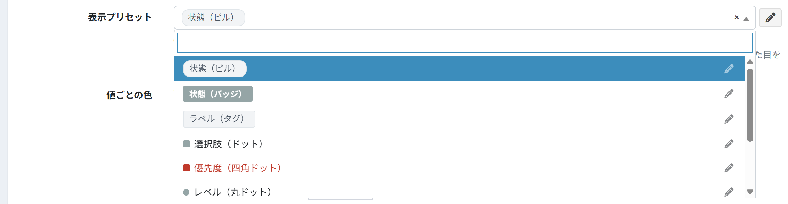
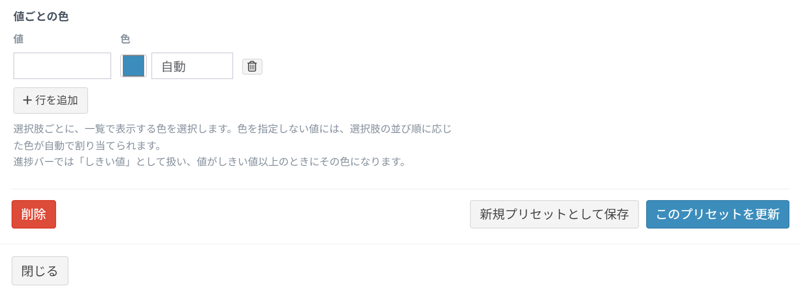

# Darstellungsvorlagen

Mit dieser Funktion speichern Sie das Aussehen einer Zelle (Farbe, Form, Symbol usw.) unter einem Namen und verwenden es in mehreren Spalten und Ansichten wieder. Dasselbe Aussehen gilt nicht nur in der Datenliste, sondern auch auf den Karten der Kanban-Ansicht.

## Was ist eine Darstellungsvorlage

Bisher wurde das Aussehen einer Zelle **für jede Spalte einzeln** eingestellt.  
Deshalb musste dieselbe Einstellung, zum Beispiel „den Zustand als Pille (abgerundet) zeigen“, für jede Tabelle und jede Spalte neu gemacht werden.

Eine Darstellungsvorlage speichert diese Einstellung nur einmal, unter einem Namen.  
In der Spalte oder Ansicht steht nur, „welche Vorlage verwendet wird“. Daraus ergibt sich Folgendes.

- Dasselbe Aussehen können Sie in anderen Spalten und anderen Tabellen verwenden, indem Sie es einfach aus der Liste wählen
- Wenn Sie eine Vorlage ändern, ändert sich die Anzeige aller Spalten, die diese Vorlage gewählt haben, auf einmal

## Wo Vorlagen verwendet werden

Darstellungsvorlagen werden in den folgenden 4 Bildschirmen verwendet.

| Bildschirm | Aufgabe | Nötige Berechtigung |
| --- | --- | --- |
| Darstellungsvorlagen (Bibliotheksbildschirm) | Vorlagen auflisten, neu anlegen, bearbeiten, löschen | Systemadministrator |
| Einstellungen der benutzerdefinierten Spalten > Zellendarstellung | Eine Vorlage als Standardaussehen dieser Spalte wählen | Berechtigung für die Tabelleneinstellungen der Tabelle |
| Einstellungen der benutzerdefinierten Ansicht > Anzeigespalten auswählen | Eine Vorlage als Aussehen nur für diese Ansicht wählen | Berechtigung für die Tabelleneinstellungen der Tabelle |
| Einstellungen der Kanban-Ansicht > Auf der Karte angezeigte Spalten > Stil | Eine Vorlage als Aussehen auf der Karte wählen | Berechtigung für die Tabelleneinstellungen der Tabelle |

※ Vorlagen gehören nicht zu einer Tabelle. Eine Vorlage, die Sie einmal anlegen, können Sie in den Spalten jeder Tabelle wählen.  
※ Eine Vorlage, die in der Ansicht angegeben ist, hat Vorrang vor der Einstellung der Spalte.

## Bibliotheksbildschirm (Liste der Darstellungsvorlagen)

### Seite öffnen

Öffnen Sie im Browser `(Adresse von Exment)/cell_style_preset`.

> ※ Diese URL gilt für die Standardeinstellung ohne „/admin“ (Sites, die mit v7.2.1 oder später neu installiert wurden). Wenn `ADMIN_ROUTE_PREFIX` in der `.env` einen Wert hat (bei Sites, die mit einer früheren Version installiert wurden: „admin“), hängen Sie diesen Wert an die URL der Site an (Beispiel: `http(s)://(URL von Exment)/admin/cell_style_preset`). Einzelheiten finden Sie unter [„admin“ in der URL ändern oder entfernen](/de/additional_prefix).

Damit Sie die Seite jederzeit öffnen können, fügen Sie sie in den Einstellungen für das [Menü](/de/menu) dem Menü hinzu.

1. Öffnen Sie „Administratoreinstellungen“ > „Menü“.
2. Klicken Sie oben rechts auf [Neu].
3. Wählen Sie bei „Menütyp“ den Wert „Systemmenü“ und bei „Menüname“ den Wert „Darstellungsvorlagen“.
4. Wählen Sie das übergeordnete Menü (zum Beispiel „Administratoreinstellungen“) und speichern Sie.

Die Liste zeigt die folgenden Felder.

| Feld | Inhalt |
| --- | --- |
| Name der Vorlage | Der Name, der in den Auswahllisten der Einstellungsbildschirme erscheint |
| Vorschau | So sieht die Anzeige in der wirklichen Datenliste aus |
| Spaltentypen | Die Spaltentypen, bei denen diese Vorlage zur Auswahl steht |
| Anzeigereihenfolge | Die Reihenfolge in den Auswahllisten (je kleiner, desto weiter oben) |
| Aktualisiert am | Zeitpunkt der letzten Aktualisierung |

Schon bei der Installation von Exment sind 15 häufig verwendete Vorlagen gespeichert.

| Name der Vorlage | Wichtigste Spaltentypen |
| --- | --- |
| Status (Pille) | Auswahl (feste Werte) |
| Status (Badge) | Auswahl (feste Werte) |
| Label (Tag) | Auswahl (feste Werte) |
| Auswahl (Punkt) | Auswahl (feste Werte) |
| Priorität (quadratischer Punkt) | Auswahl (feste Werte), Auswahl (Wert und Bezeichnung speichern) |
| Stufe (runder Punkt) | Auswahl (feste Werte), Auswahl (Wert und Bezeichnung speichern) |
| JA/NEIN (Badge) | JA/NEIN, Auswahl mit 2 Werten |
| Zuständige Person (Avatar) | Benutzer, Organisation |
| Fortschritt (Balken) | Ganzzahl, Dezimalzahl |
| Zahl (fett) | Ganzzahl, Dezimalzahl, Währung |
| Datum (ohne Umbruch) | Datum, Datum und Uhrzeit, Uhrzeit |
| Code (Festbreitenschrift) | Einzeiliger Text, Automatische Nummerierung, URL, E-Mail |
| Nur Text (ohne Feldname) | Alle Spaltentypen |
| Warnung (rot, fett) | Alle Spaltentypen |
| Ganze Zelle füllen | Alle Spaltentypen |

Wer Vorlagen bearbeiten und löschen kann, ist wie folgt geregelt.

- Den Bibliotheksbildschirm können nur Systemadministratoren öffnen (Benutzer, die die Systemberechtigung über eine Rollengruppe bekommen haben, können ihn nicht öffnen). Im Bibliotheksbildschirm können alle Vorlagen bearbeitet und gelöscht werden, unabhängig vom Ersteller und einschließlich der von Anfang an gespeicherten Vorlagen.
- Im Bildschirm von „Vorlagen an Ort und Stelle anlegen und bearbeiten (Stift-Schaltfläche)“ können Systemadministratoren alle Vorlagen bearbeiten und löschen. Andere Benutzer können nur die Vorlagen bearbeiten und löschen, die sie selbst angelegt haben. Die anderen Vorlagen sind schreibgeschützt: [Löschen] erscheint nicht, und [Diese Vorlage aktualisieren] kann nicht gedrückt werden. Im Bearbeitungsbildschirm steht „Diese Vorlage kann nicht bearbeitet werden. Um sie mit Änderungen zu verwenden, speichern Sie sie als neue Vorlage.“ Um sie mit Änderungen zu verwenden, nehmen Sie [Als neue Vorlage speichern].

※ Wenn „Rollenverwaltung verwenden“ in den Systemeinstellungen auf NO steht, können alle Benutzer den Bibliotheksbildschirm verwenden.

### Vorlage erstellen oder bearbeiten

Klicken Sie oben rechts in der Liste auf die Schaltfläche [Neu] oder in einer Zeile auf das Bearbeiten-Symbol.

#### Name der Vorlage
Der Name, der in den Auswahllisten der Einstellungsbildschirme erscheint. Pflichtfeld.

#### Anzeigeformat der Zelle
Wählen Sie, in welcher Form der Wert erscheint.

| Auswahl | Anzeige |
| --- | --- |
| Standard | Anzeige wie bisher (ohne Schmuck) |
| Nur Textfarbe | Der Text bekommt nur eine Farbe |
| Tag (kleine Rundung) | Tag mit Rahmen und leicht abgerundeten Ecken |
| Pille (große Rundung) | Tag mit stark abgerundeten Ecken |
| Badge (ausgefüllt) | Badge in kräftiger Farbe mit ausgefülltem Hintergrund |
| Quadratische Markierung + Text | Vor dem Wert steht eine quadratische Farbmarkierung |
| Runde Markierung + Text | Vor dem Wert steht eine runde Farbmarkierung |
| Festbreitenschrift | Anzeige mit gleicher Zeichenbreite (Code, ID usw.) |
| Avatar (Initiale im Kreis) | Der Anfangsbuchstabe erscheint als rundes Symbol (zuständige Person usw.) |
| Fortschrittsbalken (0-100) | Der Wert erscheint als waagerechter Balken |
| Gesamte Zelle füllen | Der ganze Hintergrund der Zelle bekommt eine Farbe |

#### Textfarbe
Die Textfarbe des Werts.  
※ Wenn bei einer Auswahlspalte auch „Farbe je Wert“ nicht angegeben ist, wird automatisch eine Farbe nach der Reihenfolge der Auswahlwerte vergeben.

#### Hintergrundfarbe
Die Hintergrundfarbe für Tag, Pille und ganze Zelle. Ohne Angabe wird sie automatisch aus der Textfarbe gebildet.

#### Rahmenfarbe
Die Rahmenfarbe für Tag, Pille und ganze Zelle. Ohne Angabe wird sie automatisch aus der Textfarbe gebildet.

#### Schriftstärke
Wählen Sie „Normal“, „Halbfett“ oder „Fett“.

#### Symbol
Das Symbol, das vor dem Wert steht. Sie wählen es über die Schaltfläche.  
※ Bei „Avatar“, „Fortschrittsbalken“ und „Gesamte Zelle füllen“ erscheint es nicht.

#### Keinen Zeilenumbruch
Bei YES wird der Text in der Zelle der Liste nicht umbrochen. Verwenden Sie das für Spalten, die mit einem Umbruch schwer lesbar sind, zum Beispiel Datum oder Nummer.

#### Spaltentypen
Bei Spalten der angekreuzten Typen steht diese Vorlage zur Auswahl.  
※ Wenn nichts angekreuzt ist, erscheint sie bei allen Typen.

#### Anzeigereihenfolge
Die Reihenfolge in den Auswahllisten der Einstellungsbildschirme. Je kleiner der Wert, desto weiter oben.

## Einer benutzerdefinierten Spalte eine Vorlage zuweisen

1. Wählen Sie im Menü die Tabelle und öffnen Sie [Tabellen-Detaileinstellungen] > [Spalteneinstellungen].
2. Öffnen Sie den Bearbeitungsbildschirm der Spalte und blättern Sie bis zum Abschnitt „Zellendarstellung“.

3. Wählen Sie in der Auswahl „Darstellungsvorlage“ die Vorlage, die Sie verwenden möchten.  
Die Auswahlmöglichkeiten erscheinen so, wie sie wirklich aussehen.

4. Nach der Auswahl wechselt die „Vorschau“ darunter sofort. Sie können das Ergebnis prüfen, ohne zu speichern.

5. Speichern Sie mit der Schaltfläche [Absenden] unten im Bildschirm.

### Farbe je Wert

Bei Auswahlspalten können Sie mit „Farbe je Wert“ für jeden Auswahlwert eine Farbe angeben.  
Werte ohne Farbe bekommen automatisch eine Farbe nach der Reihenfolge der Auswahlwerte.

※ Beim Fortschrittsbalken gilt die Angabe als „Schwellenwert“: Die Farbe gilt, wenn der Wert den Schwellenwert erreicht oder überschreitet.

## Vorlagen an Ort und Stelle anlegen und bearbeiten (Stift-Schaltfläche)

Mit einem Klick auf die Stift-Schaltfläche rechts neben „Darstellungsvorlage“ bearbeiten Sie Vorlagen, ohne den Einstellungsbildschirm zu verlassen.

Wenn Sie links die Einstellungen ändern, wird die „Vorschau“ rechts sofort aktualisiert.

Unten im Dialog gibt es die folgenden Schaltflächen.

| Schaltfläche | Verhalten |
| --- | --- |
| Als neue Vorlage speichern | Fügt den aktuellen Inhalt als **andere Vorlage** hinzu. Die ursprüngliche Vorlage ändert sich nicht. |
| Diese Vorlage aktualisieren | Überschreibt die gerade geöffnete Vorlage. **Auch die Anzeige anderer Spalten, die diese Vorlage gewählt haben, ändert sich.** |
| Löschen | Löscht die Vorlage. Zum Schutz vor Fehlbedienung wird erst beim zweiten Drücken gelöscht. |
| Schließen | Schließt ohne Speichern. |

> Wenn Sie eine vorhandene Vorlage nur leicht ändern und dann verwenden möchten, nehmen Sie nicht „Diese Vorlage aktualisieren“, sondern **„Als neue Vorlage speichern“**.  
> Beim Aktualisieren ändert sich auch das Aussehen anderer Spalten, die dieselbe Vorlage verwenden.

## Einer Spalte der Ansicht eine Vorlage zuweisen

Manchmal soll dieselbe Tabelle je nach Ansicht anders aussehen.  
Dann geben Sie die Vorlage unter „Anzeigespalten auswählen“ in den Einstellungen der benutzerdefinierten Ansicht an.

In der Spalte „Darstellungsvorlage für Zellen“ wählen Sie für jede Spalte eine Vorlage.  
Mit der Stift-Schaltfläche rechts öffnen Sie denselben Dialog wie in den Spalteneinstellungen.

※ Die hier angegebene Vorlage hat **Vorrang vor den Einstellungen der benutzerdefinierten Spalte.**  
※ Wenn Sie nichts wählen, gelten die Einstellungen der benutzerdefinierten Spalte.

## Häufige Fragen und Hinweise

#### Was passiert mit den Spalten, wenn ich eine Vorlage lösche
Die Spalten, die diese Vorlage gewählt hatten, kehren zur Anzeige „Standard“ ohne Schmuck zurück. Die Daten ändern sich nicht.

#### Die Vorlage erscheint nicht in der Auswahl
Vielleicht ist der Typ der Spalte nicht in „Spaltentypen“ der Vorlage enthalten.  
Öffnen Sie die Vorlage im Bibliotheksbildschirm und prüfen Sie „Spaltentypen“. Wenn sie bei allen Typen erscheinen soll, kreuzen Sie nichts an.

#### Ich habe das Aussehen geändert, und die Anzeige anderer Tabellen hat sich auch geändert
Vorlagen gehören nicht zu einer Tabelle. Sie werden in ganz Exment gemeinsam verwendet.  
Wenn Sie das Aussehen nur für eine Tabelle ändern möchten, legen Sie mit „Als neue Vorlage speichern“ eine andere Vorlage an.

## Verwandte Themen

- [Benutzerdefinierte Spalten](/de/column)
- [Benutzerdefinierte Ansichten](/de/view)
- [Datenliste](/de/data_grid)
- [Kanban-Ansicht](/de/view_kanban)
