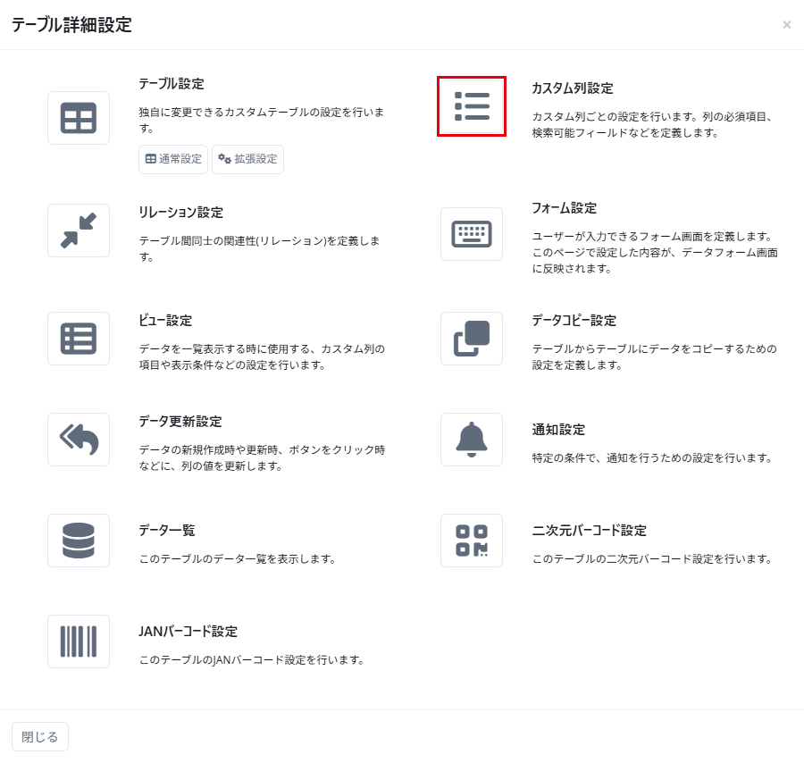
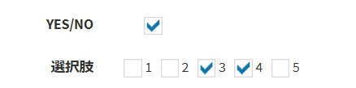
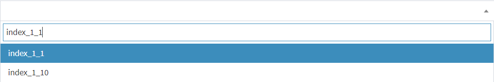

# Verwaltung der benutzerdefinierten Spalten
Auf dieser Seite legen Sie die Spalten einer benutzerdefinierten Tabelle („benutzerdefinierte Spalten“) an, ändern und löschen sie. Spalten sind die einzelnen Angaben der Daten, zum Beispiel „Kundenname“, „Postleitzahl“ und „Adresse“.  

- So legen Sie Spalten an: Lesen Sie unten „Einstellungsbildschirm“ → „Eine Spalte neu hinzufügen“ → „Speichern“.
- Welche Spaltentypen es gibt: Lesen Sie unten „Spaltentyp“.
- Erklärung der einzelnen Felder: Lesen Sie unten „Die Eingabefelder im Einzelnen (gemeinsam)“ und „Die Eingabefelder im Einzelnen (je Spaltentyp)“.  

## Einstellungsbildschirm
- Kreuzen Sie in der Liste der benutzerdefinierten Tabellen genau 1 Tabelle an, die Sie einstellen möchten, und klicken Sie oben rechts auf „Tabellen-Detaileinstellungen“.  

- Oder wählen Sie die Tabelle im Menü und klicken Sie ebenso oben rechts auf „Tabellen-Detaileinstellungen“.  
※Dafür muss die Tabelle vorher im Menü eingerichtet sein.  

- Klicken Sie im erscheinenden Bildschirm der Tabellen-Detaileinstellungen auf das Symbol der benutzerdefinierten Spalten.

- Damit erscheint die Liste der Spalten dieser benutzerdefinierten Tabelle.  

## Eine Spalte neu hinzufügen
- Klicken Sie im Bildschirm „Einstellungen der benutzerdefinierten Spalten“ oben rechts auf die Schaltfläche [Neu].

- Der Bildschirm zum Hinzufügen einer benutzerdefinierten Spalte erscheint. Füllen Sie die nötigen Felder aus.

## Speichern
Wenn Sie die Einstellungen eingegeben haben, klicken Sie auf [Absenden].

## Bearbeiten
Wenn Sie eine Spalte ändern möchten, klicken Sie in ihrer Zeile auf den Link [Bearbeiten].  

## Löschen
Wenn Sie eine Spalte löschen möchten, klicken Sie in ihrer Zeile auf den Link [Löschen].  

**※Spalten, die vom System installiert wurden, lassen sich aber nicht löschen.**

## Die Eingabefelder im Einzelnen (gemeinsam)
- Spaltenname (alphanumerisch): Der Name der Spalte, den das System verwendet. Sie schreiben ihn mit Buchstaben und Ziffern oder mit „-“ und „\_“. Er lässt sich nur 1 Mal festlegen und nicht ändern.  
**※Die folgenden Namen sind nicht möglich.**  
id,suuid,parent_id,parent_type,created_at,updated_at,deleted_at,created_user,updated_user,deleted_user

### Anzeigename der Spalte
Der Name der Spalte, der auf dem Bildschirm angezeigt wird.

## Spaltentyp
Der Typ der Spalte. Der hier gewählte Typ bestimmt die Form des Eingabefeldes beim Anlegen von Daten.

> Die genaue Systemspezifikation je benutzerdefinierter Spalte steht in der [Referenz der benutzerdefinierten Spalten](/de/column_reference).

#### Einzeiliger Text
Einzeiliger Text (Textfeld).  

#### Mehrzeiliger Text
Mehrzeiliger Text (Textbereich).  

#### Texteditor
Die Daten lassen sich mit einem Texteditor eingeben.

#### URL
Ein Feld für die Eingabe einer URL.  

#### E-Mail
Ein Feld für die Eingabe einer E-Mail-Adresse.  

#### Ganzzahl
Ein Feld, in das nur ganze Zahlen eingegeben werden können. Außerdem können beim Anlegen der Daten links und rechts die Schaltflächen [+] und [-] erscheinen, mit denen der Wert per Klick steigt oder sinkt.  

#### Dezimalzahl
Ein Feld, in das nur Dezimalzahlen eingegeben werden können. Wenn „Als Prozent anzeigen“ auf YES steht, werden die Daten mit % angezeigt.  

#### Währung
Ein Feld für die Eingabe von Geldbeträgen. Für die Anzeige wählen Sie aus 4 Formaten (￥, 円, ＄, €).

#### Datum
Ein Feld für das Datum. Beim Anlegen der Daten lässt sich das Datum im Kalender ändern.  

#### Uhrzeit
Ein Feld für die Uhrzeit. Beim Anlegen der Daten lässt sich die Uhrzeit an der Uhr ändern.  

#### Datum und Uhrzeit
Ein Feld für Datum und Uhrzeit. Beim Anlegen der Daten lassen sich Datum und Uhrzeit im Kalender und an der Uhr ändern.  

#### Auswahl (feste Werte)
Ein Auswahlfeld. Eine Auswahlliste, bei der Wert und Bezeichnung gleich sind.  

#### Auswahl (Wert und Bezeichnung speichern)
Ein Auswahlfeld. Eine Auswahlliste, bei der Wert und Bezeichnung verschieden sind.  

#### Auswahl (aus Tabelle)
Ein Auswahlfeld. Sie erstellen eine Auswahl, deren Optionen die Einträge einer anderen Tabelle sind.  

#### JA/NEIN
Sie erstellen einen Schalter zwischen „YES“ und „NO“. Beim Anlegen der Daten wird bei YES 1 und bei NO 0 gespeichert.  

#### Auswahl mit 2 Werten
Sie erstellen einen Schalter zwischen 2 Werten. Auch die Werte, die beim Anlegen der Daten gespeichert werden, lassen sich ändern.  

#### Automatische Nummerierung
Beim Anlegen der Daten wird ein Wert wie eine UUID oder eine zufällige Zeichenfolge erzeugt.  

#### Bild
Ein Feld zum Hochladen von Bildern.  
※In der Datenliste und im Detailbildschirm der Daten werden Bilder mit Link angezeigt. Der Link (a-Tag) hat die class „image-link“. Deshalb können Sie mit einem [Plugin (Skript)](/de/plugin_quickstart_script) oder einem [Plugin (Stil)](/de/plugin_quickstart_style) Verhalten und Aussehen gezielt nur für die Bildlinks ändern.

#### Datei
Ein Feld zum Hochladen von Dateien.  

#### Benutzer
Eine Auswahl, mit der Sie Benutzer des Systems wählen.  

#### Organisation
Eine Auswahl, mit der Sie Organisationen des Systems wählen.  

## Die Eingabefelder im Einzelnen (gemeinsam)
- ##### Spaltenname (alphanumerisch)
Der Name der Spalte, den das System verwendet. Sie schreiben ihn mit Buchstaben und Ziffern oder mit „-“ und „_“. Er lässt sich nur 1 Mal festlegen und nicht ändern.  
**※Die folgenden Namen sind nicht möglich.**  
id,suuid,parent_id,parent_type,created_at,updated_at,deleted_at,created_user,updated_user,deleted_user

- ##### Anzeigename der Spalte
Der Name der Spalte, der auf dem Bildschirm angezeigt wird.

- ##### Spaltentyp
Aus der [Liste der Spaltentypen](/de/column?id=Spaltentyp) wählen Sie die Spalte, die für das Anlegen der Daten verwendet wird.

- ##### Erforderlich
Sie wählen, ob diese Spalte ein Pflichtfeld ist. Bei YES ist sie im Eingabebildschirm der Daten ein Pflichtfeld, und ohne Eingabe erscheint ein Fehler.  

- ##### Suchindex
Siehe „[Suchindex](/de/column?id=Suchindex-1)“ unten.  

- ##### In Freitextsuche einbeziehen
Erscheint, wenn der Suchindex auf YES steht.  
Siehe „[In Freitextsuche einbeziehen](/de/column?id=フリーワード検索対象詳細)“ unten.  

- ##### Eindeutig
Bei YES lässt sich beim Anlegen von Daten kein Wert speichern, der einem Wert anderer Daten gleicht. Wenn Sie Duplikate über eine Kombination mehrerer Spalten verhindern möchten, lesen Sie die Einstellungen für zusammengesetzte eindeutige Schlüssel unter [Einstellungen der benutzerdefinierten Tabelle](/de/table).  

- ##### Nur einmal eingeben
Bei YES lässt sich die Spalte nur beim Neuanlegen ausfüllen. Beim Bearbeiten der Daten wird sie nur angezeigt.

- ##### Standardwert
Der Wert, der von Anfang an im Eingabefeld steht.  

- ##### Platzhalter
Die Zeichenfolge, die in heller Schrift erscheint, solange das Eingabefeld leer ist (Platzhalter).  

- ##### Hilfe
Der Inhalt, der als Erklärung unter dem Eingabefeld erscheint.

- ##### Anzeigereihenfolge
Sie geben die Reihenfolge in der Liste der benutzerdefinierten Spalten an.

- ##### Zum Standardformular / zur Standardansicht hinzufügen
Bei YES wird die Spalte beim Anlegen auch dem Standardformular und der Standardansicht hinzugefügt. Das lässt sich nur beim Anlegen einer Spalte einstellen. Spätere Änderungen nehmen Sie im [Bildschirm der Formulare](/de/form) und im [Bildschirm der Ansichten](/de/view) vor.

- ##### Zu den Überschriftenspalten hinzufügen
Sie können die neue benutzerdefinierte Spalte den Überschriftenspalten hinzufügen.  
※Diese Einstellung erscheint nur beim Anlegen einer benutzerdefinierten Spalte. Spätere Änderungen nehmen Sie in den Einstellungen der Überschriftenspalten unter [Einstellungen der benutzerdefinierten Tabelle](/de/table) vor.

- ##### Zellendarstellung
Sie legen fest, mit welchem Aussehen (Farbe, Tag, Badge usw.) der Wert dieser Spalte in der Datenliste erscheint.  
Sie wählen unter „Darstellungsvorlage“. Einzelheiten stehen unter [Darstellungsvorlagen](/de/cell_style_preset).

## Die Eingabefelder im Einzelnen (je Spaltentyp)
- ##### Maximale Länge (Einzeiliger Text, Mehrzeiliger Text)
Die Obergrenze für die Zahl der Zeichen. Wird sie überschritten, gibt es einen Fehler.  

- ##### Zulässige Zeichen (Einzeiliger Text)
Es lassen sich nur Zeichen der angekreuzten Arten eingeben.
Wenn nichts angekreuzt ist, lassen sich Zeichen aller Arten eingeben.

- ##### Eingabevorschläge (Einzeiliger Text)
Aus den Werten, die in derselben benutzerdefinierten Spalte schon gespeichert sind, erscheinen die zur Eingabe passenden als Vorschläge.

- ##### Regulärer Ausdruck (Einzeiliger Text)
Die Eingabe lässt sich mit einem regulären Ausdruck prüfen (einer Schreibweise für Regeln zur Zeichenfolge). Einzelheiten stehen unter [Regulärer Ausdruck](/de/column?id=Regulärer-Ausdruck).

- ##### Mindestwert (Ganzzahl, Dezimalzahl)
Der kleinste Wert, der eingegeben werden kann. Wird ein kleinerer Wert gesendet, gibt es einen Fehler. Bleibt das Feld leer, wird der Mindestwert nicht geprüft.  

- ##### Höchstwert (Ganzzahl, Dezimalzahl)
Der größte Wert, der eingegeben werden kann. Wird ein größerer Wert gesendet, gibt es einen Fehler. Bleibt das Feld leer, wird der Höchstwert nicht geprüft.  

- ##### Berechnungsformel (Ganzzahl, Dezimalzahl, Währung)
Einzelheiten stehen unten unter [Berechnungsformel](/de/column?id=Berechnungsformel).

- ##### Auswahloptionen (Auswahl (feste Werte), Auswahl (Wert und Bezeichnung speichern))
Sie tragen die Optionen ein, die im Eingabefeld zur Wahl stehen. Sie tragen je 1 pro Zeile ein, getrennt durch Zeilenumbrüche.  
Beim Spaltentyp „Auswahl (Wert und Bezeichnung speichern)“ trennen Sie mit einem Komma und schreiben in die 1. Spalte den Wert und in die 2. Spalte die Bezeichnung.  

↓  
  
Wenn Sie die Daten im Formular speichern, wird der Wert der 1. Spalte in der Datenbank gespeichert.  

- #####  Als Optionsfelder / Kontrollkästchen anzeigen (JA/NEIN, Auswahl (feste Werte), Auswahl (Wert und Bezeichnung speichern))
Bei Spalten der Typen Auswahl (feste Werte) und Auswahl (Wert und Bezeichnung speichern) mit Mehrfachauswahl NO lässt sich die Auswahl im Formular als Optionsfelder anzeigen.
 

Bei Spalten des Typs JA/NEIN oder bei Spalten der Typen Auswahl (feste Werte) und Auswahl (Wert und Bezeichnung speichern) mit Mehrfachauswahl YES lässt sich die Auswahl im Formular als Kontrollkästchen anzeigen.

- ##### Freie Eingabe zulassen (Auswahl (feste Werte))
Bei YES lassen sich auch Optionen frei eingeben und speichern, die nicht in den Spalteneinstellungen eingetragen sind.  

>Wenn [Als Optionsfelder / Kontrollkästchen anzeigen](/de/column?id=radio_buttom) auf YES steht, ist diese Einstellung nicht möglich.

- ##### Art des Anfangswerts (Datum, Uhrzeit, Datum und Uhrzeit, Benutzer)
Sie können die Art des Anfangswerts beim Neuanlegen von Daten festlegen.  
• Bei Spalten der Typen Datum, Uhrzeit sowie Datum und Uhrzeit lässt sich als Anfangswert [Festgelegtes Datum und Uhrzeit] oder [der Zeitpunkt der Dateneingabe] einstellen.  
• Bei Benutzerspalten lässt sich als Anfangswert [ein angegebener Benutzer] oder [Login-Benutzer] einstellen.

- ##### Zieltabelle (Auswahl (aus Tabelle))
Sie legen die Tabelle fest, deren Einträge als Optionen erscheinen.  

>Den Text, der in der Liste als Option erscheint, ändern Sie in den Einstellungen der Überschriftenspalten unter [Einstellungen der benutzerdefinierten Tabelle](/de/table).

- ##### Auswahloptionen bei Bedarf suchen (Auswahl (aus Tabelle), Benutzer, Organisation)
Normalerweise zeigt die Auswahl im Bearbeitungsbildschirm der Daten beim Laden des Bildschirms alle Optionen als Liste.  

Bei YES werden die Optionen zuerst nicht geladen. Die Daten werden mit der Eingabe des Benutzers gesucht, und die Optionen werden so eingegrenzt.  

Wenn Sie eine Zeichenfolge in das Eingabefeld eingeben, sucht der Server die Daten und zeigt das Ergebnis als Optionen.

> Unabhängig von dieser Einstellung wird bei insgesamt 100 oder mehr Daten immer eingegrenzt, um die Leistung zu verbessern.  
Diese Obergrenze lässt sich mit einem [Einstellungswert](/de/config) ändern.  

- ##### Art der Nummerierung (Automatische Nummerierung)
Sie wählen die Art, nach der beim Anlegen der Daten nummeriert wird.
- Format  
Die Nummer wird in dem Format gespeichert, das der Benutzer angegeben hat.
- Zufällig (25 Zeichen)    
Gespeichert wird eine zufällige Zeichenfolge aus 5 × 5 = 25 Zeichen (Lizenzcode).
- Zufällig (UUID)  
Gespeichert wird eine zufällige Zeichenfolge mit insgesamt 32 Stellen.

- ##### Stellenanzahl (Automatische Nummerierung)
Die Zahl der Stellen, die bei der automatischen Nummerierung als Daten gespeichert werden. Fehlende Stellen werden mit 0 aufgefüllt.  

- ##### Auch Benutzer/Organisationen ohne Berechtigung anzeigen (Benutzer, Organisation)
Sie legen fest, ob nur Benutzer und Organisationen mit Zugriffsberechtigung auf die Tabelle erscheinen oder alle Benutzer und Organisationen.

- ##### Schaltfläche „Mir zuweisen“ anzeigen (Benutzer)
Bei YES erscheint im Bildschirm zum Anlegen und Bearbeiten der Daten neben dieser Spalte die Schaltfläche [Mir zuweisen]. Ein Klick wählt den angemeldeten Benutzer.  
※Wenn „Mehrfachauswahl zulassen“ auf YES steht, kommt der angemeldete Benutzer zu den schon gewählten Benutzern dazu.

- ##### Aus der Zwischenablage eingefügte Bilder annehmen (Bild, Datei)
Bei YES wird im Bildschirm zum Anlegen und Bearbeiten der Daten ein mit Ctrl+V eingefügtes Bild (Screenshot usw.) als Datei dieser Spalte hinzugefügt. Der Dateiname ist „paste-(JahrMonatTag)-(StundeMinuteSekunde)-(laufende Nummer)“.  
※Wenn „Mehrfachauswahl zulassen“ auf YES steht, kommt das Bild zu den schon gewählten Dateien dazu. Bei NO ersetzt das eingefügte Bild die Datei.  
※Beim Einfügen in einen Texteditor kommt das Bild wie bisher in den Text. Und wenn Sie Text in ein Textfeld einfügen, wird nichts als Datei hinzugefügt.  
※Wenn es im Bildschirm mehrere Spalten gibt, bei denen diese Einstellung auf YES steht, wird das Bild der ersten Spalte hinzugefügt.

- ##### Mehrfachauswahl zulassen
Wählen Sie YES, wenn bei Bildern und Dateien oder bei Feldern der Auswahltypen mehrere Einträge gewählt werden können sollen.  

## Regeln für das Format der automatischen Nummerierung
Wenn der Spaltentyp „Automatische Nummerierung“ und die Art der Nummerierung (Automatische Nummerierung) „Format“ ist, werden Nummern automatisch nach einer Regel vergeben, die Sie selbst festlegen.  

Die einstellbaren Parametervariablen stehen auf der folgenden Seite.  
[Parametervariablen](/de/params)

## Suchindex
Ein „Suchindex“ wird vorab in der Datenbank eingerichtet, damit die Suche in den Daten schneller wird. Ein „Index“ ist ein Verzeichnis zum Nachschlagen.  
In Exment lassen sich einige Funktionen nur mit Spalten nutzen, bei denen der Suchindex auf YES steht.
    

Bei YES werden die folgenden Funktionen wirksam.  
- Die Spalte erscheint in der [benutzerdefinierten Ansicht](/de/view) unter „Zielspalte“ der Einstellung „Filter der Ansicht“  
    

- Die Spalte erscheint in der [benutzerdefinierten Ansicht](/de/view) unter „Zielspalte“ der Einstellung „Daten sortieren“  
    

- Die Spalte erscheint in der [Datenliste](/de/data_grid) bei den Feldern der Einstellung „Filter“  
    

- In der [Datenliste](/de/data_grid) erscheint das Symbol zum „Sortieren“
    

- Wenn ein Benutzer ein Wort in die Suchleiste oben auf der Seite eingibt, wird die Spalte bei der Datensuche durchsucht. Wählen Sie YES bei Spalten, nach denen im Suchbildschirm gesucht werden soll, zum Beispiel bei Codes und Namen.  

- **In Freitextsuche einbeziehen** lässt sich einstellen.  
Bei YES wird die Spalte durchsucht, wenn Sie eine Zeichenfolge in die Suchleiste eingeben und suchen.

※Wenn eine Tabelle sehr viele „Suchindizes“ hat, kann das Anlegen und Aktualisieren von Daten langsamer werden.  
Für eine Tabelle werden bis zu 10 „Suchindizes“ empfohlen. Möglich sind höchstens 20.  
※Die Obergrenze der Suchindizes lässt sich mit einem [Einstellungswert](/de/config) ändern.

## In der Bezeichnung verwenden
> Diese Einstellung wurde in v1.3.0 in die [erweiterten Einstellungen der benutzerdefinierten Tabelle](/de/table) verlegt.

## Regulärer Ausdruck
> Diese Einstellung erscheint nur, wenn der [Expertenmodus](/de/additional_expert) aktiviert ist.

Beim Spaltentyp „Einzeiliger Text“ lässt sich die Eingabe mit einem regulären Ausdruck prüfen.  

  

#### Beispiele für reguläre Ausdrücke
~~~
# Telefonnummer  
^0\d{2,3}-\d{1,4}-\d{4}$

# Postleitzahl  
^\d{3}-\d{4}$

# Nur Hiragana
^[ぁ-ん]+$

# Nur Katakana
^[ァ-ヴ]+$
~~~

#### Sonstiges
- Wenn ein regulärer Ausdruck eingestellt ist, sind die „Zulässigen Zeichen“ unwirksam.  
- Für die Prüfung des regulären Ausdrucks wird eine PHP-Funktion verwendet. Wenn Sie Beispiele für reguläre Ausdrücke suchen, suchen Sie nach regulären Ausdrücken für PHP.  
- Das „/“ am Anfang und am Ende und das „u“ am Ende sind nicht nötig.  
- Zum Inhalt regulärer Ausdrücke nehmen wir keine Anfragen an. Wir bitten um Ihr Verständnis.

## Berechnungsformel
Bei den Spaltentypen „Ganzzahl“, „Dezimalzahl“ und „Währung“ lässt sich eine Berechnungsformel einstellen.  
Wenn Sie im Eingabebildschirm der Daten die Felder ausfüllen, wird automatisch mit der eingestellten Formel gerechnet.  

### Einstellung
- Bei den Spaltentypen „Ganzzahl“, „Dezimalzahl“ und „Währung“ erscheint das Feld „Berechnungsformel“. Klicken Sie darauf.  
    

- Der Dialog für die Berechnungsformel erscheint.  
  

- Geben Sie die Formel ein. Sie geben sie mit den Schaltflächen der rechten Spalte ein oder von Hand.
※Die möglichen Variablen stehen weiter unten.
  

- Wenn die Eingabe fertig ist, klicken Sie auf die Schaltfläche „Formel prüfen“ und bestätigen so die Eingabe.
  

- ※Wenn die eingegebene Formel einen Fehler hat, erscheint ein Fehler, und sie lässt sich nicht einstellen.
  

- Wenn Sie nach der Eingabe einer richtigen Formel auf die Schaltfläche zum Festlegen klicken, schließt sich der Dialog, und die Formel ist eingestellt.
  

- Danach wird die Formel im Eingabebildschirm der Daten ausgeführt. (Im Beispiel unten ist für Spalte 3 „Spalte 1 × Spalte 2“ eingestellt)
  

### Nutzbare Formeln und Variablen

#### Normale Operatoren
- +, -, *, /  
※Geben Sie sie in Zeichen halber Breite ein. Beachten Sie: Die Multiplikation ist nicht "×" und die Division nicht "÷".

- Klammern ()

#### Variablen
※Wir empfehlen, Variablen mit den Schaltflächen der rechten Spalte im Dialog „Berechnungsformel“ einzufügen.

- Der Wert einer anderen Spalte
- Der Spaltenwert der referenzierten Tabelle
- Der Spaltenwert der übergeordneten Tabelle
- Die Summe einer Spalte der untergeordneten Tabelle
- Die Anzahl der Einträge der untergeordneten Tabelle

| Element | Beispiel | Erklärung |
| ---- | ---- | ---- |
| ${value:(Spaltenname)} | ${value:mitsumori_zeigaku} | Ein anderer Wert derselben Tabelle wird eingesetzt. (Beispiel: Wenn Sie in der Tabelle der Angebotspositionen den Angebotsbetrag ${value:mitsumori_zeigaku} schreiben, wird der Wert eingesetzt, der im Feld „Angebotsbetrag“ steht)  |
| ${select_table:(Spaltenname).(Spaltenname der referenzierten Tabelle)} | ${select_table:client.client_shikiri} | Bei Spalten derselben Tabelle mit dem Spaltentyp „Auswahl (aus Tabelle)“, „Benutzer“ oder „Organisation“ wird der Wert der referenzierten Spalte eingesetzt. (Beispiel: Die Tabelle „Vertragsinformationen (contract)“ hat die Spalte „Kunde (client)“, die auf die Tabelle „Kundeninformationen (client)“ verweist. Mit ${select_table:client.client_shikiri} wird der Wert eingesetzt, der im Händlerpreis des Kunden (client_shikiri) der Tabelle „Kundeninformationen (client)“ steht)  |
| ${parent:(Spaltenname)} | ${parent:mitsumori_value} | Ein Wert der übergeordneten Tabelle wird eingesetzt. (Beispiel: Die Tabelle der Angebote und die Tabelle der Angebotspositionen haben eine 1:n-Relation. Wenn Sie für eine Spalte der Tabelle der Angebotspositionen den Angebotsbetrag der übergeordneten Tabelle ${parent:mitsumori_value} schreiben, wird der Wert der Spalte „Angebotsbetrag“ eingesetzt, der in den übergeordneten Daten steht)  |
| ${sum:(Name der untergeordneten Tabelle).(Spaltenname der untergeordneten Tabelle)} | ${sum:mitsumori_detail.mitsumori_zeigaku} | Bei einer 1:n-Relation und einem Formular, in dem über- und untergeordnete Daten zugleich eingegeben werden, wird die Summe der Werte der angegebenen Spalte der untergeordneten Tabelle eingesetzt. (Beispiel: Die Tabelle der Angebote und die Tabelle der Angebotspositionen haben eine 1:n-Relation. Wenn Sie für eine Spalte der Tabelle der Angebote den Positionsbetrag der untergeordneten Tabelle ${sum:mitsumori_detail:mitsumori_zeigaku} schreiben, wird die Summe der Werte „Angebotsbetrag“ aller untergeordneten Daten eingesetzt)  |
| ${count:(Name der untergeordneten Tabelle)} | ${count:mitsumori_detail} | Bei einer 1:n-Relation und einem Formular, in dem über- und untergeordnete Daten zugleich eingegeben werden, wird die Anzahl der Einträge der untergeordneten Tabelle eingesetzt. (Beispiel: Wenn die Tabelle der Angebote und die Tabelle der Angebotspositionen eine 1:n-Relation haben, wird die Anzahl der Einträge der untergeordneten Tabelle eingesetzt)  |

### Bei einer zirkulären Formel
Mit der folgenden Einstellung endet die Berechnung nie.    

- Spalte calc1: Berechnungsformel „${value:calc2} + 2“
- Spalte calc2: Berechnungsformel „${value:calc1} + 2“

„Den Wert der Spalte calc1 eingeben“ → „In die Spalte calc2 den Wert von calc1 + 2 setzen“ → „In die Spalte calc1 den Wert von calc2 + 2 setzen“ → „In die Spalte calc2 den Wert von calc1 + 2 setzen“ ... Die Berechnung wird nicht fertig.  

Wenn eine solche Formel eingestellt ist und Sie im Eingabebildschirm der Daten einen Wert eingeben, erscheint die folgende Warnung.  
Prüfen Sie dann die Einstellung der Formeln.
  

### Bei einer Division durch 0
Je nach Formel kann eine Division durch 0 auftreten.  
Dann bleibt das Ergebnisfeld leer.

### Sonstiges
Die Logik der Berechnungsformeln gilt für die Dateneingabe am Bildschirm.  
Für das Anlegen von Daten über Funktionen wie API und Plugins gilt sie derzeit nicht. Wir bitten um Ihr Verständnis.
