# Dashboard
Das Dashboard ist die Seite, die erscheint, wenn Sie sich bei Exment anmelden oder auf „HOME“ bzw. auf den Namen der Website oben links klicken.  
Sie können Datenlisten, Diagramme, Kalender usw. frei anordnen und so die Informationen, die Sie in Exment verwalten, auf einen Blick sehen.

Diese Seite hat folgenden Inhalt.

| Was Sie tun möchten | Wo es steht |
|---|---|
| Ein Dashboard erstellen | Dashboard neu erstellen, Einstellpunkte des Dashboards |
| Listen, Diagramme usw. auf dem Dashboard ablegen | Anzuzeigende Elemente wählen |
| Festlegen, was auf der horizontalen und vertikalen Achse eines Diagramms steht | Einstellungen des Diagramms im Einzelnen |
| Anderen Benutzern und Organisationen zeigen | Dashboard teilen |
| Auf der Seite filtern, das Diagramm wechseln und sortieren | Dashboard bedienen |
  
### Beispiel für ein Dashboard
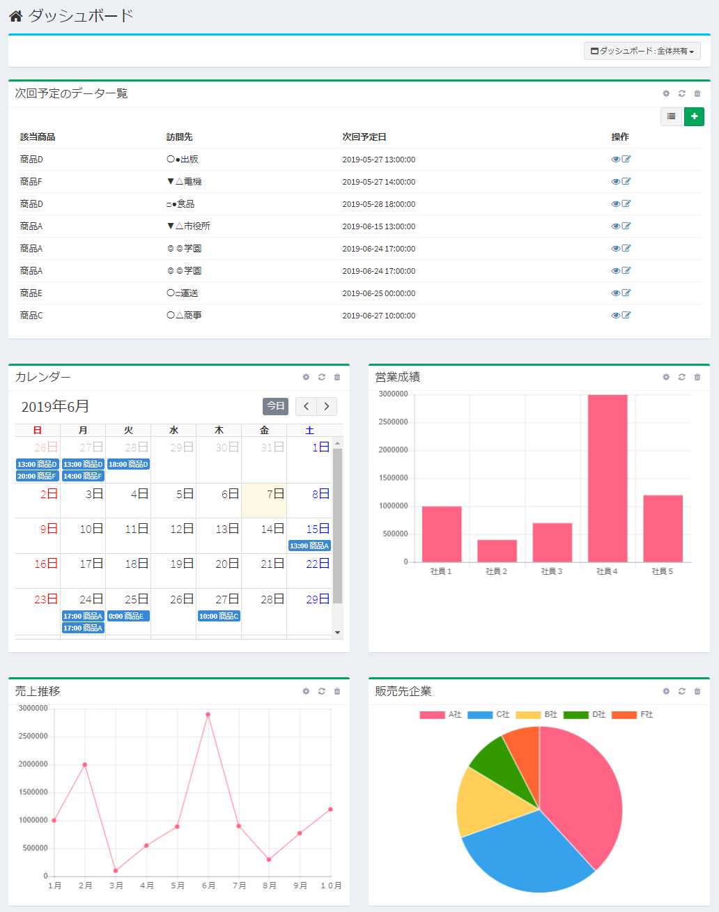

## Dashboard neu erstellen
1. Klicken Sie oben rechts auf der Dashboard-Seite auf „Dashboard erstellen“.
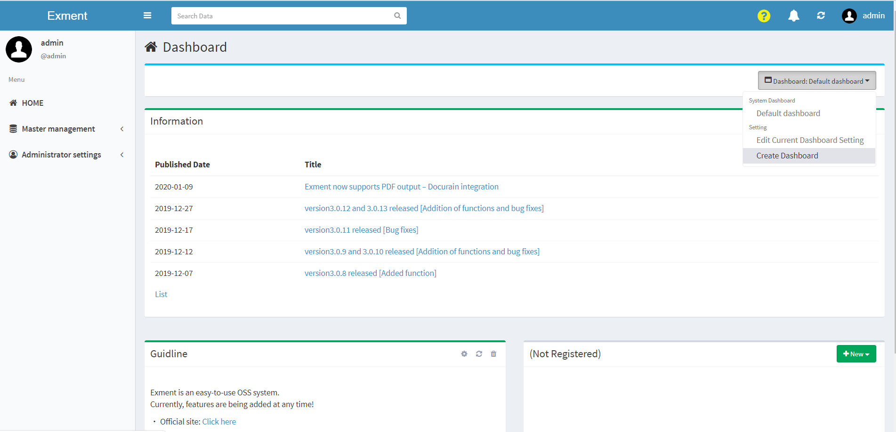

2. Stellen Sie die nötigen Punkte ein. Die Bedeutung der Punkte finden Sie unten unter „Einstellpunkte des Dashboards“.  
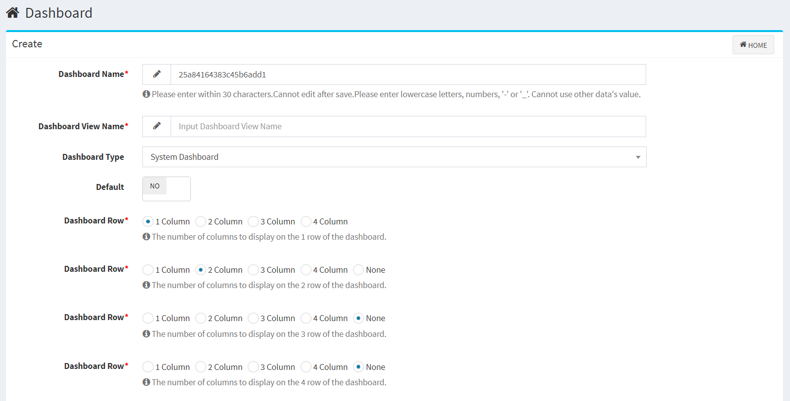

## Einstellpunkte des Dashboards
#### Dashboard-Name (alphanumerisch)
Der Name des Dashboards.  
Er lässt sich nach dem Speichern nicht mehr ändern.

#### Anzeigename des Dashboards
Der Name, der auf der Seite erscheint, wenn Sie ein Dashboard wählen.  
Auch Japanisch ist möglich. Er lässt sich auch nach dem Speichern ändern.

#### Dashboard-Typ
Wählen Sie „System-Dashboard“ oder „Benutzer-Dashboard“.  

- „System-Dashboard“  
Nur der Systemadministrator kann es einstellen. Alle Benutzer können dieses Dashboard verwenden.  

- „Benutzer-Dashboard“  
Auch andere als der Systemadministrator können es einstellen. Nur der Benutzer, der es erstellt hat, kann dieses Dashboard verwenden.    

※ Ein „System-Dashboard“ lässt sich später nicht in ein „Benutzer-Dashboard“ ändern.  
**Ein „Benutzer-Dashboard“, das ein Systemadministrator erstellt hat,** lässt sich später in ein „System-Dashboard“ ändern.  
※ Wenn [Benutzer-Dashboard deaktivieren](/de/config) eingestellt ist, können allgemeine Benutzer keine Dashboards mehr erstellen.

#### Standard
Wählen Sie „YES“ oder „NO“.  
Wenn es mehrere Dashboards gibt, erscheint beim Öffnen des Dashboards zuerst das Dashboard mit „YES“.  
※ Auch ein Dashboard mit „NO“ können Sie anzeigen, indem Sie es in der Liste wählen.  
※ Nur bei 1 Dashboard kann „Standard“ auf „YES“ stehen.  
Wenn Sie bei 2 oder mehr Dashboards „YES“ wählen, werden alle außer dem zuletzt auf „YES“ gestellten Dashboard auf „NO“ geändert.

#### Anzahl der Spalten wählen
Wählen Sie die Anzahl der Spalten, die jede Zeile des Dashboards zeigt.  
In 1 Zeile sind höchstens 4 Spalten möglich.  
※ Mit mehr Spalten wird die Fläche pro Element kleiner.  

#### Maximale Höhe von Dashboard-Zeile (n) (px)
Die maximale Höhe der Elemente dieser Zeile in Pixeln. Sie lässt sich pro Zeile einstellen.  
Wenn der Inhalt eines Elements höher ist, wird innerhalb des Elements gescrollt.  
Geben Sie eine ganze Zahl von 150 bis 3000 ein. Ohne Eingabe sind es 400px.

### Beispiel mit 4 Spalten in 1 Zeile
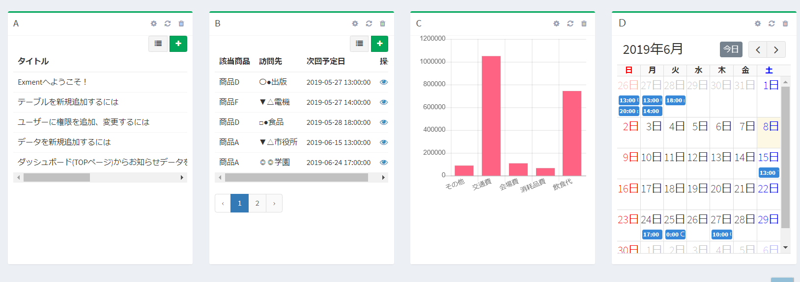  

## Filterleiste des Dashboards einstellen
Oben auf dem Dashboard können Sie eine „Filterleiste“ anzeigen, mit der alle Diagramme zusammen gefiltert werden.  
Sie müssen nicht für jede Bedingung wie Region, Produkt oder Verantwortlicher eine Ansicht anlegen. Auf 1 Dashboard wechseln Sie die Bedingungen und sehen die Auswertung.  
※ Die Bedienung der Filterleiste finden Sie unter [Mit der Filterleiste filtern](/de/dashboard?id=Mit-der-Filterleiste-filtern).

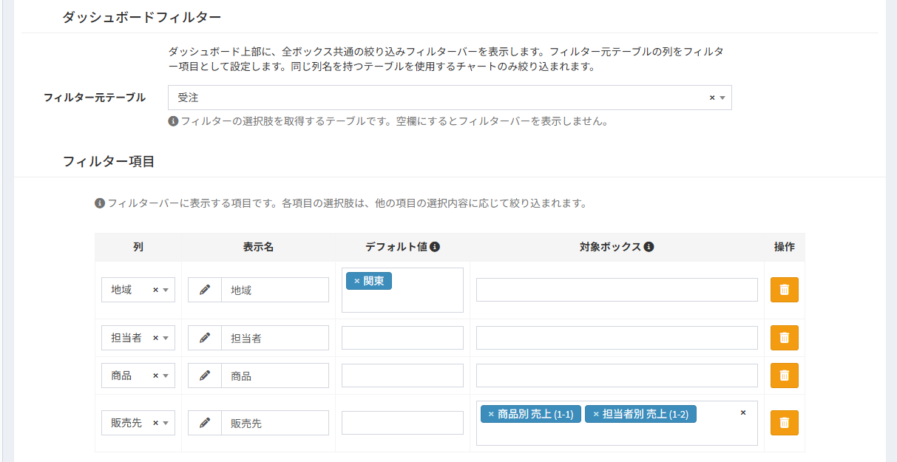

#### Quelltabelle des Filters
Wählen Sie die Tabelle, aus der die Auswahlwerte der Filter geholt werden.  
Ist das Feld leer, erscheint keine Filterleiste.

#### Filterelemente
Stellen Sie die Elemente der Filterleiste ein, 1 pro Zeile. Mit „Neu“ fügen Sie Zeilen hinzu.

| Einstellung | Inhalt |
|---|---|
| Spalte | Wählen Sie aus den Spalten der Quelltabelle des Filters die Spalte, nach der gefiltert wird. |
| Anzeigename | Der Name, der in der Filterleiste erscheint. Ist das Feld leer, erscheint der Spaltenname. |
| Standardwert | Der Wert, der beim Öffnen des Dashboards von Anfang an gewählt ist. Bei Elementen mit Auswahl aus einer Liste geben Sie die gespeicherten Werte durch Kommas getrennt an, bei Elementen mit einem Bereich „von“ – „bis“ in der Form „Minimum~Maximum“ (auch nur eine Seite ist möglich). Ist das Feld leer, ist nichts gewählt. |
| Zielelemente | Wählen Sie die Diagramme, die dieser Filter filtert. Ist das Feld leer, werden alle Diagramme mit demselben Spaltennamen gefiltert. Zur Auswahl stehen nur gespeicherte Diagramme. Wählen Sie sie deshalb auf der Einstellseite, nachdem Sie die Diagramme hinzugefügt haben. |

> Gefiltert werden nur Diagramme, die eine **Tabelle mit einer Spalte verwenden, die denselben Spaltennamen wie das Filterelement hat**.  
> Bei Diagrammen, auf die das nicht zutrifft, steht „Nicht von Filtern betroffen“.

> Damit auch Tabellen mit vielen Daten flüssig zu bedienen sind, empfehlen wir, bei den Spalten der Filterelemente in den [Einstellungen der benutzerdefinierten Spalten](/de/column) den „Suchindex“ einzuschalten.

> Wenn Sie ein Dashboard über eine [Vorlage](/de/template) exportieren und importieren, werden auch die Einstellungen der Filterleiste (einschließlich der Zielelemente) unverändert übernommen.

# Anzuzeigende Elemente wählen
Wählen Sie über [Neu] oben rechts in jeder Spalte des erstellten Dashboards das Element, das angezeigt wird. Es gibt 4 Arten von Elementen: „Datenliste“, „System“, „Diagramm“ und „Kalender“.  
※ Wenn ein [Plugin (Dashboard)](/de/plugin_quickstart_dashboard) installiert ist, ist auch „Plugin“ wählbar.

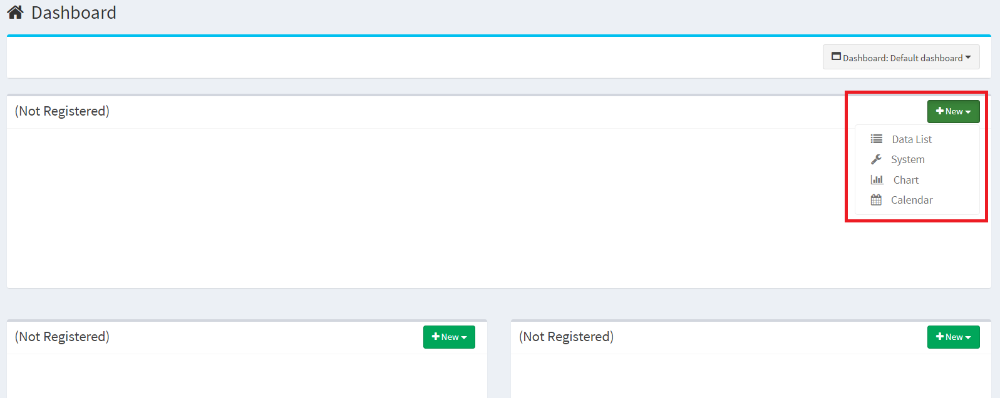  

Danach stellen Sie für jedes Element ein, was es anzeigt.

## Datenliste
Sie wählen eine Tabelle und eine Ansicht. Die Liste dieser Daten erscheint auf dem Dashboard.

### Beispiel für eine Datenliste
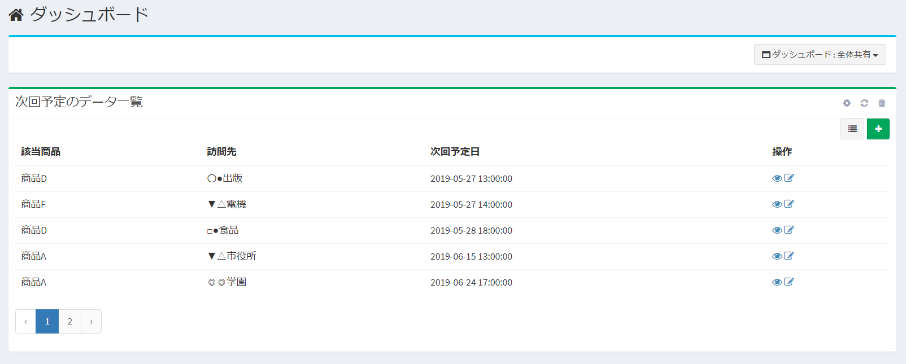

### Einstellpunkte der Datenliste
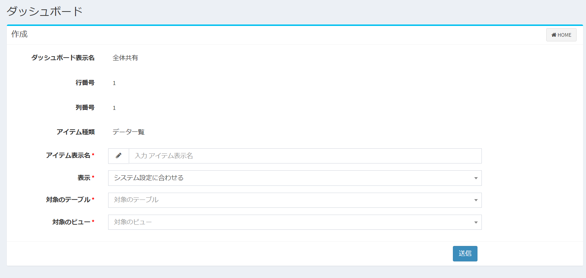
#### Anzeigename des Elements
Geben Sie den Namen des Elements ein, der auf der Seite erscheint.

#### Anzeige
Wählen Sie, wie viele Daten auf einmal angezeigt werden.

#### Zieltabelle
Wählen Sie aus den Tabellen, die in den [Einstellungen der benutzerdefinierten Tabellen](/de/table) erstellt wurden, die Tabelle, die angezeigt wird.

#### Zielansicht
Wählen Sie aus den [Ansichten](/de/view) der gewählten Zieltabelle die Ansicht, die angezeigt wird.  
※ Kalenderansicht, Kanban-Ansicht, Gantt-Diagramm-Ansicht und Bedingungsansicht sind nicht wählbar. Bei einem System-Dashboard sind nur Systemansichten wählbar.  

## System
Auf dem Dashboard erscheint eine Anzeige zum System.  
※ Zurzeit sind „Leitfaden“, „Exment-Neuigkeiten“, „Editor“, „HTML“, „Benachrichtigungsliste“ und „2D-/JAN-Barcode“ möglich.

### Einstellpunkte des Systems
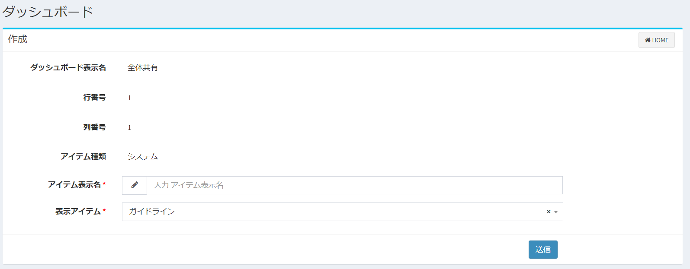

#### Anzeigename des Elements
Geben Sie den Namen des Elements ein, der auf der Seite erscheint.

#### Anzuzeigendes Element
Wählen Sie das Element, das angezeigt wird.

- ##### Leitfaden
Zeigt Hinweise zum System an.  
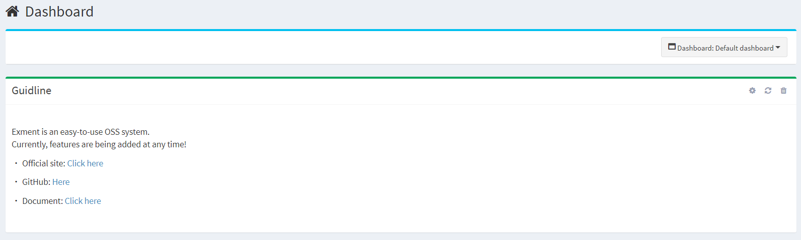

- ##### Exment-Neuigkeiten
Holt die Neuigkeiten von der offiziellen Website von Exment und zeigt sie an.
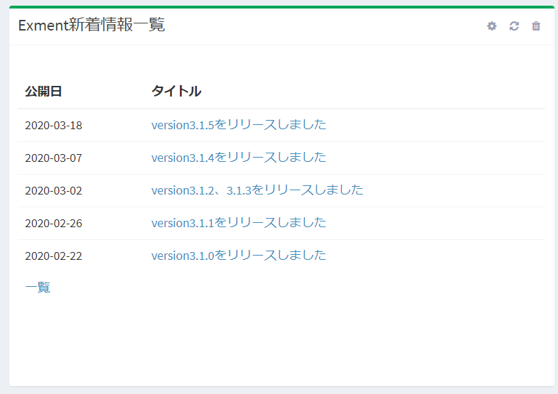

- ##### Editor
Sie geben frei einen Text ein, der auf der Seite angezeigt wird.
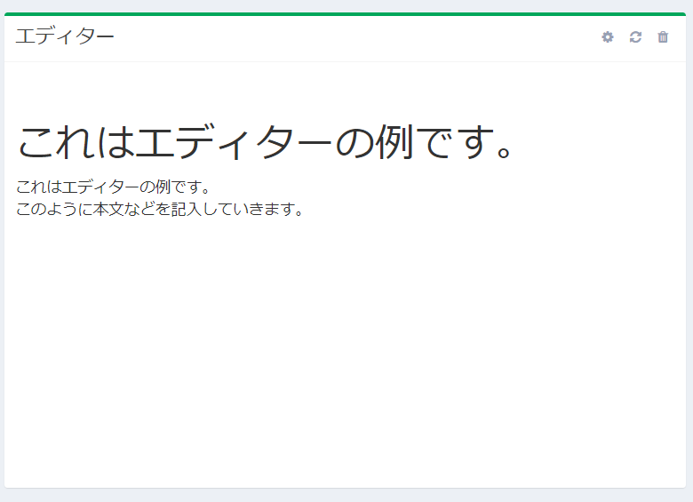

- ##### HTML
Sie geben den Inhalt im HTML-Format ein, der auf der Seite angezeigt wird. ※ Auch Skripte werden ausgeführt.
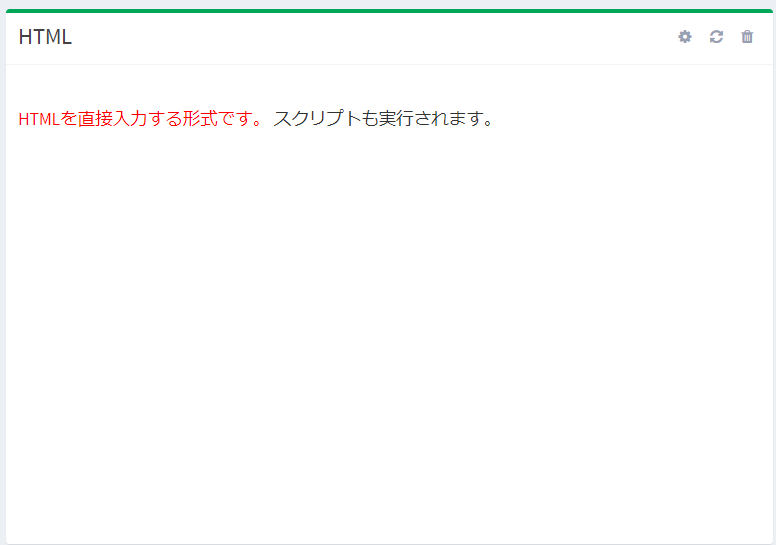

- ##### 2D-/JAN-Barcode
Zeigt die Schaltfläche zum Einlesen von 2D-/JAN-Barcodes an.  
Den Anzeigenamen „2D-/JAN-Barcode“ auf der Schaltfläche zum Einlesen von 2D-/JAN-Barcodes können Sie in der Datei .env mit „EXMENT_TEXT_SCAN_BUTTON_JA/EN“ ändern.  

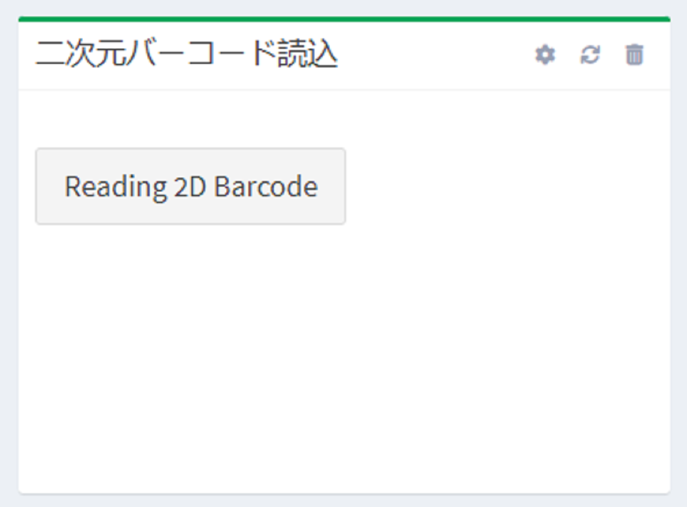

## Diagramm
Die Daten einer Ansicht von Exment (Ansicht, Ansicht aller Daten, Auswertungsansicht usw.) erscheinen als Diagramm auf dem Dashboard. Es gibt 18 Diagrammtypen, darunter Balkendiagramm, Liniendiagramm und Kreisdiagramm.  
Bei einem angezeigten Diagramm können Sie auf der Seite den Typ wechseln, filtern, sortieren usw. ([Dashboard bedienen](/de/dashboard?id=Dashboard-bedienen)).  
※ Einzelheiten finden Sie unter [Einstellungen des Diagramms im Einzelnen](/de/dashboard?id=Einstellungen-des-Diagramms-im-Einzelnen).

### Beispiel für ein Balkendiagramm

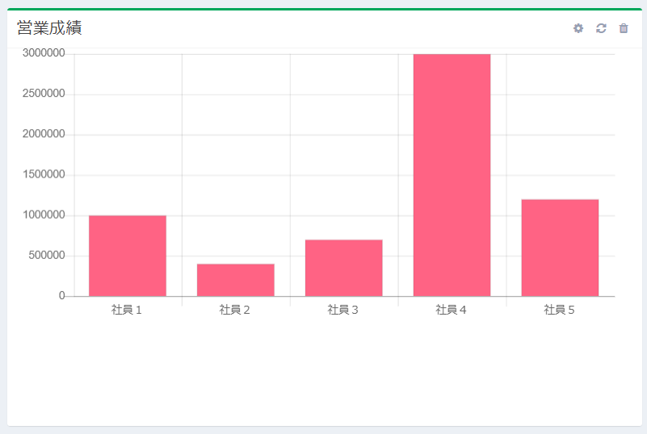

### Beispiel für ein Liniendiagramm  
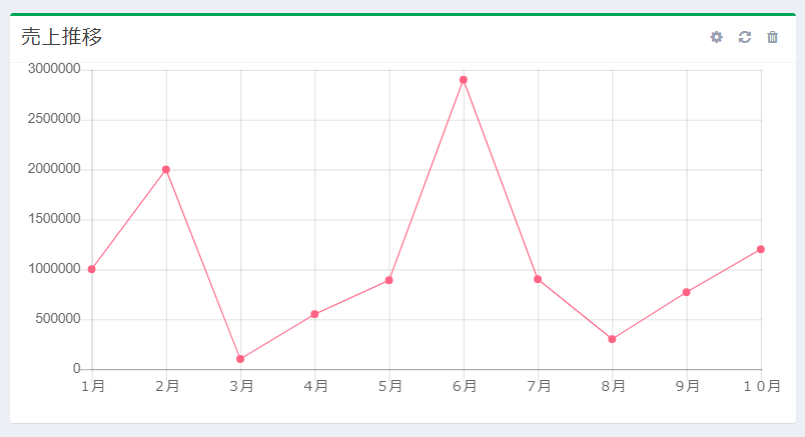

### Beispiel für ein Kreisdiagramm
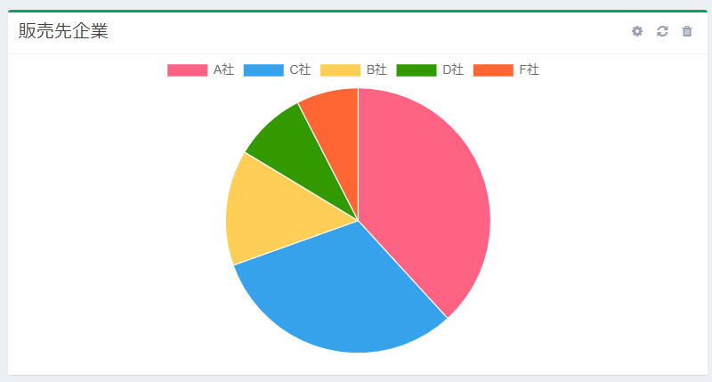

### Einstellpunkte des Diagramms
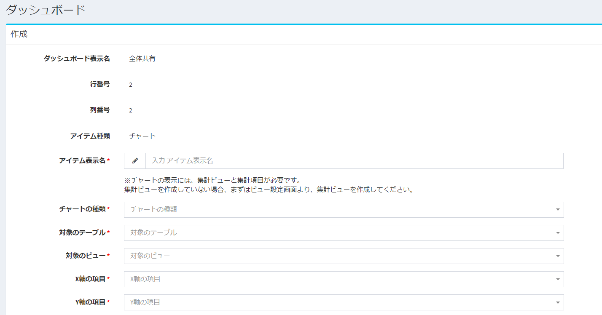

#### Anzeigename des Elements
Geben Sie den Namen des Elements ein, der auf der Seite erscheint.

#### Diagrammtyp
Wählen Sie 1 Diagrammtyp aus den folgenden 18 Typen.

| Gruppe | Diagrammtyp |
|---|---|
| Grundtypen | Balkendiagramm, Liniendiagramm, Kreisdiagramm |
| Eine Reihe | Horizontales Balkendiagramm, Flächendiagramm, Ringdiagramm, Netzdiagramm, Trichterdiagramm, Tachodiagramm, Streudiagramm |
| Mehrere Reihen | Gruppiertes Balkendiagramm, Gestapeltes Balkendiagramm, Mehrfach-Liniendiagramm, Heatmap, Gestapeltes Flächendiagramm, Treemap, Sunburst-Diagramm, Boxplot |

Diagramme der Gruppe „Mehrere Reihen“ zeigen pro Element der horizontalen Achse mehrere Reihen (Beispiel: Umsatz pro Monat, getrennt nach Produkt).

Für Diagramme mit mehreren Reihen muss die Auswertungsansicht nach 2 oder mehr Spalten gruppiert sein. Von den Gruppierungsspalten wird die unter [Reihenspalte](/de/dashboard?id=Reihenspalte-(mehrere-Reihen)) gewählte Spalte (Standard: die 2. Spalte) zur Reihe, und die erste der übrigen Spalten zur horizontalen Achse.

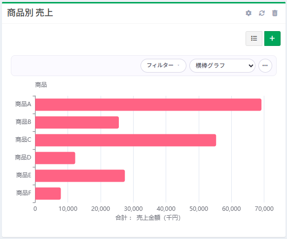

Horizontales Balkendiagramm

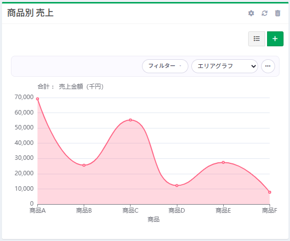

Flächendiagramm

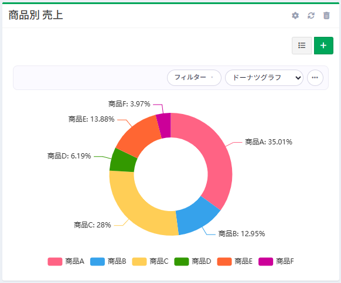

Ringdiagramm

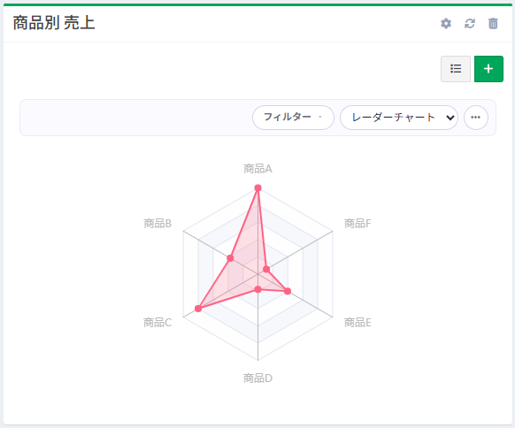

Netzdiagramm

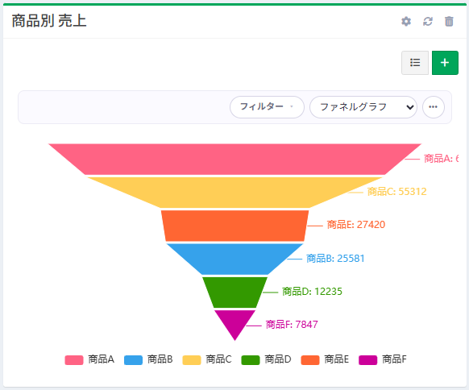

Trichterdiagramm

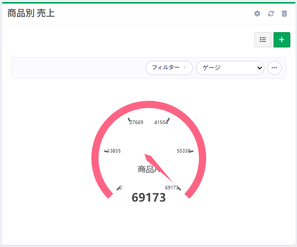

Tachodiagramm

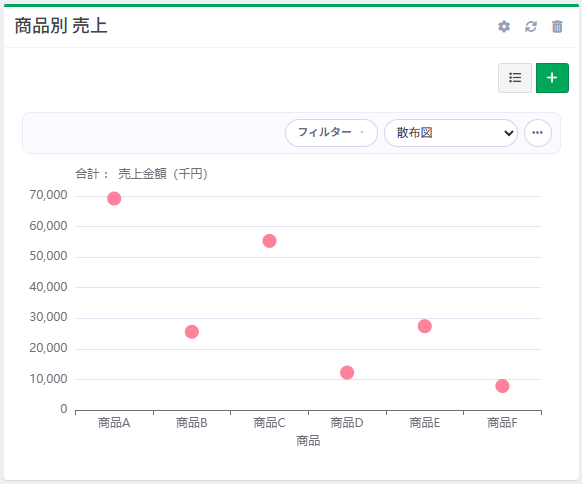

Streudiagramm

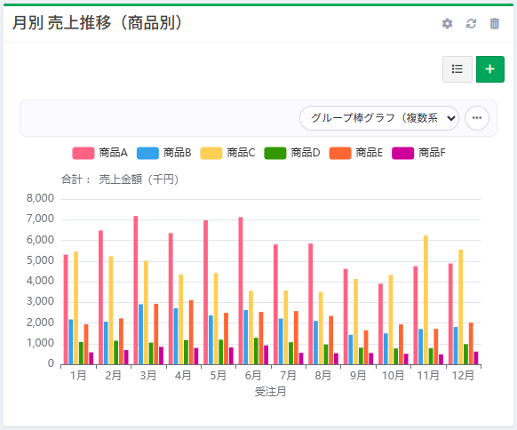

Gruppiertes Balkendiagramm

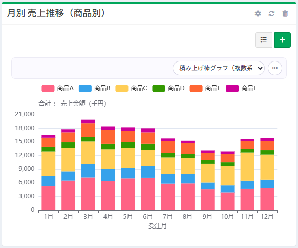

Gestapeltes Balkendiagramm

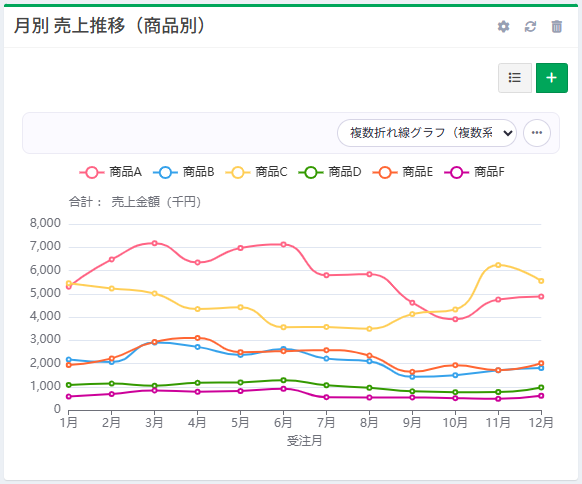

Mehrfach-Liniendiagramm

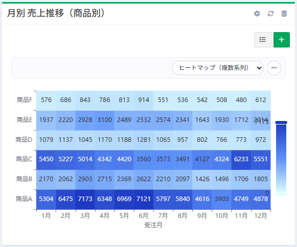

Heatmap

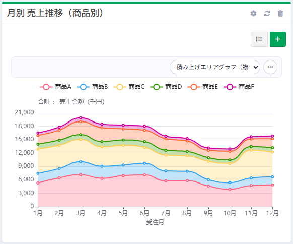

Gestapeltes Flächendiagramm

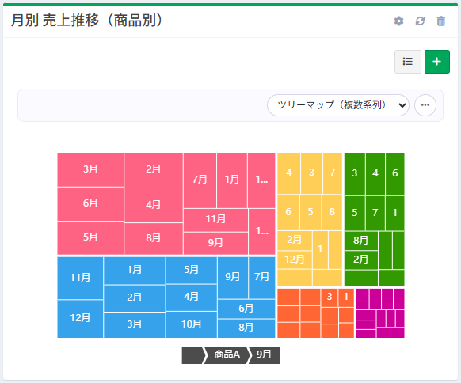

Treemap

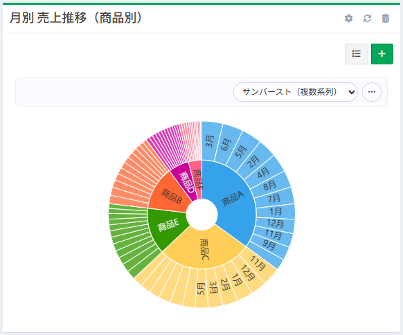

Sunburst-Diagramm

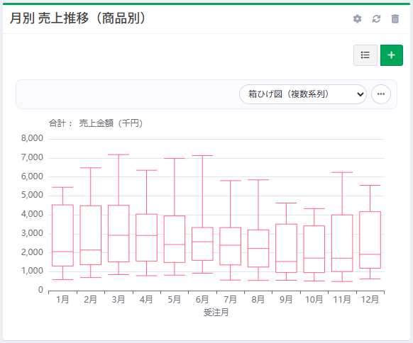

Boxplot

#### Zieltabelle
Wählen Sie aus den Tabellen, die in den [Einstellungen der benutzerdefinierten Tabellen](/de/table) erstellt wurden, die Tabelle, die angezeigt wird.  
※ Zur Auswahl stehen die Tabellen, für die Sie die Leseberechtigung haben.

#### Zielansicht
Wählen Sie aus den Ansichten der gewählten Zieltabelle (Ansicht, Ansicht aller Daten, Auswertungsansicht usw.) die Ansicht, die angezeigt wird.  
※ Kalenderansicht, Kanban-Ansicht, Gantt-Diagramm-Ansicht und Bedingungsansicht sind nicht wählbar. Bei einem System-Dashboard sind nur Systemansichten wählbar.  
※ Für Diagramme mit mehreren Reihen wählen Sie eine Auswertungsansicht.  

#### X-Achse
Wählen Sie die X-Achse (horizontale Achse) des Diagramms.  
※ Einzelheiten finden Sie unter [Einstellungen des Diagramms im Einzelnen](/de/dashboard?id=Einstellungen-des-Diagramms-im-Einzelnen).  

#### Y-Achse
Wählen Sie die Y-Achse (vertikale Achse) des Diagramms.  
※ Einzelheiten finden Sie unter [Einstellungen des Diagramms im Einzelnen](/de/dashboard?id=Einstellungen-des-Diagramms-im-Einzelnen).  

#### Reihenspalte (mehrere Reihen)

Diese Einstellung erscheint nur, wenn ein Diagramm mit mehreren Reihen gewählt ist.

Wählen Sie aus den Gruppierungsspalten der Auswertungsansicht die Spalte, die als Reihe dient. Ohne Auswahl wird die 2. Gruppierungsspalte zur Reihe.

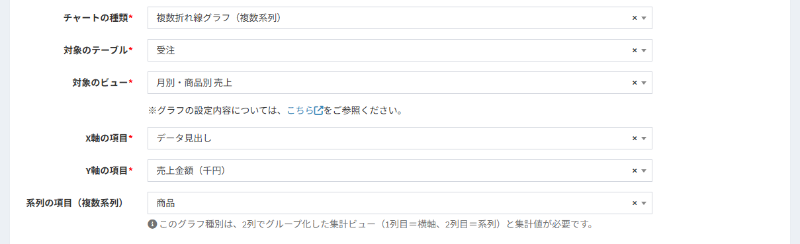

#### Filterfelder des Diagramms

Wählen Sie die Spalten, mit denen nur dieses Diagramm gefiltert wird. Sie können mehrere wählen.

Die gewählten Spalten lassen sich über die Schaltfläche **Filter** des Diagramms zum Filtern verwenden ([Mit dem Diagrammfilter filtern](/de/dashboard?id=Mit-dem-Diagrammfilter-filtern)).

Wenn Sie keine Spalte wählen, erscheint die Schaltfläche **Filter** nicht.

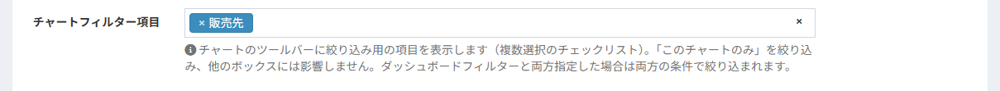

#### Weitere Optionen je nach Diagrammtyp

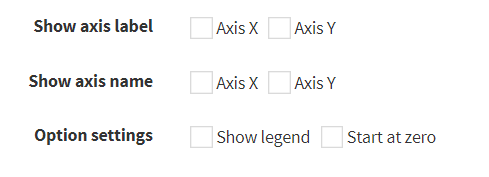

Die gewählten Optionen wirken sich auf das Diagramm aus.

※ **Achsenbeschriftung anzeigen**, **Achsentitel anzeigen** und **Bei null beginnen** gibt es nur beim Balkendiagramm und beim Liniendiagramm.

## Kalender
Die Daten einer Kalenderansicht von Exment erscheinen auf dem Dashboard. Für die Darstellung gibt es 2 Formen: „Monatlich“ und „Liste“.
>Den angezeigten Text können Sie in den [Einstellungen der Überschriftenspalten](/de/table) ändern.

### Beispiel für „Monatlich“
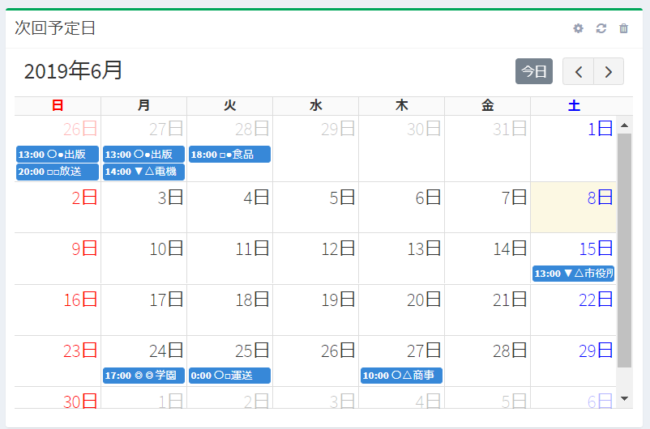  

### Beispiel für „Liste“
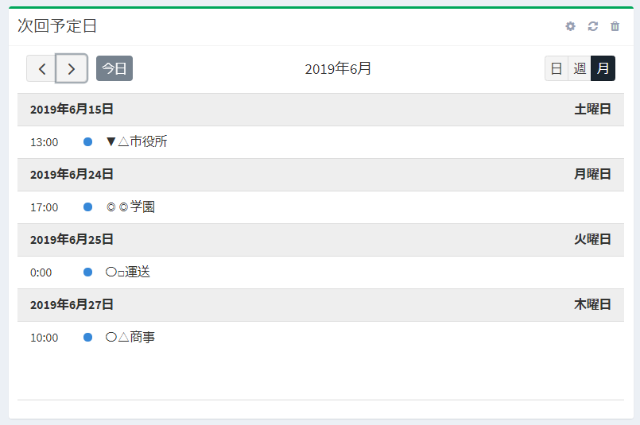  

### Einstellpunkte des Kalenders

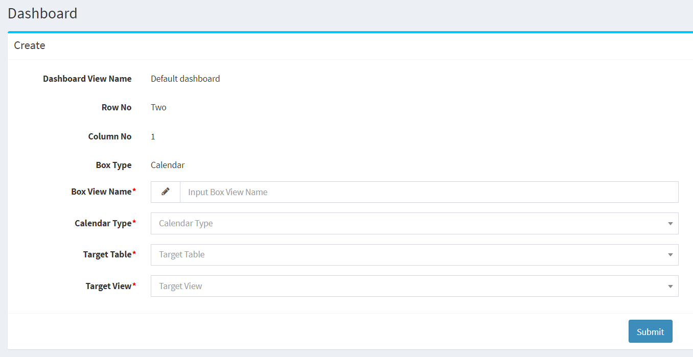  

#### Anzeigename des Elements
Geben Sie den Namen des Elements ein, der auf der Seite erscheint.

#### Kalendertyp
Wählen Sie aus den 2 Typen „Monatlich“ und „Liste“ den Kalender, der angezeigt wird.

#### Zieltabelle
Wählen Sie aus den Tabellen, die in den [Einstellungen der benutzerdefinierten Tabellen](/de/table) erstellt wurden, die Tabelle, die angezeigt wird.  
※ Zur Auswahl stehen nur Tabellen, für die eine Kalenderansicht eingerichtet ist.

#### Zielansicht
Wählen Sie aus den Kalenderansichten der gewählten Zieltabelle die Ansicht, die angezeigt wird.  

## Einstellungen des Diagramms im Einzelnen
Welche Punkte für die X-Achse und die Y-Achse eines Diagramms wählbar sind, hängt von der Art der Zielansicht ab.  

### Wenn die Zielansicht eine Ansicht aller Daten oder eine Standardansicht ist

#### X-Achse
Für die X-Achse stehen die folgenden 2 Arten zur Auswahl. Wählen Sie eine davon.

- Der Punkt „Diagrammbeschriftung“.  
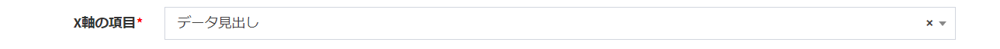  

Damit erscheinen auf der X-Achse die [Überschriftenspalten aus den Einstellungen der benutzerdefinierten Tabelle](/de/table).  

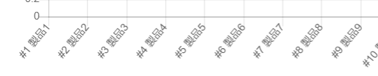  

- Die Punkte, die unter [„Anzeigespalten auswählen“ der Einstellungen der benutzerdefinierten Ansicht](/de/view) stehen. Damit erscheinen auf der X-Achse die Werte der gewählten Spalte.  
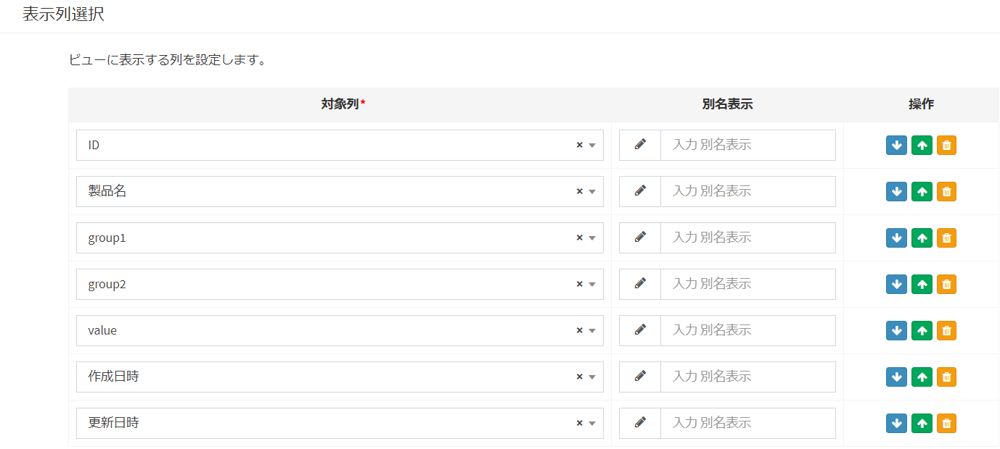  

#### Y-Achse
Für die Y-Achse steht die folgende 1 Art zur Auswahl. Wählen Sie einen der Punkte.

- Von den Punkten, die unter [„Anzeigespalten auswählen“ der Einstellungen der benutzerdefinierten Ansicht](/de/view) stehen, die folgenden Spaltentypen. Damit erscheinen auf der Y-Achse die Werte der gewählten Spalte.
    - Ganzzahl
    - Dezimalzahl
    - Währung

### Wenn die Zielansicht eine Auswertungsansicht ist

#### X-Achse
Für die X-Achse steht die folgende 1 Art zur Auswahl.

- Der Punkt „Diagrammbeschriftung“.  
  

Damit erscheinen auf der X-Achse die Werte, die unter [„Gruppierungsspalten auswählen“ der Einstellungen der benutzerdefinierten Ansicht](/de/view) eingestellt sind.  
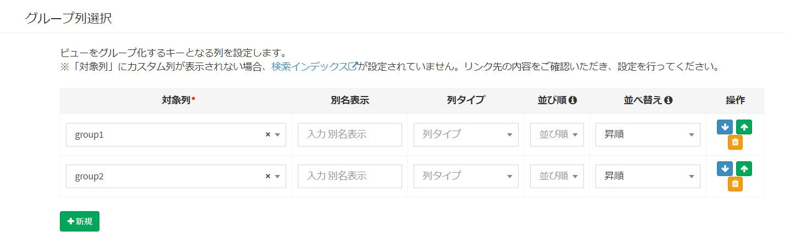  
  

#### Y-Achse
Für die Y-Achse stehen die folgenden 2 Arten zur Auswahl. Wählen Sie eine davon.

- Von den Punkten, die unter [„Gruppierungsspalten auswählen“ der Einstellungen der benutzerdefinierten Ansicht](/de/view) stehen, die folgenden Spaltentypen. Damit erscheinen auf der Y-Achse die Werte der gewählten Spalte.
    - Ganzzahl
    - Dezimalzahl
    - Währung

  

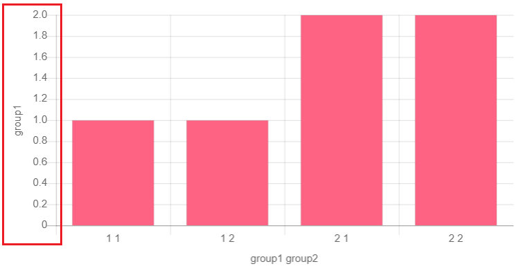  

- Die Punkte, die unter [„Summenspalten auswählen“ der Einstellungen der benutzerdefinierten Ansicht](/de/view) stehen. Damit erscheinen auf der Y-Achse die Werte der gewählten Spalte.

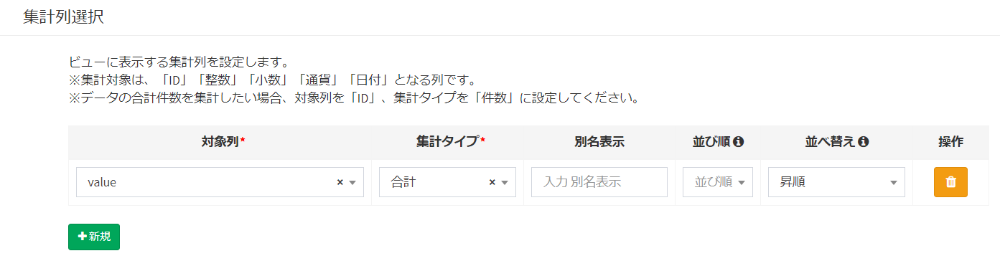  

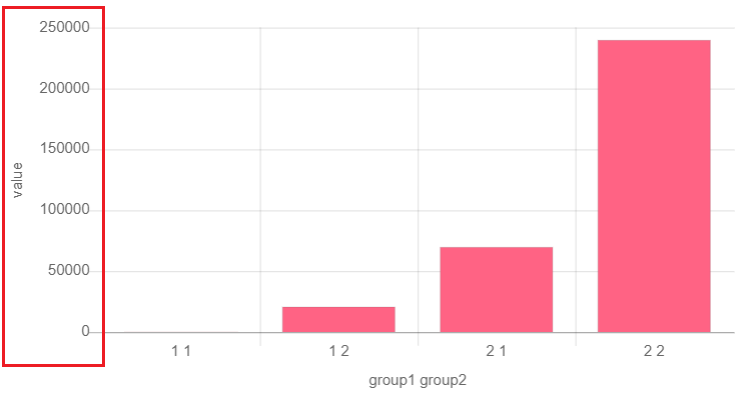  

## Dashboard teilen
Sie teilen ein erstelltes Dashboard mit anderen Benutzern und Organisationen.  
※ Teilen lässt sich nur ein „Benutzer-Dashboard“. (Ein „System-Dashboard“ ist von Anfang an für alle Benutzer sichtbar.)  

#### So teilen Sie
1. Klicken Sie auf der Seite zum Ändern der Dashboard-Einstellungen auf die Schaltfläche „Teilen“.  
※ Beim Neuerstellen erscheint diese Schaltfläche nicht.
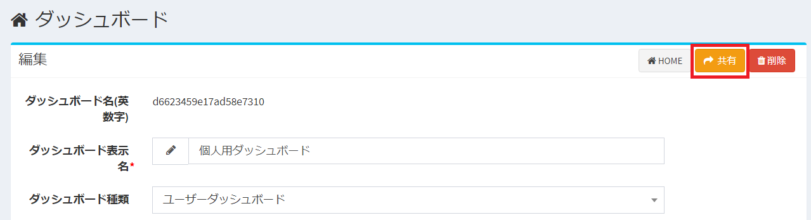

2. Der Dialog zum Teilen des Dashboards erscheint.
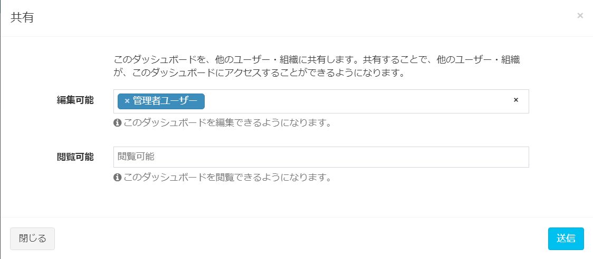

3. Fügen Sie die Benutzer oder Organisationen hinzu, mit denen Sie teilen möchten, und klicken Sie auf „Absenden“. Damit ist das Dashboard geteilt.  
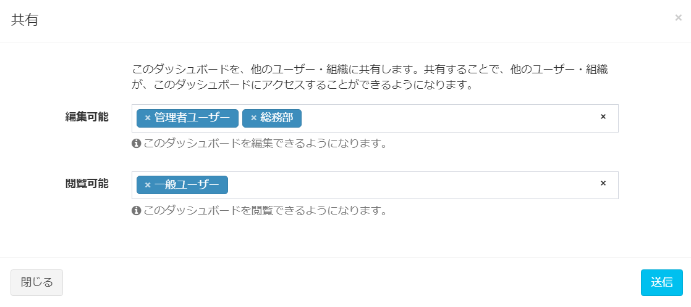  

# Dashboard bedienen

Auf dem Dashboard können Sie Diagramme filtern, den Diagrammtyp wechseln und Daten sortieren. Außer beim Ändern von Farben ändert diese Bedienung weder die Einstellungen des Dashboards noch die Einstellungen der Diagramme noch die Daten.

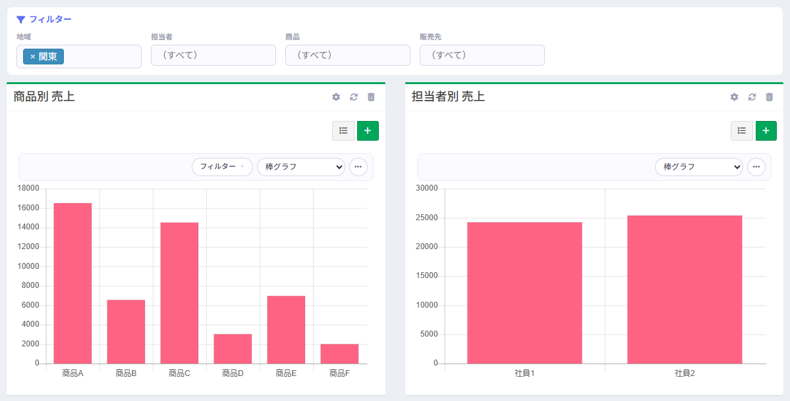

| Bedienung | Was möglich ist | Wirkt auf |
|---|---|---|
| [Filterleiste](/de/dashboard?id=Mit-der-Filterleiste-filtern) | Filtert die Diagramme des Dashboards zusammen | Ganzes Dashboard |
| [Klick auf das Diagramm](/de/dashboard?id=Per-Klick-auf-das-Diagramm-filtern) | Wählt den angeklickten Wert in der Filterleiste | Ganzes Dashboard |
| [Diagrammfilter](/de/dashboard?id=Mit-dem-Diagrammfilter-filtern) | Filtert nur 1 Diagramm | Einzelnes Diagramm |
| [Diagrammtyp wechseln](/de/dashboard?id=Diagrammtyp-wechseln) | Zeigt dieselben Daten mit einem anderen Diagrammtyp | Einzelnes Diagramm |
| [Menü „⋯“](/de/dashboard?id=Menü-„⋯“) | Sortieren, Datenbeschriftungen anzeigen, Daten exportieren | Einzelnes Diagramm |
| [Farben ändern](/de/dashboard?id=Farben-des-Diagramms-ändern) | Ändert die Farben von Balken, Kreissegmenten usw. | Einzelnes Diagramm |

## Mit der Filterleiste filtern

Wenn Sie die [Filterleiste des Dashboards einstellen](/de/dashboard?id=Filterleiste-des-Dashboards-einstellen), erscheint oben auf dem Dashboard die Filterleiste.

Wenn Sie in der Filterleiste einen Wert wählen, gilt dieselbe Bedingung für alle Diagramme, auf die dieser Filter wirkt.

※ Benutzer ohne Leseberechtigung für die Quelltabelle des Filters sehen die Filterleiste nicht.

#### Werte wählen

Klicken Sie auf ein Filterelement und wählen Sie Werte aus der Liste. Sie können mehrere Werte wählen.

Wenn in einem anderen Filter ein Wert gewählt ist, zeigt die Liste nur die Werte, zu denen es Daten mit dieser Bedingung gibt. Wenn Sie zum Beispiel bei „Region“ den Wert „Kanto“ wählen, erscheinen bei „Verantwortlicher“ nur die Verantwortlichen von Kanto.

Bei Spalten mit Datum oder Datum und Uhrzeit geben Sie statt einer Liste einen Bereich „von“ – „bis“ an. Auch bei Zahlenspalten wird ein Bereich angegeben, wenn es zu viele Auswahlwerte gibt.

> Wenn es zu viele Auswahlwerte für die Anzeige gibt, wählen Sie zuerst in einem anderen Filter einen Wert und grenzen so ein.

#### Filter aufheben

Mit einem Klick auf „Zurücksetzen“ gilt wieder der Zustand der [Standardwerte](/de/dashboard?id=Filterelemente).

Wenn keine Standardwerte eingestellt sind, werden alle Filter aufgehoben.

#### Diagramme, die nicht von Filtern betroffen sind

Bei Diagrammen, auf die die Filterleiste nicht wirkt, steht „Nicht von Filtern betroffen“. Bei Diagrammen, für die ein Teil der Filterelemente nicht gilt, steht „Hier nicht angewendete Filter“.

So sehen Sie, wie sich die gewählten Filter auf die angezeigten Daten auswirken.

> Die Filterbedingungen stehen in der URL. Mit „Zurück“ und „Vorwärts“ des Browsers kehren Sie zu früheren Bedingungen zurück. Wenn Sie die URL weitergeben, sehen andere Benutzer das Dashboard mit denselben Bedingungen.

> Die zuletzt gewählten Bedingungen werden pro Benutzer gemerkt. Beim nächsten Öffnen des Dashboards erscheinen dieselben Bedingungen.

## Per Klick auf das Diagramm filtern

Wenn Sie auf einen Balken, ein Kreissegment usw. eines Diagramms klicken, wird dieser Wert in der Filterleiste gewählt und die anderen Diagramme werden gefiltert.

Das angeklickte Diagramm zeigt weiter alle Werte. Der gewählte Wert erscheint kräftig, die anderen Werte blass.

| Bedienung | Ergebnis |
|---|---|
| Auf einen Wert klicken | Wählt nur diesen Wert. |
| Noch einmal auf den gewählten Wert klicken (wenn nur dieser Wert gewählt ist) | Hebt die Auswahl auf. |
| Mit gedrückter Strg-Taste klicken (Mac: ⌘) | Wählt den Wert zusätzlich. Bei einem Klick auf einen schon gewählten Wert wird nur dieser Wert aus der Auswahl entfernt. |

※ Möglich, wenn die Spalte der horizontalen Achse des Diagramms zu den Elementen der Filterleiste gehört.  
※ Möglich bei Diagrammen von Auswertungsansichten. Nicht möglich, wenn die Spalte der horizontalen Achse ein Element mit einem Bereich „von“ – „bis“ (zum Beispiel eine Datumsspalte) oder eine Spalte mit Mehrfachauswahl ist.  
※ Nicht möglich bei Netzdiagramm, Tachodiagramm, Treemap, Sunburst-Diagramm und Boxplot.  
※ Wenn Sie in der Filterleiste einen Wert wählen, werden Diagramme, deren horizontale Achse zu diesem Filterelement gehört, nicht gefiltert. Der gewählte Wert wird hervorgehoben.

## Mit dem Diagrammfilter filtern

Der Diagrammfilter gilt nur für dieses Diagramm. Er wirkt nicht auf andere Diagramme.

Wenn für ein Diagramm [Filterfelder des Diagramms](/de/dashboard?id=Filterfelder-des-Diagramms) eingestellt sind, erscheint oben rechts im Diagramm die Schaltfläche „Filter“.

Klicken Sie auf „Filter“ und wählen Sie die Werte, die angezeigt werden.

Auf der Schaltfläche steht die Anzahl der Felder, nach denen gefiltert wird. Mit einem Klick auf „Zurücksetzen“ werden die Bedingungen des Diagrammfilters aufgehoben.

Bei mehr als 8 Auswahlwerten erscheint über der Liste ein Suchfeld, mit dem Sie den gewünschten Wert finden.

Bei Spalten mit Datum oder Datum und Uhrzeit geben Sie statt einer Liste einen Bereich „von“ – „bis“ an. Auch bei Zahlenspalten wird ein Bereich angegeben, wenn es zu viele Auswahlwerte gibt.

※ Der Diagrammfilter lässt sich zusammen mit der Filterleiste verwenden. Dann wird nach beiden Bedingungen gefiltert.  
※ Die Auswahl im Diagrammfilter wird aufgehoben, wenn Sie die Seite neu laden (F5).

## Diagrammtyp wechseln

Über das Auswahlfeld für den Diagrammtyp oben rechts im Diagramm können Sie dieselben Daten mit einem anderen Diagrammtyp anzeigen.

Der gewählte Diagrammtyp wird pro Benutzer gemerkt. Beim nächsten Öffnen des Dashboards erscheint derselbe Typ.

Wenn Sie wieder den ursprünglichen Diagrammtyp wählen, wird der Wechsel aufgehoben und es gilt wieder der ursprüngliche Typ.

※ Diagramme mit einer Reihe lassen sich nur untereinander wechseln, Diagramme mit mehreren Reihen ebenfalls nur untereinander. Ein Balkendiagramm lässt sich zum Beispiel in ein Ringdiagramm oder ein Streudiagramm wechseln, aber nicht in ein Gestapeltes Balkendiagramm (mehrere Reihen).

## Menü „⋯“

Mit einem Klick auf „⋯“ oben rechts im Diagramm erscheint das Menü.

| Menü | Inhalt |
|---|---|
| Sortieren nach | Sortiert aufsteigend oder absteigend nach den Elementen der horizontalen Achse oder nach den Werten. |
| Datenbeschriftungen | Zeigt die Werte über den Balken, Punkten usw. an. Erscheint nur bei Balkendiagramm, Liniendiagramm, Kreisdiagramm, Horizontalem Balkendiagramm, Flächendiagramm, Streudiagramm, Gruppiertem Balkendiagramm, Gestapeltem Balkendiagramm, Mehrfach-Liniendiagramm und Gestapeltem Flächendiagramm. |
| Daten exportieren | Lädt die angezeigten Daten als CSV-Datei herunter. |
| Farben zurücksetzen | Stellt geänderte Farben wieder her. Erscheint nur für Benutzer, die Farben ändern können, und nur, wenn Farben geändert sind. |
| Zurücksetzen | Stellt Sortierung und Datenbeschriftungen auf die ursprüngliche Einstellung zurück. |

※ Die Einstellungen für Sortierung und Datenbeschriftungen werden pro Benutzer gemerkt.  
※ Bei Diagrammen ohne anzeigbaren Menüpunkt erscheint „⋯“ nicht.

## Farben des Diagramms ändern

Benutzer mit der Bearbeitungsberechtigung für das Dashboard können mit einem Rechtsklick auf einen Balken, ein Kreissegment usw. die Farbe ändern.

Wählen Sie aus „Designfarben“ und „Standardfarben“ oder geben Sie mit „Weitere Farben...“ eine beliebige Farbe an. Mit „Automatisch“ gilt wieder die ursprüngliche Farbe.

Bei Balkendiagramm, Kreisdiagramm usw. lässt sich die Farbe pro Balken oder Kreissegment ändern. Bei Diagrammen, die mit 1 Farbe gezeichnet werden (Liniendiagramm, Flächendiagramm usw.), und bei Diagrammen mit mehreren Reihen lässt sich die Farbe pro Reihe ändern.

Mit „Weitere Farben...“ öffnet sich eine Palette, in der Sie eine beliebige Farbe angeben können.

Klicken Sie in die Palette oder geben Sie die RGB-Werte ein. Mit ↕ wechseln Sie zur Eingabe von HSL und HEX. Mit einem Klick auf „OK“ wird die Farbe übernommen.

※ Die geänderte Farbe wird in den Einstellungen des Diagramms gespeichert und erscheint für alle Benutzer gleich.  
※ Benutzer, die nur ansehen können, können keine Farben ändern.  
※ Heatmap und Boxplot unterstützen das Ändern der Farben nicht.
