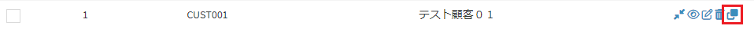

# Daten
Diese Seite erklärt die Bildschirme, in denen Sie die Daten einer Tabelle als Liste ansehen, neu hinzufügen, bearbeiten, anzeigen und löschen.  
Tabellen legt der Systemadministrator an. Die Benutzer geben in diese Tabellen Werte ein und speichern sie.

| Was Sie tun möchten | Wo Sie nachsehen |
|---|---|
| Daten als Liste ansehen | [Datenliste](/de/data?id=Datenliste) |
| Daten hinzufügen | [Daten neu hinzufügen](/de/data?id=Daten-neu-hinzufügen) |
| Daten ändern | [Daten bearbeiten](/de/data?id=Daten-bearbeiten) |
| Den Inhalt von Daten ansehen | [Daten anzeigen](/de/data?id=Daten-anzeigen) |
| Daten löschen | [Daten löschen](/de/data?id=Daten-löschen) |
| Daten durch Kopieren anlegen | [Daten kopieren](/de/data?id=Daten-kopieren) |

## Datenliste
Die Liste der Daten, die in dieser Tabelle gespeichert sind.  
In der Liste erscheinen die Daten, die Sie selbst angelegt haben, und die Daten, für die Ihnen eine Berechtigung zugewiesen ist.

※ Wenn für einen Benutzer oder eine Organisation die „Berechtigung, alle Daten zu bearbeiten oder anzusehen“ eingetragen ist, erscheinen unabhängig von der obigen Bedingung alle Daten.  
  
  
Eine genaue Erklärung der Liste finden Sie unter [Datenliste](/de/data_grid).  

## Daten neu hinzufügen
1. Klicken Sie oben rechts auf der Seite auf den Link [Neu].  

※ Wenn der angemeldete Benutzer für diese Tabelle keine Berechtigung „Bearbeiten“ hat, erscheint diese Schaltfläche nicht.  
Wie Berechtigungen zugewiesen werden, finden Sie im linken Menü unter [Rollengruppen und Berechtigungen](/de/role_group).  

2. Der Bildschirm zum Anlegen neuer Daten erscheint.  

  
Eine genaue Erklärung dieses Bildschirms finden Sie unter [Datenformular](/de/data_form).  

### Den Inhalt vor dem Speichern prüfen (Vorschau)
Wenn Sie im Bildschirm zum Anlegen oben rechts auf die Schaltfläche [Vorschau] klicken, sehen Sie den gerade eingegebenen Inhalt in einem anderen Fenster, ohne zu speichern.  
Er erscheint je Block des Formulars als Liste von Feldnamen und Werten.

- Die Schaltfläche [Vorschau] erscheint nur im Bildschirm zum Anlegen neuer Daten. Im Bearbeitungsbildschirm erscheint sie nicht.  
- Die Vorschau speichert die Daten nicht. Um die Anzeige nach einer Änderung der Eingabe zu erneuern, klicken Sie im ursprünglichen Bildschirm noch einmal auf die Schaltfläche [Vorschau].  
- Blöcke von untergeordneten Tabellen erscheinen in der Vorschau nicht.

## Daten bearbeiten
1. Klicken Sie in der Zeile, die Sie bearbeiten möchten, auf den Link [Bearbeiten].  

※ Wenn der angemeldete Benutzer für diese Tabelle keine Berechtigung „Bearbeiten“ hat, erscheint dieser Link nicht.  
Wie Berechtigungen zugewiesen werden, finden Sie im linken Menü unter [Rollengruppen und Berechtigungen](/de/role_group).  

2. Der Bearbeitungsbildschirm der Daten erscheint.  

  
Eine genaue Erklärung des Bearbeitungsbildschirms finden Sie unter [Datenformular](/de/data_form).  

> Wenn beim Aktualisieren der Daten bereits ein anderer Benutzer dieselben Daten aktualisiert hat, erscheint die folgende Fehlermeldung.

## Daten anzeigen
1. Klicken Sie in der Zeile, die Sie anzeigen möchten, auf den Link [Anzeigen].  

2. Der Anzeigebildschirm der Daten erscheint.  

  
Eine genaue Erklärung des Anzeigebildschirms finden Sie unter [Datendetails](/de/data_details).  

## Daten löschen
- Klicken Sie in der Zeile, die Sie löschen möchten, auf den Link [Löschen].  

## Daten kopieren
※ Damit der Link [Kopieren] erscheint, müssen Sie einen Einstellungswert ändern. Sehen Sie dazu „Kopier-Link der benutzerdefinierten Daten anzeigen“ unter [Konfiguration](/de/config).  

1. Klicken Sie in der Zeile, die Sie kopieren möchten, auf den Link [Kopieren].  

2. Der Bearbeitungsbildschirm erscheint mit dem Inhalt der gewählten Daten.  

3. Ändern Sie, was nötig ist, und speichern Sie.  

Was kopiert wird und was nicht:

- Kopiert werden nur die Felder, die im Formular stehen.  
- Automatische Nummerierung, Dateien, Bilder usw. werden nicht kopiert.  
