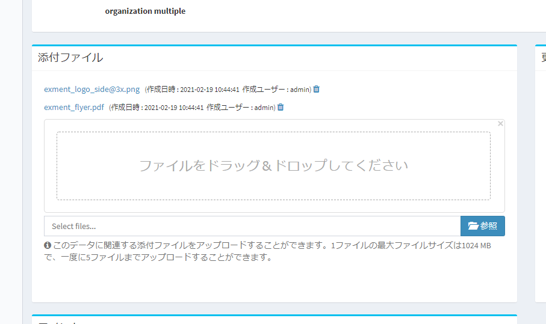

# Datenimport und -export (Befehl)
Diese Seite erklärt, wie Sie die Daten einer Tabelle mit Befehlen auf dem Server importieren und exportieren.

| Was Sie tun möchten | Befehl | Wo Sie nachsehen |
|---|---|---|
| Daten in eine Datei ausgeben | `php artisan exment:export` | „Datenexport“ |
| Daten in Teilen mit festgelegter Anzahl ausgeben | `php artisan exment:chunkexport` | „Datenexport (chunk-Modus)“ |
| Daten aus einer Datei einlesen | `php artisan exment:import` | „Datenimport“ |
| Dateien auf einmal in Spalten vom Typ „Bild“ und „Datei“ einlesen | `php artisan exment:file-import` | „Datenimport - Anhänge der Bild- und Dateispalten einlesen“ |
| Anhänge (Dokumente) von Daten auf einmal einlesen | `php artisan exment:document-import` | „Datenimport - Liste der Dokumente (Anhänge)“ |

> Einen Überblick über den Import und Export von Daten finden Sie unter [Datenimport und -export](/de/data_import_export).

## Datenexport
Exportiert (gibt aus) die Daten der Tabelle mit einem Befehl in eine Datei.  
Die Dateiformate sind csv und xlsx.  


### Bedienung

- Führen Sie in der Befehlszeile den folgenden Befehl aus.

~~~
php artisan exment:export (Tabellenname)

# Beispiel
php artisan exment:export information
~~~

- Wenn Sie diesen Befehl ausführen, werden die csv-Daten in den Ordner „(Stammordner von Exment)/storage/app/export/(Ausführungszeitpunkt: yyyyMMddHHiiss)“ ausgegeben.

### Argumente des Befehls

```
php artisan exment:export (Tabellenname) {--action=default} {--type=all} {--page=1} {--count=} {--format=csv} {--view=} {--dirpath=} {--add_setting=0} {--add_relation=0} {--add_comment=0}
```

- ##### Tabellenname  
(Pflicht) Der Name der Tabelle (alphanumerisch), die ausgegeben wird.

- ##### action  
(Optional) Die Art, wie exportiert wird.
    - default : Gibt alle Systemspalten und benutzerdefinierten Spalten aus. Standardwert.
    - view : Gibt in der Form der angegebenen Ansicht aus.

- ##### type  
(Optional) Die Art (Anzahl) der exportierten Daten.
    - all : Alle Daten. Standardwert.
    - page : Die angegebene Seite.

- ##### page    
(Optional) Die Seitennummer, wenn type page ist. Ganze Zahl. Ohne Angabe wird die 1. Seite ausgegeben.

- ##### count    
(Optional) Die größte Anzahl ausgegebener Daten, wenn type page ist. Ohne Angabe gilt die Anzahl, die in der Ansicht angegeben ist.

- ##### format  
(Optional) Das Dateiformat des Exports.
    - csv : CSV-Format. Standardwert.
    - xlsx : Xlsx-Format (Excel).

- ##### view  
(Optional) Die Ansicht, die ausgegeben wird. Angabe als id oder suuid. Ohne Angabe wird mit der Ansicht aller Daten ausgegeben.

- ##### dirpath  
(Optional) Der Ordnerpfad für den Export. Vollständiger Pfad. Ohne Angabe: (Stammordner von Exment)/storage/app/export/(Ausführungszeitpunkt: yyyyMMddHHiiss).

- ##### add_relation  
(Optional) Ob auch die Relationsdaten ausgegeben werden. Der Standardwert ist 0 (nicht ausgeben). Gilt nur im Xlsx-Format und wenn action default ist.

- ##### add_setting  
(Optional) Ob auch die Einstellungsdaten ausgegeben werden. Der Standardwert ist 0 (nicht ausgeben). Gilt nur im Xlsx-Format und wenn action default ist.

- ##### add_comment  
(Optional) Ob auch die Kommentare der einzelnen Daten ausgegeben werden. Der Standardwert ist 0 (nicht ausgeben). Bei 1 werden die Kommentare in das Blatt (im CSV-Format: die Datei) „comment“ ausgegeben. Gilt nur, wenn action default ist und „Kommentare verwenden“ in den Einstellungen der benutzerdefinierten Tabelle auf YES steht.

~~~
# Beispiel: Ausgabe im Xlsx-Format, mit Kommentaren
php artisan exment:export information --format=xlsx --add_comment=1
~~~


<h2 id="export_chunk"><a href="#/de/data_cmd_import_export?id=export_chunk" data-id="export_chunk" class="anchor"><span>Datenexport (chunk-Modus)</span></a></h2>

Gibt die Daten in Teilen mit einer festgelegten Anzahl aus (Standardwert: 1000). Bei der Ausgabe großer Datenmengen hat so jede Datei weniger Zeilen.  


### Bedienung

- Führen Sie in der Befehlszeile den folgenden Befehl aus.

~~~
php artisan exment:chunkexport (Tabellenname)

# Beispiel
php artisan exment:chunkexport information
~~~

- Wenn Sie diesen Befehl ausführen, werden die csv-Daten in den Ordner „(Stammordner von Exment)/storage/app/export/(Ausführungszeitpunkt: yyyyMMddHHiiss)“ ausgegeben.


### Argumente des Befehls

```
php artisan exment:chunkexport (Tabellenname) {--action=default} {--start=1} {--end=1000} {--count=1000} {--seqlength=1} {--delimiter=} {--format=csv} {--view=} {--dirpath=}
```

- ##### Tabellenname  
(Pflicht) Der Name der Tabelle (alphanumerisch), die ausgegeben wird.

- ##### action  
(Optional) Die Art, wie exportiert wird.
    - default : Gibt alle Systemspalten und benutzerdefinierten Spalten aus. Standardwert.
    - view : Gibt in der Form der angegebenen Ansicht aus.

- ##### start  
(Optional) Die Dateinummer, bei der die Ausgabe beginnt. Wenn der Export unterwegs abgebrochen ist, können Sie ihn auch ab der angegebenen laufenden Nummer fortsetzen. Ohne Angabe 1.

- ##### end  
(Optional) Die Dateinummer, bei der die Ausgabe endet. Ohne Angabe 1000.

- ##### count    
(Optional) Die größte Anzahl an Daten je Datei. Ohne Angabe 1000.

- ##### seqlength    
(Optional) Die Stellenzahl, auf die die laufende Nummer mit 0 aufgefüllt wird. Bei „3“ zum Beispiel wird die laufende Nummer als "001", "002" ausgegeben. Ohne Angabe 1.

- ##### delimiter    
(Optional) Das Zeichen, das im Dateinamen zwischen Tabellenname und laufender Nummer steht. Ohne Angabe „.“ (Punkt).

- ##### format  
(Optional) Das Dateiformat des Exports.
    - csv : CSV-Format. Standardwert.
    - xlsx : Xlsx-Format (Excel).

- ##### view  
(Optional) Die Ansicht, die ausgegeben wird. Angabe als id oder suuid. Ohne Angabe wird mit der Ansicht aller Daten ausgegeben.

- ##### dirpath  
(Optional) Der Ordnerpfad für den Export. Vollständiger Pfad. Ohne Angabe: (Stammordner von Exment)/storage/app/export/(Ausführungszeitpunkt: yyyyMMddHHiiss).


### Ausgabe

- Die Dateinamen werden mit laufender Nummer ausgegeben: **„(Name der benutzerdefinierten Tabelle).laufende Nummer.csv“** (Beispiel: client.1.csv).

```
#Beispiel
client.1.csv
client.2.csv
client.3.csv

#Beispiel (mit seqlength=3)
client.001.csv
client.002.csv
client.003.csv
```

- Unabhängig von der Anzahl der Daten und von der Option count können in einem Durchlauf höchstens 1000 Dateien ausgegeben werden.


## Datenimport
Liest Daten aus Dateien, die in einem festgelegten Ordner liegen, auf einmal in benutzerdefinierte Tabellen ein.

- Verwendbar sind EXCEL-Dateien oder csv-Dateien im selben Format wie beim Import über den Bildschirm.  
- Auch mehr als 5000 Daten können eingelesen werden. Im Bildschirm ist das begrenzt.  

### Hinweise
- CSV-Dateien, die im ZIP-Format komprimiert sind, können nicht eingelesen werden.  

- Es wird dieselbe Fehlerprüfung ausgeführt wie beim Import über den Bildschirm. Deshalb kann das Einlesen großer Datenmengen sehr lange dauern.  

- Die Daten werden in Blöcken von 100 eingelesen. Wenn zum Beispiel die ersten 100 Daten richtig gespeichert wurden und in den nächsten 100 Daten ein Fehler ist, wird die Verarbeitung der Datei dort abgebrochen. Die schon gespeicherten 100 Daten können nicht zurückgenommen werden. Löschen Sie sie von Hand oder nehmen Sie die schon gespeicherten Daten aus der Datei heraus.  

- <span class="red">Auch beim Import per Befehl kann bei sehr vielen Daten der Speicher nicht reichen, und es kommt zu einem Fehler.</span>  
Daran wird zurzeit gearbeitet. Verwenden Sie zum Einlesen großer Datenmengen bitte die [Masseneinfügung großer Datenmengen](/de/data_bulk_insert).

- Beim Einlesen mit csv können zurzeit nur die Daten dieser Tabelle eingelesen werden. Wenn Sie auch Relationsdaten einlesen möchten, verwenden Sie xlsx.


### Daten vorbereiten
Zuerst erstellen Sie die Dateien für den Import. Einzelheiten finden Sie unter „Vorlage exportieren“ in [Datenimport und -export](/de/data_import_export).  

- Der Zeichensatz der csv-Dateien, die eingelesen werden können, ist <strong>UTF-8</strong>.  

- Verwenden Sie für den Dateinamen eine der folgenden Formen.  
※ Die Dateien im Ordner werden in der Reihenfolge ihrer Namen eingelesen. Wenn die Reihenfolge wichtig ist, zum Beispiel beim gleichzeitigen Einlesen von verknüpften Daten, vergeben Sie deshalb nach der Methode 3. laufende Nummern in der Reihenfolge des Einlesens.

    1. „(Name der benutzerdefinierten Tabelle).csv“    ※ Beispiel: client.csv
    2. „(Name der benutzerdefinierten Tabelle).(laufende Nummer).csv“   ※ Beispiel: client.1.csv, client.002.csv
    3. „(laufende Nummer).(Name der benutzerdefinierten Tabelle).csv“   ※ Beispiel: 01.client.csv, 02.estimate.csv

- <span class="small">Vor v3.8.0 konnte auch mit dem Dateinamen „<span class="bold">laufende Nummer<span class="red">#</span>(Name der benutzerdefinierten Tabelle).csv</span>“ importiert werden.  
In v3.8.0 wurde [die Bibliothek für den Import geändert](/ja/update/v3_8) (Japanisch). Deshalb kann mit diesem Dateinamen nicht mehr importiert werden.  
Wenn Sie mit laufender Nummer importieren, ändern Sie den Namen in die Form „<span class="bold">laufende Nummer<span class="red">.</span>(Name der benutzerdefinierten Tabelle).csv</span>“ und importieren Sie dann.</span>

### Bedienung

- Legen Sie auf dem Server am folgenden Ort einen Arbeitsordner an. Als Ordnername empfehlen wir etwas, woran man den Inhalt dieser Arbeit erkennt, oder das Datum.  

~~~
(Stammverzeichnis des Projekts)/storage/app/import/(Ordnername)
~~~

- Legen Sie die erstellten csv-Dateien oder EXCEL-Dateien (mehrere möglich) in diesen Ordner.

#### Beispiel für den Ordner
  

- Führen Sie in der Befehlszeile den folgenden Befehl aus.
~~~
php artisan exment:import {Ordnername}
~~~

#### Beispiel für die Ausführung des Befehls
  


### Nach der Ausführung
- Löschen Sie nach dem Einlesen bei Bedarf die Dateien, die im Ordner "storage/app/import" liegen. (※ Sie werden nicht automatisch gelöscht.)


<h2 id="import_file"><a href="#/de/data_cmd_import_export?id=import_file" data-id="import_file" class="anchor"><span>Datenimport - Anhänge der Bild- und Dateispalten einlesen</span></a></h2>
In Spalten vom Typ „Bild“ und „Datei“ können Sie Anhänge auf einmal speichern. Es geht um den folgenden Teil des Bildschirms.  

  

### Verhalten
- Wenn Sie in eine benutzerdefinierte Spalte, in der schon ein Anhang gespeichert ist, einen neuen Anhang einlesen, wird die frühere Datei gelöscht.


### Importdaten vorbereiten

- Legen Sie auf dem Server am folgenden Ort einen Arbeitsordner an. Als Ordnername empfehlen wir etwas, woran man den Inhalt dieser Arbeit erkennt, oder das Datum.  

~~~
(Stammverzeichnis des Projekts)/storage/app/file-import/(Ordnername)
~~~

- Legen Sie im angelegten Ordner den Ordner „files“ an.

- Legen Sie alle Anhänge, die Sie importieren möchten, in den Ordner „files“.

### Importinformationen eintragen
- Erstellen Sie die Datei für den Import. Laden Sie die Importdatei über die folgenden Links herunter.  
    - [xlsx-Format](https://exment.net/downloads/template/file_import_ja.xlsx)
    - [csv-Format](https://exment.net/downloads/template/file_import_ja.csv)

- Der Zeichensatz der csv-Dateien, die eingelesen werden können, ist <strong>UTF-8</strong>.  

- Verwenden Sie für den Dateinamen eine der folgenden Formen.  
※ Die Dateien im Ordner werden in der Reihenfolge ihrer Namen eingelesen. Wenn die Reihenfolge wichtig ist, zum Beispiel beim gleichzeitigen Einlesen von verknüpften Daten, vergeben Sie deshalb nach der Methode 3. laufende Nummern in der Reihenfolge des Einlesens.

    1. „(Name der benutzerdefinierten Tabelle).csv“    ※ Beispiel: client.csv
    2. „(Name der benutzerdefinierten Tabelle).(laufende Nummer).csv“   ※ Beispiel: client.1.csv, client.002.csv
    3. „(laufende Nummer).(Name der benutzerdefinierten Tabelle).csv“   ※ Beispiel: 01.client.csv, 02.estimate.csv

- Bei xlsx ist der Dateiname frei. Verwenden Sie für den Blattnamen die folgende Form.  

    1. „(Name der benutzerdefinierten Tabelle)“    ※ Beispiel: client

- Schreiben Sie die Werte in das Blatt. Halten Sie sich dabei an die „Liste der Importfelder“ unten.

- Legen Sie die erstellte Importdatei in „(Stammverzeichnis des Projekts)/storage/app/file-import/(Ordnername)“.

#### Liste der Importfelder

  

##### id(ID)  
Die ID der benutzerdefinierten Daten, in die der Anhang eingelesen wird. Eine positive ganze Zahl, die beim Speichern der Daten automatisch fortlaufend vergeben wird.  

##### column_name(Spaltenname)  
Der alphanumerische Name der benutzerdefinierten Spalte, in die der Anhang eingelesen wird. (Beispiel: estimate_file, avatar)  

##### file_name(Name des Anhangs)  
Schreiben Sie den Namen des Anhangs, der im Ordner „files“ liegt.

##### display_file_name(Name des Anhangs (Anzeige im Bildschirm))  
Der Dateiname, mit dem der Anhang im Bildschirm erscheint und heruntergeladen wird. ※ Die Angabe ist nicht nötig. Ohne Angabe ist der Wert von file_name der Dateiname beim Herunterladen.

### Ordnerstruktur vor dem Einlesen
Beim Einlesen sieht die Ordnerstruktur so aus.

```
(Stammverzeichnis des Projekts)/storage/app/file-import/(Ordnername)
    - Importdatei (Beispiel: client.csv)
    - files
        - Einzulesende Datei (Beispiel: Anhang1.pdf)
        - Einzulesende Datei (Beispiel: Anhang2.pdf)
        - Einzulesende Datei (Beispiel: Anhang3.jpg)
```

### Bedienung

- Führen Sie in der Befehlszeile den folgenden Befehl aus.
~~~
php artisan exment:file-import {Ordnername}
~~~

### Nach der Ausführung
- Nach der Ausführung sind die Anhänge, die im Ordner "storage/app/file-import" liegen, an einen Ort kopiert, von dem die Anwendung sie herunterladen kann.  
Löschen Sie bei Bedarf die Dateien, die im Ordner "storage/app/file-import" liegen. (※ Sie werden nicht automatisch gelöscht.)


<h2 id="import_document"><a href="#/de/data_cmd_import_export?id=import_document" data-id="import_document" class="anchor"><span>Datenimport - Liste der Dokumente (Anhänge)</span></a></h2>
Bei den Dokumenten (Anhängen) von benutzerdefinierten Daten können Sie Dateien auf einmal speichern. Es geht um den folgenden Teil des Bildschirms.  

  

### Verhalten
- Zu denselben benutzerdefinierten Daten können mehrere Anhänge hinzugefügt werden. Auch wenn schon Anhänge gespeichert sind, werden die früheren Dateien nicht gelöscht.


### Importdaten vorbereiten

- Legen Sie auf dem Server am folgenden Ort einen Arbeitsordner an. Als Ordnername empfehlen wir etwas, woran man den Inhalt dieser Arbeit erkennt, oder das Datum.  

~~~
(Stammverzeichnis des Projekts)/storage/app/document-import/(Ordnername)
~~~

- Legen Sie im angelegten Ordner den Ordner „documents“ an.

- Legen Sie alle Anhänge, die Sie importieren möchten, in den Ordner „documents“.

### Importinformationen eintragen
- Erstellen Sie die Datei für den Import. Laden Sie die Importdatei über die folgenden Links herunter.  
    - [xlsx-Format](https://exment.net/downloads/template/document_import_ja.xlsx)
    - [csv-Format](https://exment.net/downloads/template/document_import_ja.csv)

- Der Zeichensatz der csv-Dateien, die eingelesen werden können, ist <strong>UTF-8</strong>.  

- Verwenden Sie für den Dateinamen eine der folgenden Formen.  
※ Die Dateien im Ordner werden in der Reihenfolge ihrer Namen eingelesen. Wenn die Reihenfolge wichtig ist, zum Beispiel beim gleichzeitigen Einlesen von verknüpften Daten, vergeben Sie deshalb nach der Methode 3. laufende Nummern in der Reihenfolge des Einlesens.

    1. „(Name der benutzerdefinierten Tabelle).csv“    ※ Beispiel: client.csv
    2. „(Name der benutzerdefinierten Tabelle).(laufende Nummer).csv“   ※ Beispiel: client.1.csv, client.002.csv
    3. „(laufende Nummer).(Name der benutzerdefinierten Tabelle).csv“   ※ Beispiel: 01.client.csv, 02.estimate.csv

- Bei xlsx ist der Dateiname frei. Verwenden Sie für den Blattnamen die folgende Form.  

    1. „(Name der benutzerdefinierten Tabelle)“    ※ Beispiel: client

- Schreiben Sie die Werte in das Blatt. Halten Sie sich dabei an die „Liste der Importfelder“ unten.

- Legen Sie die erstellte Importdatei in „(Stammverzeichnis des Projekts)/storage/app/document-import/(Ordnername)“.

#### Liste der Importfelder

  

##### id(ID)  
Die ID der benutzerdefinierten Daten, in die der Anhang eingelesen wird. Eine positive ganze Zahl, die beim Speichern der Daten automatisch fortlaufend vergeben wird.  

##### file_name(Name des Anhangs)  
Schreiben Sie den Namen des Anhangs, der im Ordner „documents“ liegt.

##### display_file_name(Name des Anhangs (Anzeige im Bildschirm))  
Der Dateiname, mit dem der Anhang im Bildschirm erscheint und heruntergeladen wird. ※ Die Angabe ist nicht nötig. Ohne Angabe ist der Wert von file_name der Dateiname beim Herunterladen.

### Ordnerstruktur vor dem Einlesen
Beim Einlesen sieht die Ordnerstruktur so aus.

```
(Stammverzeichnis des Projekts)/storage/app/document-import/(Ordnername)
    - Importdatei (Beispiel: client.csv)
    - documents
        - Einzulesende Datei (Beispiel: Anhang1.pdf)
        - Einzulesende Datei (Beispiel: Anhang2.pdf)
        - Einzulesende Datei (Beispiel: Anhang3.jpg)
```

### Bedienung

- Führen Sie in der Befehlszeile den folgenden Befehl aus.
~~~
php artisan exment:document-import {Ordnername}
~~~

### Nach der Ausführung
- Nach der Ausführung sind die Anhänge, die im Ordner "storage/app/document-import" liegen, an einen Ort kopiert, von dem die Anwendung sie herunterladen kann.  
Löschen Sie bei Bedarf die Dateien, die im Ordner "storage/app/document-import" liegen. (※ Sie werden nicht automatisch gelöscht.)
