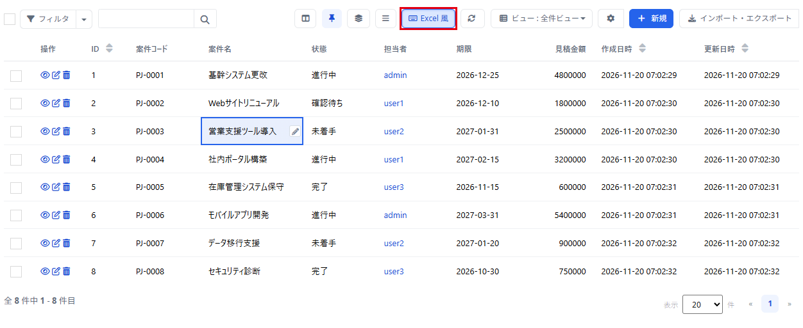

# Werkzeuge der Datenliste

Diese Seite fasst die Funktionen zusammen, mit denen Sie in der [Datenliste](/de/data_grid) die Anzeige umschalten und an Ort und Stelle bearbeiten.  
Eine Einstellung ist nicht nötig. Sie können sie sofort verwenden, wenn Sie die Datenliste öffnen.

## Schaltflächen der Symbolleiste

Oben rechts in der Datenliste, links neben der Auswahl der Ansicht, stehen die Schaltflächen.

Von links: [Anzuzeigende Spalten auswählen], [Spalten fixieren], [Zeilen gruppieren], [Darstellungsdichte], [Automatisch aktualisieren]. Ab v7.1.0 erscheint auch die Schaltfläche [\[Excel-Modus\]](/de/data_grid_tools?id=Bearbeitung-wie-in-Excel).

> Diese Einstellungen gelten für jede Person einzeln. Sie ändern die Einstellungen der Ansicht nicht und haben deshalb keinen Einfluss auf die Bildschirme anderer Benutzer.  
> [Spalten fixieren] und [Darstellungsdichte] werden **im Browser gespeichert** und bleiben auch nach dem Schließen des Browsers erhalten.  
> [Zeilen gruppieren] und [Automatisch aktualisieren] werden im Browser gespeichert, bis Sie den Tab schließen.  
> [Anzuzeigende Spalten auswählen] wird nicht im Browser gespeichert, sondern **nur in der Adresse (URL) der Liste gehalten** (`_columns_`). Wenn Sie die Liste über das Menü neu öffnen oder die Ansicht wechseln, ist der ursprüngliche Zustand wieder da. Wenn Sie eine kopierte Adresse öffnen, erscheinen dieselben Spalten. Auch wenn Sie im [Filter] auf [Suchen] drücken, geht die Angabe der gewählten Spalten verloren.

### Anzuzeigende Spalten auswählen

Sie wählen aus den Spalten der Ansicht die Spalten, die im Bildschirm erscheinen.

- Wenn Sie oben im Eingabefeld Text eingeben, wird nach dem Spaltennamen gefiltert.
- Mit [Alle auswählen], [Alle abwählen] und [Auf Standard zurücksetzen] ändern Sie alles auf einmal.
- Mit [Übernehmen] wenden Sie die Auswahl an, mit [Abbrechen] schließen Sie.

※ [Übernehmen] ist nicht möglich, wenn keine Spalte gewählt ist.  
※ Auch bei ausgeblendeten Spalten gehen keine Daten verloren. Mit [Auf Standard zurücksetzen] stellen Sie jederzeit den ursprünglichen Zustand her.

### Spalten fixieren

Die angegebenen Spalten bleiben am linken Rand des Bildschirms stehen, auch wenn Sie waagerecht blättern. Bei breiten Tabellen mit vielen Daten verlieren Sie so nicht aus den Augen, welche Zeile Sie ansehen.

| Feld | Inhalt |
| --- | --- |
| Erste 2 Spalten fixieren / Erste 3 Spalten fixieren | Stellt häufige Kombinationen sofort ein |
| Fixierung aufheben | Hebt alle Fixierungen auf |
| Aktionsspalte fixieren | Zeigt die Spalte [Aktionen] immer. Am Anfang ON. In v7.0 heißt der Eintrag „Aktionsspalte rechts fixieren“ |
| Kopfzeile fixieren | Lässt die Kopfzeile beim senkrechten Blättern stehen. Am Anfang ON |
| (Liste der Spaltennamen) | Sie wählen die zu fixierenden Spalten einzeln |

※ Wenn der Bildschirm nicht breit genug ist, werden einige Spalten nicht fixiert. Dann erscheint im Bildschirm eine Meldung.

### Zeilen gruppieren

Die Daten der gezeigten Seite werden nach den Werten der gewählten Spalte zusammengefasst.

- In der Überschrift der Gruppe steht die Anzahl der Daten dieser Gruppe.
- Mit einem Klick auf das Dreieck links neben der Überschrift klappen Sie die Gruppe ein oder aus.
- Mit [Keine Gruppierung] kehren Sie zur ursprünglichen Reihenfolge zurück.

> **Warum dort „nur diese Seite“ steht**  
> Das Gruppieren ordnet nur die Daten der Seite neu, die gerade im Bildschirm geladen ist.  
> Wenn Sie über alle Daten hinweg auswerten möchten, legen Sie eine [Auswertungsansicht](/de/view) an.

### Darstellungsdichte

Schaltet die Zeilenhöhe und den Zeilenumbruch in den Zellen um.

| Feld | Inhalt |
| --- | --- |
| Kompakt | Verringert die Zeilenhöhe. Auf einen Bildschirm passen mehr Zeilen. |
| Standard | Die Standardhöhe. |
| Großzügig | Vergrößert die Zeilenhöhe. Die Lesbarkeit hat Vorrang. |
| Einzeilige Zeilen | Der Text in der Zelle wird nicht umbrochen, sondern steht in einer Zeile. Lange Texte werden abgekürzt. Am Anfang ON; wird mit den 3 Höhen oben kombiniert. |

### Automatisch aktualisieren

Die Liste wird in festen Abständen automatisch neu geladen.  
Bei Arbeiten, die mehrere Personen gleichzeitig erledigen (zum Beispiel Annahme von Anfragen), sehen Sie den neuesten Stand, während der Bildschirm offen bleibt.

Wählen Sie Aus / 30 Sekunden / 1 Minute / 5 Minuten.  
※ Diese Einstellung endet, wenn Sie den Tab schließen.

## Bedienung in der Tabelle

※ Ab v7.1.0 steht die Spalte [Aktionen] (Anzeigen, Bearbeiten, Löschen) beim Bildschirmdesign „Modern“ direkt rechts neben dem Kontrollkästchen (auf der linken Seite der Tabelle). Bei „Klassisch“ steht sie wie bisher am rechten Rand.

### Inline-Bearbeitung (Bearbeiten per Doppelklick)

Mit einem Doppelklick auf eine Zelle ändern Sie den Wert an Ort und Stelle. Bei Zellen, die bearbeitet werden können, erscheint ein Stift-Symbol, wenn Sie die Maus darauf setzen.

Wenn Sie einen Wert wählen (eingeben), wird automatisch gespeichert, und die Anzeige der Zelle wird aktualisiert.

Die folgenden Spaltentypen können bearbeitet werden.

| Spaltentyp | Eingabe, die erscheint |
| --- | --- |
| Auswahl (feste Werte), Auswahl (Wert und Bezeichnung speichern), JA/NEIN | Auswahlliste |
| Einzeiliger Text, E-Mail, URL | Texteingabe |
| Ganzzahl, Dezimalzahl, Währung | Zahleneingabe |
| Datum, Datum und Uhrzeit | Der Kalender von Exment (Datumsauswahl). Derselbe wie im Bearbeitungsbildschirm |

Die folgenden Spalten können nicht an Ort und Stelle bearbeitet werden.

- Spalten mit Mehrfachauswahl
- Spalten, die durch eine Formel automatisch berechnet werden, und Spalten, die als Eingabe einer Formel verwendet werden
- Spalten, die der Benutzer im Bearbeitungsbildschirm (Formular) dieser Daten nicht ändern kann

Bei Tabellen, in denen das Bearbeiten deaktiviert ist, und in der Anzeige des Papierkorbs erscheint das Stift-Symbol nicht. Es erscheint auch nicht ohne Bearbeitungsrecht für die Tabelle.  
Für das Speichern gelten dieselben Bedingungen wie im Bearbeitungsbildschirm dieser Daten: die Feldeinstellungen des Formulars, die Einstellung „Über die Oberfläche nicht änderbar“, die Eingabeprüfung, die Sperre durch den Workflow und die Berechtigung des Benutzers für diese Daten. Auch der Änderungsverlauf wird geschrieben. Wenn die Änderung nicht möglich war, wird nicht gespeichert, der Grund erscheint als Meldung, und die ursprüngliche Anzeige kommt zurück.

### Bearbeitung wie in Excel

Wenn Sie [Excel-Modus] in der Symbolleiste auf ON stellen, wählen und bearbeiten Sie Zellen wie in Excel mit der Tastatur (ab v7.1.0). Am Anfang OFF. ON/OFF wird im Browser gespeichert.

| Bedienung | Inhalt |
| --- | --- |
| Klick | Wählt die Zelle (die Details der Daten öffnen sich nicht) |
| Pfeiltasten, Tab, Umschalt+Tab | Bewegt die gewählte Zelle |
| Pos1, Ende (Strg+Pos1, Strg+Ende) | Geht zum Anfang oder Ende der Zeile (zum Anfang oder Ende der Tabelle) |
| F2, Enter, Doppelklick, Eingabe von Zeichen | Beginnt die Bearbeitung der gewählten Zelle. Wenn Sie Zeichen eingeben, beginnt die Eingabe mit diesen Zeichen (auch die japanische Eingabe wird unterstützt) |
| Entf, Rücktaste | Beginnt die Bearbeitung mit leerem Feld (der Wert wird erst gelöscht, wenn Sie mit Enter speichern) |
| Enter, Tab während der Bearbeitung | Speichert und geht zur nächsten Zelle |
| Esc während der Bearbeitung | Bricht die Bearbeitung ab und stellt den ursprünglichen Wert wieder her |

※ Bei OFF ist alles wie bisher (ein Klick öffnet die Daten; Sie bearbeiten per Doppelklick oder Stift-Symbol).  
※ Welche Zellen bearbeitet werden können und welche Bedingungen für das Speichern gelten (Eingabeprüfung, Berechtigung, Workflow usw.), ist gleich wie bei der [Inline-Bearbeitung](/de/data_grid_tools?id=Inline-Bearbeitung-(Bearbeiten-per-Doppelklick)). Es ändert sich nur, wie die Bearbeitung beginnt und endet.

### Rechtsklick-Menü

Mit einem Rechtsklick auf eine Zeile erscheinen die Aktionen für diese Daten als Menü.

| Feld | Inhalt |
| --- | --- |
| Schnellvorschau | Zeigt die Details an Ort und Stelle, ohne den Bildschirm zu wechseln |
| Anzeigen | Öffnet den Detailbildschirm der Daten |
| Bearbeiten | Öffnet den Bearbeitungsbildschirm der Daten |
| Als neu duplizieren | Öffnet den Bildschirm zum Anlegen mit den kopierten Werten dieser Zeile |
| Mich als ○○ festlegen | Setzt in einer Spalte wie „Zuständige Person“ den angemeldeten Benutzer |
| Auf dieser Seite filtern: „○○“ | Zeigt nur die Zeilen mit demselben Wert wie die angeklickte Zelle |
| Zellwert kopieren | Kopiert den Wert der angeklickten Zelle in die Zwischenablage |
| Löschen | Löscht diese Daten nach einer Bestätigung |

※ Das Menü wird je Tabelle aus den Berechtigungen des Benutzers gebildet. Benutzer, die nur ansehen dürfen, sehen deshalb Löschen und Bearbeiten nicht. Die Berechtigung für die einzelnen Daten (zum Beispiel Daten, die durch den Workflow gesperrt sind) wird beim Ausführen geprüft. Wenn die Aktion nicht ausgeführt werden kann, erscheint eine Meldung.  
※ Wenn Sie beim Rechtsklick die Umschalttaste gedrückt halten, öffnet sich das eigene Menü des Browsers.

### Schnellvorschau

Sie sehen den Inhalt eines Datensatzes, ohne die Liste zu verlassen.

- Mit [Ganze Seite öffnen] gehen Sie zum normalen Detailbildschirm.
- Mit [Schließen] kehren Sie zur Liste zurück. Die Blätterposition und der Filter der Liste bleiben erhalten.

### Mehrfachauswahl und Massenaktionen

Wenn Sie das Kontrollkästchen am linken Rand von Zeilen ankreuzen, ändert sich die Farbe der gewählten Zeilen, und unten im Bildschirm erscheint eine Aktionsleiste.

| Schaltfläche | Inhalt |
| --- | --- |
| Massenbearbeitung | Ändert die Werte der gewählten Zeilen zusammen |
| CSV / Excel | Gibt nur die gewählten Zeilen in eine Datei aus (je Format eine Schaltfläche) |
| Mehrere löschen | Löscht die gewählten Zeilen zusammen |
| Auswahl aufheben | Hebt die ganze Auswahl auf |

※ Einträge wie [Mehrere löschen] hängen von der Berechtigung und von den [Einstellungen zur Massenaktualisierung](/de/operation) ab.

#### Workflow ausführen
In Tabellen mit Workflow können Sie die Workflow-Aktion für die angekreuzten Daten zusammen ausführen (ab v7.1.0).  
Klicken Sie im Menü der Massenaktionen der Liste oder in der Aktionsleiste unten im Bildschirm auf [Workflow ausführen].

- Die Aktionen, die für die gewählten Daten ausgeführt werden können, erscheinen mit der Anzahl, zum Beispiel „Genehmigen (8 von 10 ausgewählten)“. Wählen Sie die Aktion, geben Sie bei Bedarf einen Kommentar oder die nächsten Bearbeiter ein und klicken Sie auf [Ausführen].
- Die Daten werden einzeln ausgeführt, mit derselben Prüfung wie bei der Aktionsschaltfläche im Detailbildschirm (Darf der Benutzer die Daten sehen? Ist die Aktion in diesem Status ausführbar? Wurde sie nicht schon ausgeführt?). Daten, bei denen die Ausführung nicht möglich ist, werden übersprungen. Am Ende erscheinen die Anzahl der ausgeführten und die Anzahl der übersprungenen Daten (mit Grund).
- Benachrichtigungen, Plugins und Genehmigungen durch mehrere Personen laufen wie bei der einzelnen Ausführung. In einem Durchgang können höchstens 500 Daten ausgeführt werden.

※ Der Eintrag erscheint auch ohne Bearbeitungsrecht für Benutzer, die bei diesen Daten die Aktion ausführen können. In der Anzeige des Papierkorbs ist er nicht verwendbar.  
※ Zum Workflow sehen Sie bitte [Workflow ausführen](/de/workflow_execution).

#### Massenbearbeitung

- Geben Sie nur die Felder ein, die Sie ändern möchten. Jedes Feld steht am Anfang auf „(keine Änderung)“ und wird so nicht geändert.
- Wenn Sie bei einem Feld, das kein Pflichtfeld ist, die leere Auswahl wählen, **wird dieser Wert in allen gewählten Zeilen gelöscht**. Pflichtfelder können nicht geleert werden.
- Mit einem Klick auf [Auf ○ Zeilen anwenden] wird nach einer Bestätigung aktualisiert.
- Der Fortschritt wird gezeigt. Am Ende erscheinen die Anzahl der Erfolge und die Anzahl der Fehlschläge.

※ In der Massenbearbeitung erscheinen nur Spalten, deren Wert in einer Auswahlliste gewählt werden kann.  
※ Das Speichern läuft für jeden Datensatz einzeln durch die normale Aktualisierung. Eingabeprüfung, Workflow und Änderungsverlauf arbeiten deshalb unverändert. Zeilen, die wegen der Berechtigung oder einer Prüfung nicht aktualisiert werden konnten, zählen als „fehlgeschlagen“.

### Anzeige beim Filtern

Wenn Sie im [Filter] Bedingungen angeben und suchen, erscheinen die aktuellen Bedingungen über der Tabelle als Chips (kleine Labels).

- Mit „ד rechts neben dem Namen der Bedingung heben Sie nur diese Bedingung auf.
- Mit [Alle entfernen] heben Sie alle Bedingungen auf.

Wenn Sie „Auf dieser Seite filtern“ im Rechtsklick-Menü verwendet haben, erscheint ein gelber Streifen.

- Es wird gezeigt, wie viele Zeilen ausgeblendet sind.
- Mit [Filter aufheben] stellen Sie den ursprünglichen Zustand wieder her.

> „Auf dieser Seite filtern“ erfasst nur die Zeilen der gerade gezeigten Seite. Wenn Sie über mehrere Seiten hinweg filtern möchten, verwenden Sie den Bereich [Filter] oder den [Filter der Ansicht](/de/view).

## Zu den Berechtigungen

Diese Funktionen verwenden die vorhandenen Berechtigungen unverändert.

- In der Liste erscheinen wie bisher nur die Daten, die der angemeldete Benutzer sehen darf.
- Bearbeiten und Löschen erscheinen nach der Berechtigung des Benutzers für die Tabelle. Bei Daten, die nicht geändert werden können (keine Berechtigung für diese Daten oder Sperre durch den Workflow), wird die Aktion beim Ausführen abgelehnt, und nichts wird gespeichert.
- Für Inline-Bearbeitung und Massenbearbeitung gelten dieselben Bedingungen wie im Bearbeitungsbildschirm dieser Daten (siehe „Inline-Bearbeitung“ oben). Daten, die nicht geändert werden können, werden nicht aktualisiert.

## Verwandte Themen

- [Datenliste](/de/data_grid)
- [Benutzerdefinierte Ansichten](/de/view)
- [Darstellungsvorlagen](/de/cell_style_preset)
- [Einstellungen zur Massenaktualisierung](/de/operation)
