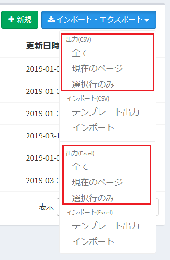
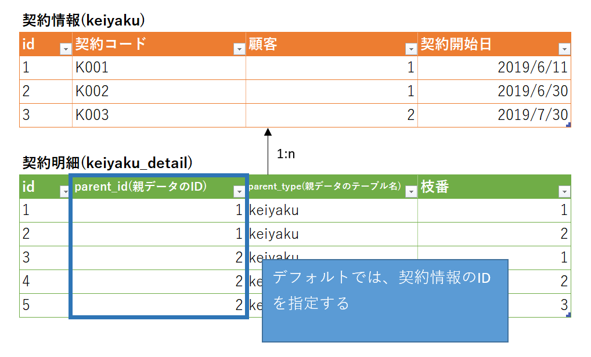

# Datenimport und -export
Diese Seite erklärt den Bildschirm, mit dem Sie die Daten einer Tabelle in eine Datei (csv, xlsx) ausgeben (Export) und aus einer Datei einlesen (Import).

| Was Sie tun möchten | Wo Sie nachsehen |
|---|---|
| Daten in eine Datei ausgeben (alle Spalten) | [Datenexport](/de/data_import_export?id=Datenexport) |
| In der Form der gerade gezeigten Ansicht in eine Datei ausgeben | „Datenexport (Ansicht)“ |
| Daten aus einer Datei einlesen | „Datenimport“ |
| Mit einem Befehl importieren und exportieren | [Datenimport und -export per Befehl](/de/data_cmd_import_export) |
| Große Datenmengen mit einem Befehl auf einmal einlesen | [Masseneinfügung großer Datenmengen](/de/data_bulk_insert) |

## Arten der Export- und Importfunktion
- Zurzeit gibt es die folgenden Arten von Export und Import.
    - Export  
    Exportiert (gibt aus) die gespeicherten Daten der Tabelle mit allen Spalten.  

    - Export (als Ansicht)  
    Exportiert (gibt aus) die Daten der Tabelle in der Form der gerade gezeigten Ansicht.  

    - Import  
    Importiert (liest ein) Daten der Tabelle aus einer csv- oder xlsx-Datei.  

- Wenn Sie in der Datenliste der Tabelle auf die Schaltfläche [Import/Export] klicken, erscheint das folgende Menü.
  

>Einträge, die Sie nicht verwenden, können Sie über [Einstellungswerte](/de/config) ausblenden.

## Datenexport
Exportiert (gibt aus) die Daten der Tabelle in eine Datei.  
Die Dateiformate sind csv und xlsx (empfohlen).  

### Bedienung
- Öffnen Sie die Datenliste.
  

- Oben rechts auf der Seite erscheint die Schaltfläche [Import/Export]. Klicken Sie darauf.  
  

- Ein Menü erscheint. Wählen Sie, was Sie ausgeben möchten.  
  
    - Alle  
    Gibt alle Daten der Tabelle aus.  
    ※ Aber: **Daten, für die der angemeldete Benutzer keine Berechtigung hat, werden nicht ausgegeben.**  
    
    - Aktuelle Seite  
    Gibt die Datenliste der gerade geöffneten Seite aus.

    - Alle (mit Kommentaren)  
    Gibt alle Daten der Tabelle und die Kommentare der einzelnen Daten aus.  
    Die Kommentare stehen im Excel-Format im Blatt „comment“ und im CSV-Format in der Datei „comment“.  
    ※ Erscheint nur bei Tabellen, bei denen „Kommentare verwenden“ in den Einstellungen der benutzerdefinierten Tabelle auf YES steht.  
    ※ Die Ausgabe der Kommentare dient zum Ansehen. Beim Import wird das Blatt (die Datei) „comment“ nicht eingelesen.

- Mit einem Klick auf die Schaltfläche [CSV] oder [Excel] werden die Daten als Datei heruntergeladen.  

### Liste der ausgegebenen Felder
##### ID  
Eine positive ganze Zahl, die beim Speichern der Daten automatisch fortlaufend vergeben wird.

##### System-ID (20-stellig)
20 alphanumerische Zeichen, die beim Speichern der Daten automatisch vergeben werden. Im Bildschirm erscheinen sie selten. Sie werden zum Beispiel bei der Datenmigration verwendet.  

##### ID der übergeordneten Daten  
Die id der übergeordneten Tabelle, wenn die Tabelle in den Relationseinstellungen als n von „1:n“ eingetragen ist. Ohne Relationseinstellung ist das Feld leer.  

##### Tabellenname der übergeordneten Daten  
Der Name der übergeordneten Tabelle (alphanumerisch), wenn die Tabelle in den Relationseinstellungen als n von „1:n“ eingetragen ist. Ohne Relationseinstellung ist das Feld leer.  

##### Liste der benutzerdefinierten Spalten  
Die Werte, die als benutzerdefinierte Spalten gespeichert sind, werden je Spalte ausgegeben.  

##### Erstellt am, Aktualisiert am, Gelöscht am  
Es werden jeweils der Zeitpunkt der Erstellung, der Aktualisierung und der Löschung der Daten ausgegeben.  

### Export bei einer 1:n-Relation
- Wenn Sie den Datenexport in einer Tabelle ausführen, die in den Relationseinstellungen als „1“ von „1:n“ eingetragen ist, **wird auch die Datenliste der verknüpften „n“-Tabelle gleichzeitig exportiert.**  

Beispiel: Die Relationseinstellung ist mit „Vertragsinformationen“ als 1 und „Vertragspositionen“ als n gespeichert  
  
- Wenn Sie im Bildschirm „Vertragsinformationen“ den Datenexport ausführen (※ „Kunde“ im Bild sind Testdaten)  
  
- werden die Daten von „Vertragsinformationen“ und von „Vertragspositionen“ beide ausgegeben.
  
  
- In „ID der übergeordneten Daten“ und „Tabellenname der übergeordneten Daten“ der „n“-Datenliste stehen die ID und der Tabellenname der verknüpften übergeordneten Tabelle.

### Export bei einer n:n-Relation
- Wenn Sie den Datenexport in einer Tabelle ausführen, die in den Relationseinstellungen als Ausgangs-n von „n:n“ eingetragen ist, **werden auch die Verknüpfungsinformationen zur verknüpften „n“-Tabelle gleichzeitig exportiert.**  

Beispiel: Die Relationseinstellung ist mit „Organisationsinformationen“ und „Benutzerinformationen“ als n:n gespeichert  
  
- Wenn Sie im Bildschirm „Organisationsinformationen“ den Datenexport ausführen,  
  
- werden die Daten von „Organisationsinformationen“ ausgegeben. Außerdem werden die Daten ausgegeben, die „Benutzerinformationen“ und „Organisationsinformationen“ verknüpfen.
  
  
- In „parent_id“ steht die ID der übergeordneten Organisationsinformationen, in „child_id“ die ID der untergeordneten Benutzerinformationen.  

### Weitere Hinweise
- Im CSV-Format und im Excel-Format steht in der 1. Zeile der Spaltenname (alphanumerisch) und in der 2. Zeile der Anzeigename der Spalte. Auch im CSV-Format hat der Kopf 2 Zeilen. Bitte beachten Sie das.  
- Eine im CSV-Format ausgegebene Datei hat den Zeichensatz UTF-8, den Zeilenumbruch LF und kein BOM.  
- Wenn wegen der Relationseinstellungen mehrere Datenlisten ausgegeben werden, sind es im Excel-Format mehrere Blätter. Im CSV-Format werden mehrere csv-Dateien in einer zip-Datei zusammengefasst.  

### Ausgabewerte beim Export ändern
Beim Export steht in den Spalten „ID der übergeordneten Daten“, „Auswahl (aus Tabelle)“, „Benutzer“ und „Organisation“ normalerweise die ID der Daten der referenzierten Tabelle. Stattdessen können Sie **den Wert einer benutzerdefinierten Spalte der referenzierten Tabelle ausgeben.**  
Die Schritte dazu stehen unten.  

#### Bei parent_id (ID der übergeordneten Daten)
1. Öffnen Sie den Bildschirm der Relationseinstellungen.

2. Stellen Sie bei „Schlüsselspalte beim Export“ die benutzerdefinierte Spalte ein, die beim Export ausgegeben werden soll, und speichern Sie.  

3. Wenn Sie danach Daten exportieren, ist der Ausgabewert statt der id der Wert der gewählten benutzerdefinierten Spalte. 

※ Normal
  
  
※ Mit „Schlüsselspalte beim Export“
  

#### Bei „Auswahl (aus Tabelle)“, „Benutzer“, „Organisation“
1. Öffnen Sie den Bildschirm der Einstellungen dieser benutzerdefinierten Spalte.

2. Stellen Sie bei „Schlüsselspalte beim Export“ die benutzerdefinierte Spalte ein, die beim Export ausgegeben werden soll, und speichern Sie.  

3. Wenn Sie danach in der referenzierenden Tabelle Daten exportieren, ist der Ausgabewert statt der id der Wert der gewählten benutzerdefinierten Spalte. 

※ Normal
  
  
※ Mit „Schlüsselspalte beim Export“
  

## Datenexport (Ansicht)
Exportiert (gibt aus) die Daten der Tabelle in der Form der gerade gezeigten Ansicht in eine Datei.  
Die Dateiformate sind csv und xlsx (empfohlen).  

### Bedienung
- Öffnen Sie die Datenliste.
  

- Oben rechts auf der Seite erscheint die Schaltfläche [Import/Export]. Klicken Sie darauf.  
  

- Ein Menü erscheint. Wählen Sie, was Sie ausgeben möchten.
  
    - Alle  
    Gibt alle Daten der Tabelle aus.  
    ※ Aber: **Daten, für die der angemeldete Benutzer keine Berechtigung hat, werden nicht ausgegeben.**  

    - Aktuelle Seite  
    Gibt die Datenliste der gerade geöffneten Seite aus.

- Mit einem Klick auf die Schaltfläche [CSV] oder [Excel] werden die Daten als Datei heruntergeladen. Die Felder der gerade gezeigten Ansicht werden unverändert ausgegeben.  

## Datenimport
Importiert (liest ein) Daten der Tabelle aus einer Datei.  
Die Dateiformate sind csv und xlsx (empfohlen). Die Daten müssen vorher in dem Format vorbereitet werden, das Exment festlegt.

Der Ablauf ist wie folgt.

1. Die Vorlage ausgeben („Vorlage exportieren“)  
2. Die Daten, die Sie einlesen möchten, in die Vorlage schreiben („Liste der Importfelder“)  
3. Den Import ausführen („Datenimport ausführen“)

> Zurzeit ist die Anzahl der Daten, die auf einmal importiert werden können, wegen der Leistung auf 5000 begrenzt.  
Wenn Sie mehr als 5000 Daten auf einmal speichern möchten, prüfen Sie bitte die [Masseneinfügung großer Datenmengen](/de/data_bulk_insert).

### Bedienung

#### Vorlage exportieren
Gibt die Vorlagendatei zum Einlesen von Daten aus.

- Öffnen Sie die Datenliste.
  

- Oben rechts auf der Seite erscheint die Schaltfläche [Import/Export]. Klicken Sie darauf.  
  

- Klicken Sie unter „Vorlage exportieren“ des Imports auf [CSV] oder [Excel].
  

- Die CSV- oder Excel-Datei zum Einlesen von Daten wird heruntergeladen.  
  
※ Das Dateiformat ist dasselbe wie bei der Ausgabe mit „Export“.  
Die Vorlage wird mit 0 Daten ausgegeben.

- Schreiben Sie die Daten, die Sie einlesen möchten, in die ausgegebene Vorlage.

### Liste der Importfelder
##### ID  
Eine positive ganze Zahl, die beim Speichern der Daten automatisch fortlaufend vergeben wird.  
Schreiben Sie hier nur etwas, wenn Sie diese ID beim Einlesen selbst festlegen möchten.  
Wenn Sie sie nicht festlegen müssen, lassen Sie das Feld leer. Beim Einlesen trägt das System den Wert automatisch ein.  

##### System-ID (20-stellig)  
20 alphanumerische Zeichen, die beim Speichern der Daten automatisch vergeben werden. Im Bildschirm erscheinen sie selten.  
Schreiben Sie hier nur etwas, wenn Sie diese System-ID beim Einlesen selbst festlegen möchten.  
Wenn Sie sie nicht festlegen müssen, lassen Sie das Feld leer. Das System trägt den Wert automatisch ein.  

##### ID der übergeordneten Daten  
Normalerweise bleibt das Feld leer.  
Wenn die Tabelle, in die Sie einlesen, in den Relationseinstellungen als n von „1:n“ eingetragen ist, geben Sie die id der übergeordneten Tabelle ein.  
  
※ In der Anfangseinstellung geben Sie die ID der Daten der übergeordneten Tabelle an. Sie können aber **auch eine benutzerdefinierte Spalte angeben und damit einlesen**. Einzelheiten finden Sie unter „[Angabe der Daten einer anderen Tabelle ändern](/de/data_import_export?id=Angabe-der-Daten-einer-anderen-Tabelle-ändern)“.  

##### Tabellenname der übergeordneten Daten  
Normalerweise bleibt das Feld leer.  
Wenn die Tabelle in den Relationseinstellungen als n von „1:n“ eingetragen ist, geben Sie den Namen der übergeordneten Tabelle (alphanumerisch) ein.  
  

##### Liste der benutzerdefinierten Spalten  
Schreiben Sie die Werte, die als benutzerdefinierte Spalten gespeichert werden.  
※ Je nach Spaltentyp werden die Werte anders geschrieben. Sehen Sie dazu unten „[Eingabe der benutzerdefinierten Spalten beim Import](/de/data_import_export?id=Eingabe-der-benutzerdefinierten-Spalten-beim-Import)“.

##### Erstellt am, Aktualisiert am, Gelöscht am  
Normalerweise bleiben die Felder leer.  
Schreiben Sie hier nur etwas, wenn Sie den Zeitpunkt der Erstellung, der Aktualisierung oder der Löschung der Daten selbst festlegen möchten.  
Bei leeren Feldern trägt das System beim Einlesen die Werte automatisch ein.

### Datenimport ausführen
Sie führen den Import im Bildschirm aus.

- Öffnen Sie die Datenliste.
  

- Oben rechts auf der Seite erscheint die Schaltfläche [Import/Export]. Klicken Sie darauf.  
  

- Klicken Sie unter „Import (CSV)“ oder „Import (Excel)“ auf „Import“.
  

- Der Importdialog erscheint.  
  

- Wählen Sie bei „Importdatei“ die Vorlagendatei, in die Sie die Daten geschrieben haben.  

- Wählen Sie bei „Primärschlüssel“ den Primärschlüssel, an dem beim Einlesen erkannt wird, ob Daten neu sind oder aktualisiert werden.  
Einzelheiten finden Sie unten unter „Arten des Primärschlüssels“.

- Wenn alles eingestellt ist, klicken Sie im Dialog auf [Absenden].

- Wenn es ein Problem mit den Importdaten gibt, erscheinen unter „Fehlermeldung“ die Zeilennummer nach dem Kopf und der Inhalt des Fehlers.

※ Wenn bei einem Feld, das in den Einstellungen der benutzerdefinierten Spalte „[Erforderlich](/de/column)“ ist, kein Wert steht, gelingt der Import nicht. Prüfen Sie, ob in der Vorlagendatei Eingaben fehlen.
- Wenn das Einlesen richtig beendet ist, schließt sich der Dialog, und die Daten werden neu geladen.

### Wie neue und zu aktualisierende Daten erkannt werden
Beim Einlesen wird für jede Zeile erkannt, ob es neue Daten sind oder ob vorhandene Daten aktualisiert werden.  
Hier steht, wie das erkannt wird.

- Im Bildschirm zum Einlesen geben Sie die Spalte „Primärschlüssel“ an, die dafür verwendet wird. (Hier ist es „ID“)  
※ Den Primärschlüssel wählen Sie beim Einlesen. Sehen Sie unten „Arten des Primärschlüssels“

- Beim Einlesen sieht das System den Wert der Spalte ID der Importdaten an.
  

    - Wenn die ID der Importdaten leer ist, werden die Daten als neue Daten behandelt.
  

    - Wenn die ID der Importdaten einen Wert hat, sucht das System in den schon gespeicherten Daten nach Daten mit derselben ID.  
  
    Gibt es Daten mit derselben ID, werden diese Daten mit dem Inhalt der Importdaten aktualisiert.  
    Gibt es keine, werden die Importdaten neu hinzugefügt. Die ID ist dann die ID der Importdaten.  

### Arten des Primärschlüssels

- ##### ID (empfohlen)  
Eine ganze Zahl, die das System automatisch vergibt. Sie wird auch für Relationen mit anderen Tabellen verwendet.  
Sie ist einfach, und der Wert lässt sich leicht vorher eintragen. Weil sie aber automatisch fortlaufend vergeben wird, kann es bei der Migration von einer Umgebung in eine andere zu unerwarteten Abweichungen kommen.

- ##### System-ID (20-stellig)  
20 alphanumerische Zeichen, die das System beim Speichern der Daten automatisch vergibt.  
Bei der Migration von einer Umgebung in eine andere empfehlen wir diese System-ID, damit klar ist, welche Daten aktualisiert werden.  

- ##### Eindeutige Spalte  
Spalten, die in den Einstellungen der benutzerdefinierten Spalte auf „Eindeutig“ stehen, können als Primärschlüssel gewählt werden. (Beispiel: E-Mail-Adresse, Benutzercode)    

### Eingabe der benutzerdefinierten Spalten beim Import
Je nach Typ der benutzerdefinierten Spalte werden die Werte beim Import anders geschrieben.  
Sehen Sie dazu den folgenden Inhalt.

##### Auswahl (Wert und Bezeichnung speichern)  
Geben Sie den „Wert“ ein, der in der Datenbank gespeichert wird, oder die „Bezeichnung“, die im Bildschirm erscheint.  

##### Auswahl (aus Tabelle), Benutzer, Organisation  
Geben Sie die **ID der referenzierten Tabelle** ein.  
  
※ In der Anfangseinstellung geben Sie die ID der Daten der referenzierten Tabelle an. Sie können aber **auch eine benutzerdefinierte Spalte angeben und damit einlesen**. Einzelheiten finden Sie unter „[Angabe der Daten einer anderen Tabelle ändern](/de/data_import_export?id=Angabe-der-Daten-einer-anderen-Tabelle-ändern)“.  

##### JA/NEIN  
Geben Sie „YES“ oder „NO“ ein, oder „1“ oder „0“.  

##### Auswahl mit 2 Werten  
Geben Sie die Anzeige oder den Wert der „Auswahl mit 2 Werten“ ein, die im Bildschirm der benutzerdefinierten Spalte eingegeben wurden.  
  

##### Alle anderen  
Geben Sie den zu speichernden Wert unverändert ein.  

### Angabe der Daten einer anderen Tabelle ändern
Beim Import schreiben Sie in die Spalten „ID der übergeordneten Daten“, „Auswahl (aus Tabelle)“, „Benutzer“ und „Organisation“ normalerweise die ID der Daten der referenzierten Tabelle. Stattdessen können Sie **die Daten mit dem Wert einer benutzerdefinierten Spalte angeben und einlesen.**  
Die Schritte dazu stehen unten.  

#### Bei parent_id (ID der übergeordneten Daten)
1. Öffnen Sie den Bildschirm der Relationseinstellungen.

2. Stellen Sie bei „Schlüsselspalte beim Import“ die benutzerdefinierte Spalte ein, mit der beim Import der Wert gesucht wird, und speichern Sie.  
※ Sie können nur Spalten angeben, die in den Einstellungen der benutzerdefinierten Spalten als „Suchindex“ angegeben sind.  

3. Laden Sie danach in der untergeordneten Tabelle die Excel-Datei zum Einlesen herunter. Im Blatt „##setting##“ stehen der Name der untergeordneten Tabelle, „parent_id“ und der Name der angegebenen benutzerdefinierten Spalte der übergeordneten Tabelle.  
  

4. Ändern Sie den Inhalt dieses Blatts nicht. Schreiben Sie die Importdaten in das Blatt der untergeordneten Tabelle.  
In die Spalte „parent_id“ schreiben Sie dabei den Wert der benutzerdefinierten Spalte, die als **Schlüsselspalte beim Import** eingetragen ist.  
Im Beispiel unten geben Sie den Wert von „Vertragscode“ der übergeordneten Tabelle „Vertragsinformationen“ ein.
  
  

5. Führen Sie danach den Import aus.

#### Bei „Auswahl (aus Tabelle)“, „Benutzer“, „Organisation“
1. Öffnen Sie den Bildschirm der Einstellungen dieser benutzerdefinierten Spalte.

2. Stellen Sie bei „Schlüsselspalte beim Import“ die benutzerdefinierte Spalte ein, mit der beim Import der Wert gesucht wird, und speichern Sie.  
※ Sie können nur Spalten angeben, die in den Einstellungen der benutzerdefinierten Spalten als „Suchindex“ angegeben sind.  

3. Laden Sie danach in der referenzierenden Tabelle die Excel-Datei zum Einlesen herunter. Im Blatt „##setting##“ stehen der Name der referenzierenden Tabelle, „value.“ + Name der benutzerdefinierten Spalte der referenzierenden Tabelle und der Name der benutzerdefinierten Spalte der referenzierten Tabelle.  
  

4. Ändern Sie den Inhalt dieses Blatts nicht. Schreiben Sie die Importdaten in das Blatt der referenzierenden Tabelle.  
In die benutzerdefinierte Spalte der referenzierenden Tabelle schreiben Sie dabei den Wert der benutzerdefinierten Spalte der referenzierten Tabelle, die als **Schlüsselspalte beim Import** eingetragen ist.  
Im Beispiel unten geben Sie den Wert von „Kundencode“ der referenzierten Tabelle „Kundenstamm“ ein.
  
  

5. Führen Sie danach den Import aus.

#### Hinweise
- Unterstützt wird nur das Einlesen im Excel-Format. Das CSV-Format wird zurzeit nicht unterstützt.
