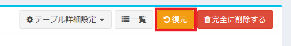

# Gelöschte Daten
Diese Seite erklärt den Bildschirm, in dem Sie gelöschte Daten als Liste ansehen, wiederherstellen und endgültig löschen.

- Gelöschte Daten können nur Benutzer ansehen, die die Berechtigung zum Anzeigen gelöschter Daten haben.
- Benutzer mit Bearbeitungsrecht können Daten wiederherstellen und endgültig löschen.  

※ Einzelheiten zu den Berechtigungen finden Sie unter [Rollengruppen](/de/role_group).

## Liste anzeigen
  

1. Wählen Sie in der Datenliste über das Zeichen ▼ rechts neben [Filter] oben links den Eintrag „Gelöschte Daten“.
2. Die Anzeige wechselt, und die gelöschten Daten dieser Tabelle erscheinen als Liste.

  

## Details anzeigen

- Von den Daten in der Liste der gelöschten Daten können Sie die Details anzeigen.  
- Klicken Sie auf die Zeile der Daten oder auf das Anzeigen-Symbol in der Aktionsspalte.

  

- Im Bildschirm der Datendetails sehen Sie, wer gelöscht hat und wann.

  

## Wiederherstellen

- Gelöschte Daten können Sie in die Datenliste zurückholen (wiederherstellen).
- Es gibt 3 Wege zum Wiederherstellen.
    - Die Schaltfläche [Wiederherstellen] im Bildschirm der Datendetails verwenden.
      
    - In der Liste der gelöschten Daten das Symbol [Wiederherstellen] in der Aktionsspalte verwenden.
      
    - In der Liste der gelöschten Daten die Daten ankreuzen, die Sie wiederherstellen möchten, und über das Zeichen ▼ oben links im Bildschirm der gelöschten Daten „Wiederherstellen“ wählen.
      

※ Daten wiederherstellen können nur Benutzer, die für diese Daten das Bearbeitungsrecht haben.

## Endgültig löschen

- Gelöschte Daten können Sie endgültig löschen. Endgültig gelöschte Daten verschwinden auch aus der Liste der gelöschten Daten.
- Es gibt 3 Wege zum endgültigen Löschen.
    - Die Schaltfläche [Endgültig löschen] im Bildschirm der Datendetails verwenden.
      
    - In der Liste der gelöschten Daten das Symbol [Endgültig löschen] in der Aktionsspalte verwenden.
      
    - In der Liste der gelöschten Daten die Daten ankreuzen, die Sie endgültig löschen möchten, und über das Zeichen ▼ oben links im Bildschirm der gelöschten Daten „Endgültig löschen“ wählen.
      

※ Daten endgültig löschen können nur Benutzer, die für diese Daten das Bearbeitungsrecht haben.

## Zur Datenliste wechseln

- Wenn Sie in der Liste der gelöschten Daten auf [Gelöschte Daten▼] klicken und „Abbrechen“ wählen, wechseln Sie zur Datenliste dieser Tabelle.

  

#### Berechtigungen
- Um gelöschte Daten anzuzeigen, braucht der Benutzer das Anzeigerecht für diese Daten.
- Um gelöschte Daten wiederherzustellen oder endgültig zu löschen, braucht der Benutzer das Bearbeitungsrecht für diese Daten.

※ Zur Einstellung der Berechtigungen sehen Sie bitte [Rollengruppen](/de/role_group).
