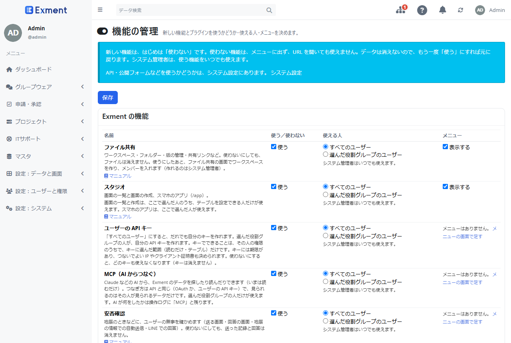

# Funktionsverwaltung
Hier legen Sie fest, ob neue Funktionen und Plugins verwendet werden, wer sie nutzen darf und ob sie im Menü stehen.  
Exment wird auf vielen Websites genutzt. Deshalb steht eine neue Funktion am Anfang auf „Nicht verwenden“. Bis ein Systemadministrator sie auf „Verwenden“ stellt, erscheint sie nicht im Menü und lässt sich auch über die URL nicht nutzen. Allein durch eine Aktualisierung von Exment ändern sich Bildschirme und Menüs nicht.

※Dieser Bildschirm ist ab Exment v7.2.1 nutzbar.

## Einstellungsbildschirm
Melden Sie sich als Systemadministrator an und öffnen Sie „Administratoreinstellungen“ → „Funktionsverwaltung“ (die URL ist `/feature`).  
Nur Systemadministratoren können diesen Bildschirm öffnen.

Der Bildschirm ist geteilt in „Funktionen von Exment“ oben und „Plugins“ unten.

## Funktionen von Exment
Die neuen Funktionen von Exment selbst. Derzeit gibt es die folgenden.

| Name | Inhalt |
| --- | --- |
| Dateifreigabe | Arbeitsbereiche, Ordner, Versionsverwaltung, Freigabelinks usw. Auch bei „Nicht verwenden“ werden die Dateien nicht gelöscht. (Erscheint nur in Versionen, die die Dateifreigabe enthalten) |
| Studio | Die Bildschirmliste, das Erstellen von Bildschirmen und die Smartphone-App (/app). Nutzen können es die Personen, die Tabellen einrichten dürfen. |
| Datenpflege | Die Daten einer Tabelle werden auf einmal bereinigt (derzeit: Anhänge auf einmal löschen). Nutzen können es die Personen, die Tabellen einrichten dürfen. (ab v7.3.0) [Datenpflege](/de/data_maintenance) |

Für jede Funktion legen Sie die folgenden 3 Dinge fest.

| Feld | Inhalt |
| --- | --- |
| Verwenden | Ob die Funktion auf dieser Website verwendet wird. Am Anfang steht sie auf „Nicht verwenden“. |
| Wer darf es nutzen | „Alle Benutzer“ oder „Benutzer der ausgewählten Rollengruppen“. Wenn Sie keine Rollengruppe wählen, können nur Systemadministratoren die Funktion nutzen. Systemadministratoren können sie jederzeit nutzen. |
| Menü | Ob die Funktion im Menü steht („Anzeigen“). Sie erscheint nur bei den Personen, die sie nutzen dürfen. Wenn es keine Menüzeile gibt, steht dort, dass die Menüzeile fehlt und beim Speichern angelegt wird. |

In der Spalte „Zustand“ steht Folgendes.

| Zustand | Bedeutung |
| --- | --- |
| Neu | Eine Funktion, über die noch niemand entschieden hat (sie gilt als „Nicht verwenden“). |
| In Verwendung | Die Funktion steht auf „Verwenden“ und ist nutzbar. |
| In dieser Umgebung nicht verfügbar | Die Funktion ist in der Einstellung des Servers gesperrt ([In der Einstellung des Servers festlegen](/de/feature?id=In-der-Einstellung-des-Servers-festlegen)). In diesem Bildschirm lässt sie sich nicht auf „Verwenden“ stellen. |
| Kann nicht verwendet werden, da eine benötigte Funktion deaktiviert ist. | Eine Funktion, die nur zusammen mit einer anderen Funktion läuft (es steht „Nur solange „○○“ verwendet wird.“ dabei), und diese andere Funktion steht auf „Nicht verwenden“. |

※Das Studio können von den hier gewählten Personen nur die nutzen, die Tabellen einrichten dürfen.  
※Ob die API, öffentliche Formulare usw. verwendet werden, steht wie bisher in den [Systemeinstellungen](/de/system_setting).

<!-- Screenshot: eine Zeile der Funktionen von Exment (Verwenden, Wer darf es nutzen, Menü) (img/feature/feature_core.png). Wird nach dem Merge von #1861 aufgenommen -->

## Plugins
Auch die installierten Plugins stehen im selben Bildschirm.  
Es gibt keine zweite, neue Einstellung. Der Bildschirm zeigt die vorhandenen Einstellungen, wie sie sind.

| Feld | Inhalt |
| --- | --- |
| Verwenden | Dasselbe wie aktiv / inaktiv beim Plugin. Wenn das Plugin inaktiv ist, steht dort, dass das Plugin inaktiv ist. Zum Ändern gehen Sie über „In den Plugin-Einstellungen ändern“ in den Bildschirm [Plugin](/de/plugin). |
| Wer darf es nutzen | Dasselbe wie die Plugin-Berechtigung „Zugriff“ der Rollengruppen. Zum Ändern gehen Sie in den Bildschirm [Rollengruppe](/de/role_group). |
| Menü | Ob das Plugin im Menü angezeigt wird. Nur das legen Sie in diesem Bildschirm fest. |

※Bei Plugins eines Typs, den alle nutzen können, und bei Plugins, die in den Plugin-Einstellungen auf „alle Benutzer dürfen es nutzen“ gestellt sind, steht das dabei.  
※Wenn ein Plugin Funktionen enthält, die es selbst angemeldet hat (zum Beispiel Webmail), stehen sie unter dem Plugin, jede in einer eigenen Zeile. Auch die Funktionen in einem Plugin stehen am Anfang auf „Nicht verwenden“. Nutzen dürfen sie von den Personen, die das Plugin nutzen dürfen, die hier gewählten.

<!-- Screenshot: die Zeile eines Plugins und die Zeilen der Funktionen im Plugin (img/feature/feature_plugin.png). Wird nach dem Merge von #1861 aufgenommen -->

## Kostenlose offizielle Plugins (in Exment enthalten)
Mit Exment werden kostenlose offizielle Plugins ausgeliefert (Projektverwaltung, IT-Support, Groupware). Sie installieren sie im Bereich „Kostenlose offizielle Plugins (in Exment enthalten)“ der „Funktionsverwaltung“. Einzelheiten stehen unter [Offizielle Plugins](/de/plugin_official).

- Bis Sie auf „Verwenden (installieren)“ klicken, wird nichts installiert und nichts geladen (es werden auch keine Tabellen angelegt).
- Nach dem Klick wird geprüft, dann installiert und aktiviert. Auch die Hauptfunktion des Plugins steht dann auf „Verwenden“. Danach steht das Plugin auch oben im Bereich „Plugins“, und Sie können festlegen, wer es nutzen darf und ob es im Menü steht.
- Wenn es eine neue Version gibt, steht dort „Version ○○ ist verfügbar.“ Sie wird nicht automatisch installiert. Sie aktualisieren mit „Auf diese Version aktualisieren“ (Einstellungen, Menüs und Berechtigungen bleiben erhalten).
- Die Version vor der Aktualisierung bleibt erhalten. Mit „Zurück zur vorherigen Version (○○)“ kehren Sie zurück.
- Plugins, die Sie schon früher von Hand installiert haben, nutzen Sie unverändert weiter (sie werden nicht neu installiert). Nur wenn die mitgelieferte Version neuer ist, erscheint ein Hinweis. Wenn Sie durch die mitgelieferte Version ersetzen, können Sie nicht zur von Hand installierten Version zurückkehren.
- Mitgelieferte Plugins werden erst installiert, nachdem die Signatur von Exceed One geprüft wurde. Plugins, deren Signatur nicht stimmt, erscheinen nicht.
- Auf Websites, auf denen der Betreiber die Versionen wechselt (SaaS usw.), steht „Die Versionen werden vom Betreiber dieser Website gewechselt.“, und es erscheinen keine Schaltflächen (`EXMENT_BUNDLED_PLUGINS_UPDATES=false` in `.env`).

#### Hinweis auf Sicherheitskorrekturen
Wenn die neue Version eines installierten offiziellen Plugins eine Sicherheitskorrektur enthält, werden die Systemadministratoren informiert.

- Oben auf der Startseite der Systemadministratoren erscheint „Update für ein offizielles Plugin verfügbar (○○)“. Auch in der Zeile der Funktionsverwaltung erscheinen das Kennzeichen „Sicherheitskorrektur“ und „Diese Version enthält eine Sicherheitskorrektur. Klicken Sie auf „Auf diese Version aktualisieren“.“
- Als Benachrichtigung an der Glocke und, auf Websites mit E-Mail-Versand, per E-Mail werden derselbe Betreff und derselbe Text nur 1 Mal gesendet.
- Andere Benutzer sehen nichts. Aktualisiert wird nur, wenn ein Systemadministrator auf „Auf diese Version aktualisieren“ klickt.
- Wenn Sie zu einer Version ohne die Sicherheitskorrektur zurückkehren, wird noch einmal nachgefragt.

#### Hinweis auf neue Funktionen
Wenn nach einer Aktualisierung von Exment neue Funktionen dazugekommen sind, über die noch nicht entschieden ist, werden die Systemadministratoren nur 1 Mal informiert: mit einem Hinweis auf der Startseite und an der Glocke („Es gibt neue Funktionen (○○). Sie sind anfangs deaktiviert. …“). Eine E-Mail wird nicht gesendet. Auf neu installierten Websites erscheint der Hinweis nicht.

<!-- Screenshot: der Bereich der kostenlosen offiziellen Plugins (img/feature/feature_bundled.png). Wird nach dem Merge von #1867 aufgenommen -->

## Wenn Sie „Nicht verwenden“ wählen
- Die Funktion erscheint nicht mehr im Menü (die Menüzeile wird nicht gelöscht, nur ausgeblendet).
- Die Seiten und die API der Funktion lassen sich auch dann nicht nutzen, wenn die URL direkt geöffnet wird.
- Die Daten (Arbeitsbereiche, Dateien, Bildschirme usw.) werden nicht gelöscht. Wenn Sie wieder „Verwenden“ wählen, ist alles wie vorher.
- Wenn Sie eine Funktion, die jemand nutzt, auf „Nicht verwenden“ stellen oder die Personen verringern, die sie nutzen dürfen, wird beim Speichern nachgefragt: „Einige Benutzer können Folgendes nicht mehr nutzen. Speichern?“

## Hinweise, wenn eine Funktion nicht nutzbar ist
Wenn Sie die URL einer nicht nutzbaren Funktion öffnen, erscheint einer der folgenden Hinweise.

| Hinweis | Wann er erscheint |
| --- | --- |
| Diese Funktion wird auf dieser Website nicht verwendet. | Wenn die Funktion auf „Nicht verwenden“ steht (oder in der Einstellung des Servers gesperrt ist). Systemadministratoren sehen auch einen Link zur „Funktionsverwaltung“. |
| Sie haben keine Berechtigung, diese Funktion zu nutzen. Bitte wenden Sie sich an Ihren Administrator. | Wenn die Funktion auf „Verwenden“ steht, die angemeldete Person aber nicht zu „Wer darf es nutzen“ gehört. |

In beiden Fällen kommen Sie über den Link „Zurück zur Startseite“ zur Startseite zurück. Bei einem Aufruf über die API kommt derselbe Hinweis als JSON zurück (404, wenn die Funktion nicht verwendet wird; 403, wenn die Berechtigung fehlt).

<!-- Screenshot: der Bildschirm „Diese Funktion wird auf dieser Website nicht verwendet.“ (img/feature/feature_not_used.png). Wird nach dem Merge von #1861 aufgenommen -->

## Auf aktualisierten Websites
Auch nach einer Aktualisierung von Exment nutzen Sie alles weiter, was Sie bisher genutzt haben.

- Funktionen, die schon vor der Aktualisierung genutzt wurden, stehen auf „Verwenden“. Sie sind wie bisher sichtbar.
  - Dateifreigabe: Websites mit mindestens einem Arbeitsbereich
  - Studio: Websites, auf denen jemand schon einmal einen Bildschirm des Studios oder die Smartphone-App geöffnet hat (geprüft wird im Vorgangsprotokoll)
- Funktionen, die nur ein Menü hatten, aber nicht genutzt wurden, stehen auf „Nicht verwenden“.
- Aktiv / inaktiv bei Plugins und die Berechtigungen der Rollengruppen ändern sich nicht.
- Von den Funktionen in einem Plugin bleiben die, die das Plugin schon früher hatte, auf Websites mit schon früher installiertem Plugin auf „Verwenden“.
- Auf neu installierten Websites beginnt alles mit „Nicht verwenden“.
- Unter „Administratoreinstellungen“ kommt der Menüpunkt „Funktionsverwaltung“ dazu.

## In der Einstellung des Servers festlegen
Wenn Sie `EXMENT_FEATURES_LOCKED` in die `.env` des Servers schreiben, können Sie eine Funktion fest auf „Nicht verwenden“ setzen, egal was der Systemadministrator der Website wählt.  
Das nutzen Dienste, die eine Funktion nicht anbieten (SaaS usw.). Schreiben Sie die Schlüssel durch Kommas getrennt.

~~~
EXMENT_FEATURES_LOCKED=file_server,studio
~~~

| Schlüssel | Funktion |
| --- | --- |
| `file_server` | Dateifreigabe |
| `studio` | Studio (einschließlich der Smartphone-App) |

Bei einer so festgelegten Funktion steht in diesem Bildschirm „In dieser Umgebung nicht verfügbar“.

※Nach einer Änderung der `.env` führen Sie auf Servern, die den Cache der Konfiguration nutzen, `php artisan config:clear` (oder `php artisan config:cache`) aus.

## Reihenfolge der Entscheidung
Ob eine Funktion nutzbar ist, wird von oben nach unten entschieden. Eine untere Einstellung kann nicht mehr erlauben als eine obere.

1. **Einstellung des Servers**: Funktionen, die in `EXMENT_FEATURES_LOCKED` stehen, sind nicht nutzbar.
2. **„Verwenden“ / „Nicht verwenden“ der Website**: Eine Funktion auf „Nicht verwenden“ kann niemand nutzen.
3. **Wer darf es nutzen**: Alle Benutzer oder die Benutzer der ausgewählten Rollengruppen (Systemadministratoren können sie jederzeit nutzen).
4. **Einstellungen in der Funktion**: Beim Studio die Berechtigungen der Tabellen, bei der Dateifreigabe die Berechtigungen der Arbeitsbereiche usw.

## Für Entwickler von Plugins
Ein Plugin kann seine eigenen Funktionen anmelden und so je 1 Zeile in diesem Bildschirm zeigen. Eine angemeldete Funktion steht am Anfang auf „Nicht verwenden“.

~~~php
use Exceedone\Exment\Services\Features;

// Zum Beispiel im Konstruktor der Plugin-Klasse anmelden. Der Schlüssel beginnt mit der uri des Plugins
Features::register('exment_groupware.mail', [
    'label' => 'Web メール',
    'endpoints' => ['plugins/exment_groupware/mail'],
]);

// In der Seite des Plugins prüfen
if (!Features::allowed('exment_groupware.mail')) {
    return Features::deny('exment_groupware.mail');
}
~~~

- Bei den Seiten, die in `endpoints` stehen, erscheint der Hinweis von oben, wenn die Funktion nicht nutzbar ist.
- Mit `existing => true` bleibt die Funktion auf Websites, auf denen das Plugin schon früher installiert war, auf „Verwenden“ (für den Fall, dass eine schon vorhandene Funktion nachträglich angemeldet wird).
- Wenn Sie in `requires` den Schlüssel einer anderen Funktion schreiben, ist die Funktion nicht nutzbar, solange die andere auf „Nicht verwenden“ steht.

## Verwandte Themen
- [Systemeinstellungen](/de/system_setting)
- [Plugin](/de/plugin)
- [Rollengruppen und Berechtigungen](/de/role_group)
- [Menü](/de/menu)
