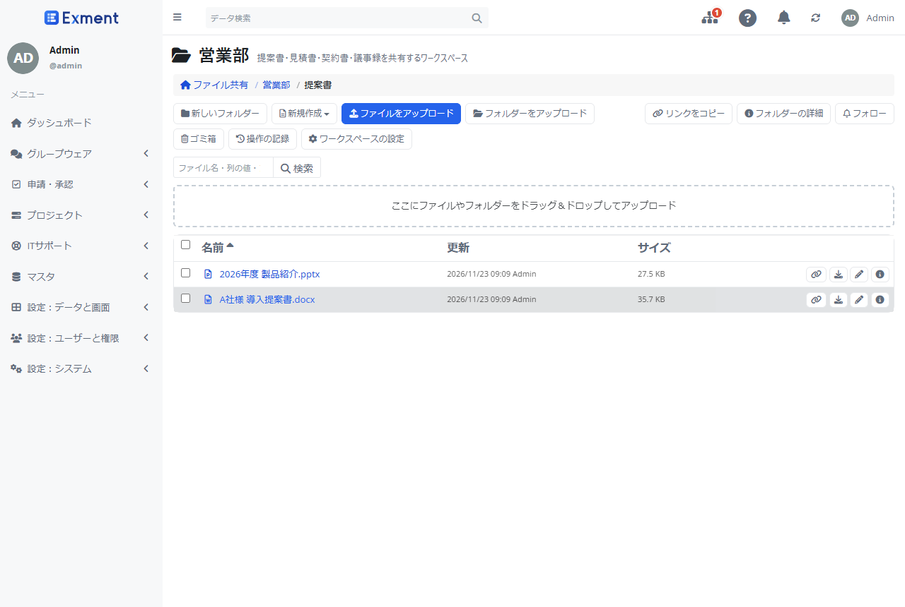
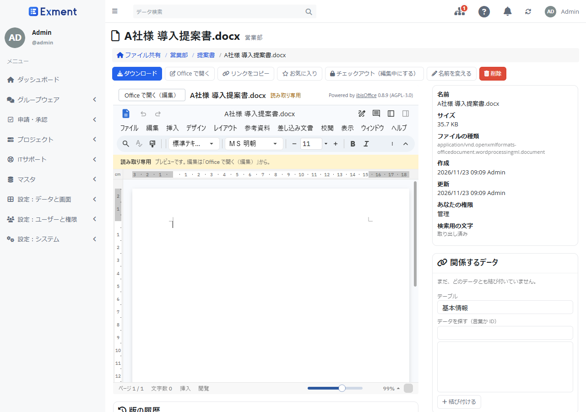

# Dateifreigabe
Sie legen Ordner und Dateien in Arbeitsbereichen pro Team ab und teilen sie. Es gibt Berechtigungen pro Ordner, eine Versionsverwaltung, eine Vorschau und einen Papierkorb. Die Funktion lässt sich wie Box oder eine Dokumentbibliothek von SharePoint verwenden.  
Der Inhalt der Dateien liegt am Speicherort für Dateien von Exment (lokal, S3, Azure, FTP usw., so wie jetzt eingestellt).

※ Diese Funktion gibt es ab Exment v7.2.1.<!-- TODO: an die Version anpassen, in der die Dateifreigabe in master kommt -->

## Erste Schritte
Die Dateifreigabe steht am Anfang auf „Nicht verwenden“. Wenn der Systemadministrator unter „Administratoreinstellungen“ → „[Funktionsverwaltung](/de/feature)“ die „Dateifreigabe“ auf „Verwenden“ stellt, erscheint im linken Menü „Dateifreigabe“. Auch wer sie verwenden darf (Rollengruppen), wählen Sie in der Funktionsverwaltung.

## Arbeitsbereiche
Ein Arbeitsbereich ist der Ablageort für die Dateien eines Teams (er entspricht einer Website in SharePoint).

- Sie erstellen ihn mit „Neuer Arbeitsbereich“. Wer ihn erstellt, wird Verwalter dieses Arbeitsbereichs. Wer Arbeitsbereiche erstellen darf, legen Sie in der `.env` mit `EXMENT_FILE_SERVER_WORKSPACE_CREATE` fest (`admin`: nur Systemadministratoren, `all`: alle).
- Unter „Einstellungen des Arbeitsbereichs“ legen Sie Folgendes fest.

| Punkt | Inhalt |
| --- | --- |
| Name, Beschreibung | Name und Beschreibung des Arbeitsbereichs. |
| Mitglieder | Benutzer und Organisationen und ihre Berechtigung (Anzeigen, Hochladen, Bearbeiten, Verwalten). Es braucht mindestens 1 Verwalter. |
| Speicherlimit (GB) | Leer bedeutet: kein Limit. Alte Versionen und Dateien im Papierkorb zählen mit. |
| Tage im Papierkorb | Danach wird endgültig gelöscht. Bei 0 bleibt alles, bis Sie es von Hand löschen. |
| Aufbewahrte Versionen | Die Anzahl der alten Versionen, die pro Datei aufbewahrt werden. |
| Spalten (Metadaten) | Die Spalten, die die Dateien dieses Arbeitsbereichs erhalten. Siehe unten „Spalten (Metadaten)“. |

Auf der Startseite stehen die Liste der Arbeitsbereiche, die Sie öffnen können, sowie „Favoriten“, „Zuletzt geänderte Dateien“ und „Für mich freigegeben“.

## Ordner und Dateien
- Sie laden mit „Neuer Ordner“, „Dateien hochladen“, „Ordner hochladen“ oder per Drag & Drop hoch. Große Dateien werden in Teilen gesendet. Wenn die Übertragung abbricht, kann sie daher an derselben Stelle fortgesetzt werden.
- Pro Datei und Ordner können Sie umbenennen, verschieben, kopieren, herunterladen (mehrere als ZIP), löschen und als Favorit markieren.
- Gelöschtes kommt in den Papierkorb. Aus dem Papierkorb können Sie es „Wiederherstellen“ oder „Endgültig löschen“.

## Berechtigungen
Es gibt 4 Berechtigungen. Eine höhere Berechtigung kann auch alles, was die niedrigeren können.

| Berechtigung | Was möglich ist |
| --- | --- |
| Anzeigen | Ansehen, herunterladen |
| Hochladen | Dateien hinzufügen |
| Bearbeiten | Umbenennen, verschieben, löschen, neue Version, Freigabelinks erstellen |
| Verwalten | Berechtigungen ändern, Auschecken aufheben, genehmigen |

- Ordner und Dateien übernehmen die Berechtigungen des übergeordneten Ordners (oder des Arbeitsbereichs).
- Mit „Vererbung der Berechtigungen beenden“ erhält der Ordner oder die Datei eigene Berechtigungen. Mit „Berechtigungen übernehmen“ stellen Sie den alten Zustand wieder her.
- Systemadministratoren können alle Arbeitsbereiche verwalten.

## Versionsverwaltung und Auschecken
- Wenn Sie eine Datei mit demselben Namen überschreiben oder „Neue Version hochladen“ wählen, entsteht eine neue Version. Über den „Versionsverlauf“ können Sie eine frühere Version herunterladen oder mit „Diese Version wiederherstellen“ den Inhalt einer früheren Version als neue Version speichern.
- Mit „Auschecken“ (in Bearbeitung setzen) können andere die Datei nicht ändern oder löschen. Wenn Sie fertig sind, wählen Sie „Einchecken“ (Bearbeitung beenden). Wer die Berechtigung Verwalten hat, kann „Auschecken aufheben“.

## Vorschau
Bilder, Videos, Audio, PDF und Text können Sie auf der Seite ansehen. Wie Office-Dateien (docx, xlsx, pptx) erscheinen, hängt von der Ausstattung des Servers ab.

| Ausstattung des Servers | Darstellung der Office-Dateien |
| --- | --- |
| LibreOffice ist vorhanden (`EXMENT_FILE_SERVER_SOFFICE_PATH`) | Die Datei wird in PDF umgewandelt und angezeigt. |
| Das offizielle Plugin „Groupware“ ist vorhanden | Mit „In Office öffnen“ öffnen Sie die Datei schreibgeschützt im Office des Browsers (ibisOffice). Ist auch LibreOffice vorhanden, wechseln Sie per Registerkarte. |
| Keines von beiden | Es wird nur der Text aus der Datei angezeigt. Für die Ansicht im Originallayout laden Sie die Datei herunter. |

Mit ibisOffice von Groupware brauchen Sie weder LibreOffice noch Docker. Es läuft auch auf einem gemieteten Server. Die Vorbereitung und die Einstellung des Webservers finden Sie unter [Groupware](/de/plugin_groupware).

※ html, svg usw. werden aus Sicherheitsgründen nicht auf der Seite angezeigt. Sie können nur heruntergeladen werden.

※ Bei Dateien, die über einen Anforderungslink von außen gekommen sind, werden beim Öffnen keine Vorschau und kein Text erzeugt. Das geschieht nur, wenn jemand mit der Berechtigung Verwalten auf „Vorschau erstellen“ klickt.

## Freigabelinks für externe Personen
Sie können Dateien und Ordner an externe Personen ohne Anmeldung weitergeben und Dateien von externen Personen erhalten. Den Link erstellen Sie auf der Seite der Datei im Bereich „Freigabelinks für externe Personen“.

| Art des Links | Inhalt | Wer ihn erstellen kann |
| --- | --- | --- |
| Freigabelink (externe Personen sehen und laden herunter) | Bei einem Ordner ist auch sein Inhalt zu sehen. Ohne „Downloads erlauben“ gibt es nur die Vorschau. | Personen mit der Berechtigung Bearbeiten |
| Anforderungslink (externe Personen laden hoch) | Externe Personen legen Dateien in den Ordner. Die Dateien anderer Personen sehen sie nicht. Dateien mit demselben Namen werden nicht überschrieben, sondern heißen „Name (2)“. | Personen mit der Berechtigung Bearbeiten (ab 7.2.1. Links, die früher von Personen mit nur der Berechtigung Hochladen erstellt wurden, lassen sich nicht mehr öffnen) |

- Sie können ein Ablaufdatum, ein Passwort und die Zahl der erlaubten Aufrufe festlegen. Das Passwort hat mindestens 8 Zeichen (`EXMENT_FILE_SERVER_SHARE_PASSWORD_MIN`). Mit „Widerrufen“ machen Sie den Link jederzeit ungültig.
- Bei jedem ungültigen Link (abgelaufen, widerrufen, Aufrufe aufgebraucht usw.) erscheint „Der Link kann nicht geöffnet werden“.
- Das Ablaufdatum neuer Freigabelinks ist im Standard 30 Tage und höchstens 90 Tage (`EXMENT_FILE_SERVER_SHARE_DEFAULT_DAYS`, `EXMENT_FILE_SERVER_SHARE_MAX_DAYS`. Bei 0: kein Standard, kein Höchstwert). Früher erstellte Links ohne Ablauf stehen in der Liste der Links mit „Kein Ablauf“.
- Die Adresse eines Freigabelinks sehen nur die Person, die den Link erstellt hat, und Personen mit der Berechtigung Verwalten für die Datei oder den Ordner.
- Für die Weitergabe an interne Personen verwenden Sie „Link kopieren“ (interner Link). Öffnen können ihn nur Personen, die die Datei ansehen dürfen.
- Wenn Freigabelinks für externe Personen nicht verwendet werden sollen, schreiben Sie `EXMENT_FILE_SERVER_EXTERNAL_SHARE=false` in die `.env`. Den Höchstwert des Ablaufdatums ändern Sie mit `EXMENT_FILE_SERVER_SHARE_MAX_DAYS`.
- Freigabelinks (`/share/...`) sind für externe Personen gedacht. Deshalb gilt für sie normalerweise der Web-IP-Filter der Systemeinstellungen nicht. Wenn sie nur von intern geöffnet werden sollen, schreiben Sie `EXMENT_FILE_SERVER_SHARE_WEB_IP_FILTER=true` in die `.env`. Die Einstellung wird beim Erstellen der Routen gelesen. Websites, die `php artisan route:cache` verwenden, müssen den Befehl nach der Änderung noch einmal ausführen.

## Spalten (Metadaten)
In den Einstellungen des Arbeitsbereichs können Sie Spalten anlegen, die die Dateien erhalten (zum Beispiel „Kunde“ oder „Art“).

- Die Typen sind Text, mehrzeiliger Text, Zahl, Datum, Auswahl, Mehrfachauswahl und Ja/Nein. Sie können Pflichtfeld, Standardwert und die Anzeige in der Liste festlegen.
- In der Liste können Sie nach Spalten filtern (auch „(leer)“ ist wählbar), sortieren und gruppieren.

## Verknüpfung mit Daten
Auf der Seite der Datei verknüpfen Sie unter „Verknüpfte Daten“ die Datei mit Daten einer Exment-Tabelle (zum Beispiel einem Kunden). Auf der Detailseite der Daten erscheint der Bereich „Dateien in der Dateifreigabe“. In beiden Fällen erscheint nur, was Sie ansehen dürfen.

## Suche
Mit „Suchen“ suchen Sie nach Dateinamen, Spaltenwerten und Text in den Dateien. Es erscheinen nur Dateien, die Sie ansehen dürfen.

- Der Text in den Dateien wird aus Text, HTML, Office (docx, xlsx, pptx) und OpenDocument entnommen. Aus PDF wird er entnommen, wenn pdftotext vorhanden ist (`EXMENT_FILE_SERVER_PDFTOTEXT_PATH`), aus Bildern und gescannten PDF, wenn tesseract vorhanden ist (`EXMENT_FILE_SERVER_OCR_PATH`).
- Normalerweise wird in der Datenbank gesucht. Mit `EXMENT_FILE_SERVER_MEILI=true` wird mit [Meilisearch](/de/additional_meilisearch) gesucht (es wird ein eigener Index `exment_files` verwendet, getrennt von der Volltextsuche der Daten).

## Genehmigung, Aufbewahrungssperre, Aufbewahrungsfrist
<!-- TODO: prüfen, wenn P5 (exment PR #1859) enthalten ist -->
| Funktion | Inhalt |
| --- | --- |
| Genehmigung | Wenn Sie unter „Regeln“ des Ordners „erfordern eine Genehmigung“ einstellen, erhalten hineingelegte Dateien den Zustand „Wartet auf Genehmigung“. Bis zur Genehmigung sehen sie nur die Person, die hochgeladen hat, und die Verwalter. Wer die Berechtigung Verwalten hat, wählt „Genehmigen“ oder „Zurückweisen“. |
| Aufbewahrungssperre | Wenn sie für einen Arbeitsbereich, einen Ordner oder eine Datei gesetzt ist, kann nichts mehr gelöscht werden. Auch alte Versionen verschwinden nicht. Setzen und aufheben können nur Systemadministratoren (Personen mit der Berechtigung Verwalten können sie nur sehen). |
| Aufbewahrungsfrist | Wenn Sie in den Einstellungen des Arbeitsbereichs eine Anzahl von Tagen festlegen, können Dateien in dieser Zeit nicht gelöscht werden. Festlegen und aufheben können nur Systemadministratoren (Personen mit der Berechtigung Verwalten können sie nur sehen). |
| Wer herunterladen darf | Personen unterhalb der festgelegten Berechtigung können nur ansehen (siehe unten „Wenn nur Ansehen erlaubt ist“). |
| Wasserzeichen | Über der Vorschau erscheinen der Name des Betrachters sowie Datum und Uhrzeit. |
| Prüfprotokoll | Anzeigen, Herunterladen, Hochladen, Löschen, Ändern von Berechtigungen, Freigabelinks usw. werden protokolliert. Das Protokoll lässt sich als CSV ausgeben. |
| Folgen, Kommentare | Wenn sich ein Arbeitsbereich, ein Ordner oder eine Datei ändert, denen Sie folgen, werden Sie über die Glocke und per E-Mail informiert. Mit `@Benutzercode` in einem Kommentar wird diese Person informiert. |

### Wenn nur Ansehen erlaubt ist
Personen unterhalb von „Wer herunterladen darf“ des Arbeitsbereichs und Freigabelinks ohne „Downloads erlauben“ sehen die Dateien wie folgt.

| Datei | Darstellung |
| --- | --- |
| Bild | Es wird ein verkleinertes Bild gezeigt. |
| Office, PDF | Wenn es eine in PDF umgewandelte Fassung gibt, wird diese gezeigt. |
| Text, Video, Audio | Wird nicht gezeigt. |

Jedes Ansehen wird im Prüfprotokoll festgehalten.

## Vorbereitung des Servers
- **Tägliche Verarbeitung**: Das automatische Löschen aus dem Papierkorb läuft mit `php artisan exment:file-server-purge` (täglich um 3:30). Richten Sie den [Aufgabenplan](/de/additional_task_schedule) ein.
- **Queue**: Miniaturbilder, Vorschau und Textentnahme laufen über die Queue.
- **Textentnahme wiederholen**: `php artisan exment:file-server-index` entnimmt den Text der Dateien, bei denen das noch fehlt, und baut den Index von Meilisearch neu auf.
- **Weitere Software** (es läuft auch ohne jede davon): LibreOffice (Vorschau von Office), pdftotext (Text aus PDF), tesseract (OCR), Meilisearch (schnelle Suche).
- **LibreOffice ohne Netzwerk ausführen**: Office-Dateien versuchen manchmal, externe URLs zu lesen. Wenn Sie in `EXMENT_FILE_SERVER_SOFFICE_PREFIX` einen Befehl eintragen, der vor LibreOffice gesetzt wird, kann ohne Netzwerk umgewandelt werden (Beispiel: `unshare -rn`, `firejail --net=none --quiet`). Prüfen Sie vorher, ob der Befehl auf dem Server verfügbar ist.
- **Obergrenzen beim Hochladen**: Große Dateien werden in Teilen gesendet. 1 Datei darf bis 2 GB groß sein (`EXMENT_FILE_SERVER_MAX_FILE_SIZE`), 1 Person darf bis zu 20 Uploads unvollendet lassen (`EXMENT_FILE_SERVER_MAX_UPLOADS`), und deren Summe darf bis 10 GB betragen (`EXMENT_FILE_SERVER_MAX_UPLOAD_BYTES`). Auch unvollendete Uploads zählen zum Speicher des Arbeitsbereichs. Uploads, bei denen 60 Minuten lang nichts ankommt, zählen nicht und werden gelöscht, wenn die Person das nächste Mal einen Upload beginnt.

## Wichtige Einstellungen (.env)
| Einstellung | Standard | Inhalt |
| --- | --- | --- |
| `EXMENT_FILE_SERVER_WORKSPACE_CREATE` | `admin` | Wer Arbeitsbereiche erstellen darf (`admin`, `all`) |
| `EXMENT_FILE_SERVER_MAX_FILE_SIZE` | `2147483648` (2 GB) | Obergrenze für die Größe von 1 Datei (Bytes. 0 bedeutet kein Limit. Ab 7.2.1 2 GB) |
| `EXMENT_FILE_SERVER_MAX_UPLOADS` | `20` | Anzahl der Uploads, die 1 Person unvollendet lassen darf |
| `EXMENT_FILE_SERVER_MAX_UPLOAD_BYTES` | `10737418240` (10 GB) | Summe der unvollendeten Uploads von 1 Person (Bytes. 0 bedeutet kein Limit) |
| `EXMENT_FILE_SERVER_EXTERNAL_SHARE` | `true` | Ob Freigabelinks für externe Personen verwendet werden |
| `EXMENT_FILE_SERVER_SHARE_DEFAULT_DAYS` | `30` | Standard für das Ablaufdatum neuer Freigabelinks (Tage. 0 bedeutet kein Standard) |
| `EXMENT_FILE_SERVER_SHARE_MAX_DAYS` | `90` | Höchstwert für das Ablaufdatum von Freigabelinks (Tage. 0 bedeutet kein Höchstwert, auch ohne Ablauf möglich) |
| `EXMENT_FILE_SERVER_SHARE_PATH` | `share` | Der erste Teil der URL von Freigabelinks |
| `EXMENT_FILE_SERVER_SHARE_PASSWORD_MIN` | `8` | Mindestlänge des Passworts von Freigabelinks (Zeichen) |
| `EXMENT_FILE_SERVER_SHARE_WEB_IP_FILTER` | `false` | Ob der Web-IP-Filter auch für Freigabelinks gilt |
| `EXMENT_FILE_SERVER_SOFFICE_PATH` | keiner | Speicherort von LibreOffice (soffice) |
| `EXMENT_FILE_SERVER_SOFFICE_PREFIX` | keiner | Befehl, der vor LibreOffice gesetzt wird (Ausführung ohne Netzwerk) |
| `EXMENT_FILE_SERVER_PDFTOTEXT_PATH` | keiner | Speicherort von pdftotext |
| `EXMENT_FILE_SERVER_OCR_PATH` | keiner | Speicherort von tesseract |
| `EXMENT_FILE_SERVER_MEILI` | `false` | Ob mit Meilisearch gesucht wird |
| `EXMENT_FILE_SERVER_AUDIT` | `true` | Ob das Prüfprotokoll geführt wird |
| `EXMENT_FILE_SERVER_NOTIFY` | `true` | Ob Hinweise an Folgende gesendet werden |

## Verwandte Themen
- [Funktionsverwaltung](/de/feature)
- [Speicherort für Dateien einstellen](/de/additional_file_saveplace)
- [Aufgabenplan](/de/additional_task_schedule)
- [Volltextsuchmaschine (Meilisearch) verwenden](/de/additional_meilisearch)
- [Rollengruppen und Berechtigungen](/de/role_group)
