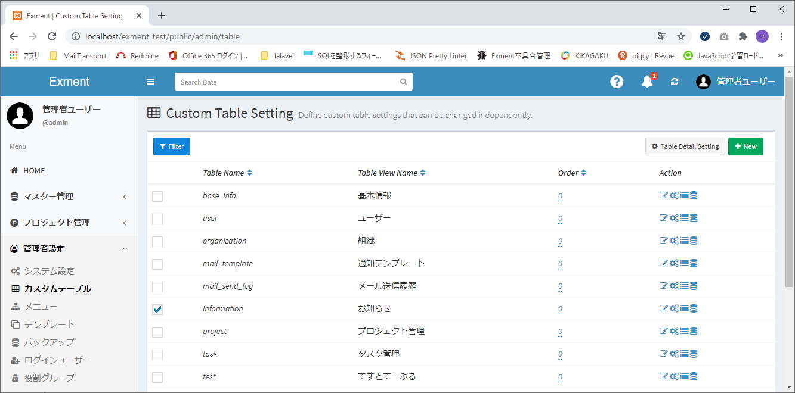
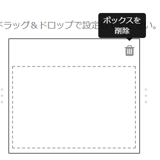
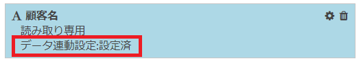

# Benutzerdefiniertes Formular
Auf dieser Seite legen Sie fest, welche Elemente im [Datenformular](/de/data_form) von Exment (dem Bildschirm zur Eingabe der Daten) stehen und wie sie angeordnet sind. Sie können die Anordnung der Elemente (das Layout der Boxen), versteckte Felder, die Datenverknüpfung und mehr ändern.  
Was Sie hier einstellen, wirkt im [Datenformular](/de/data_form) der jeweiligen Tabelle.

- So öffnen Sie den Bildschirm: „Die Seite anzeigen“ und „Formular bearbeiten“ unten
- So ordnen Sie Elemente an: „Einstellungsfelder des benutzerdefinierten Formulars“ unten
- Werte der Daten kopieren, die aus einer anderen Tabelle gewählt wurden: „Einstellungen zur Datenverknüpfung“ unten
- Eine andere Auswahl passend zum gewählten Wert eingrenzen: „Einstellungen zum Relationsfilter“ unten
- Das verwendete Formular je nach Bedingung wechseln: „Einstellungen zu Anzeigebedingungen des Formulars“ unten

## Die Seite anzeigen
- Kreuzen Sie in der Liste der benutzerdefinierten Tabellen die Tabelle an, die Sie einstellen, und klicken Sie oben rechts auf „Tabellen-Detaileinstellungen“.  

> ※ Sie können die Seite auch direkt aus der Datenliste oder dem Eingabebildschirm dieser benutzerdefinierten Tabelle öffnen. Klicken Sie auch dann oben rechts auf „Tabellen-Detaileinstellungen“.  

- Wenn Sie im erscheinenden Bildschirm der Tabellen-Detaileinstellungen auf das Symbol der Formulareinstellungen klicken, erscheint die Liste der Formulare.  
※Für jede Tabelle ist von Anfang an 1 Standardformular angelegt.


## Formular bearbeiten
Um ein Formular zu ändern, klicken Sie bei diesem Formular auf den Link [Bearbeiten].  


## Einstellungsfelder des benutzerdefinierten Formulars


### Grundeinstellungen des Formulars
Sie geben die Grundinformationen des Formulars ein.

- ##### Anzeigename des Formulars
Sie geben den Namen des Formulars ein.  

- ##### Standardformular
Wählen Sie YES, wenn dieses Formular das Standardformular sein soll.  
Wenn [Einstellungen zu Anzeigebedingungen des Formulars](/de/form?id=Einstellungen-zu-Anzeigebedingungen-des-Formulars) vorhanden sind, haben diese Vorrang.

- ##### Anzeige der Detailseite
Sie wählen, wie die Elemente im [Detailbildschirm der Daten](/de/data_details) erscheinen: passend zum Layout aus Zeilen und Spalten, das Sie in diesem Bildschirm festlegen, oder einfach in 1 Spalte untereinander.  


- ##### Anzeige der Überschriften
Sie legen fest, wie die Überschrift jedes Elements erscheint.  
※Das ist die Einstellung für das ganze Formular. Um es je Element zu ändern, ändern Sie die Einstellung des einzelnen Elements.

### Einstellung der Formularblöcke
Sie stellen die Blöcke des Formulars ein.  
Ein Block ist eine Einheit von Daten. Normalerweise gibt es 1 Block je Tabelle.  
Wenn es aber eine 1:n-Relation gibt, lassen sich auch die Daten der untergeordneten Tabelle im selben Bildschirm eingeben. Kreuzen Sie beim Block der untergeordneten Tabelle „Verwenden“ an und stellen Sie ihn ein.


#### Felder des Formularblocks
※Alle folgenden Felder sind Einstellungen für untergeordnete Tabellen.

- ##### Formular als Tabelle darstellen  
Die Eingabefelder der untergeordneten Tabelle erscheinen in Tabellenform.

- ##### Laden der Daten untergeordneter Tabellen optimieren  
Bei YES werden die Zeilen dieser untergeordneten Tabelle automatisch geladen, nachdem der Bearbeitungsbildschirm angezeigt wurde. Bei Daten mit vielen Zeilen in der untergeordneten Tabelle verkürzt das die Zeit, bis der Bearbeitungsbildschirm erscheint. Der Standardwert ist NO.  
Nutzbar ist es beim Bearbeiten vorhandener Daten in 1:n-Blöcken, bei denen „Formular als Tabelle darstellen“ auf YES steht. Bis das Laden beendet ist, lässt sich nicht speichern.  
Wenn Sie „Formular als Tabelle darstellen“ auf NO setzen und das Formular speichern, wird auch diese Einstellung NO.  
※Nutzbar ab v7.1.0.


- ##### Name des Formularblocks  
Der Name, der bei jedem Block des Formulars angezeigt wird.  

- ##### Anzeigereihenfolge  
Wenn es mehrere untergeordnete Tabellen gibt, legen Sie hier ihre Reihenfolge fest.  


#### Formularelemente
Sie wählen die Elemente, die im Eingabeformular erscheinen, und ordnen sie an.  
Die Elemente wählen Sie aus der „Vorschlagsliste der Formularelemente“ unten.


Im Formular können Sie Boxen mit 1 bis 4 Spalten platzieren.  
In diese Boxen setzen Sie die Formularelemente.


Mit den Boxen können Sie Folgendes tun.  

- Ein Klick auf die Schaltfläche „+“ neben einer Box fügt der aktuellen Zeile eine neue Spalte hinzu.  


- Ein Klick auf die Schaltfläche „+“ unter einer Box fügt eine neue Zeile hinzu. (Wenn es die nächste Zeile schon gibt, kommt in dieser Zeile eine neue Spalte dazu)  


- Durch Ziehen und Ablegen des freien Rands rechts an einer Box ändern Sie die Größe der Box.  


- Ein Klick auf das Papierkorbsymbol oben rechts an einer Box löscht die Box.  


Indem Sie Zeilen und Spalten der Boxen hinzufügen oder entfernen und die Breite ändern, erstellen Sie zum Beispiel die folgenden Layouts.  

- 1 Spalte - 2 Spalten


- 3 Spalten - 1 Spalte


- 1 Spalte - 2 Spalten - 1 Spalte


### Vorschlagsliste der Formularelemente  
Die Elemente, die Sie dem Formular hinzufügen können.  
Es gibt 2 Arten: „Tabellenspalte“ und „Sonstiges“.  


#### Tabellenspalte  
Die benutzerdefinierten Spalten, die für die benutzerdefinierte Tabelle eingestellt sind.  
Durch Ziehen und Ablegen in eine Box der „Formularelemente“ kommen sie ins Datenformular. Das Verhalten hängt vom Typ der benutzerdefinierten Spalte und von den Einstellungen unter [Details der Formularelemente](/de/form?id=Details-der-Formularelemente) ab. Normalerweise lässt sich der Wert des Elements bearbeiten oder anzeigen.

#### Sonstiges  
Elemente, die nicht mit Daten verbunden sind und im Formular nur angezeigt werden, zum Beispiel Überschrift, Erläuterung und HTML.  
Durch Ziehen und Ablegen in eine Box der „Formularelemente“ kommen sie ins Datenformular.

- ##### Überschrift:
Wird im Formular als Überschrift angezeigt.

- ##### Erläuterung:
Zeigt im Formular einen erklärenden Text. HTML ist nicht nutzbar.

- ##### HTML:
Zeigt im Formular HTML.  
※Aus Sicherheitsgründen werden die Tags `<script>` und `<iframe>` und das Attribut `id` nicht ausgegeben (ab v6.2.15). Wenn im Bildschirm ein Skript laufen soll, nutzen Sie ein [Skript-Plugin](/de/plugin_quickstart_script).  

- ##### Erweitertes HTML:
Zusätzlich zu HTML lassen sich Zeichenfolgen in der Form der [Parameter](/de/params) verwenden. Beim Zeichnen des Bildschirms werden sie durch die Werte der gespeicherten Daten ersetzt, und so entsteht das HTML.  
※Wie bei „HTML“ werden die Tags `<script>` und `<iframe>` und das Attribut `id` nicht ausgegeben (ab v6.2.15).  
Beispiel:
```
<h4>ID: ${id}, Firmencode: ${value:company_code}</h4>
```
※Die Spaltenwerte werden nur beim Zeichnen des Bildschirms ersetzt. Bitte beachten Sie: Wenn Sie im Bearbeitungsbildschirm der Daten den Wert der Spalte ändern, ändert sich der angezeigte Wert nicht mit.  

- ##### Bild:
Zeigt im Formular ein Bild.

- ##### Trennlinie:
Zeigt im Formular eine Trennlinie.


#### Details der Formularelemente
Ein Element, das Sie einer Box hinzugefügt haben, erscheint mit einem Etikett wie dem folgenden.  
- Elemente, die in den Einstellungen der benutzerdefinierten Spalte Pflichtfelder sind, haben neben dem Namen eine rote Markierung.  
- Ein Klick auf das Papierkorbsymbol rechts am Etikett entfernt das Element aus der Box.  
- Ein Klick auf das Zahnradsymbol rechts am Etikett öffnet den Dialog der Detaileinstellungen.  


##### Anzeigeform der Überschrift
Für jedes Element können Sie festlegen, wie die Überschrift erscheint.
(Das hat Vorrang vor der Einstellung für das ganze Formular)

##### Feldtyp
Sie legen fest, wie das Element im Datenformular erscheint. Es gibt die folgenden 4 Arten.

| Art | Aussehen im Bildschirm | Benutzer ändert den Wert | Nutzung durch Berechnungsfelder und die Datenverknüpfung |
|---|---|---|---|
| Schreibgeschützt | Erscheint ausgegraut | Nicht möglich | Möglich |
| Nur Anzeige | Erscheint als Text | Nicht möglich | Nicht möglich |
| Verstecktes Feld | Erscheint nicht (wird als verstecktes Feld (hidden) hinzugefügt) | - | Möglich |
| Interner Parameter | Erscheint nicht (wird kurz vor dem Speichern im System hinzugefügt) | - | - |

- Schreibgeschützt:  
Wenn Sie das ankreuzen, kann der Benutzer den Wert nicht ändern. Nur das System, Berechnungsfelder und die [Einstellungen zur Datenverknüpfung](/de/form?id=Einstellungen-zur-Datenverknüpfung) können den Wert ändern und lesen.  
Mit dieser Einstellung erscheint das Element im Formular wie unten ausgegraut.  
  
- Nur Anzeige:  
Wenn Sie das ankreuzen, kann der Benutzer den Wert nicht ändern. Auch das System, Berechnungsfelder und die [Einstellungen zur Datenverknüpfung](/de/form?id=Einstellungen-zur-Datenverknüpfung) können den Wert nicht ändern und nicht lesen.  
Mit dieser Einstellung erscheint das Element im Formular wie unten als Text.  
  
- Verstecktes Feld:  
Wenn Sie das ankreuzen, erscheint das Element nicht im Bildschirm und wird als verstecktes Feld (hidden) hinzugefügt.  
Nutzen Sie diese Einstellung, wenn Sie das Element für Berechnungsfelder oder die [Einstellungen zur Datenverknüpfung](/de/form?id=Einstellungen-zur-Datenverknüpfung) brauchen, es aber nicht im Bildschirm zeigen möchten.  

- Interner Parameter:  
Wenn Sie das ankreuzen, wird das Element dem Bildschirm nicht hinzugefügt. Es wird kurz vor dem Speichern der Daten im System hinzugefügt.  
Weil es im Bildschirm nicht vorhanden ist, lässt es sich nicht für Berechnungsfelder oder die Datenverknüpfung nutzen.  
Nutzen Sie diese Einstellung für Elemente, die niemand verfälschen oder ändern soll, zum Beispiel interne Parameterwerte.


##### Einstellungen zur Datenverknüpfung (Element)  
Siehe [Einstellungen zur Datenverknüpfung](/de/form?id=Einstellungen-zur-Datenverknüpfung).  

##### Einstellungen zum Relationsfilter (Element)  
Siehe [Einstellungen zum Relationsfilter](/de/form?id=Einstellungen-zum-Relationsfilter).  


## Einstellungen zur Datenverknüpfung
Wenn es im Formular ein Element gibt, mit dem Daten einer anderen Tabelle gewählt werden, können Sie den Inhalt der gewählten Daten in ein anderes Element des Formulars kopieren.  
Beispiel: Wenn im Formular „Vertrag“ der „Kunde“ gewählt wird, wird der Wert „Kundenname“ aus den Daten „Kunde“ in den „Kundennamen“ des Formulars „Vertrag“ kopiert.


Im Formular „Vertrag“ gibt es die Auswahl „Kunde“ und den einzeiligen Text „Kundenname“.  
  
 
Wenn „Kunde“ gewählt wird, 


wird der Wert automatisch in den Text „Kundenname“ gesetzt  


<br />  

#### Schritte
- Öffnen Sie den Bildschirm des benutzerdefinierten Formulars.  
Klicken Sie bei den Formularelementen auf das Einstellungssymbol von „Kundenname“.  


- Im geöffneten Dialog gibt es das Feld „Einstellungen zur Datenverknüpfung“.  


- Unter „Spalte auswählen“ wählen Sie die benutzerdefinierte Spalte, die das Kopieren auslöst (Auslöser).  
**※ Wählbar sind Spalten im selben Formular mit dem Spaltentyp „Auswahl (aus Tabelle)“, „Benutzer“ oder „Organisation“.**
In diesem Beispiel wählen Sie „Kunde“.  


- Nach der Wahl unter „Spalte auswählen“ erscheinen die Optionen des 2. Feldes „Verknüpfungsspalte auswählen“.  
Die benutzerdefinierten Spalten der unter „Spalte auswählen“ gewählten Tabelle erscheinen als Liste.  
In diesem Beispiel wählen Sie „Kundenname“.  


- Klicken Sie zum Schluss auf die Schaltfläche zum Festlegen.  
Der Dialog schließt sich, und neben der Schaltfläche [Einstellungen zur Datenverknüpfung] steht „Eingerichtet“.  


- Klicken Sie unten auf der Seite auf die Schaltfläche [Absenden] und speichern Sie die Einstellungen.


## Einstellungen zum Relationsfilter
Beim Spaltentyp „Auswahl (aus Tabelle)“, „Benutzer“ oder „Organisation“ werden die Optionen passend zur Wahl in einem anderen Element desselben Formulars eingegrenzt. Das lässt sich nur einstellen, wenn eine Spalte der übergeordneten Tabelle oder der referenzierten Tabelle der Zieltabelle im selben Formular vorhanden ist.  

#### Beispiel
Zwischen den Tabellen „Kundeninformationen“ und „Ansprechpartner“ ist eine 1:n-Relation eingestellt, und die Tabelle „Vertragsinformationen“ hat die Spalten „Kunde“ und „Ansprechpartner“.  
Wenn die Spalte „Kunde“ gewählt wird, sollen die Optionen der Spalte „Ansprechpartner“ auf die Ansprechpartner eingegrenzt werden, deren übergeordneter Datensatz der gewählte „Kunde“ ist.

  

Es gibt die folgenden Daten.
  

Im Bildschirm der Vertragsinformationen:
 

Wenn unter „Kunde“ die „Firma A“ gewählt wird, sind die Ansprechpartner der Firma A die Optionen.
  

Wenn unter „Kunde“ die „Firma B“ gewählt wird, sind die Ansprechpartner der Firma B die Optionen.
  

#### Schritte
- Öffnen Sie den Bildschirm des benutzerdefinierten Formulars.  
Klicken Sie bei den Formularelementen auf das Einstellungssymbol der Spalte „Ansprechpartner“.  


- Im geöffneten Dialog gibt es das Feld „Einstellungen zum Relationsfilter“.  
Als Optionen erscheinen die Spalten im selben Formular, die der gewählten Spalte übergeordnet sind.  
In diesem Beispiel erscheinen die Spalten der Tabelle „Kunde“, der übergeordneten Tabelle der Tabelle „Ansprechpartner“.  
※Die Schaltfläche „Einstellungen zum Relationsfilter“ erscheint, wenn die benutzerdefinierte Spalte „Auswahl (aus Tabelle)“, „Benutzer“ oder „Organisation“ ist.


- Klicken Sie nach der Einstellung auf die Schaltfläche zum Festlegen.  


#### Zum Verhalten vor v3.3.1
<span class="small">Vor v3.3.1 gab es diesen Einstellungsbildschirm nicht. Die Optionen wurden bei allen Feldern mit einer 1:n-Beziehung (über- und untergeordnet) oder einer Referenzbeziehung eingegrenzt.  
Das führte manchmal zu unnötigem Eingrenzen und zu unerwarteten Fehlern. Deshalb kam in v3.3.1 die Einstellung dazu, mit der Sie wählen, ob eingegrenzt wird.  
Bei einer Aktualisierung von einer Version vor v3.3.1 auf v3.3.1 oder höher wird wegen der Kompatibilität die Einstellung „bei allen Feldern mit einer 1:n-Beziehung (über- und untergeordnet) oder einer Referenzbeziehung die Optionen eingrenzen“ übernommen.  
Einzelheiten zum Verhalten bei der Aktualisierung stehen [hier](/patch/relation_filter) (Englisch).</span>


## Einstellungen zu Anzeigebedingungen des Formulars
Wenn Sie Bedingungen und Prioritäten festlegen, wechselt das Formular, das beim Anlegen der Daten und im Detailbildschirm der Daten verwendet wird, je nach Bedingung.  

### Neu anlegen
Sie legen sie über die Schaltfläche [Neu] rechts neben den Einstellungen zu Anzeigebedingungen des Formulars an.


### Einstellungsbildschirm


##### Zielformular  
Sie wählen das Formular, das verwendet werden soll, wenn die Bedingung erfüllt ist.

##### Priorität  
Sie legen die Priorität fest, mit der das Formular verwendet wird.
Bei Daten, die mehrere Anzeigebedingungen erfüllen, erscheint der Bildschirm mit dem Formular der höchsten Priorität.

##### Bedingungsfeld  
Die Spalte, die als Anzeigebedingung verwendet wird.

##### Filterbedingung  
Sie wählen den Inhalt der Bedingung.
Was wählbar ist, hängt vom Typ der unter „Bedingungsfeld“ gewählten Spalte ab („Datum“, „Benutzer“ usw.).

##### Bedingungswert  
Sie geben den Wert ein, mit dem die Filterbedingung verglichen wird.

##### Schaltfläche [Löschen]  
Löscht die Anzeigebedingung des Formulars.

##### Schaltfläche [Neu]  
Fügt eine neue Anzeigebedingung des Formulars hinzu.
