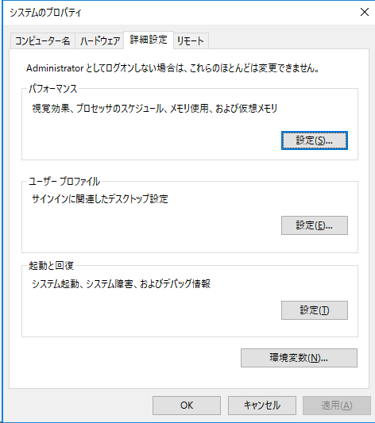
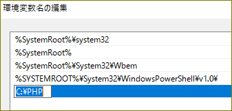
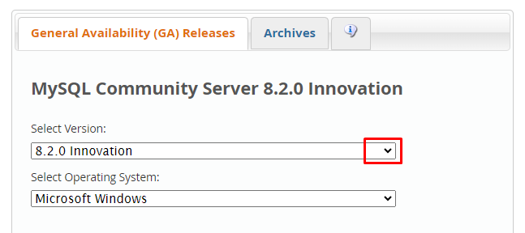
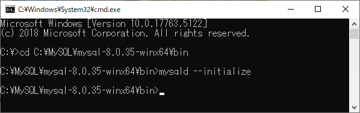
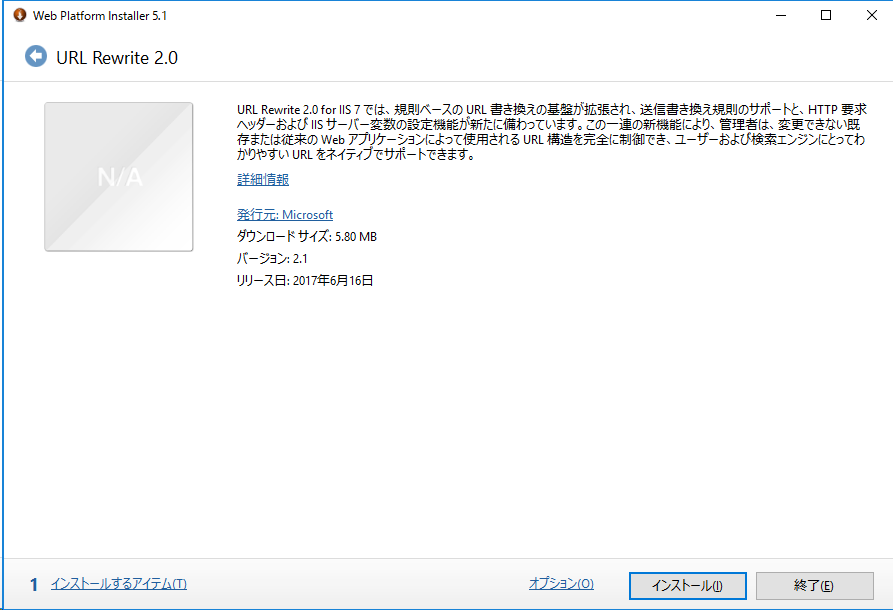
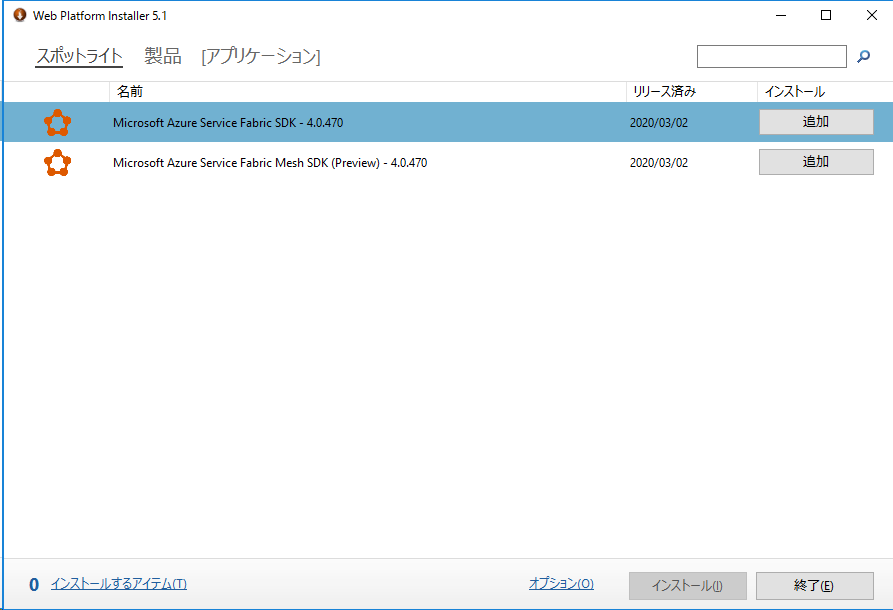
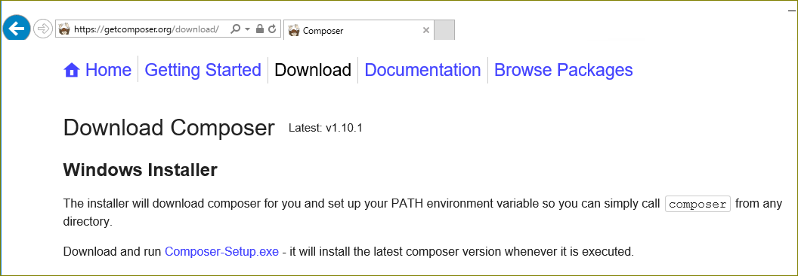
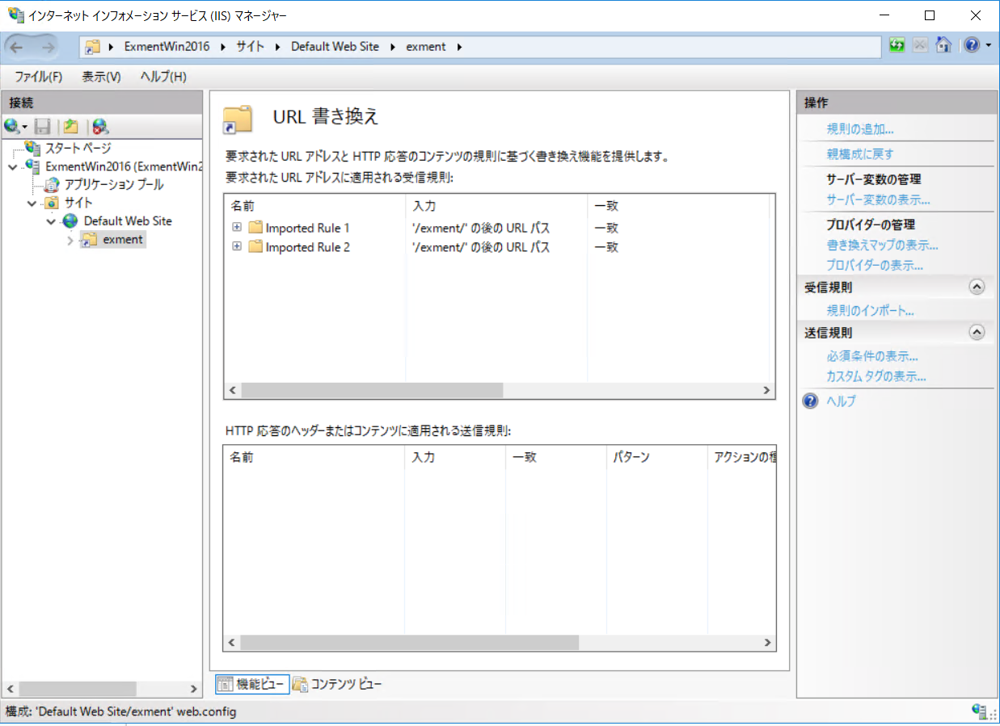

# Aufbau unter Windows Server
Hier steht, wie Sie Exment auf dem IIS (dem Webserver, der zu Windows gehört) von Windows Server installieren.  
Die Schritte beginnen mit der Installation des Webservers und bauen alles von Grund auf.

Der grobe Ablauf ist der folgende.

1. Den Webserver (IIS) installieren
2. PHP vorbereiten
3. MySQL installieren
4. IIS vorbereiten
5. Composer installieren
6. Exment herunterladen und die Ausführung vorbereiten

## Umgebung
Die Schritte dieser Seite wurden in der folgenden Umgebung erstellt.
- Windows Server 2019 Standard, japanische Version
- IIS 10
- PHP 8.2.X
- MySQL 8.4.X

Die Unterschiede bei der Verwendung von Windows 10 zu Testzwecken stehen jeweils an der passenden Stelle.

## Hinweise

- Je nach Umgebung und Version lassen sich die Einstellungen möglicherweise nicht genau nach dieser Anleitung vornehmen. Wir bitten um Verständnis.

- Auf dieser Seite stehen nur die Schritte, um Exment unter Windows Server zu betreiben.  
Allgemeines IT-Wissen wie die Verwaltung von Windows Server, das Anlegen einer Datenbank und Befehle wird nicht erklärt. Wir bitten um Verständnis.

- **Für diese Schritte brauchen Sie Administratorrechte. Starten Sie die Eingabeaufforderung, PowerShell und ausführbare Dateien bei Bedarf mit „Als Administrator ausführen“ (oder erhöhen Sie die Rechte über die Benutzerkontensteuerung)**.

## Installationsschritte unter Windows Server

> Wir empfehlen, vor Beginn der Arbeit im Explorer von Windows Server die Anzeige der „Dateinamenerweiterungen“ einzuschalten

### Den Webserver (IIS) installieren
Wenn das Feature IIS auf dem Server nicht aktiviert ist, installieren Sie zuerst das Feature IIS.
1. Öffnen Sie im Server-Manager unter \[Verwalten\] den Assistenten \[Rollen und Features hinzufügen\]  
   
2. Wählen Sie bei \[Installationstyp\] „Rollenbasierte oder featurebasierte Installation“ und bei \[Serverauswahl\] den Server, auf dem IIS installiert wird (normalerweise der Server, auf dem Sie arbeiten), und gehen Sie weiter.
3. Wählen Sie bei \[Serverrollen\] „Webserver (IIS)“ und fügen Sie auch die angezeigten Features hinzu  
   
4. Gehen Sie in den Bildschirmen \[Features\] und \[Rolle "Webserver" (IIS)\] ohne Änderung weiter
5. Klappen Sie bei \[Rollendienste\] den Punkt \[Anwendungsentwicklung\] auf, setzen Sie das Häkchen bei „CGI“ und gehen Sie weiter  
     
   Fügen Sie andere Rollen (Authentifizierung, Komprimierung usw.) nach Bedarf hinzu (für den Betrieb von Exment selbst ist nichts weiter nötig)
6. Klicken Sie bei \[Bestätigung\] auf „Installieren“ und warten Sie, bis die Installation fertig ist
7. Starten Sie nach der Installation einen Browser (Internet Explorer oder Ähnliches), öffnen Sie http://localhost und prüfen Sie, dass die Standardseite von IIS angezeigt wird

> Wenn Sie unter Windows 10 installieren, aktivieren Sie unter \[Systemsteuerung\] - \[Programme\] -\[Programme und Features\] - \[Windows-Features aktivieren oder deaktivieren] die „Internetinformationsdienste“ und unter \[Anwendungsentwicklungsfeatures\] „CGI“.

### PHP vorbereiten
Laden Sie PHP herunter und installieren Sie es
1. Öffnen Sie https://windows.php.net/download/
2. Laden Sie bei \[PHP 8.2\] die ZIP-Datei von \[VC15 x64 Non Thread Safe\] herunter  
   > Wenn Sie unter Windows 10 ein 32-Bit-Windows verwenden, laden Sie die ZIP-Datei von \[VC15 x86 Non Thread Safe \] herunter
3. Klicken Sie mit der rechten Maustaste auf die heruntergeladene ZIP-Datei und öffnen Sie die Eigenschaften. Setzen Sie auf der Registerkarte \[Allgemein\] unter \[Sicherheit\] das Häkchen bei „Zulassen“ und klicken Sie auf \[OK\]  
   
4. Entpacken Sie den Inhalt der ZIP-Datei in einen passenden Ordner (Beispiel: C:\PHP)
5. Stellen Sie die Umgebungsvariable ein, mit der PHP ausgeführt wird  
   Führen Sie unter \[Ausführen\] sysdm.cpl aus und öffnen Sie die \[Systemeigenschaften\]
6. Öffnen Sie auf der Registerkarte \[Erweitert\] die \[Umgebungsvariablen\]  
   
7. Suchen Sie in der Liste \[Systemvariablen\] den Eintrag mit dem Variablennamen "Path" und wählen Sie ihn aus  
   
8. Klicken Sie auf \[Bearbeiten\] und dann auf \[Neu\]  
   
9.  Geben Sie den Pfad des Ordners ein, in den Sie PHP entpackt haben (Beispiel: C:\PHP), und klicken Sie dreimal auf \[OK\]  
    
10. Führen Sie in der Eingabeaufforderung  
    ```
    set path
    ```
    aus und prüfen Sie, dass der Pfad zum Ordner von PHP gesetzt ist
11. Erstellen Sie die Konfigurationsdatei von PHP  
    Kopieren Sie die Datei „php.ini-development“ im Ordner, in den Sie PHP entpackt haben, und erstellen Sie so die Datei php.ini
12. Bearbeiten Sie die Datei php.ini und speichern Sie sie
    1.  Ändern Sie im Abschnitt "Paths and Directories"  
        ```
        ;extension_dir = "ext"
        ```
        in
        ```
        extension_dir = "Pfad des Ordners, in den PHP entpackt wurde\ext" (Beispiel: extension_dir = "C:\PHP\ext")
        ```
        (entfernen Sie das ; am Zeilenanfang, damit die Zeile kein Kommentar mehr ist)
    2. Ändern Sie im Abschnitt "Dynamic Extension"
        ```
        ;extension=gd
        ;extension=openssl
        ;extension=pdo_mysql
        ```
        in
        ```
        extension=gd
        extension=openssl
        extension=pdo_mysql
        ```
        (entfernen Sie das ; am Zeilenanfang, damit die Zeile kein Kommentar mehr ist)
    3.  Ändern Sie im Abschnitt "File Uploads"  
        ```
        ;upload_tmp_dir=
        ```
        in
        ```
        upload_tmp_dir = "Pfad eines beliebigen Arbeitsordners" (Beispiel: upload_tmp_dir = "C:\Temp")
        ```
        (entfernen Sie das ; am Zeilenanfang, damit die Zeile kein Kommentar mehr ist)  
        ※Der angegebene Ordner ist der vorläufige Ablageort beim Hochladen von Dateien.
    4. Fügen Sie am Ende der Datei die folgende Zeile hinzu.
        ```
        extension=php_fileinfo.dll
        ```

13. Führen Sie in der Eingabeaufforderung den folgenden Befehl aus und prüfen Sie, dass PHP läuft  
    ```
    php -v
    ```
    

    Wenn ein Fehler erscheint, dass die Laufzeit Visual C++ 14.0 nicht gefunden wurde, laden Sie von [The latest supported Visual C++ downloads](https://support.microsoft.com/help/2977003/the-latest-supported-visual-c-downloads) das Visual C++ Redistributable Package für Visual Studio 2015, 2017 und 2019 (vc_redist.x64.exe) herunter und installieren Sie es  
    

### MySQL installieren
Installieren Sie das MySQL, das Exment verwendet, und nehmen Sie die Anfangskonfiguration vor  
Hier wird MySQL 8.4.X installiert

1. Öffnen Sie die Seite [MySQL Community Downloads](https://dev.mysql.com/downloads/mysql/)
2. Klicken Sie auf \[General Availability (GA) Releases\]  
   
3. Wählen Sie bei \[Select Version\] "8.4.X", bei \[Select Operating System\] "Microsoft Windows" und bei \[Select OS Version\] "Windows (x86, 64bit)"
     
   > Wenn Sie unter Windows 10 ein 32-Bit-Windows verwenden, wählen Sie bei \[Select OS Version\] "Windows (x86, 32bit)"
4. Klicken Sie bei \[Other Downloads\] in der Zeile "ZIP Archive" auf die Schaltfläche \[Download\] und laden Sie die Datei mysql-8.4.xx-winx64.zip herunter
   
5. Wenn \[Login Now or Sign Up for a free account.\] angezeigt wird, klicken Sie ganz unten auf \[No thanks, just start my download.\]. Der Download beginnt
6. Klicken Sie mit der rechten Maustaste auf die heruntergeladene ZIP-Datei und öffnen Sie die Eigenschaften. Setzen Sie auf der Registerkarte \[Allgemein\] unter \[Sicherheit\] das Häkchen bei „Zulassen“ und klicken Sie auf \[OK\]  
   
7. Entpacken Sie den Inhalt der ZIP-Datei in einen passenden Ordner (Beispiel: C:\MySQL)
8. Starten Sie die Eingabeaufforderung als Administrator und wechseln Sie in den Ordner mysql-8.4.xx-winx64\bin in dem Ordner, in den Sie die ZIP-Datei entpackt haben
   
9.  Führen Sie den folgenden Befehl aus, um MySQL zu initialisieren
    ```
    mysqld --initialize
    ```
    

    Wenn ein Fehler erscheint, dass die Laufzeit Visual C++ 12.0 nicht gefunden wurde, lesen Sie [The latest supported Visual C++ downloads](https://support.microsoft.com/help/2977003/the-latest-supported-visual-c-downloads). Laden Sie von \[Update for Visual C++ 2013 Redistributable Package\](https://support.microsoft.com/help/4032938/update-for-visual-c-2013-redistributable-package) das Microsoft Visual C++ Redistributable Package für Visual Studio 2013 (vc_redist.x64.exe) in der Sprache Ihres Windows herunter (in diesem Beispiel die japanische Version (Japanese)) und installieren Sie es  
    
10. Führen Sie den folgenden Befehl aus und prüfen Sie, dass MySQL startet. Wenn "mysqld: ready for connections." angezeigt wird, ist MySQL richtig gestartet
    ```
    mysqld --console
    ```
    
11. Drücken Sie Ctrl + C, um MySQL vorerst anzuhalten
12. Installieren Sie MySQL als Windows-Dienst. Als Dienst installiert, wird MySQL beim Start von Windows automatisch ausgeführt
    ```
    mysqld --install
    ```
    
13. Führen Sie den folgenden Befehl aus, um MySQL sofort zu starten
    ```
    net start mysql
    ```
    
14. Prüfen Sie den Anfangswert des Passworts des Administrators (root) für MySQL  
    Wenn der Ordner, in den Sie MySQL entpackt haben, C:\MySQL ist, liegt in C:\MySQL\mysql-8.4.xx-winx64\data eine Datei mit der Erweiterung .err. Öffnen Sie sie mit einem Texteditor wie dem Editor  
    > In der Abbildung unten heißt die Datei ExmentServer2.err  
    
15. Nahe am Anfang der Datei steht eine Zeile mit "\[Note\] A temporary password is generated for root@localhost:" (in der Abbildung unten rot unterstrichen). Die Zeichenfolge dahinter (in der Abbildung 1fyr*IXeC2%w) ist das Anfangspasswort. Notieren Sie dieses Passwort
    
16. Gehen Sie zurück zur Eingabeaufforderung des Administrators und führen Sie den folgenden Befehl aus, um die Anfangseinstellungen von MySQL vorzunehmen
    ```
    mysql_secure_installation
    ```
    1. Es wird "Enter password for user root:" gefragt. Geben Sie das notierte Anfangspasswort ein und drücken Sie Enter
    2. Es wird "The existing password for the user account root has expired. Please set a new password." angezeigt  
       Mit "New password:" wird nach dem neuen Passwort gefragt. Geben Sie das neue Passwort ein und drücken Sie Enter. Zur Bestätigung erscheint "Re-enter new password:. Geben Sie das neue Passwort noch einmal ein und drücken Sie Enter
       > Verwenden Sie ein starkes Passwort, das schwer zu erraten ist. Wir empfehlen, diese Anforderungen zu erfüllen: mindestens 8 Zeichen, mindestens 3 der Arten Großbuchstaben/Kleinbuchstaben/Ziffern/Sonderzeichen, keine Wörter, die so im Wörterbuch stehen
    3. Es wird gefragt, ob Sie das VALIDATE PASSWORD PLUGIN verwenden möchten  
       Wenn Sie ein starkes, schwer zu erratendes Passwort festgelegt haben, geben Sie eine andere Taste als "y" ein und drücken Sie Enter
    4. Es wird "Change the password for root ?" gefragt. Geben Sie eine andere Taste als "y" ein und drücken Sie Enter
    5. Geben Sie bei allen weiteren Fragen "y" ein und drücken Sie Enter
    6. Wenn "All done!" angezeigt wird, sind die Anfangseinstellungen fertig
17. Führen Sie den folgenden Befehl aus und melden Sie sich bei MySQL an
    ```
    mysql -u root -p
    ```
18. Mit "Enter password:" wird nach dem Passwort gefragt. Geben Sie das eben festgelegte Passwort ein und drücken Sie Enter
    
19. Wenn die Eingabeaufforderung "MySQL>" angezeigt wird, führen Sie die folgenden Befehle der Reihe nach aus
    > Hier heißt der MySQL-Benutzer, den Exment verwendet, "exment_user", und sein Passwort ist "M!p3~S$W7fLm"  
      Legen Sie den wirklichen Benutzernamen und das Passwort selbst fest (verwenden Sie ein starkes Passwort, das schwer zu erraten ist)  
      Diesen Benutzernamen und dieses Passwort verwenden Sie bei der Ersteinrichtung von Exment
    ```
    CREATE DATABASE exment_database;
    CREATE USER 'exment_user' IDENTIFIED BY 'M!p3~S$W7fLm';
    GRANT ALL ON exment_database.* TO 'exment_user';
    FLUSH PRIVILEGES;
    ```
20. Geben Sie Folgendes ein und drücken Sie Enter, um sich von MySQL abzumelden
    ```
    \q
    ```

### IIS vorbereiten
Bereiten Sie IIS für die Ausführung von Exment vor
1. Richten Sie das Modul URL Rewrite ein.  
   Öffnen Sie https://www.iis.net/downloads/microsoft/url-rewrite und klicken Sie auf \[Install this extention\]
2. urlrewrite2.exe wird heruntergeladen. Führen Sie die Datei aus und installieren Sie nach den Anweisungen auf dem Bildschirm
   1. Klicken Sie auf \[Installieren\]  
      
   2.  Klicken Sie auf \[Ich stimme zu\]  
      
   3.  Die Installation beginnt  
      
   4.  Klicken Sie auf \[Fertig stellen\]  
      
   5.  Klicken Sie auf \[Beenden\]  
      
3. Öffnen Sie im Server-Manager unter \[Tools\] den \[Internetinformationsdienste (IIS)-Manager\]  
   
4. Klappen Sie im Bereich „Verbindungen“ \[(Servername)\] - \[Sites\] auf und wählen Sie \[Default Web Site\]
5. Doppelklicken Sie in der Ansicht „Features“ auf \[Handlerzuordnungen\]
6. Klicken Sie im Bereich „Aktionen“ auf \[Modulzuordnung hinzufügen\]
7. Geben Sie bei \[Modulzuordnung hinzufügen\] Folgendes ein und klicken Sie auf \[OK\]  
   - Anforderungspfad: *.php  
   - Modul: FastCgiModule  
   - Ausführbare Datei: (Pfad des Ordners, in den PHP entpackt wurde)\php-cgi.exe (Beispiel: C:\PHP\php-cgi.exe)  
   - Name: beliebig (Beispiel: PHP)  
   
8. Wenn eine Bestätigungsmeldung angezeigt wird, klicken Sie auf \[Ja\]

### Composer installieren
Installieren Sie das Verwaltungswerkzeug für PHP-Bibliotheken (Composer), das Exment braucht
1. Öffnen Sie die [Downloadseite von Composer (https://getcomposer.org/download/)](https://getcomposer.org/download/) und laden Sie Composer-Setup.exe an der Stelle herunter, an der "Download and run Composer-Setup.exe - it will install the latest composer version whenever it is executed" steht  
   
2.  Führen Sie die heruntergeladene Composer-Setup.exe aus
3.  Wählen Sie "Install for all users"  
   
4.  Setzen Sie bei "Developer Mode" kein Häkchen und gehen Sie weiter  
   
5. Prüfen Sie, dass der bei "Setting Check" angezeigte Pfad von PHP richtig ist, und gehen Sie weiter  
   
6. Wenn "PHP Configration Error" angezeigt wird, setzen Sie das Häkchen bei \[Create a php,ini file\] oder \[Update this php.ini\] und gehen Sie weiter  
   
7. Geben Sie bei "Proxy Settings" den Proxy an, den Sie für die Internetverbindung verwenden. Wenn Sie keinen Proxy verwenden, gehen Sie ohne Änderung weiter  
   
8. Ein Bestätigungsbildschirm wird angezeigt. Klicken Sie auf \[Install\]  
   
9. Wenn "Information" angezeigt wird, gehen Sie ohne Änderung weiter  
    
10. Klicken Sie auf \[Finish\], um abzuschließen  
    

### Exment herunterladen und die Ausführung vorbereiten

1. Laden Sie von der Seite mit den Installationsschritten von Exment ([https://exment.net/docs/#/quickstart](https://exment.net/docs/#/quickstart)) die Exment-ZIP-Datei (exment.zip) herunter
2. Klicken Sie mit der rechten Maustaste auf die heruntergeladene ZIP-Datei und öffnen Sie die Eigenschaften. Setzen Sie auf der Registerkarte \[Allgemein\] unter \[Sicherheit\] das Häkchen bei „Zulassen“ und klicken Sie auf \[OK\]  
   
3. Entpacken Sie den Inhalt des Ordners exment in der ZIP-Datei in einen passenden Ordner (Beispiel: C:\exment)  
     
   **Entpacken Sie die Dateien auf keinen Fall direkt unter dem Ordner „inetpub\wwwroot“. Sonst sind Konfigurationsdateien von außen sichtbar, in denen zum Beispiel die Einstellungswerte der Datenbank und das Passwort für E-Mails stehen. Das führt zu einem schweren Informationsabfluss**
4. Erstellen Sie ein virtuelles Verzeichnis  
   Öffnen Sie den Internetinformationsdienste (IIS)-Manager, klappen Sie im Bereich \[Verbindungen\] \[(Servername)\] - \[Sites\] auf, klicken Sie mit der rechten Maustaste auf \[Default Web Site\] und wählen Sie \[Virtuelles Verzeichnis hinzufügen\]  
   
5. Konfigurieren Sie das virtuelle Verzeichnis wie folgt  
   Im Beispiel ist der Alias (der Pfad der URL, über die Exment erreicht wird) "exment"  
   Stellen Sie als physischen Pfad den Pfad des Ordners ein, in den Sie die ZIP-Datei von Exment entpackt haben (Beispiel: C:\exment)
   - Alias: exment  
   - Physischer Pfad: C:\Exment\public  
   
6. Fügen Sie "index.php" zu den Standarddokumenten hinzu  
   Wählen Sie \[Default Web Site\] und öffnen Sie \[Standarddokument\] mit einem Doppelklick  
   
7. Klicken Sie im Bereich \[Aktionen\] auf \[Hinzufügen\]
8. Fügen Sie index.php hinzu  
   
9.  Fügen Sie in Web.config eine Regel zum Umschreiben der URL (Rewrite) hinzu  
   Wählen Sie im Bereich \[Verbindungen\] das unter „4.“ hinzugefügte virtuelle Verzeichnis (im Beispiel exment) und öffnen Sie \[URL Rewrite\] mit einem Doppelklick  
   
10. Klicken Sie im Bereich \[Aktionen\] auf \[Regel(n) hinzufügen\]  
   
11. Wählen Sie bei \[Regel(n) hinzufügen\] unter \[Eingehende Regeln\] die \[Leere Regel\] und klicken Sie auf \[OK\]  
   
12. Erstellen Sie bei \[Eingehende Regel bearbeiten\] die Regel wie folgt  
    
    - Name: beliebiger Name
    - \[Übereinstimmung mit URL\]
      - Angeforderte URL: Entspricht dem Muster
      - Unter Verwendung von: Reguläre Ausdrücke
      - Muster: (.*)$
    - Bedingungen
      - Logische Gruppierung: Übereinstimmung mit allen
      - Klicken Sie auf \[Hinzufügen\] und fügen Sie die folgenden 2 Bedingungen hinzu
        - Bedingungseingabe: {REQUEST_FILENAME}  
        Typ: Ist keine Datei
        - Bedingungseingabe: {REQUEST_FILENAME}  
        Typ: Ist kein Verzeichnis
    - Aktion
      - Aktionstyp: Umschreiben
      - Aktionseigenschaften
      - URL umschreiben: index.php/{R:1}
      - Abfragezeichenfolge anhängen: ON
      - Umgeschriebene URL protokollieren: OFF
    - Verarbeitung von nachfolgenden Regeln beenden: ON
13. Klicken Sie im Bereich \[Aktionen\] auf \[Übernehmen\]
14. Wenn „Die Änderungen wurden erfolgreich gespeichert“ angezeigt wird, klicken Sie auf \[Zurück zu Regeln\]

<!-- Die Schritte danach müssen geprüft werden -->

15. Stellen Sie die Zugriffsrechte des Ordners so ein, dass Laravel hineinschreiben kann
    Geben Sie dem Ausführungsbenutzer von IIS (IIS_IUSRS) Schreibrechte für den Ordner, in den Sie die ZIP-Datei von Exment entpackt und für den Sie das virtuelle Verzeichnis konfiguriert haben  
    > Im Beispiel C:\exment
    
    

16. Fügen Sie dem Ausführungsbenutzer von IIS (IIS_IUSRS) die Schreibberechtigung für den Ordner exment hinzu
    1. Klicken Sie mit der rechten Maustaste auf den Ordner exment und wählen Sie \[Eigenschaften\]
    2. Öffnen Sie die Registerkarte \[Sicherheit\] und klicken Sie auf \[Bearbeiten\]
    3. Klicken Sie bei \[Berechtigungen für "exment"\] auf die Schaltfläche \[Hinzufügen\], um \[Benutzer oder Gruppen auswählen\] anzuzeigen
    4. Geben Sie im Feld \[Geben Sie die zu verwendenden Objektnamen ein\] IIS_IUSRS ein und klicken Sie auf \[Namen überprüfen\]
    5. Wenn die Anzeige zu (Computername)\IIS_IUSRS wechselt, klicken Sie auf \[OK\]  
       
    6. Sie kommen zurück zu \[Berechtigungen für "exment"\]. Klicken Sie im Feld \[Gruppen- oder Benutzernamen\] auf IIS_IUSRS und setzen Sie im Feld \[Berechtigungen\] bei \[Schreiben\] das Häkchen unter \[Zulassen\]  
    
    1. Klicken Sie zweimal auf \[OK\], um die Eigenschaften zu schließen

<!--
Tatsächlich scheint IIS_IUSRS nicht nur für den Ordner storage, sondern auch für andere Dateien und Ordner im Ordner exment Schreibrechte zu brauchen.
Da nicht bekannt ist, welche Ressource mindestens welche Rechte braucht, wurde in der Testumgebung dem ganzen Ordner C:\exment die Schreibberechtigung für IIS_IUSRS gegeben und so geprüft, dass die Webanwendung Exment läuft.
Sobald die mindestens nötigen Zugriffsrechte bekannt sind, wird dieser Teil entsprechend überarbeitet.

14. Stellen Sie die Zugriffsrechte des Ordners so ein, dass Laravel hineinschreiben kann
    > Geben Sie dem Ausführungsbenutzer von IIS (IIS_IUSRS) Schreibrechte für den Ordner, in den Sie die ZIP-Datei von Exment entpackt und für den Sie das virtuelle Verzeichnis konfiguriert haben (Beispiel: C:\exment)
15. Konfigurieren Sie die Zugriffsrechte
    1. Klicken Sie mit der rechten Maustaste auf den Ordner exment und wählen Sie \[Eigenschaften\]
    2. Öffnen Sie die Registerkarte \[Sicherheit\] und klicken Sie auf \[Bearbeiten\]
    3. Klicken Sie bei \[Berechtigungen für "exment"\] auf die Schaltfläche \[Hinzufügen\], um \[Benutzer oder Gruppen auswählen\] anzuzeigen
    4. Geben Sie im Feld \[Geben Sie die zu verwendenden Objektnamen ein\] IIS_IUSRS ein und klicken Sie auf \[Namen überprüfen\]
    5. Wenn die Anzeige zu (Computername)\IIS_IUSRS wechselt, klicken Sie auf \[OK\]  
    6. Sie kommen zurück zu \[Berechtigungen für "exment"\]. Klicken Sie im Feld \[Gruppen- oder Benutzernamen\] auf IIS_IUSRS und setzen Sie im Feld \[Berechtigungen\] bei \[Schreiben\] das Häkchen unter \[Zulassen\]  
    7. Klicken Sie zweimal auf \[OK\], um die Eigenschaften zu schließen
-->

17.  Starten Sie einen Browser (Chrome oder Microsoft Edge) und öffnen Sie http://localhost/(Alias des virtuellen Verzeichnisses) (Beispiel: http://localhost/exment. Bei einer Website mit „admin“ in `ADMIN_ROUTE_PREFIX` ist es http://localhost/exment/admin)  
    Die Installationsseite von Exment wird angezeigt.
> Exment unterstützt die Anzeige im Internet Explorer nicht. Verwenden Sie für den Zugriff auf Exment Chrome oder Microsoft Edge

   1. Prüfen Sie Language und Timezone (im Beispiel ist Language \[Japanisch\] und Timezone \[(GMT+09:00)Japan\]) und klicken Sie auf \[Submit\]
   

   2. Geben Sie die Einstellungen der angelegten Datenbank ein und klicken Sie auf \[Absenden\]
   > Im Beispiel: <br />Datenbank \[exment_database\] <br />Benutzername \[exment_user\] <br />Passwort \[M!p3~S$W7fLm\] 

   

   3. Klicken Sie auf \[Installation ausführen\]  
   
   Wenn die Installation normal abgeschlossen ist, wird der Bildschirm der Ersteinrichtung von Exment angezeigt.  
   Zur Ersteinrichtung lesen Sie [diese Seite](/de/first_setting).

18.  Nehmen Sie nach dem Ende der Installation die Zugriffsrechte zurück, die Sie für den Ordner exment eingestellt hatten

   1. Klicken Sie mit der rechten Maustaste auf den Ordner exment und wählen Sie \[Eigenschaften\]
   > Im Beispiel C:\exment  
   2. Öffnen Sie die Registerkarte \[Sicherheit\] und klicken Sie auf \[Bearbeiten\]
   3. Wählen Sie im Feld \[Gruppen- oder Benutzernamen\] den Eintrag \[IIS_IUSRS\]
   4. Klicken Sie bei \[Berechtigungen\] auf \[Namen überprüfen\] und entfernen Sie im Feld \[Berechtigungen\] bei \[Schreiben\] das Häkchen unter \[Zulassen\]
   
   5. Klicken Sie zweimal auf \[OK\], um die Eigenschaften zu schließen   

19.  Fügen Sie für einige Ordner die Schreibberechtigung hinzu. Es sind die folgenden Ordner und Dateien.

| Art | Name der Datei oder des Ordners | Funktionen, die sie brauchen |
| ---- | ---- | ---- |
| Ordner | storage | Alle Funktionen |
| Ordner | bootstrap/cache | Alle Funktionen |
| Datei | .env | Einfache Installation, Wiederherstellung |
| Ordner | config | Einfache Installation, Wiederherstellung |
| Ordner | app | Einfache Installation |
| Ordner | public | Einfache Installation |
| Ordner | resources | Einfache Installation |

Das folgende Beispiel zeigt die Schritte, um dem Ordner storage die Berechtigung hinzuzufügen.

   1. Klicken Sie mit der rechten Maustaste auf den Ordner storage und wählen Sie \[Eigenschaften\]
   > Im Beispiel C:\exment\storage
   2. Öffnen Sie die Registerkarte \[Sicherheit\] und klicken Sie auf \[Bearbeiten\]
   3. Klicken Sie bei \[Berechtigungen für "storage"\] auf die Schaltfläche \[Hinzufügen\], um \[Benutzer oder Gruppen auswählen\] anzuzeigen
   4. Geben Sie im Feld \[Geben Sie die zu verwendenden Objektnamen ein\] IIS_IUSRS ein und klicken Sie auf \[Namen überprüfen\]
   5. Wenn die Anzeige zu (Computername)\IIS_IUSRS wechselt, klicken Sie auf \[OK\]  
       
   6. Sie kommen zurück zu \[Berechtigungen für "storage"\]. Klicken Sie im Feld \[Gruppen- oder Benutzernamen\] auf IIS_IUSRS und setzen Sie im Feld \[Berechtigungen\] bei \[Schreiben\] das Häkchen unter \[Zulassen\]  
    
   7. Klicken Sie zweimal auf \[OK\], um die Eigenschaften zu schließen

20.  Fügen Sie die Schreibberechtigung für den Ordner hinzu, den Sie in php.ini bei upload_tmp_dir angegeben haben, damit hochgeladene Dateien vorläufig abgelegt werden können
   1. Klicken Sie mit der rechten Maustaste auf den betreffenden Ordner und wählen Sie \[Eigenschaften\]
   > Im Beispiel C:\Temp
   2. Öffnen Sie die Registerkarte \[Sicherheit\] und klicken Sie auf \[Bearbeiten\]
   3. Klicken Sie bei \[Berechtigungen für "Temp"\] auf die Schaltfläche \[Hinzufügen\], um \[Benutzer oder Gruppen auswählen\] anzuzeigen
   4. Geben Sie im Feld \[Geben Sie die zu verwendenden Objektnamen ein\] IIS_IUSRS ein und klicken Sie auf \[Namen überprüfen\]
   5. Wenn die Anzeige zu (Computername)\IIS_IUSRS wechselt, klicken Sie auf \[OK\]  
       
   6. Sie kommen zurück zu \[Berechtigungen für "Temp"\]. Klicken Sie im Feld \[Gruppen- oder Benutzernamen\] auf IIS_IUSRS und setzen Sie im Feld \[Berechtigungen\] bei \[Schreiben\] das Häkchen unter \[Zulassen\]  
    
   7. Klicken Sie zweimal auf \[OK\], um die Eigenschaften zu schließen

   > Zur Ersteinrichtung nach der Installation lesen Sie [diese Seite](/de/first_setting)

   
## Vorgehen beim Wechsel der PHP-Version
Wenn Sie die Version von PHP ändern, aktualisieren Sie mit den folgenden Schritten.  
※Während der Arbeit am Versionswechsel ist Exment nicht erreichbar.  
※Das Beispiel unten zeigt die Schritte für die Aktualisierung von PHP7.4 auf PHP8.2.  
※Je nach Umgebung, Zeitpunkt der Einführung, Version und Art der Installation können die Schritte anders sein.  

- Halten Sie zuerst IIS an.

- Sichern Sie den Ausführungsordner des PHP, das Sie gerade verwenden. Die Methode ist frei: Sie können den Ordner zum Beispiel umbenennen oder an einen anderen Ort kopieren.

- Laden Sie das neue PHP herunter.  

   1. Öffnen Sie https://windows.php.net/download/
   2. Laden Sie bei \[PHP 8.2\] die ZIP-Datei von \[VC15 x64 Non Thread Safe\] herunter  
      > Wenn Sie unter Windows 10 ein 32-Bit-Windows verwenden, laden Sie die ZIP-Datei von \[VC15 x86 Non Thread Safe \] herunter
   3. Entpacken Sie den Inhalt der ZIP-Datei in denselben Pfad wie das frühere PHP.  
   ※ Es wird vorausgesetzt, dass der PATH in den Umgebungsvariablen gesetzt ist.  

- Kopieren Sie die Datei php.ini aus dem gesicherten PHP-Ordner der früheren Version in den PHP-Ordner der neuen Version.

- Ändern Sie bei Bedarf die Datei php.ini.
   1. Wenn die GD-Bibliothek im Abschnitt "Dynamic Extension" auskommentiert ist, aktivieren Sie sie.
        ```
        ;extension=gd
        ```
        ändern in
        ```
        extension=gd
        ```
        (entfernen Sie das ; am Zeilenanfang, damit die Zeile kein Kommentar mehr ist)

   ※ Je nach ursprünglicher PHP-Version steht dort extension=gd2. Ändern Sie es in extension=gd.  

- Starten Sie IIS.  

- Prüfen Sie zum Beispiel in der Eingabeaufforderung, dass die Version von PHP 8.2.X ist.

~~~
php -v
~~~
