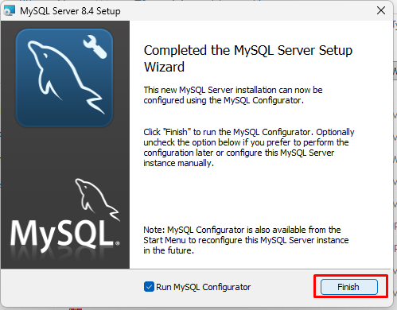
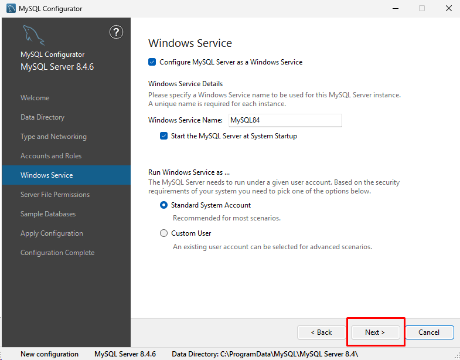
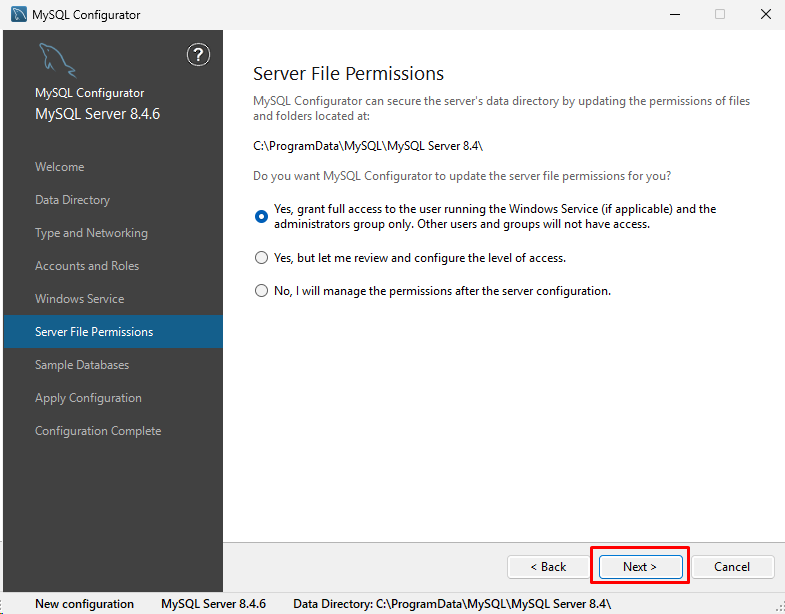

# MySQL-Installation
Hier steht, wie Sie MySQL installieren und einstellen, um es mit Exment zu verwenden.  
※Die Schritte können je nach Betriebssystem, Version und Zeitpunkt der Installation anders sein.  

Lesen Sie passend zu Ihrem Server einen der beiden folgenden Abschnitte.

| Server | Wo Sie nachlesen |
| ---- | ---- |
| Windows | Unten „MySQL-Einstellungen (Windows)“ |
| Linux | Unten „MySQL-Einstellungen (Linux)“ (die Schritte unterscheiden sich danach, ob MySQL5.7 schon vorhanden ist) |

## MySQL-Einstellungen (Windows)

- Empfohlen: Erstellen Sie vor dem Upgrade eine [Datenbanksicherung](https://dev.mysql.com/doc/refman/8.4/en/mysqldump-sql-format.html).

- (Wenn MySQL läuft) Öffnen Sie die Eingabeaufforderung als Administrator und halten Sie MySQL an.  
Geben Sie in die „Suchleiste“ rechts neben der Start-Schaltfläche „Eingabeaufforderung“ ein.  
Klicken Sie mit der rechten Maustaste auf „Eingabeaufforderung“, das oben unter „Höchste Übereinstimmung“ erscheint.  
Wählen Sie im angezeigten Menü „Als Administrator ausführen“.
   

~~~
net stop mysql57
net stop mysql80
~~~

- Öffnen Sie die folgende Website und laden Sie MySQL herunter.  
※Den MySQL Installer gibt es nur für die Reihe MySQL 8.0. Laden Sie für MySQL 8.1 und höher (auch 8.4) den MySQL Server als MSI oder ZIP herunter.  
[MySQL Community Server Downloads](https://downloads.mysql.com/archives/community/)  

- Wählen Sie bei Select Version „8.4.X“ und als Betriebssystem Windows (x86, 64-bit).  

- Laden Sie eines der folgenden herunter.
	- MSI Installer

- Führen Sie die heruntergeladene MSI-Datei aus und installieren Sie nach den Anweisungen auf dem Bildschirm (Assistent).
	- Klicken Sie im Bildschirm Welcome auf „Next“.

		
	- Stimmen Sie dem License Agreement zu und klicken Sie auf „Next“.

		
	- Wählen Sie als Setup Type „Complete“.

		
	- Klicken Sie auf „Install“.

		
	- Klicken Sie nach dem Ende der Installation auf „Finish“.

		

- Wenn die Installation der MSI-Datei fertig ist, öffnet sich der MySQL Server Configurator von selbst.
	- Klicken Sie bei „Welcome to the MySQL Server Configurator“ auf „Next“.

		

- Lassen Sie bei Data Directory den Anfangswert und klicken Sie auf „Next“.

	

- Type and Networking:
	- Config Type: Development Computer
	- Connectivity: TCP/IP (der Standardport ist 3306)
	- Klicken Sie auf „Next“.

		

- Accounts and Roles: Legen Sie das Passwort des Benutzers root fest und klicken Sie auf „Next“.

	

- Windows Service: Legen Sie den Dienstnamen fest (Beispiel: MySQL84) und klicken Sie auf „Next“.

	

- Lassen Sie bei Server File Permissions den Anfangswert und klicken Sie auf „Next“.

	

- Überspringen Sie Sample Databases und klicken Sie auf „Next“.

	

- Klicken Sie bei Apply Configuration auf „Execute“ und danach auf „Next“ und „Finish“.

	

- Ändern Sie my.ini. (C:\ProgramData\MySQL\MySQL Server 8.4\my.ini)

~~~
# Die folgenden Zeilen am Ende hinzufügen

local-infile=1
~~~

- Starten Sie MySQL neu. (Der Dienstname hängt von der Umgebung ab)

~~~
net stop MySQL84
net start MySQL84
~~~

### Umgebungsvariable hinzufügen 

- Klicken Sie im Explorer mit der rechten Maustaste auf „Dieser PC“ und dann auf „Eigenschaften“.

- Klicken Sie auf „Erweiterte Systemeinstellungen“.

- Klicken Sie auf „Umgebungsvariablen“.  

- Klicken Sie unter „Benutzervariablen“ auf „Path“ und dann auf „Bearbeiten“.  

- Wenn es die Zeile „C:\Program Files\MySQL\MySQL Server 5.7\bin“ gibt, löschen Sie sie.

- Klicken Sie auf „Neu“ und fügen Sie die folgende Zeile hinzu.  
 „C:\Program Files\MySQL\MySQL Server 8.4\bin“   

- Schließen Sie nach der Eingabe alle geöffneten Dialoge mit „OK“.  

## MySQL-Einstellungen (Linux)
Hier steht, wie Sie MySQL unter Linux installieren.  
※Setzen Sie bei Bedarf sudo vor die Befehle.  
※Wenn das Ziel der Installation CentOS8, RHEL8 oder Ähnliches ist, verwenden Sie statt yum den Befehl dnf.

Die Schritte unterscheiden sich danach, ob MySQL5.7 schon installiert ist.

| Aktueller Zustand | Wo Sie nachlesen |
| ---- | ---- |
| MySQL5.7 ist installiert | „Wenn MySQL5.7 vorhanden ist (Aktualisierung von MySQL5.7 auf MySQL8.4)“ |
| MySQL5.7 ist nicht installiert | „Wenn MySQL5.7 nicht vorhanden ist (Neuinstallation von MySQL8.4)“ |

### Wenn MySQL5.7 vorhanden ist (Aktualisierung von MySQL5.7 auf MySQL8.4)
- Entfernen Sie die Pakete von MySQL5.7.
~~~
sudo killall mysqld; sudo killall mysqld_safe;
sudo rpm -e --nodeps mysql57-community-release
sudo yum remove mysql mysql-server mysql-client mysql-common mysql-devel mysql-community-client-plugins -y
~~~

- Installieren und starten Sie MySQL8.4.

※Je nach Version des Betriebssystems ist das rpm ein anderes.

Zum Beispiel unter AlmaLinux9.5, wenn die Ausgabe so aussieht:
 

~~~
[root@localhost ~]# uname -a
Linux localhost.localdomain 5.14.0-503.11.1.el9_5.x86_64 #1 SMP PREEMPT_DYNAMIC Tue Nov 12 09:26:13 EST 2024 x86_64 x86_64 x86_64 GNU/Linux
~~~

ist es dieses rpm:
 

~~~
sudo rpm -ivh https://dev.mysql.com/get/mysql84-community-release-el9-2.noarch.rpm
~~~

So lautet der Befehl in diesem Fall.
 

~~~
# Bei CENTOS STREAM

rpm -ivh https://dev.mysql.com/get/mysql84-community-release-el9-2.noarch.rpm
rpm --import https://repo.mysql.com/RPM-GPG-KEY-mysql-2023
dnf clean packages
dnf update -y

# mysql-community-server installieren und starten
dnf install mysql-community-server -y
systemctl start mysqld
systemctl enable mysqld
~~~

~~~
# Bei CENTOS8
sudo rpm -ivh https://dev.mysql.com/get/mysql84-community-release-el8-2.noarch.rpm
sudo rpm --import https://repo.mysql.com/RPM-GPG-KEY-mysql-2023

# Hiermit prüfen, ob es mysql-community-server gibt
sudo yum search mysql-community-server

# Wenn der Befehl oben eine Meldung wie „Error: Unable to find a match: mysql-community-server“ ausgibt (nicht vorhanden), zuerst den folgenden Befehl ausführen
sudo yum -y module disable mysql

# mysql-community-server installieren und starten
sudo yum -y install mysql-community-server
sudo systemctl enable mysqld.service
~~~

- Ändern Sie my.cnf.

~~~
vi /etc/my.cnf

# Die folgenden Zeilen am Ende hinzufügen

local-infile=1
~~~

- Starten Sie MySQL.

~~~
sudo systemctl start mysqld
~~~

### Wenn MySQL5.7 nicht vorhanden ist (Neuinstallation von MySQL8.4)
- Installieren und starten Sie MySQL8.4.

※Je nach Version des Betriebssystems ist das rpm ein anderes.

Zum Beispiel unter AlmaLinux9.5, wenn die Ausgabe so aussieht:
 

~~~
[root@localhost ~]# uname -a
Linux localhost.localdomain 5.14.0-503.11.1.el9_5.x86_64 #1 SMP PREEMPT_DYNAMIC Tue Nov 12 09:26:13 EST 2024 x86_64 x86_64 x86_64 GNU/Linux
~~~

ist es dieses rpm:
 

~~~
sudo rpm -ivh https://dev.mysql.com/get/mysql84-community-release-el9-2.noarch.rpm
~~~

So lautet der Befehl in diesem Fall.
 

~~~
# Bei CENTOSSTREAM

rpm -ivh https://dev.mysql.com/get/mysql84-community-release-el9-2.noarch.rpm
rpm --import https://repo.mysql.com/RPM-GPG-KEY-mysql-2023
dnf clean packages
dnf update -y

# mysql-community-server installieren und starten
dnf install mysql-community-server -y
systemctl start mysqld
systemctl enable mysqld
~~~

~~~
# Bei CENTOS 8
sudo rpm -ivh https://dev.mysql.com/get/mysql84-community-release-el8-2.noarch.rpm
sudo rpm --import https://repo.mysql.com/RPM-GPG-KEY-mysql-2023

# Hiermit prüfen, ob es mysql-community-server gibt
sudo yum search mysql-community-server

# Wenn der Befehl oben eine Meldung wie „Error: Unable to find a match: mysql-community-server“ ausgibt (nicht vorhanden), zuerst den folgenden Befehl ausführen
sudo yum -y module disable mysql

# mysql-community-server installieren und starten
sudo yum -y install mysql-community-server
sudo systemctl enable mysqld.service
sudo systemctl start mysqld
~~~

- Prüfen Sie das Anfangspasswort von MySQL.

~~~
cat /var/log/mysqld.log | grep -i 'temporary password'

#Es wird ein Protokoll wie das folgende ausgegeben. Dort das Passwort ablesen
2025-03-25T04:35:28.567119Z 6 [Note] [MY-010454] [Server] A temporary password is generated for root@localhost: et5k>Y.b0eJ.
~~~

- (Optional) Schalten Sie die Passwortrichtlinie aus.

~~~
vi /etc/my.cnf

#Das folgende validate_password hinzufügen
[mysqld]
validate_password=OFF
~~~

- Starten Sie MySQL neu.

~~~
sudo systemctl restart mysqld
~~~

- Nehmen Sie die Anfangseinstellungen von MySQL vor. Führen Sie den folgenden Befehl aus.

~~~
mysql_secure_installation

Enter password for user root: (das eben kopierte Passwort eingeben)

New password: (neues Passwort eingeben)
Re-enter new password: (neues Passwort eingeben)

Change the password for root? : n

Remove anonymous users? : y #Anonyme Benutzerkonten entfernen
Disallow root login remotely? : y # root-Konten entfernen, die von außerhalb von localhost erreichbar sind
Remove test database and access to it? : y # Datenbank test entfernen
Reload privilege tables now? : y #privilege-Tabellen neu laden
~~~

- Melden Sie sich bei MySQL an.

~~~
mysql -u root -p(Passwort)
~~~
- Ändern Sie my.cnf.

~~~
vi /etc/my.cnf

# Die folgenden Zeilen am Ende hinzufügen

local-infile=1
~~~

- Starten Sie MySQL neu.

~~~
sudo systemctl restart mysqld
~~~

- Legen Sie die Datenbank und den Benutzer für Exment an.  
※Hier heißt die Datenbank „exment_database“ und der Benutzer „exment_user“.  
Die IP-Adresse, von der die Verbindung kommt, ist hier „192.168.137.%“.

~~~
CREATE DATABASE exment_database;
CREATE USER 'exment_user'@'192.168.137.%' IDENTIFIED BY '(Passwort für exment_user)';
GRANT ALL ON exment_database.* TO 'exment_user'@'192.168.137.%';
FLUSH PRIVILEGES;
~~~

- Erlauben Sie in den Einstellungen der Firewall nur den Zugriff auf MySQL von der IP-Adresse, von der die Verbindung kommt.  
※Hier ist die IP-Adresse, von der die Verbindung kommt, „192.168.137.%“.

~~~
firewall-cmd --permanent --new-zone=from_webserver
firewall-cmd --reload
firewall-cmd --permanent --zone=from_webserver --add-source="192.168.137.0/24"
firewall-cmd --permanent --zone=from_webserver --add-port=3306/tcp
firewall-cmd --zone=from_webserver --add-service=mysql
firewall-cmd --reload
~~~
