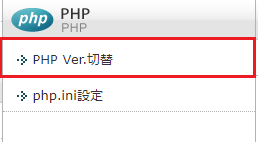

# Einrichtung auf einem Mietserver
So installieren Sie Exment auf einem Mietserver (Shared Hosting). Das ist eine Möglichkeit, wenn Sie eine Umgebung einfach aufbauen und betreiben möchten.  
Diese Seite erklärt die Schritte für Xserver und für Sakura Internet.

| Ihr Server | Wo Sie nachsehen |
|---|---|
| Xserver | [Bei Xserver](/de/install_rental?id=Bei-Xserver) |
| Sakura Internet | [Bei Sakura Internet](/de/install_rental?id=Bei-Sakura-Internet) |

Der grobe Ablauf ist bei beiden gleich.

1. Ein MySQL (eine Datenbank) für Exment anlegen
2. Per SSH mit dem Server verbinden und composer installieren
3. Exment in einem Ordner installieren, der nicht im Web veröffentlicht ist
4. Nur den Ordner „public“ von Exment im Web veröffentlichen
5. Die Einstellungen nach der [Installationsanleitung](/de/quickstart) abschließen

## Hinweise zum Aufbau auf einem Mietserver
- Exment braucht die folgende Umgebung.
    1. PHP 8.2 oder höher
    1. MySQL 8.0 oder höher (empfohlen: 8.4)  
    oder MariaDB 10.11 oder höher  
  Besonders die MySQL-Version erfüllt bei manchen Mietservern die Bedingungen nicht.  
  Prüfen Sie bitte vorher, ob Ihr Mietserver die Bedingungen erfüllt.

- Bei einem Mietserver ist der Ordner festgelegt, der im Web veröffentlicht wird (/home/username/www, /public_html usw.).  
Legen Sie den Ordner, in dem Exment installiert ist, nicht direkt unter diesen Ordner. Dateien mit den Einstellungen der Datenbank, dem Mail-Passwort usw. wären sonst von außen sichtbar. Das führt zu einem schweren Datenleck.  
Die Schritte auf dieser Seite veröffentlichen nur den Ordner, der im Web veröffentlicht werden soll. Veröffentlichen Sie ihn genau nach diesen Schritten.

- Auf einem Mietserver installieren Sie nach der Verbindung per SSH zuerst composer und danach Exment.

- Je nach Umgebung des Mietservers und den Versionen auf dem Server lassen sich die Schritte dieser Seite manchmal nicht richtig ausführen.

- Diese Seite beschreibt nur die Schritte, um Exment auf einem Mietserver zu betreiben.  
Allgemeines IT-Wissen wie SSH, das Anlegen einer Datenbank oder Linux-Befehle wird nicht erklärt. Wir bitten um Ihr Verständnis.

## Installation auf einem Mietserver

### Bei Xserver
※Der Betrieb wurde mit dem Tarif X10 geprüft.

<iframe width="560" height="420" src="https://www.youtube.com/embed/RB6i0F2fev0" frameborder="0" allow="accelerometer; autoplay; encrypted-media; gyroscope; picture-in-picture" allowfullscreen></iframe>

**(1) MySQL anlegen**

Legen Sie vorher ein MySQL für Exment an.

**(2) Das PHP für Befehle auf die Version der Verwaltungsoberfläche einstellen**

Bei Xserver kann sich die PHP-Version, die in der Verwaltungsoberfläche eingestellt ist, von der PHP-Version unterscheiden, die Befehle nach der Verbindung per SSH verwenden.  
Stellen Sie deshalb die PHP-Version für Befehle ein.

1. Klicken Sie in der Verwaltungsoberfläche von Xserver auf „PHP Ver.切替“ (PHP-Version wechseln).  
Wählen Sie danach die Domain aus.  
  
  

2. Unter „PHPバージョン切替“ (PHP-Version wechseln) steht die aktuelle Version. Notieren Sie sie.  
  

3. Verbinden Sie sich per SSH mit Xserver.

4. Sehen Sie mit dem folgenden Befehl nach, welche PHP-Versionen auf Xserver installiert sind.  
Kopieren Sie aus dem Ergebnis den Pfad des PHP mit der notierten Version.

~~~ bash
find /opt/php-*/bin -type f -name 'php'

## /opt/php-8.2.9/bin/php ←in diesem Beispiel dieser Pfad
~~~

5. Legen Sie einen Ordner an und erstellen Sie einen symbolischen Link auf PHP (eine Art Abkürzung, die auf eine Datei an einem anderen Ort zeigt).

~~~
mkdir $HOME/bin
ln -s /opt/php-8.2.9/bin/php $HOME/bin/php
~~~

6. Ändern Sie die Datei bashrc und nehmen Sie dieses PHP in den Pfad auf.

~~~ bash
vi ~/.bashrc

## Das Folgende in die letzte Zeile schreiben und mit „:wq!“ speichern
export PATH=$HOME/bin:$PATH

## Die Änderung übernehmen
source ~/.bashrc
~~~

7. Prüfen Sie die PHP-Version. Wenn es die Version aus der Verwaltungsoberfläche ist, ist es geschafft.

~~~ bash
php --version
~~~

**(3) composer installieren**

~~~ bash
cd ~
curl -sS https://getcomposer.org/installer | php -- --install-dir=$HOME/bin/
## Umbenennen
mv $HOME/bin/composer.phar $HOME/bin/composer
## Prüfen
composer --version
# Composer version 2.6.5 2023-10-06 10:11:52
~~~

**(4) Exment installieren**

Installieren Sie niemals direkt unter dem Ordner „$HOME/(Domainname)/public_html“. Dateien mit den Einstellungen der Datenbank, dem Mail-Passwort usw. wären sonst von außen sichtbar. Das führt zu einem schweren Datenleck.  
Hier legen Sie den Ordner „$HOME/(Domainname)/laravel“ an und installieren Exment darin.

~~~ bash
cd ~/(Domainname)
mkdir laravel
cd laravel
wget https://exment.net/downloads/en/exment.zip
unzip exment.zip
rm exment.zip
~~~

**(5) Nur den Ordner public veröffentlichen**

Machen Sie „$HOME/(Domainname)/public_html“ zu einem symbolischen Link auf den eben angelegten Ordner „$HOME/(Domainname)/laravel/exment/public“.  
So bleiben Laravel selbst und die Einstellungen außerhalb des Ordners, der im Web veröffentlicht wird. Nur der Ordner public von laravel liegt in public_html.

~~~ bash
## Das vorgegebene public_html löschen
rm -r $HOME/(Domainname)/public_html
ln -s $HOME/(Domainname)/laravel/exment/public $HOME/(Domainname)/public_html
~~~

**(6) Die Installation fortsetzen**

Jetzt ist alles bereit, um Exment zu öffnen.  
Schließen Sie die Einstellungen nach der [Installationsanleitung](/de/quickstart) ab.  
※Ab v7.2.1 öffnet sich Exment unter dieser URL. Bei Websites, deren `.env` unter `ADMIN_ROUTE_PREFIX` „admin“ enthält (Websites, die mit einer früheren Version installiert wurden), hängen Sie „/admin“ an das Ende der URL an.  

#### PHP für Befehle und cron
Bei Xserver sind das PHP für das Web (das in der Verwaltungsoberfläche unter „PHP Ver.切替“ gewählte PHP) und das PHP, das bei der Eingabe von `php` per SSH oder in cron läuft, verschieden.

- Wenn Sie per SSH `php` eingeben, läuft `~/bin/php` (das oben verlinkte PHP). Ohne diesen Link läuft das Standard-PHP des Servers (es kann eine alte Version sein).
- cron liest `~/.bashrc` nicht. Mit `php` allein läuft das Standard-PHP des Servers (zum Beispiel 8.0), und Exment läuft nicht.

Führen Sie deshalb die artisan-Befehle und cron **mit dem vollen Pfad des PHP aus, das dieselbe Version wie die Verwaltungsoberfläche hat**.

- Beispiel (bei PHP 8.3): `/usr/bin/php8.3` oder das oben mit `find` gefundene `/opt/php-8.3.x/bin/php`
- Wenn Sie die PHP-Version in der Verwaltungsoberfläche ändern, ändern Sie auch den Link `~/bin/php` und den Pfad in cron auf dieselbe Version.

Den [Aufgabenplan](/de/additional_task_schedule) stellen Sie in der Verwaltungsoberfläche von Xserver unter „Cron設定“ (Cron-Einstellungen) wie folgt ein (ersetzen Sie `(Server-ID)` und `(Domainname)` durch Ihre eigenen Werte).

~~~
* * * * * cd /home/(Server-ID)/(Domainname)/laravel/exment && nice -n 15 /usr/bin/php8.3 artisan schedule:run >> /dev/null 2>&1
~~~

Für die Warteschlange ([Verzögerte Ausführung von Benachrichtigungen](/de/additional_queue)) können Sie auf einem Mietserver keinen Worker einrichten, der ständig läuft. Lassen Sie `QUEUE_CONNECTION` in der `.env` auf `sync` (dem Wert bei der Installation). Wenn Sie doch `database` einstellen, lassen Sie cron jede Minute die angesammelten Jobs abarbeiten.

~~~
* * * * * cd /home/(Server-ID)/(Domainname)/laravel/exment && nice -n 15 /usr/bin/php8.3 artisan queue:work --stop-when-empty --max-time=50 >> /dev/null 2>&1
~~~

#### Vorgehen beim Wechsel der PHP-Version
Wenn Sie die PHP-Version ändern, gehen Sie nach den folgenden Schritten vor.

- Während der Arbeit am Versionswechsel ist Exment nicht erreichbar.
- Das Beispiel unten zeigt die Aktualisierung von PHP7.4 auf PHP8.2.
- Je nach Umgebung, Zeitpunkt der Einführung, Version und Art der Installation können die Schritte anders sein.

1. Klicken Sie in der Verwaltungsoberfläche von Xserver auf „PHP Ver.切替“ (PHP-Version wechseln).  
Wählen Sie danach die Domain aus.

2. Wechseln Sie unter „PHPバージョン切替“ (PHP-Version wechseln) auf die neue Version und klicken Sie auf „変更“ (Ändern).  
  

3. Verbinden Sie sich per SSH mit Xserver.

4. Prüfen Sie mit dem folgenden Befehl die aktuelle PHP-Version.  
(Zu diesem Zeitpunkt wird noch die alte Version angezeigt.)

~~~ 
php --version
~~~

5. Entfernen Sie den symbolischen Link auf PHP.

~~~
unlink $HOME/bin/php
~~~

6. Sehen Sie nach, welchen Pfad die unter „PHPバージョン切替“ gewählte Version hat.

~~~ bash
find /opt/php-*/bin -type f -name 'php'

## /opt/php-8.2.9/bin/php  ←in diesem Beispiel dieser Pfad
~~~

7. Erstellen Sie einen symbolischen Link auf den gefundenen Pfad.

~~~
ln -s /opt/php-8.2.9/bin/php $HOME/bin/php
~~~

8. Prüfen Sie die PHP-Version. Wenn die neue Version angezeigt wird, hat es geklappt.

~~~ 
php --version
~~~

### Bei Sakura Internet
※Der Betrieb wurde mit dem Tarif Standard geprüft.  
※Bei Sakura Internet kann die Ausführung von „composer“ mittendrin abbrechen.  
Führen Sie den Befehl deshalb mit „nice -n 20“ davor aus, also „nice -n 20 composer“.

**(1) MySQL anlegen**

Legen Sie vorher ein MySQL für Exment an.

**(2) Den veröffentlichten Ordner ändern**

1. Wählen Sie im Verwaltungsmenü von Sakura Internet unter „ドメイン/SSL設定“ (Domain-/SSL-Einstellungen) die Domain aus, die Sie ändern möchten.  
  

2. Ändern Sie unter „マルチドメインの対象のフォルダ“ (Zielordner der Multidomain) den angegebenen Ordner. Hier verwenden wir „/exment“.  
  

**(3) Per SSH verbinden, Shell und Pfad einstellen**

1. Verbinden Sie sich mit Ihrer ID und Ihrem Passwort per SSH.

2. Ändern Sie die Shell.

~~~
which bash
#  /usr/local/bin/bash

chsh -s /usr/local/bin/bash
# Password:  ## Passwort eingeben
# chsh: user information updated
~~~

3. Ändern Sie .bash_profile.

~~~ bash
vi .bash_profile

## Das Folgende eintragen und mit „:wq!“ speichern
PATH=$PATH:$HOME/bin:$HOME/usr/local/bin
export PATH
~~~

4. Trennen Sie die SSH-Verbindung einmal und verbinden Sie sich erneut per SSH.

**(4) composer installieren**

~~~ bash
cd ~
mkdir -p usr/local/bin/
curl -sS https://getcomposer.org/installer | php -- --install-dir=usr/local/bin/
## Umbenennen
mv usr/local/bin/composer.phar usr/local/bin/composer
## Prüfen
nice -n 20 composer --version
# Composer version 2.6.5 2023-10-06 10:11:52
~~~

**(5) Exment installieren**

Installieren Sie niemals direkt unter dem Ordner „$HOME/www/“. Dateien mit den Einstellungen der Datenbank, dem Mail-Passwort usw. wären sonst von außen sichtbar. Das führt zu einem schweren Datenleck.  
Hier legen Sie den Ordner „$HOME/laravel“ an und installieren Exment darin.

~~~ bash
cd ~
mkdir laravel
cd laravel
wget https://exment.net/downloads/en/exment.zip
unzip exment.zip
rm exment.zip
~~~

**(6) Nur den Ordner public veröffentlichen**

Legen Sie „$HOME/www/exment“ als symbolischen Link auf den eben angelegten Ordner „$HOME/laravel/exment/public“ an.  
So bleiben Laravel selbst und die Einstellungen außerhalb des Ordners, der im Web veröffentlicht wird. Nur der Ordner public von laravel liegt im Ordner www.

~~~
ln -s $HOME/laravel/exment/public $HOME/www/exment
~~~

**(7) Die Installation fortsetzen**

Jetzt ist alles bereit, um Exment zu öffnen.  
Schließen Sie die Einstellungen nach der [Installationsanleitung](/de/quickstart) ab.  
※Ab v7.2.1 öffnet sich Exment unter dieser URL. Bei Websites, deren `.env` unter `ADMIN_ROUTE_PREFIX` „admin“ enthält (Websites, die mit einer früheren Version installiert wurden), hängen Sie „/admin“ an das Ende der URL an.  

#### Vorgehen beim Wechsel der PHP-Version
Wenn Sie die PHP-Version ändern, gehen Sie nach den folgenden Schritten vor.

- Während der Arbeit am Versionswechsel ist Exment nicht erreichbar.
- Je nach Umgebung, Zeitpunkt der Einführung, Version und Art der Installation können die Schritte anders sein.

1. Klicken Sie in der Verwaltungsoberfläche von Sakura Internet auf „スクリプト設定“ (Skript-Einstellungen) → „言語のバージョン設定“ (Einstellung der Sprachversion).  
  

2. Wechseln Sie unter „PHPのバージョン“ (PHP-Version) auf die neue Version und klicken Sie auf „保存“ (Speichern).  
  

3. Verbinden Sie sich per SSH mit Sakura Internet.

4. Prüfen Sie die PHP-Version. Wenn die neue Version angezeigt wird, hat es geklappt.

~~~ bash
php --version
~~~
