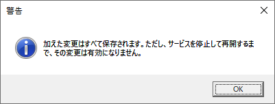
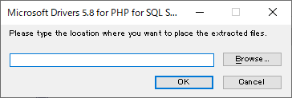

# Installation mit SQL Server
So verwenden Sie SQL Server als Datenbank von Exment.

- <span class="red bold">※Die Funktionen Sicherung und Wiederherstellung werden derzeit nicht unterstützt.</span>
- Die Schritte können je nach Betriebssystem, Version, Zeitpunkt der Installation usw. anders sein.

## Ablauf
1. **SQL Server vorbereiten** (Installation, Datenbank und Benutzer anlegen) … „SQL Server einrichten“
2. **Prüfen, ob die Verbindung klappt** … „Verbindung prüfen“
3. **Von Exment aus verbinden** (den PHP-Treiber installieren und Exment installieren) … „Exment einrichten“

## SQL Server einrichten

### SQL Server installieren
1. Laden Sie SQL Server von der folgenden Website herunter.  
※Wählen Sie die Edition passend zum Zweck, zur Größe des Unternehmens usw.  
[SQL Server herunterladen](https://www.microsoft.com/en-us/sql-server/sql-server-downloads)  

2. Führen Sie die heruntergeladene Datei aus und setzen Sie die Installation fort.  
  

3. Die Installation ist abgeschlossen.

### SQL Server Management Studio (GUI-Werkzeug) installieren
SQL Server Management Studio ist ein Werkzeug, mit dem Sie SQL Server über eine Oberfläche bedienen.

- Öffnen Sie die folgende Website.  
Klicken Sie unter „Available languages“ (Verfügbare Sprachen) auf die Sprache, die Sie verwenden möchten. Laden Sie dann das Werkzeug herunter und installieren Sie es.  
https://docs.microsoft.com/en-us/sql/ssms/download-sql-server-management-studio-ssms?view=sql-server-ver15#available-languages


### Zusätzliche Einstellungen (Windows)
※Wir haben festgestellt, dass derzeit die folgenden Einstellungen nötig sind, wenn SQL Server unter Windows installiert wurde.

1. Öffnen Sie im Startmenü von Windows den „SQL Server-Konfigurations-Manager“.  
  

2. Klicken Sie im linken Menü auf „SQL Server-Netzwerkkonfiguration“ → „Protokolle für (Name der Edition)“. Klicken Sie danach mit der rechten Maustaste auf „TCP/IP“ und dann auf „Aktivieren“.  
  
  
  

3. Klicken Sie auf die Schaltfläche des Startmenüs, geben Sie „Dienste“ ein und starten Sie die angezeigte App „Dienste“.  
  

4. Wählen Sie in der Liste der Dienste „SQL Server (Name der Edition)“ und klicken Sie auf „Dienst neu starten“.  
  


### Datenbank anlegen, Benutzer hinzufügen
1. Starten Sie „SQL Server Management Studio“.  
  

2. Melden Sie sich an.  
  

#### Datenbank anlegen
1. Klicken Sie im linken Menü mit der rechten Maustaste auf den Ordner „Datenbanken“ und dann auf „Neue Datenbank“.  
  

2. Geben Sie einen beliebigen Datenbanknamen ein und klicken Sie auf OK.  
  

#### Benutzer hinzufügen
1. Klicken Sie im linken Menü mit der rechten Maustaste auf „Sicherheit“ → „Anmeldungen“ und wählen Sie „Neue Anmeldung“.  
  

2. Geben Sie den Anmeldenamen und das Kennwort ein und wählen Sie „SQL Server-Authentifizierung“. Wir empfehlen, das Häkchen bei „Kennwortrichtlinie erzwingen“ zu entfernen. (Halten Sie sich an die Richtlinien Ihres Unternehmens, Ihrer Organisation usw.)  
    

3. Wählen Sie oben links „Benutzerzuordnung“.  
Wählen Sie in der Datenbankliste unter „Benutzer, die dieser Anmeldung zugeordnet sind“ die eben angelegte Datenbank.  
Wählen Sie unter „Mitgliedschaft in Datenbankrolle“ Folgendes.
   - db_backupoperator
   - db_ddladmin
   - db_datawriter
   - db_datareader
   - public
   - dbcreator (※Wird für das manuelle Sichern und Wiederherstellen der Daten verwendet. Setzen Sie das Häkchen, wenn Sie Daten manuell sichern und wiederherstellen.)

       

4. Wenn alles fertig ist, klicken Sie auf OK.

#### Anmeldung am Server einstellen
1. Klicken Sie im linken Menü mit der rechten Maustaste auf den Server oben links und wählen Sie „Eigenschaften“.  
 

2. Wählen Sie im Menü „Sicherheit“ unter „Serverauthentifizierung“ den Eintrag „SQL Server- und Windows-Authentifizierungsmodus“ und klicken Sie auf OK.

3. Klicken Sie auf die Schaltfläche des Startmenüs, geben Sie „Dienste“ ein und starten Sie die angezeigte App „Dienste“.  
  

4. Wählen Sie in der App „Dienste“ noch einmal „SQL Server (Name der Edition)“ und klicken Sie auf „Dienst neu starten“.  
  

#### Port prüfen
- Klicken Sie im „SQL Server-Konfigurations-Manager“ mit der rechten Maustaste auf „TCP/IP“ und dann auf „Eigenschaften“.  
Öffnen Sie danach die Registerkarte „IP-Adressen“ und prüfen Sie ganz unten den Wert von „Dynamische TCP-Ports“. (Sie brauchen ihn später in den Datenbankeinstellungen von Exment.)  
  
  


## Verbindung prüfen
Prüfen Sie, ob die Verbindung zu SQL Server klappt.

1. Starten Sie „SQL Server Management Studio“.  
  

2. Melden Sie sich mit den folgenden Angaben an.
    - Servername: der vorgegebene Servername
    - Authentifizierung: SQL Server-Authentifizierung
    - Benutzername: der Benutzername des angelegten Benutzers
    - Kennwort: das Kennwort des angelegten Benutzers

      

3. Prüfen Sie, ob die Anmeldung normal klappt.  
Wenn die Einstellungen nicht richtig abgeschlossen sind, erscheint ein Fehler.


## Exment einrichten
Hier bereiten Sie die Umgebung vor und nehmen die Einstellungen vor, damit Exment sich mit SQL Server verbinden kann.

### Treiber installieren
Installieren Sie den Treiber (das Bauteil, mit dem PHP sich mit SQL Server verbindet). Die Schritte hängen vom Betriebssystem des Servers ab, auf dem Exment installiert ist.

#### Windows
1. Führen Sie den folgenden Befehl aus.  
Im Ergebnis steht ein Dateipfad. Notieren Sie ihn.

```
php -i | find "extension_dir"
# Beispiel für das Ergebnis
extension_dir => C:\xampp\php\ext => C:\xampp\php\ext
```


2. Laden Sie von der folgenden Website den Treiber herunter, mit dem PHP sich mit Microsoft SQL Server verbindet.  
https://docs.microsoft.com/en-us/sql/connect/php/download-drivers-php-sql-server?view=sql-server-ver15

3. Führen Sie die heruntergeladene EXE-Datei aus. Es erscheint ein Dialog wie der folgende.  


4. Fügen Sie den in Schritt 1 notierten Dateipfad ein und klicken Sie auf „OK“.  


5. Die dll-Dateien für die Verbindung mit SQL Server werden in den Ordner der PHP-Erweiterungen gelegt.  


6. Öffnen Sie die Datei php.ini und schreiben Sie den folgenden Inhalt an das Ende der Datei.  
※Passen Sie den Dateinamen nach den Angaben in den Kommentaren an.

```
extension=php_pdo_sqlsrv_82_ts_x64.dll
# Teil "82": die verwendete PHP-Version. Bei PHP8.3 ist es 83
# Teil "ts": Wenn der Befehl „php -i | find "Thread Safety"“ „enabled“ ausgibt, tragen Sie „ts“ ein, bei „disabled“ tragen Sie „nts“ ein
# Teil "x64": Wenn die erste Zeile der Ausgabe des Befehls „php -v“ „x64“ enthält, tragen Sie „x64“ ein, sonst „x86“
```

7. Starten Sie PHP neu. Damit sind die Einstellungen unter Windows abgeschlossen.


#### Linux

Installieren Sie nach der Anleitung [hier](https://docs.microsoft.com/en-us/sql/connect/php/installation-tutorial-linux-mac?view=sql-server-ver15) den ODBC-Treiber und den PHP-Treiber für Ihr Betriebssystem.


### Exment einrichten
- Setzen Sie danach die Installation nach der [Installationsanleitung](/de/quickstart) fort.

- Geben Sie im Bildschirm der Datenbankeinstellungen die folgenden Werte ein.
    - Datenbanktyp : SQL Server
    - Hostname : Servername
    - Port : die im TCP/IP-Bildschirm geprüfte Portnummer
    - Datenbank : der Name der angelegten Datenbank
    - Benutzername : der Name des angelegten Benutzers
    - Passwort : das Passwort des angelegten Benutzers
