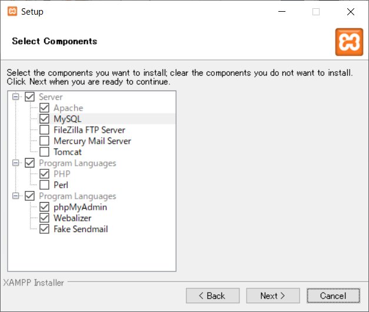
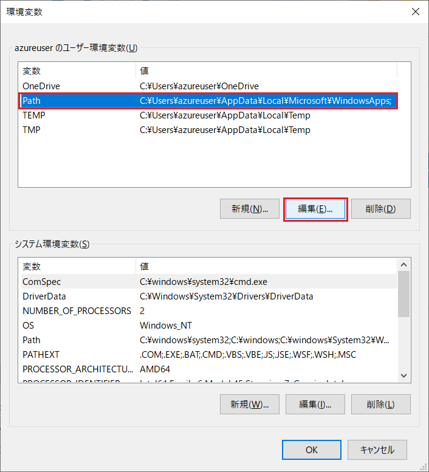

# Umgebung mit XAMPP aufbauen
Hier steht, wie Sie mit XAMPP auf einem Windows-PC eine Umgebung aufbauen, in der Exment läuft.  
XAMPP ist eine Software, mit der Sie PHP, Apache und MySQL zusammen installieren können. Wir empfehlen sie, wenn Sie eine Entwicklungsumgebung von Grund auf neu aufbauen.

## Hinweise
- **Verwenden Sie die Installation mit XAMPP nur für Entwicklung und Tests. Wir empfehlen, sie nicht als Produktivumgebung zu verwenden.** 

## Installationsschritte
Gehen Sie in der folgenden Reihenfolge vor.

1. XAMPP installieren und Apache und MySQL starten
2. Den Befehl mysql nutzbar machen (Umgebungsvariable)
3. Die Datenbank anlegen
4. Eine URL für Exment einrichten (Subdomain-Einstellung)
5. Exment installieren

### XAMPP installieren
1. Laden Sie XAMPP von der folgenden Website herunter.  
[XAMPP herunterladen](https://www.apachefriends.org/jp/download.html)

2. Wählen Sie eine Ausgabe mit „PHP8.2“ oder höher und laden Sie sie herunter.  

3. Fahren Sie mit der Installation von XAMPP fort.  

4. Unterwegs erscheint ein Bildschirm, in dem Sie die Komponenten von XAMPP wählen. Wählen Sie Apache und MySQL.  
Setzen Sie auch bei „phpMyAdmin“ ein Häkchen.  
※Alle anderen Häkchen setzen Sie nach Belieben.  
Klicken Sie danach auf „Next“.  

5. Folgen Sie danach dem Bildschirm und schließen Sie die Installation ab.

6. Starten Sie nach der Installation das XAMPP Control Panel.  

7. Klicken Sie ganz oben in den Zeilen „Apache“ und „MySQL“ auf „Start“.  

8. Wenn eine Meldung der Firewall erscheint, klicken Sie auf „Zulassen“.  

9. Jetzt läuft Apache.  

#### Hinweis
- Nach einem Neustart des Betriebssystems müssen Sie das XAMPP Control Panel erneut starten und Apache wieder starten.

### Umgebungsvariable hinzufügen
Damit Sie mysql in der Eingabeaufforderung ausführen können, muss der Pfad in den „Umgebungsvariablen“ stehen.

1. Klicken Sie im Explorer mit der rechten Maustaste auf „Dieser PC“ und dann auf „Eigenschaften“.  

2. Klicken Sie auf „Erweiterte Systemeinstellungen“.  

3. Klicken Sie auf „Umgebungsvariablen“.  

4. Klicken Sie unter „Benutzervariablen“ auf „Path“ und dann auf „Bearbeiten“.  

5. Klicken Sie auf „Neu“ und fügen Sie die folgende Zeile hinzu.

~~~
C:\xampp\mysql\bin  
~~~

6. Schließen Sie nach der Eingabe alle geöffneten Dialoge mit „OK“.

##### Wenn Sie das Mysql von XAMPP ausführen
- Wenn Sie das Mysql ausführen, das in XAMPP enthalten ist, fügen Sie beim Schritt [Exment installieren](/de/install_xampp?id=Exment-installieren) den Pfad bis zu dem Ordner mit der ausführbaren Datei in die .env im Stammverzeichnis von Exment ein.

~~~
#Beispiel  
EXMENT_MYSQL_BIN_DIR="C:/xampp/mysql/bin"
~~~

#### Datenbank anlegen
1. Starten Sie das XAMPP Control Panel und klicken Sie in der Zeile „MySQL“ auf „Admin“.  

2. Klicken Sie im linken Menü auf „Neu“.  

3. Geben Sie in der Zeile „Datenbank erstellen“ einen beliebigen Datenbanknamen aus Buchstaben und Ziffern ein und klicken Sie auf „Anlegen“.  

Damit ist die Datenbank angelegt.

### Subdomain-Einstellung
In der normalen Einstellung können Sie Exment verwenden, wenn Sie die Projektdateien von Exment in den Ordner "C:\xampp\htdocs" legen.  
So gibt es aber ein großes Problem. Wenn Sie zum Beispiel die URL [http://localhost/exment/.env](http://localhost/exment/.env) öffnen, wird die Einstellungsdatei mit den Angaben zur Datenbank auf dem Bildschirm angezeigt.  
Deshalb empfehlen wir dringend eine Einstellung, die dieses Problem verhindert. Stellen Sie sie mit den folgenden Schritten ein.

1. Legen Sie im Ordner „C:\xampp“ den Ordner „local“ an.  

2. Öffnen Sie "C:\xampp\apache\conf\extra\httpd-vhosts.conf".

3. Fügen Sie am Ende der Datei den folgenden Eintrag hinzu. **※Am Ende von DocumentRoot ist „/public“ nötig**  

~~~
<VirtualHost *:80>
    DocumentRoot "C:/xampp/htdocs"
    ServerName localhost
</VirtualHost>

<VirtualHost *:80>
  DocumentRoot "C:/xampp/local/exment/public"
  ServerName exment.localapp
</VirtualHost>

<Directory "C:\xampp\local\exment\public">
  Allow from all
  AllowOverride All
  Require all granted
</Directory>
~~~

4. Öffnen Sie "C:\WINDOWS\system32\drivers\etc\hosts" und bearbeiten Sie die Datei wie folgt.  
※Diese Datei lässt sich nicht direkt bearbeiten. Kopieren Sie sie zum Beispiel auf den Desktop, bearbeiten Sie sie dort und überschreiben Sie dann die Datei am ursprünglichen Ort.  

~~~
127.0.0.1       localhost
127.0.0.1       exment.localapp
~~~

5. Starten Sie Apache im XAMPP Control Panel neu. Klicken Sie in der Zeile „Apache“ auf die Schaltfläche „Stop“ und danach wieder auf „Start“.  

6. Jetzt können Sie Exment unter der folgenden URL öffnen.  
http://exment.localapp

### Exment installieren
Installieren Sie Exment nach den [Installationsschritten](/de/quickstart) von Exment.  
Die Installation von Exment führen Sie normalerweise im Ordner "C:\xampp\local" aus.  
Hier gehen wir davon aus, dass Exment im Ordner "C:\xampp\local\exment" installiert wurde.  

- Während der Installation gibt es einen Bildschirm, in dem Sie die Einstellungen der Datenbank eingeben. Geben Sie dort Folgendes ein.
    - Datenbanktyp: MariaDB
    - Hostname: 127.0.0.1
    - Port: 3306
    - Datenbank: (der oben angelegte Datenbankname)
    - Benutzername: root
    - Passwort: (leer)

## Vorgehen bei einem PHP-Versionswechsel
Wenn Sie die PHP-Version ändern, gehen Sie nach den folgenden Schritten vor.

- Während der Arbeit am Versionswechsel ist Exment nicht erreichbar.
- Das Beispiel unten zeigt die Schritte für ein Update von PHP7.4 auf PHP8.2. Dabei wird nicht ganz XAMPP aktualisiert, sondern nur PHP ersetzt.
- Je nach Umgebung, Zeitpunkt der Einführung, Version und Installationsweise können die Schritte anders sein.

1. Stoppen Sie zur Vorbereitung Apache und MySQL und beenden Sie das XAMPP Control Panel.

2. Sichern Sie den PHP-Ordner (Standard ist C:\xampp\php) und den Apache-Ordner (Standard ist C:\xampp\apache) des XAMPP, das Sie jetzt verwenden. Die Art ist Ihnen überlassen: Sie können zum Beispiel die Ordner umbenennen oder an einen anderen Ort kopieren.

3. Laden Sie das neue XAMPP im ZIP-Format herunter.  

   1. Öffnen Sie [XAMPP herunterladen](https://www.apachefriends.org/jp/download.html).
   2. Laden Sie die Datei herunter, die zu Ihrem Betriebssystem und zur gewünschten PHP-Version passt.  
      > Wählen Sie dabei nicht installer.exe, sondern die zip-Datei. (Wenn Sie sie entpacken können, geht auch die 7z-Datei.)
      

   3. Entpacken Sie die ZIP-Datei. Kopieren Sie den PHP-Ordner und den Apache-Ordner, die direkt im entpackten Ordner liegen, in den XAMPP-Ordner.  

4. Ändern Sie bei Bedarf die Datei php.ini.  
※Wenn Sie die ursprüngliche ini-Datei geändert hatten, braucht auch die neue ini-Datei dieselben Änderungen. Vergleichen Sie die gesicherte php.ini mit der neuen php.ini und fügen Sie die Einstellungswerte und Ähnliches hinzu.  

5. Starten Sie das XAMPP Control Panel.

6. Drücken Sie die Schaltfläche config von Apache und wählen Sie in der Auswahlliste „Apache(httpd-xampp.conf)“. 
   

7. Bearbeiten Sie httpd-xampp.conf. 
   1. Ersetzen Sie zuerst jedes "php7_module" durch "php_module".
   2. Ersetzen Sie jedes übrige "php7" durch "php8".
   

8. Drücken Sie die Schaltfläche Shell, um das Befehlsfenster zu öffnen, und prüfen Sie, ob die PHP-Version neu ist.

~~~
php -v
~~~

9. Klicken Sie in den Zeilen „Apache“ und „MySQL“ auf „Start“.  

   > Beim „Start“ von „Apache“ kann ein Fehler auftreten.  
   Öffnen Sie dann rechts in derselben Zeile „Logs“ → „Apache(error.log)“.  
   Wenn in der neuesten Zeile des Protokolls „PHP Warning: 'vcruntime140.dll'...“ steht, müssen Sie das „Visual C++ Redistributable“-Paket installieren.  
   Öffnen Sie die [Download-Website von Microsoft](https://visualstudio.microsoft.com/downloads/), scrollen Sie ganz nach unten und öffnen Sie „Other Tools, Frameworks, and Redistributables“ (Andere Tools, Frameworks und Redistributables).	  
   Klicken Sie auf die Download-Schaltfläche von „Microsoft Visual C++ Redistributable for Visual Studio 2022“, um das Installationsprogramm zu erhalten, und führen Sie es aus.
