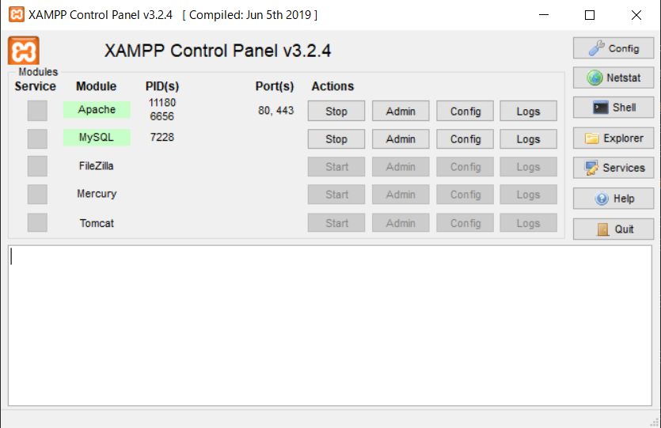

# Einrichtung mit XAMPP
So bauen Sie mit XAMPP auf einem Windows-PC eine Umgebung auf, in der Exment läuft.  
XAMPP ist eine Software, mit der Sie PHP, Apache und MySQL zusammen installieren. Wir empfehlen sie, wenn Sie eine Entwicklungsumgebung von Grund auf aufbauen.

## Hinweise
- **Nutzen Sie die Installation mit XAMPP nur für Entwicklung und Tests. Wir empfehlen, sie nicht als Produktivumgebung zu verwenden.** 

## Installation
Gehen Sie in der folgenden Reihenfolge vor.

1. XAMPP installieren und Apache und MySQL starten
2. Den Befehl mysql nutzbar machen (Umgebungsvariable)
3. Eine Datenbank anlegen
4. Eine URL für Exment anlegen (Subdomain einrichten)
5. Exment installieren

### XAMPP installieren
1. Laden Sie XAMPP von der folgenden Website herunter.  
[XAMPP herunterladen](https://www.apachefriends.org/jp/download.html)

2. Wählen Sie eine Version mit „PHP8.2“ oder höher und laden Sie sie herunter.  

3. Setzen Sie die Installation von XAMPP fort.  

4. Unterwegs erscheint der Bildschirm zur Auswahl der XAMPP-Komponenten. Wählen Sie Apache und MySQL.  
Setzen Sie auch bei „phpMyAdmin“ ein Häkchen.  
※Alle anderen Häkchen können Sie nach Wunsch setzen.  
Klicken Sie danach auf „Next“.  

5. Folgen Sie danach dem Bildschirm und schließen Sie die Installation ab.

6. Starten Sie nach der Installation das XAMPP Control Panel.  

7. Klicken Sie ganz oben in den Zeilen „Apache“ und „MySQL“ auf „Start“.  

8. Wenn die Einstellung der Firewall erscheint, klicken Sie auf „Zulassen“.  

9. Jetzt läuft Apache.  

#### 【Hinweis】
- Nach einem Neustart des Betriebssystems müssen Sie das XAMPP Control Panel noch einmal starten und Apache erneut starten.

### Umgebungsvariable hinzufügen
Um mysql in der Eingabeaufforderung auszuführen, müssen Sie den Pfad in die „Umgebungsvariablen“ aufnehmen.

1. Klicken Sie im Explorer mit der rechten Maustaste auf „Dieser PC“ und dann auf „Eigenschaften“.  

2. Klicken Sie auf „Erweiterte Systemeinstellungen“.  

3. Klicken Sie auf „Umgebungsvariablen“.  

4. Klicken Sie unter „Benutzervariablen“ auf „Path“ und dann auf „Bearbeiten“.  

5. Klicken Sie auf „Neu“ und fügen Sie die folgende Zeile hinzu.

~~~
C:\xampp\mysql\bin  
~~~

6. Schließen Sie nach der Eingabe alle offenen Dialoge mit „OK“.

##### Wenn Sie das MySQL von XAMPP ausführen
- Wenn Sie das MySQL in XAMPP ausführen, tragen Sie beim Schritt [Exment installieren](/de/install_xampp?id=Exment-installieren) den Pfad zum Ordner mit der ausführbaren Datei in die .env im Stammverzeichnis von Exment ein.

~~~
#Beispiel  
EXMENT_MYSQL_BIN_DIR="C:/xampp/mysql/bin"
~~~

#### Datenbank anlegen
1. Starten Sie das XAMPP Control Panel und klicken Sie in der Zeile „MySQL“ auf „Admin“.  

2. Klicken Sie im linken Menü auf „Neu“.  

3. Geben Sie in der Zeile „Datenbank erstellen“ einen beliebigen Datenbanknamen aus Buchstaben und Ziffern ein und klicken Sie auf „Anlegen“.  

Damit ist die Datenbank angelegt.

### Subdomain einrichten
Mit den üblichen Einstellungen können Sie Exment nutzen, wenn Sie die Projektdateien von Exment in den Ordner "C:\xampp\htdocs" legen.  
So gibt es aber ein großes Problem: Wenn Sie zum Beispiel die URL [http://localhost/exment/.env](http://localhost/exment/.env) öffnen, wird die Einstellungsdatei mit den Angaben zur Datenbank auf dem Bildschirm angezeigt.  
Wir empfehlen deshalb dringend eine Einstellung, die dieses Problem verhindert. Richten Sie sie mit den folgenden Schritten ein.

1. Legen Sie im Ordner „C:\xampp“ den Ordner „local“ an.  

2. Öffnen Sie "C:\xampp\apache\conf\extra\httpd-vhosts.conf".

3. Fügen Sie am Ende der Datei die folgenden Zeilen hinzu. **※Am Ende von DocumentRoot muss „/public“ stehen**  

~~~
<VirtualHost *:80>
    DocumentRoot "C:/xampp/htdocs"
    ServerName localhost
</VirtualHost>

<VirtualHost *:80>
  DocumentRoot "C:/xampp/local/exment/public"
  ServerName exment.localapp
</VirtualHost>

<Directory "C:\xampp\local\exment\public">
  Allow from all
  AllowOverride All
  Require all granted
</Directory>
~~~

4. Öffnen Sie "C:\WINDOWS\system32\drivers\etc\hosts" und bearbeiten Sie die Datei wie folgt.  
※Diese Datei lässt sich nicht direkt bearbeiten. Kopieren Sie sie zum Beispiel auf den Desktop, bearbeiten Sie sie dort und überschreiben Sie danach die Datei am ursprünglichen Ort.  

~~~
127.0.0.1       localhost
127.0.0.1       exment.localapp
~~~

5. Starten Sie Apache im XAMPP Control Panel neu. Klicken Sie in der Zeile „Apache“ auf die Schaltfläche „Stop“ und danach wieder auf „Start“.  

6. Jetzt können Sie Exment unter der folgenden URL öffnen.  
http://exment.localapp

### Exment installieren
Installieren Sie Exment nach der [Installationsanleitung](/de/quickstart) von Exment.  
Exment wird normalerweise im Ordner "C:\xampp\local" installiert.  
Hier gehen wir davon aus, dass es im Ordner "C:\xampp\local\exment" installiert wurde.  

- Während der Installation gibt es einen Bildschirm für die Einstellungen der Datenbank. Geben Sie dort Folgendes ein.
    - Datenbanktyp: MariaDB
    - Hostname: 127.0.0.1
    - Port: 3306
    - Datenbank: (der Name der oben angelegten Datenbank)
    - Benutzername: root
    - Passwort: (leer)

## Vorgehen beim Wechsel der PHP-Version
Wenn Sie die PHP-Version ändern, gehen Sie nach den folgenden Schritten vor.

- Während der Arbeit am Versionswechsel ist Exment nicht erreichbar.
- Das Beispiel unten zeigt die Aktualisierung von PHP7.4 auf PHP8.2. Bei diesem Verfahren wird nicht das ganze XAMPP aktualisiert, sondern nur PHP ersetzt.
- Je nach Umgebung, Zeitpunkt der Einführung, Version und Art der Installation können die Schritte anders sein.

1. Halten Sie zur Vorbereitung Apache und MySQL an und beenden Sie das XAMPP Control Panel.

2. Sichern Sie den PHP-Ordner (Standard: C:\xampp\php) und den Apache-Ordner (Standard: C:\xampp\apache) des jetzt verwendeten XAMPP. Sie können die Ordner umbenennen, an einen anderen Ort kopieren oder eine andere Methode Ihrer Wahl verwenden.

3. Laden Sie das neue XAMPP im ZIP-Format herunter.  

   1. Öffnen Sie [XAMPP herunterladen](https://www.apachefriends.org/jp/download.html).
   2. Laden Sie die Datei herunter, die zu Ihrem Betriebssystem und zur gewünschten PHP-Version passt.  
      > Wählen Sie dabei nicht installer.exe, sondern die zip-Datei. (Wenn Sie sie entpacken können, geht auch die 7z-Datei.)
      

   3. Entpacken Sie die ZIP-Datei und kopieren Sie den PHP-Ordner und den Apache-Ordner, die direkt im entpackten Ordner liegen, in den XAMPP-Ordner.  

4. Ändern Sie bei Bedarf die Datei php.ini.  
※Wenn Sie die ursprüngliche ini-Datei geändert hatten, braucht auch die neue ini-Datei dieselben Änderungen. Vergleichen Sie die gesicherte php.ini mit der neuen php.ini und ergänzen Sie die Einstellungswerte usw.  

5. Starten Sie das XAMPP Control Panel.

6. Drücken Sie die Schaltfläche config von Apache und wählen Sie im Pulldown-Menü „Apache(httpd-xampp.conf)“. 
   

7. Bearbeiten Sie httpd-xampp.conf. 
   1. Ersetzen Sie zuerst jedes "php7_module" durch "php_module".
   2. Ersetzen Sie jedes verbliebene "php7" durch "php8".
   

8. Drücken Sie die Schaltfläche Shell, um das Befehlsfenster zu öffnen, und prüfen Sie, ob die PHP-Version neu ist.

~~~
php -v
~~~

9. Klicken Sie in den Zeilen „Apache“ und „MySQL“ auf „Start“.  

   > Beim „Start“ von „Apache“ kann ein Fehler auftreten.  
   Öffnen Sie dann rechts in derselben Zeile „Logs“ → „Apache(error.log)“.  
   Wenn in der neuesten Zeile des Logs „PHP Warning: 'vcruntime140.dll'...“ steht, müssen Sie das „Visual C++ Redistributable“ installieren.  
   Öffnen Sie die [Downloadseite von Microsoft](https://visualstudio.microsoft.com/downloads/), scrollen Sie ganz nach unten und öffnen Sie „Other Tools, Frameworks, and Redistributables“.	  
   Klicken Sie auf die Download-Schaltfläche von „Microsoft Visual C++ Redistributable for Visual Studio 2022“, um das Installationsprogramm zu erhalten, und führen Sie es aus.  
