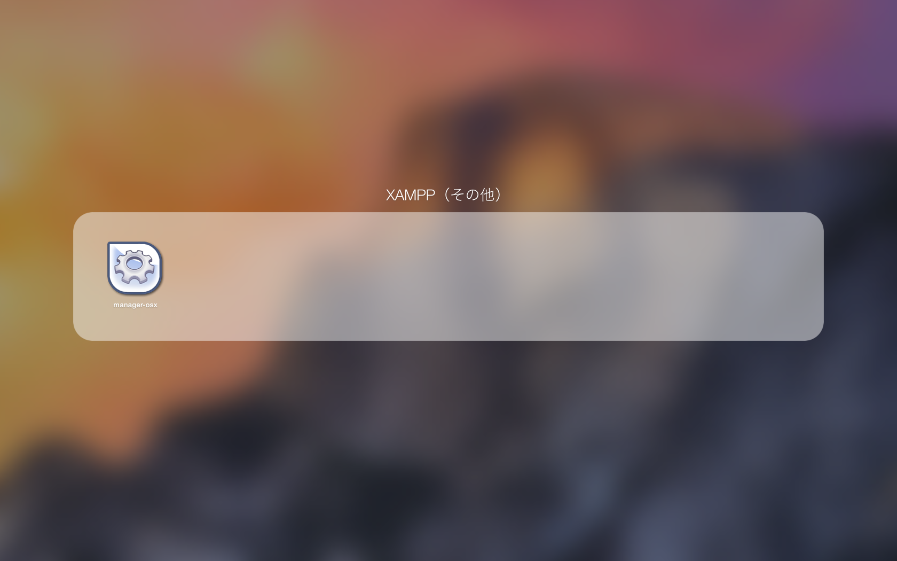
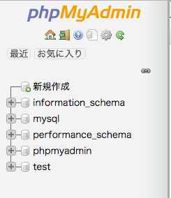

# Einrichtung mit XAMPP
So bauen Sie mit XAMPP auf einem Mac eine Umgebung auf, in der Exment läuft.  
XAMPP ist eine Software, mit der Sie PHP, Apache und MySQL zusammen installieren. Wir empfehlen sie, wenn Sie eine Entwicklungsumgebung von Grund auf aufbauen.

## Hinweise
- **Nutzen Sie die Installation mit XAMPP nur für Entwicklung und Tests. Wir empfehlen, sie nicht als Produktivumgebung zu verwenden.** 

## Installation
Gehen Sie in der folgenden Reihenfolge vor.

1. XAMPP installieren und Apache und MySQL starten
2. Den Befehl mysql nutzbar machen (Umgebungsvariable)
3. Eine Datenbank anlegen
4. Eine URL für Exment anlegen (Subdomain einrichten)
5. Exment installieren

### XAMPP installieren
1. Laden Sie XAMPP von der folgenden Website herunter.  
[XAMPP herunterladen](https://www.apachefriends.org/jp/download.html)  

2. Wählen Sie unter „XAMPP für OS X“ die Version mit „PHP8.2“ und laden Sie sie herunter.  

3. Setzen Sie die Installation von XAMPP fort.  

4. Setzen Sie im Bildschirm zur Auswahl der XAMPP-Komponenten beide Häkchen und drücken Sie Next.  

5. Drücken Sie danach nach den Angaben auf dem Bildschirm Next und schließen Sie die Installation ab.

6. Nach der Installation finden Sie im LaunchPad unter XAMPP (Andere) die App manager-osx. Damit starten Sie XAMPP.  

7. Klicken Sie nach dem Start von XAMPP auf Manage Servers.  

8. Klicken Sie bei MySQL und Apache auf die Schaltfläche Start, sodass Status auf Running steht.  

#### 【Hinweis】
- Nach einem Neustart des Betriebssystems müssen Sie das XAMPP Control Panel noch einmal starten und Apache erneut starten.  

### Umgebungsvariable hinzufügen
Um mysql im Terminal auszuführen, ergänzen Sie den Path in der Einstellungsdatei .bash_profile des Terminals.

1. Öffnen Sie .bash_profile mit dem folgenden Befehl.

~~~
vi .bash_profile
~~~

2. Drücken Sie im geöffneten Bildschirm die Taste i, um in den Eingabemodus zu wechseln (unten links steht INSERT). Geben Sie dann den Path wie folgt ein.

~~~
export PATH="/Applications/XAMPP/xamppfiles/bin:$PATH"
~~~

3. Zum Speichern und Schließen drücken Sie die Taste Esc und geben dann :wq ein.  

4. Lesen Sie zum Schluss .bash_profile mit dem folgenden Befehl ein. Damit ist der Path gesetzt.

~~~
source ~/.bash_profile
~~~

#### Datenbank anlegen
1. Starten Sie das XAMPP Control Panel. Öffnen Sie danach im Webbrowser die folgende URL, um phpMyadmin aufzurufen.

http://localhost/phpmyadmin/index.php  

2. Klicken Sie im linken Menü auf „Neu“.  

3. Geben Sie in der Zeile „Datenbank erstellen“ einen beliebigen Datenbanknamen aus Buchstaben und Ziffern ein und klicken Sie auf „Anlegen“.  

Damit ist die Datenbank angelegt.

### Subdomain einrichten
Mit den üblichen Einstellungen können Sie Exment nutzen, wenn Sie die Projektdateien von Exment in den Ordner "/Applications/XAMPP/htdocs" legen.  
So gibt es aber ein großes Problem: Wenn Sie zum Beispiel die URL [http://localhost/exment/.env](http://localhost/exment/.env) öffnen, wird die Einstellungsdatei mit den Angaben zur Datenbank auf dem Bildschirm angezeigt.  
Wir empfehlen deshalb dringend eine Einstellung, die dieses Problem verhindert. Richten Sie sie mit den folgenden Schritten ein.

1. Legen Sie im Ordner „/Applications/XAMPP“ den Ordner „local“ an.  

2. Öffnen Sie "/Applications/XAMPP/xamppfiles/etc/extra/httpd-xampp.conf".

3. Fügen Sie am Ende der Datei die folgenden Zeilen hinzu. **※Am Ende von DocumentRoot muss „/public“ stehen**  

~~~
<VirtualHost *:80>
    DocumentRoot "/Applications/XAMPP/xamppfiles/htdocs"
    ServerName localhost
</VirtualHost>

<VirtualHost *:80>
  DocumentRoot "/Applications/XAMPP/local/exment/public"
  ServerName exment.localapp
</VirtualHost>

<Directory "/Applications/XAMPP/local/exment/public">
  Allow from all
  AllowOverride All
  Require all granted
</Directory>  
~~~

4. Öffnen Sie "/Applications/XAMPP/xamppfiles/etc/httpd.conf" und suchen Sie mit der Textsuche nach den folgenden Zeilen.

~~~
User daemon
Group daemon
</IfModule>
~~~

Ändern Sie diese Zeilen wie folgt.

~~~
User (Anmeldename des Mac-Benutzers)
Group daemon
</IfModule>
~~~

5. Bearbeiten Sie "/etc/hosts".  
Geben Sie im Terminal den folgenden Befehl ein.  
※Sie werden nach dem Passwort gefragt. Geben Sie das Passwort des angemeldeten Benutzers ein.

~~~
sudo vi /etc/hosts
~~~

Fügen Sie der Datei hosts die folgenden Einträge hinzu.

~~~
127.0.0.1       localhost
127.0.0.1       exment.localapp
~~~

6. Starten Sie Apache im XAMPP Control Panel neu.  

### Exment installieren
Installieren Sie Exment nach der [Installationsanleitung](/de/quickstart) von Exment.  
Exment wird normalerweise im Ordner "/Applications/XAMPP/local" installiert.  
Hier gehen wir davon aus, dass es im Ordner "/Applications/XAMPP/local/exment" installiert wurde.  

- Während der Installation gibt es einen Bildschirm für die Einstellungen der Datenbank. Geben Sie dort Folgendes ein.
    - Datenbanktyp: MariaDB
    - Hostname: 127.0.0.1
    - Port: 3306
    - Datenbank: (der Name der oben angelegten Datenbank)
    - Benutzername: root
    - Passwort: (leer)

