# LINE-Anbindung
Diese Funktion verbindet Exment mit dem offiziellen LINE-Konto Ihres Unternehmens.  
Sie können Benachrichtigungen von Exment in LINE empfangen. Über die Schaltflächen der Benachrichtigungskarte in LINE lassen sich auch Workflow-Aktionen (zum Beispiel eine Genehmigung) ausführen.  
Diese Seite erklärt die Einrichtung der Verbindung und das Erstellen von Benachrichtigungen.

- Die Funktion, mit der Sie über LINE und E-Mail fragen, ob die Mitarbeiter in Sicherheit sind, steht unter [Sicherheitsabfrage](/de/safety_check).
- Die LINE-Anbindung gibt es ab v7.0.0.

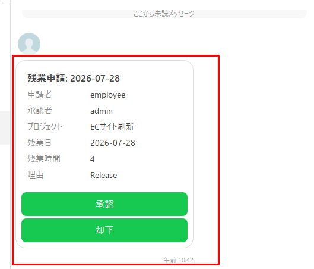

## Was die LINE-Anbindung kann
- **LINE-Konto verknüpfen**: Jeder Benutzer verknüpft sein eigenes LINE-Konto mit seinem Exment-Benutzer. Ohne diese Verknüpfung kommen keine Benachrichtigungen in LINE an.
- **LINE-Benachrichtigung**: Wenn Sie in einer [Benachrichtigung](/de/notify) als Aktion „LINE“ wählen, wird eine Nachricht an LINE gesendet. Neben Text ist auch das Kartenformat (Flex Message) möglich.
- **Workflow aus LINE ausführen**: Die Benachrichtigungskarte zeigt Schaltflächen für Aktionen wie „Genehmigen“ und „Ablehnen“. Mit einem Druck auf die Schaltfläche wird die Aktion direkt aus LINE ausgeführt.
- **LINE-Sendeverlauf**: Nachrichten, die als LINE-Benachrichtigung oder Sicherheitsabfrage gesendet wurden, werden aufgezeichnet, egal ob der Versand gelungen ist oder nicht.

## Ablauf der Einrichtung
Richten Sie die Anbindung in dieser Reihenfolge ein. Nur Schritt 5 führt jeder Benutzer aus, der Benachrichtigungen empfangen soll.

| Schritt | Inhalt | Wer |
| --- | --- | --- |
| 1 | [Das offizielle LINE-Konto vorbereiten](/de/line?id=Das-offizielle-LINE-Konto-vorbereiten) | Administrator |
| 2 | [Die Kanaldaten in die Systemeinstellungen von Exment eintragen](/de/line?id=Systemeinstellungen) | Administrator |
| 3 | [Die Webhook-URL bei LINE registrieren](/de/line?id=Webhook-einstellen) | Administrator |
| 4 | [Die Aufgabenplanung einrichten](/de/additional_task_schedule) (wenn Sie Benachrichtigungen mit „Zeitablauf“ verwenden) | Serveradministrator |
| 5 | [Das LINE-Konto verknüpfen](/de/line?id=LINE-Konto-verknüpfen) | Jeder Benutzer |
| 6 | [Eine LINE-Flex-Vorlage erstellen](/de/line?id=LINE-Flex-Vorlage) (wenn Sie im Kartenformat senden) | Administrator |
| 7 | [Die Benachrichtigung einstellen](/de/line?id=LINE-Benachrichtigung-einstellen) | Administrator |

## Voraussetzungen
- Sie brauchen ein offizielles LINE-Konto, in dem die Messaging API aktiviert ist (die Messaging API ist die Schnittstelle, über die Programme LINE-Nachrichten senden und empfangen). Die Nachrichten von Exment werden von diesem Konto gesendet.
- Die Server von LINE müssen die Webhook-URL von Exment erreichen. Veröffentlichen Sie Exment unter einer URL mit „https://“, die aus dem Internet erreichbar ist und ein gültiges SSL-Zertifikat hat.
- Wenn Sie Benachrichtigungen mit dem Auslöser „Zeitablauf“ verwenden, muss die [Aufgabenplanung](/de/additional_task_schedule) eingerichtet sein.

> Bei offiziellen LINE-Konten hängt die Höchstzahl der Nachrichten pro Monat vom Tarif ab.  
Eine Benachrichtigung von Exment zählt als eine Nachricht pro Empfänger. Antworten auf Aktionen der Benutzer (zum Beispiel „Das LINE-Konto wurde erfolgreich verknüpft!“) zählen nicht.  
Einzelheiten finden Sie in den Tarifen der offiziellen LINE-Konten.

## Das offizielle LINE-Konto vorbereiten

### Messaging API aktivieren
1. Erstellen Sie im [LINE Official Account Manager](https://manager.line.biz) ein offizielles LINE-Konto. Sie können auch ein vorhandenes Konto verwenden.
2. Aktivieren Sie die Messaging API unter „Settings“ → „Messaging API“. Wenn Sie einen Provider auswählen (oder erstellen), wird für das offizielle LINE-Konto ein Kanal der Messaging API angelegt.

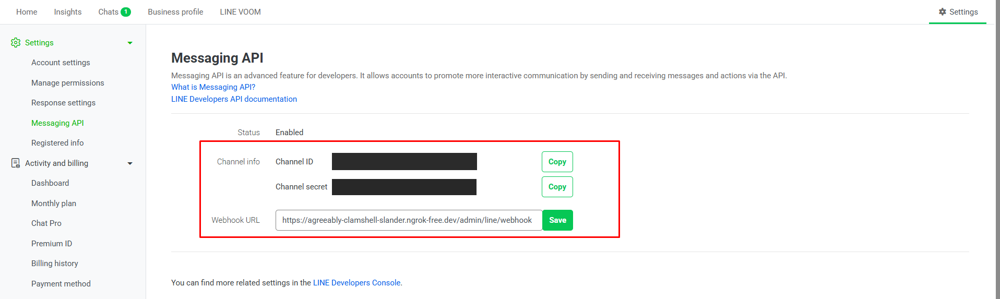

### Kanaldaten prüfen
Suchen Sie die folgenden drei Werte heraus, die Sie in Exment eintragen, und notieren Sie sie.

| Wert | Wo er steht | Wofür |
| --- | --- | --- |
| Channel secret | Im LINE Official Account Manager unter „Settings“ → „Messaging API“ oder in der [LINE Developers Console](https://developers.line.biz/console/) auf dem Tab „Basic settings“ | Prüfung der Signatur der Daten, die von LINE kommen (Webhook) |
| Channel access token (long-lived) | Wählen Sie in der LINE Developers Console den Kanal und klicken Sie auf dem Tab „Messaging API“ unter „Channel access token“ auf [Issue] | Senden von Nachrichten |
| Basic ID | Im LINE Official Account Manager neben dem Kontonamen oder in der LINE Developers Console auf dem Tab „Messaging API“ unter „Bot basic ID“. Die ID beginnt mit „@“ | Erstellen des QR-Codes für die Kontoverknüpfung |

※Bewahren Sie Channel secret und Channel access token so auf, dass Dritte sie nicht erfahren.

### Antworteinstellungen
- Schalten Sie im LINE Official Account Manager unter „Settings“ → „Response settings“ den Punkt „Webhooks“ ein.
- Wenn automatische Antwortnachrichten eingestellt sind, empfehlen wir, sie auszuschalten. Exment antwortet auf Textnachrichten der Benutzer. Solange die automatischen Antwortnachrichten aktiv sind, werden sie zusätzlich zur Antwort von Exment gesendet.

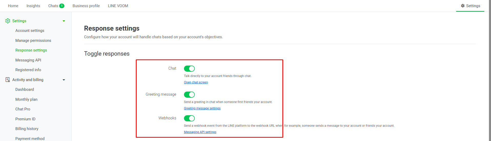

## Systemeinstellungen
Tragen Sie die drei Werte in Exment ein.

**(1) Die Detaileinstellungen der Systemeinstellungen öffnen**

Klicken Sie im linken Menü auf „Administratoreinstellungen“ → „Systemeinstellungen“ und wechseln Sie mit der Schaltfläche oben rechts zu [Detaileinstellungen].  
Die Seite lässt sich auch über die folgende URL öffnen.

~~~
http(s)://(URL von Exment)/system?advanced=1
~~~

> ※Die URL gilt für die Standardeinstellung ohne „/admin“ (Websites, die ab v7.2.1 neu installiert wurden). Wenn `ADMIN_ROUTE_PREFIX` in der `.env` einen Wert hat (bei Websites aus älteren Versionen ist es „admin“), hängen Sie diesen Wert an die URL der Website an (Beispiel: `http(s)://(URL von Exment)/admin/system?advanced=1`). Einzelheiten stehen unter [„admin“ in der URL ändern oder entfernen](/de/additional_prefix).

**(2) Die „LINE-Einstellungen“ ausfüllen**

Tragen Sie unter „LINE-Einstellungen“ die folgenden Felder ein und klicken Sie auf [Speichern].

| Feld | Inhalt |
| --- | --- |
| Channel-Zugriffstoken | Tragen Sie das Channel access token (long-lived) ein, das Sie in der LINE Developers Console ausgestellt haben. |
| Channel-Secret | Tragen Sie das Channel secret ein. |
| Basic ID des offiziellen LINE-Kontos | Tragen Sie die Basic ID ein, beginnend mit „@“. |
| Webhook-URL | Hier steht die Webhook-URL, die Sie bei LINE registrieren. Das Feld lässt sich nicht bearbeiten. |

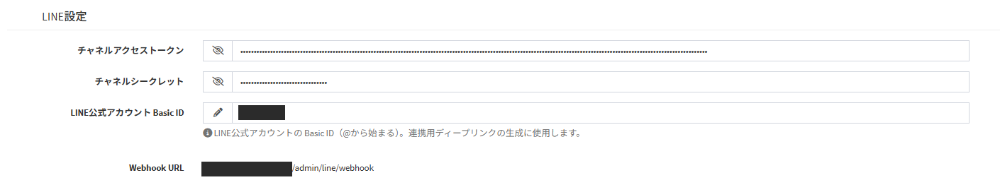

- Channel-Zugriffstoken und Channel-Secret werden nach dem Speichern verdeckt angezeigt.
- Diese Werte lassen sich auch in der Datei „.env“ einstellen. Wenn beide vorhanden sind, hat der auf der Seite der Systemeinstellungen gespeicherte Wert Vorrang. Einzelheiten stehen unter [Einstellungswerte](/de/line?id=Einstellungswerte).

## Webhook einstellen
Über den Webhook teilt LINE Exment mit, was in LINE passiert ist. Wenn ein Benutzer den Verknüpfungscode sendet oder eine Schaltfläche der Benachrichtigungskarte drückt, wird der Inhalt an Exment gesendet.

1. Wählen Sie in der LINE Developers Console den Kanal und öffnen Sie den Tab „Messaging API“.
2. Klicken Sie bei „Webhook URL“ auf [Edit], fügen Sie die Webhook-URL ein, die in den Systemeinstellungen unter „LINE-Einstellungen“ steht, und klicken Sie auf [Update].
3. Schalten Sie „Use webhook“ ein.
4. Klicken Sie auf [Verify] und prüfen Sie, dass „Success“ erscheint.

Die Webhook-URL hat die folgende Form.

~~~
https://(URL von Exment)/line/webhook
~~~

- Die Webhook-URL lässt sich auch im LINE Official Account Manager unter „Settings“ → „Messaging API“ einstellen.
- Als Webhook-URL können Sie nur eine URL registrieren, die mit „https://“ beginnt und ein gültiges SSL-Zertifikat hat.
- Der [IP-Filter](/de/additional_ip_filter) von Exment gilt nicht für die Webhook-URL. Wenn Sie den Zugriff mit einer Firewall oder Ähnlichem einschränken, stellen Sie diese so ein, dass die Server von LINE zugreifen können.

## LINE-Konto verknüpfen
Benutzer, die Benachrichtigungen in LINE empfangen sollen, verknüpfen selbst ihr LINE-Konto mit ihrem Exment-Benutzer.  
**An Benutzer ohne verknüpftes LINE-Konto wird keine LINE-Benachrichtigung gesendet.** Bitten Sie die Benutzer um die Verknüpfung, bevor Sie LINE-Benachrichtigungen verwenden.

### Verknüpfen
**(1) Die Seite „LINE-Verknüpfung“ öffnen**

Melden Sie sich bei Exment an, öffnen Sie oben rechts das Benutzermenü (Ihren Namen) und klicken Sie auf [LINE-Verknüpfung].

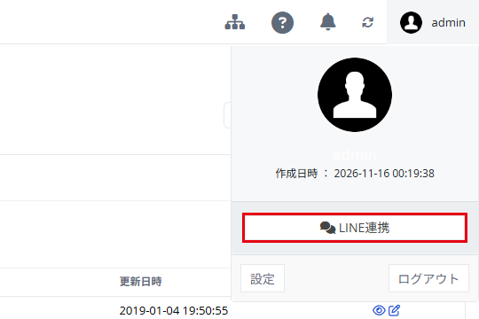

Die Seite lässt sich auch über die folgende URL öffnen.

~~~
http(s)://(URL von Exment)/line/link
~~~

- Ab v7.1.0 steht „LINE-Verknüpfung“ nicht mehr im linken Menü, sondern im Benutzermenü oben rechts. Der Punkt erscheint nur, wenn in den [Systemeinstellungen](/de/line?id=Systemeinstellungen) die Basic ID des offiziellen LINE-Kontos eingetragen ist.
- In v7.0 öffnen Sie die Seite über „LINE-Verknüpfung“ ganz oben im linken Menü (beim Update auf v7.1.0 wird dieser oberste Menüpunkt gelöscht. Menüpunkte, die Sie selbst verschoben haben, bleiben erhalten).

**(2) Den QR-Code anzeigen**

Klicken Sie auf [QR-Code erzeugen]. Der QR-Code für die Verknüpfung erscheint.

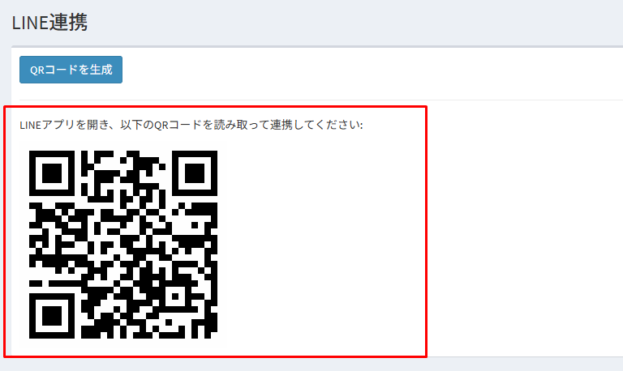

**(3) Mit der LINE-App scannen und senden**

- Scannen Sie den QR-Code mit der LINE-App auf dem Smartphone.  
Der Chat mit dem offiziellen LINE-Konto öffnet sich, und „LINK (Verknüpfungscode)“ ist bereits eingetragen.  
※Wenn Sie das offizielle LINE-Konto noch nicht als Freund hinzugefügt haben, fügen Sie es nach den Hinweisen auf dem Bildschirm hinzu.

- Senden Sie die Nachricht unverändert. Wenn die Antwort „Das LINE-Konto wurde erfolgreich verknüpft!“ kommt, ist die Verknüpfung fertig.

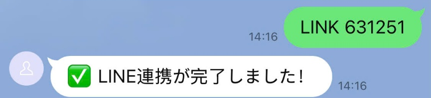

**(4) Prüfen, ob die Verknüpfung gelungen ist**

Wenn Sie die Seite „LINE-Verknüpfung“ erneut öffnen, steht dort „LINE-Konto verknüpft“.

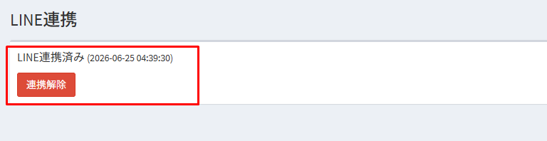

**Wenn die Verknüpfung nicht gelingt**

- **Gültigkeit des Verknüpfungscodes**: Der Verknüpfungscode ist in der Anfangseinstellung 10 Minuten gültig. Wenn er abgelaufen ist, klicken Sie noch einmal auf [QR-Code erzeugen].
- **Ein LINE-Konto lässt sich nur mit einem Benutzer verknüpfen**. Wenn Sie den Verknüpfungscode von einem bereits verknüpften LINE-Konto senden, kommt die Antwort „Dieses LINE-Konto ist bereits mit einem Konto verknüpft. Um dies zu ändern, heben Sie die Verknüpfung bitte zuerst im Web auf.“ Wenn der verknüpfte Benutzer aber gelöscht ist, wird die frühere Verknüpfung automatisch aufgehoben, und das Konto lässt sich mit einem anderen Benutzer verknüpfen.
- **Zahl der falschen Codes**: In der Anfangseinstellung können Sie höchstens 5-mal einen falschen Verknüpfungscode senden. Wenn Sie innerhalb von 10 Minuten (Anfangseinstellung) nach dem ersten falschen Code 5-mal einen falschen Code senden, ist die Verknüpfung gesperrt, bis diese 10 Minuten vorbei sind. In dieser Zeit kommt auch auf den richtigen Verknüpfungscode die Antwort „Der Verknüpfungscode ist ungültig oder abgelaufen. Bitte prüfen Sie ihn und versuchen Sie es erneut.“

### Verknüpfung aufheben
Klicken Sie auf der Seite „LINE-Verknüpfung“ auf [Verknüpfung aufheben].  
Wenn Sie das Smartphone oder das LINE-Konto gewechselt haben, heben Sie die Verknüpfung auf und verknüpfen Sie dann erneut.

## LINE-Flex-Vorlage
Wenn Sie LINE-Benachrichtigungen im Kartenformat (Flex Message) senden, legt diese Vorlage den Inhalt der Karte fest.  
Wenn Sie in der Benachrichtigungseinstellung keine Vorlage wählen, wird eine Textnachricht gesendet (dann brauchen Sie keine Vorlage).

### Vorlage erstellen
**(1) Die Listenseite öffnen**

Rufen Sie die folgende URL auf und öffnen Sie die Datenliste von „LINE Flexテンプレート“ (LINE-Flex-Vorlage).  
Wenn Sie die Seite ins linke Menü aufnehmen möchten, fügen Sie sie unter [Menü](/de/menu) mit dem Menütyp „Tabelle“ hinzu.

~~~
http(s)://(URL von Exment)/data/line_flex_template
~~~

**(2) Die Vorlage erstellen**

Klicken Sie auf [Neu], füllen Sie die folgenden Felder aus und speichern Sie.

| Feld | Inhalt |
| --- | --- |
| Flexキー (Flex-Schlüssel) | Der Schlüssel, an dem die Vorlage erkannt wird (Beispiel: ot_request). Verwenden Sie nicht „safety_check“. Dieser Schlüssel wird von der [Sicherheitsabfrage](/de/safety_check) verwendet. |
| テンプレート名 (Vorlagenname) | Der Name der Vorlage. Er erscheint in der Benachrichtigungseinstellung in der Auswahl „LINE-Flex-Vorlage“. |
| タイトル (Titel) | Die Überschrift der Karte. Variablen sind möglich. Wenn das Feld leer ist, wird die Überschrift des Datensatzes angezeigt. |
| 本文項目 (Textfelder) | Die Felder, die im Text der Karte stehen. Geben Sie ein Feld pro Zeile in der Form „Anzeigename = Wert“ ein. |
| 説明 (Beschreibung) | Die Beschreibung der Vorlage. Sie wird in LINE nicht angezeigt. |

- Bei einer neuen Vorlage stehen in „タイトル“ und „本文項目“ Anfangswerte für Benachrichtigungen zur Workflow-Ausführung (Status, Aktionsname usw.). Ändern Sie den Inhalt, wenn Sie die Vorlage zum Beispiel für Benachrichtigungen beim Erstellen oder Aktualisieren von Daten verwenden.
- Die Vorlage „Sicherheitsabfrage“ (Flex-Schlüssel „safety_check“) wird bei der Installation der [Sicherheitsabfrage](/de/safety_check) automatisch angelegt. Wählen Sie sie in der Benachrichtigungseinstellung nicht unter „LINE-Flex-Vorlage“ aus. Bearbeiten oder löschen Sie sie auch nicht.

### So schreiben Sie die Textfelder
Schreiben Sie ein Feld pro Zeile. Links vom „=“ steht der Anzeigename, rechts der Wert. Im Wert können Sie Variablen verwenden.  
Hier ein Beispiel für die Karte eines Überstundenantrags.

~~~
Antragsteller = ${created_user}
Genehmiger = ${value:approver}
Projekt = ${value:project}
Überstundentag = ${value:ot_date}
Überstunden = ${value:ot_hours}
Grund = ${value:reason}
~~~

- Zeilen, deren Wert leer ist, erscheinen nicht auf der Karte.
- Wenn „本文項目“ leer ist, zeigt eine Benachrichtigung zur Workflow-Ausführung die Standardfelder wie Status und Aktionsname.

### Verfügbare Variablen
Sie können [Parametervariablen](/de/params) verwenden. Die wichtigsten Variablen sind die folgenden.

| Variable | Inhalt |
| --- | --- |
| ${value} | Überschrift des Datensatzes |
| ${value:(Spaltenname)} | Wert einer Spalte des Datensatzes (Beispiel: ${value:approver}) |
| ${created_user} | Name des Benutzers, der den Datensatz erstellt hat |
| ${table_view_name} | Anzeigename der Tabelle |
| ${workflow:status_name} | Name des Status nach der Aktion ※1 |
| ${workflow:status_from_name} | Name des Status vor der Aktion ※1 |
| ${workflow:action_name} | Name der ausgeführten Aktion ※1 |
| ${workflow:action_user} | Benutzer, der die Aktion ausgeführt hat ※1 |
| ${workflow:comment} | Kommentar, der beim Ausführen der Aktion eingegeben wurde ※1 |
| ${notify_target_column_key} | Spaltenname der „Datumsspalte“ ※2 |
| ${notify_target_column_value} | Wert der „Datumsspalte“ ※2 |

※1 Nur in Benachrichtigungen mit dem Auslöser „Workflow-Ausführung“ verwendbar.  
※2 Nur in Benachrichtigungen mit dem Auslöser „Zeitablauf“ verwendbar.

### Schaltflächen der Karte
Die Schaltflächen der Karte werden automatisch hinzugefügt, auch wenn in der Vorlage nichts dazu eingestellt ist.

| Schaltfläche | Wann sie erscheint |
| --- | --- |
| Workflow-Aktionen („Genehmigen“, „Ablehnen“ usw.) | Sie erscheinen, wenn alle folgenden Bedingungen erfüllt sind. • Für den Datensatz ist ein Workflow eingestellt, und es gibt eine Aktion, die der Empfänger ausführen kann • Der Empfänger hat diese Aktion noch nicht ausgeführt • „Kommentar“ der Aktion steht nicht auf „Erforderlich“ • Nach der Aktion muss kein nächster Bearbeiter gewählt werden (im nächsten Status gibt es keine Aktion, deren ausführende Benutzer „Auswahl durch den Ausführenden der vorherigen Aktion“ sind) ※Geprüft werden nur Aktionen, deren „Bedingung für den Wechsel zum nächsten Status“ auf „1 oder mehr Personen führen aus“ steht. Für andere Aktionen lesen Sie [Einstellung des Workflows](/de/line?id=Einstellung-des-Workflows). |
| Details anzeigen | Erscheint, wenn die URL von Exment mit „https://“ beginnt. Ein Druck öffnet die Detailseite des Datensatzes. |

Einzelheiten stehen unter [Workflow-Aktionen aus LINE ausführen](/de/line?id=Workflow-Aktionen-aus-LINE-ausführen).

## LINE-Benachrichtigung einstellen
Stellen Sie auf der Einstellungsseite der [Benachrichtigung](/de/notify) unter „Einstellungen für Benachrichtigungsaktionen“ die folgenden Felder ein.  
Wie Sie die Seite der Benachrichtigungseinstellungen öffnen, steht unter [Benachrichtigung](/de/notify).

| Feld | Inhalt |
| --- | --- |
| Aktion | Wählen Sie „LINE“. |
| Benachrichtigungsziel | Wählen Sie die Benutzer, an die gesendet wird (erforderlich). Möglich sind Spalten vom Typ „Benutzer“ (angezeigt als „Benutzerdefinierte Spalte: (Spaltenname)“), „Angegebener Benutzer“, „Angegebene Organisation“, „Ersteller“ und weitere. |
| LINE-Flex-Vorlage | Wählen Sie eine [LINE-Flex-Vorlage](/de/line?id=LINE-Flex-Vorlage), wenn Sie im Kartenformat senden. Wenn das Feld leer ist, wird als Text gesendet. |

- Beim Senden als Text wird die Nachricht aus Betreff und Text der „Benachrichtigungsvorlage“ gebildet.
- Wenn Sie „Angegebene Organisation“ wählen, wird an alle Benutzer der Organisation gesendet.
- An Benutzer des Benachrichtigungsziels, die ihr LINE-Konto nicht verknüpft haben, wird nicht gesendet. Das ist kein Fehler und wird auch nicht im [LINE-Sendeverlauf](/de/line?id=LINE-Sendeverlauf) aufgezeichnet.
- Die LINE-Benachrichtigung wird direkt nach dem Ende der Verarbeitung gesendet, zum Beispiel nach dem Speichern der Daten. Die [verzögerte Ausführung der Benachrichtigungen](/de/additional_queue) (Queue) wird nicht verwendet.
- Wenn der Versand fehlschlägt, wird nicht automatisch erneut gesendet. Das Ergebnis sehen Sie im [LINE-Sendeverlauf](/de/line?id=LINE-Sendeverlauf).

### Beispiel 1: Beim Erstellen und Aktualisieren von Daten benachrichtigen
- Auslöser: „Daten erstellen/aktualisieren/teilen/kommentieren“
- Einstellungen für Benachrichtigungsbedingungen: „Erstellt“ und „Aktualisiert“ ankreuzen
- Aktion: „LINE“
- Benachrichtigungsziel: „Benutzerdefinierte Spalte: Zuständiger“
- LINE-Flex-Vorlage: die erstellte Vorlage

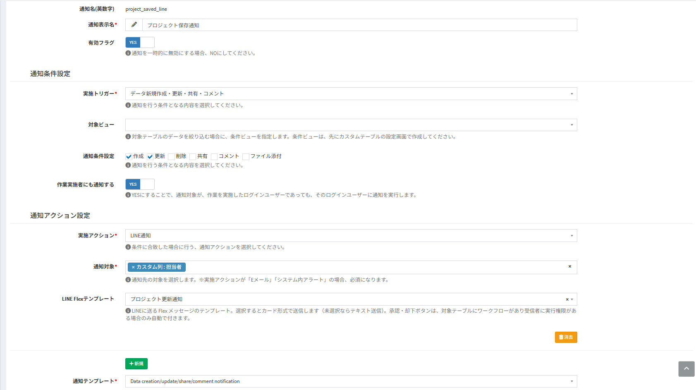

Wenn ein Datensatz gespeichert wird, kommt in LINE eine Karte wie die folgende an.

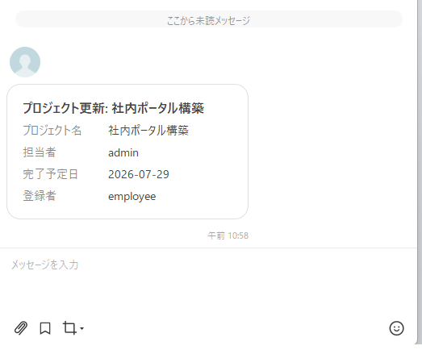

※In der Anfangseinstellung wird der Benutzer, der die Daten gespeichert hat, selbst nicht benachrichtigt. Wenn auch er benachrichtigt werden soll, stellen Sie „Auch den ausführenden Benutzer benachrichtigen“ auf YES.

### Beispiel 2: Die Mitglieder einer Organisation benachrichtigen
Wählen Sie unter „Benachrichtigungsziel“ den Punkt „Angegebene Organisation“ und unter „Empfängerorganisation“ die Organisation.  
Gesendet wird an die Benutzer der Organisation, die ihr LINE-Konto verknüpft haben.

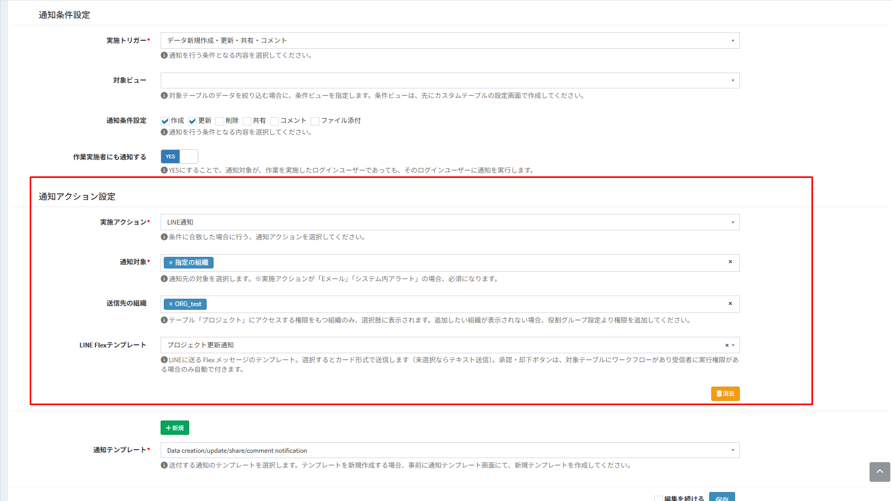

※In der Auswahl erscheinen nur Organisationen, die eine Zugriffsberechtigung für die Tabelle haben.

### Beispiel 3: Am Tag vor einer Frist erinnern
- Auslöser: „Zeitablauf“
- Datumsspalte: die Datumsspalte, von der aus gerechnet wird (Beispiel: geplantes Fertigstellungsdatum)
- Benachrichtigungstag: „1“
- Vor/nach: „Vor“
- Benachrichtigungszeit: die Stunde, zu der die Benachrichtigung gesendet wird (0 bis 23)
- Aktion: „LINE“

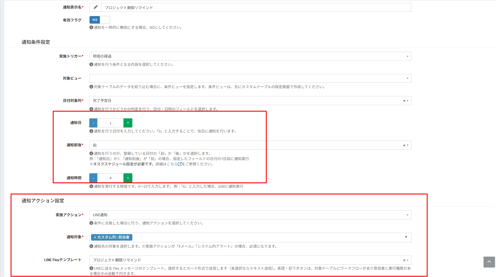

Zur angegebenen Stunde kommt eine Karte wie die folgende an.

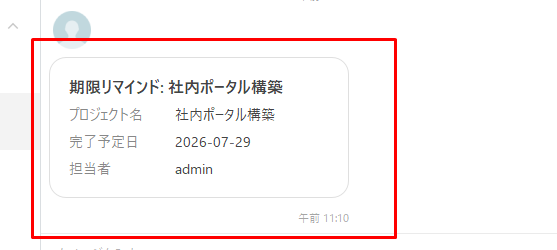

- Für Benachrichtigungen mit „Zeitablauf“ muss die [Aufgabenplanung](/de/additional_task_schedule) eingerichtet sein. Die Benachrichtigung läuft zur Minute 00 der Stunde, die unter „Benachrichtigungszeit“ steht.
- Wenn Sie die Einstellung sofort prüfen möchten, führen Sie den folgenden Befehl aus. Die Benachrichtigung läuft dann unabhängig von der „Benachrichtigungszeit“.

~~~
php artisan exment:notify --name=(Benachrichtigungsname (alphanumerisch))
~~~

- Damit dieselbe Erinnerung nicht doppelt gesendet wird, zum Beispiel wenn der Befehl mehrmals läuft, stellen Sie den Einstellungswert „LINE_DEDUPE_MINUTES“ ein. Einzelheiten stehen unter [Einstellungswerte](/de/line?id=Einstellungswerte).

## Workflow-Aktionen aus LINE ausführen
Über die Schaltflächen der Benachrichtigungskarte in LINE lassen sich Workflow-Aktionen ausführen.  
Als Beispiel genehmigt hier ein Genehmiger einen Überstundenantrag in LINE. Wie Sie einen Workflow einrichten, steht unter [Workflow-Einstellungen](/de/workflow_setting).

Es sind die folgenden drei Dinge zu tun.

1. Die Workflow-Aktion so einstellen, dass sie aus LINE ausgeführt werden kann ([Einstellung des Workflows](/de/line?id=Einstellung-des-Workflows))
2. Einstellen, dass der Genehmiger eine LINE-Benachrichtigung erhält (unten „Einstellung der Benachrichtigung“)
3. Die Schaltfläche der Karte drücken (unten „Aus LINE genehmigen“)

### Einstellung des Workflows
Stellen Sie in den Workflow-Einstellungen unter „Aktionseinstellungen“ die Aktion, die aus LINE ausgeführt werden soll, wie folgt ein.

- Ausführende Benutzer: die Benutzer, die die Aktion ausführen (Beispiel: „Vorab festlegen“ mit der Spalte „Genehmiger“ der Tabelle)
- Kommentar: „Optional“ oder „Nicht verwenden“

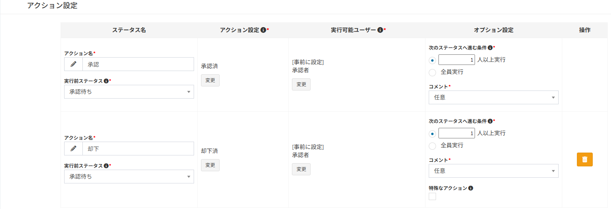

**Aktionen, die sich nicht aus LINE ausführen lassen**

Führen Sie die folgenden Aktionen auf den Seiten von Exment aus.

- **Aktionen, deren „Kommentar“ auf „Erforderlich“ steht**: Auf der LINE-Karte erscheint keine Schaltfläche, weil ein Kommentar eingegeben werden muss.
- **Aktionen, nach denen der nächste Bearbeiter gewählt werden muss** (wenn es im nächsten Status eine Aktion gibt, deren ausführende Benutzer „Auswahl durch den Ausführenden der vorherigen Aktion“ sind): Je nach „Bedingung für den Wechsel zum nächsten Status“ gilt Folgendes.

| „Bedingung für den Wechsel zum nächsten Status“ | LINE-Karte |
| --- | --- |
| „1 oder mehr Personen führen aus“ | Die Schaltfläche erscheint nicht. |
| 2 oder mehr Personen oder „Alle führen aus“ | Die Schaltfläche erscheint. Ausführungen, bei denen der Status nicht wechselt (Beispiel: die erste und zweite Person, wenn 3 Personen genehmigen), sind aus LINE möglich. Wenn die Schaltfläche bei einer Ausführung gedrückt wird, bei der der Status wechselt (Beispiel: die dritte Person), wird die Aktion nicht ausgeführt, und es kommt die Antwort „Für diese Aktion müssen die nächsten Bearbeiter ausgewählt werden. Bitte führen Sie sie im Web aus.“ |

### Einstellung der Benachrichtigung
Richten Sie eine Benachrichtigung ein, die dem Genehmiger eine LINE-Benachrichtigung sendet. **Wählen Sie unbedingt eine „LINE-Flex-Vorlage“**. Beim Senden als Text erscheinen keine Schaltflächen.

- **Beim Erstellen der Daten benachrichtigen**: Stellen Sie in der Benachrichtigungseinstellung der Tabelle den Auslöser „Daten erstellen/aktualisieren/teilen/kommentieren“, in den Einstellungen für Benachrichtigungsbedingungen „Erstellt“, das Benachrichtigungsziel „Benutzerdefinierte Spalte: Genehmiger“ und die Aktion „LINE“ ein.
- **Beim Ausführen einer Aktion den nächsten Bearbeiter benachrichtigen**: Stellen Sie in der Benachrichtigungseinstellung des Workflows die Aktion „LINE“ und das Benachrichtigungsziel „Nächster Bearbeiter“ ein.

### Aus LINE genehmigen
**(1)** Der Antragsteller wählt den Genehmiger und erstellt den Datensatz des Überstundenantrags.

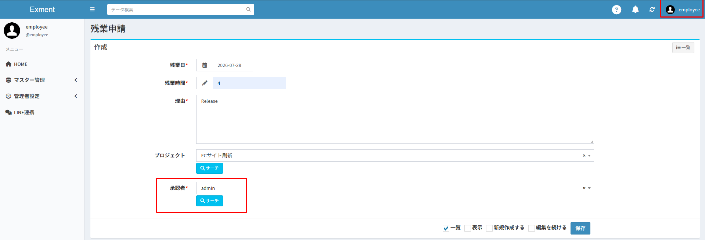

**(2)** Der Genehmiger erhält in LINE eine Karte mit den Schaltflächen „Genehmigen“ und „Ablehnen“.  
Mit einem Druck auf die Schaltfläche wird die Aktion ausgeführt, und es kommt die Antwort „Erledigt: Genehmigen“.

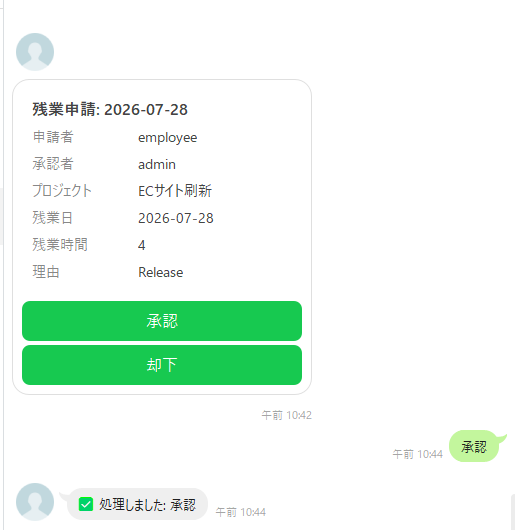

**(3)** Der Status des Datensatzes in Exment wird aktualisiert.

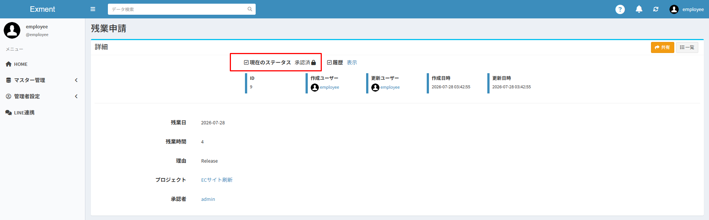

Die Aktion wird als der Benutzer ausgeführt, der das LINE-Konto verknüpft hat. Beim Druck auf die Schaltfläche wird noch einmal geprüft, ob dieser Benutzer die Aktion ausführen darf.

Wenn die Aktion nicht ausgeführt werden konnte, kommt eine der folgenden Antworten.

| Antwort | Grund |
| --- | --- |
| „Diese Aktion ist nicht verfügbar oder wurde bereits verarbeitet.“ | Die Aktion lässt sich nicht ausführen, zum Beispiel weil ein anderer Benutzer sie schon verarbeitet hat oder dieselbe Aktion schon ausgeführt wurde. |
| „Für diese Aktion müssen die nächsten Bearbeiter ausgewählt werden. Bitte führen Sie sie im Web aus.“ | Der nächste Bearbeiter muss gewählt werden. Führen Sie die Aktion auf den Seiten von Exment aus. |
| „Für diese Aktion ist ein Kommentar erforderlich. Bitte führen Sie sie im Web aus.“ | Nach dem Senden der Karte wurde „Kommentar“ der Aktion auf „Erforderlich“ geändert. |
| „Für dieses Konto ist die Anmeldung nicht aktiviert.“ | Benutzer, die nicht als Login-Benutzer eingerichtet sind, können keine Aktionen aus LINE ausführen. |

## LINE-Sendeverlauf
Nachrichten, die als LINE-Benachrichtigung oder [Sicherheitsabfrage](/de/safety_check) gesendet wurden, werden in der Tabelle „LINE送信履歴“ (LINE-Sendeverlauf) aufgezeichnet, egal ob der Versand gelungen ist oder nicht.  
Antworten auf Aktionen der Benutzer (zum Beispiel „Das LINE-Konto wurde erfolgreich verknüpft!“ oder „Erledigt: Genehmigen“) werden nicht aufgezeichnet.  
Über die folgende URL öffnen Sie die Liste.

~~~
http(s)://(URL von Exment)/data/line_send_log
~~~

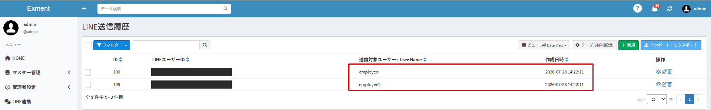

| Spalte | Inhalt |
| --- | --- |
| LINEユーザーID (LINE-Benutzer-ID) | Die LINE-Benutzer-ID des Empfängers. |
| メッセージ種別 (Nachrichtenart) | „text“ (Text) oder „flex“ (Karte). |
| 送信Flexテンプレート (gesendete Flex-Vorlage) | Die LINE-Flex-Vorlage, mit der die Karte gesendet wurde. |
| 件名 (Betreff) | Der Betreff der Nachricht. Bei einer Karte der Titel. |
| 本文 (Text) | Die Daten der an LINE gesendeten Nachricht (JSON-Format). Bei einer Karte wird der ganze Inhalt der Flex Message aufgezeichnet. |
| 送信対象ユーザー (Empfängerbenutzer) | Der Exment-Benutzer, an den gesendet wurde. |
| 送信日時 (gesendet am) | Datum und Uhrzeit, zu denen die Nachricht gesendet wurde. |
| 送信結果 (Sendeergebnis) | „success“ (Erfolg) oder „failed“ (Fehlschlag). |
| エラー内容 (Fehler) | Der Grund, wenn der Versand fehlgeschlagen ist (Beispiel: „HTTP 400 …“). |

- An Benutzer ohne verknüpftes LINE-Konto wird nicht gesendet. Deshalb gibt es dazu auch keinen Eintrag im Verlauf. Wenn eine Benachrichtigung nicht ankommt, prüfen Sie zuerst die Verknüpfung des LINE-Kontos.
- Welche Spalten die Liste zeigt, ändern Sie mit einer [benutzerdefinierten Ansicht](/de/view).

## Einstellungswerte
In der Datei „.env“ können Sie die folgenden Einstellungen ändern. Einzelheiten stehen in der [Liste der Einstellungswerte](/de/config).

| Einstellungsschlüssel | Standardwert | Inhalt |
| --- | --- | --- |
| LINE_CHANNEL_ACCESS_TOKEN | (keiner) | Das Channel-Zugriffstoken. Der auf der Seite der Systemeinstellungen gespeicherte Wert hat Vorrang. |
| LINE_CHANNEL_SECRET | (keiner) | Das Channel-Secret. Der auf der Seite der Systemeinstellungen gespeicherte Wert hat Vorrang. |
| LINE_OA_BASIC_ID | (keiner) | Die Basic ID. Der auf der Seite der Systemeinstellungen gespeicherte Wert hat Vorrang. |
| LINE_DEDUPE_MINUTES | 0 | Bei LINE-Benachrichtigungen mit „Zeitablauf“: Nachdem an denselben Benutzer eine LINE-Nachricht zu demselben Datensatz gesendet wurde, wird in dieser Zeit (in Minuten) nicht erneut gesendet. Das gilt auch für Nachrichten, die über andere Benachrichtigungseinstellungen gesendet wurden, und für fehlgeschlagene Nachrichten. Bei 0 ist diese Funktion ausgeschaltet. |
| LINE_LINK_CODE_TTL_MINUTES | 10 | Die Gültigkeit des Verknüpfungscodes (in Minuten). |
| LINE_LINK_MAX_ATTEMPTS | 5 | Wie oft ein falscher Verknüpfungscode gesendet werden kann. Wird diese Zahl überschritten, ist die Verknüpfung für eine bestimmte Zeit gesperrt. |
| LINE_LINK_ATTEMPT_DECAY_MINUTES | 10 | Die Zeit (in Minuten), in der falsche Verknüpfungscodes gezählt werden. Wenn innerhalb dieser Zeit nach dem ersten falschen Code die Zahl aus „LINE_LINK_MAX_ATTEMPTS“ erreicht wird, ist die Verknüpfung gesperrt, bis diese Zeit vorbei ist. |
| LINE_HTTP_TIMEOUT | 10 | Das Zeitlimit (in Sekunden) für die Kommunikation mit den Servern von LINE. |
| LINE_API_BASE | https://api.line.me | Die URL der LINE Messaging API. Ändern Sie sie normalerweise nicht. |

※Benachrichtigungen, die wegen „LINE_DEDUPE_MINUTES“ nicht gesendet wurden, stehen nicht im LINE-Sendeverlauf. In „storage/logs/laravel.log“ steht dann „LINE reminder skipped by dedupe“.

## Wenn etwas nicht funktioniert
| Symptom | Häufige Ursachen | Abhilfe |
| --- | --- | --- |
| [Verify] für den Webhook gelingt nicht | • Die Webhook-URL beginnt nicht mit „https://“, oder das SSL-Zertifikat ist ungültig • Exment ist aus dem Internet nicht erreichbar • Das Channel secret ist nicht richtig | Prüfen Sie die Webhook-URL, die Veröffentlichung des Servers und das „Channel-Secret“ in den Systemeinstellungen. |
| Auf den gesendeten Verknüpfungscode kommt keine Antwort | • „Use webhook“ ist ausgeschaltet • Die Webhook-URL ist nicht richtig | Prüfen Sie den Abschnitt [Webhook einstellen](/de/line?id=Webhook-einstellen). |
| Beim Klick auf [QR-Code erzeugen] erscheint „Die Basic-ID des LINE Official Account ist nicht eingerichtet. Legen Sie sie unter „Einstellungen: System“ > „Systemeinstellungen“ fest.“ | Die Basic ID ist nicht eingetragen | Tragen Sie in den Systemeinstellungen die „Basic ID des offiziellen LINE-Kontos“ ein. |
| Es kommt die Antwort „Der Verknüpfungscode ist ungültig oder abgelaufen. Bitte prüfen Sie ihn und versuchen Sie es erneut.“ | • Der Verknüpfungscode ist abgelaufen oder falsch • Die Verknüpfung ist vorübergehend gesperrt, weil mehrmals nacheinander ein falscher Verknüpfungscode gesendet wurde | Klicken Sie auf [QR-Code erzeugen] und scannen Sie den neuen QR-Code. Wenn die Verknüpfung vorübergehend gesperrt ist, warten Sie (in der Anfangseinstellung 10 Minuten) und senden Sie dann. |
| Es kommt die Antwort „Dieses LINE-Konto ist bereits mit einem Konto verknüpft. Um dies zu ändern, heben Sie die Verknüpfung bitte zuerst im Web auf.“ | Das LINE-Konto ist schon mit einem Exment-Benutzer verknüpft | Melden Sie sich mit dem verknüpften Benutzer bei Exment an, klicken Sie auf der Seite „LINE-Verknüpfung“ auf [Verknüpfung aufheben] und verknüpfen Sie dann erneut. |
| Es kommt die Antwort „Um Ihr Konto zu verknüpfen, senden Sie: LINK &lt;Code&gt;.“ | Ein Benutzer ohne verknüpftes LINE-Konto hat eine andere Nachricht als den Verknüpfungscode gesendet | Scannen Sie den QR-Code und verknüpfen Sie das Konto, wie unter [LINE-Konto verknüpfen](/de/line?id=LINE-Konto-verknüpfen) beschrieben. |
| Es kommt die Antwort „Ungültiger Befehl.“ | Ein Benutzer mit verknüpftem LINE-Konto hat eine andere Nachricht als den Verknüpfungscode gesendet | Das ist kein Fehler. Exment antwortet nicht auf andere Nachrichten als den Verknüpfungscode. Zu den zusätzlichen Antworten der Sicherheitsabfrage lesen Sie [Sicherheitsabfrage](/de/safety_check). |
| Die LINE-Benachrichtigung kommt nicht an, und im LINE-Sendeverlauf steht kein Eintrag | Der Benutzer des Benachrichtigungsziels hat sein LINE-Konto nicht verknüpft | Bitten Sie den Benutzer, [sein LINE-Konto zu verknüpfen](/de/line?id=LINE-Konto-verknüpfen). |
| Im LINE-Sendeverlauf steht als Sendeergebnis „failed“ | • Das Channel access token ist falsch oder ungültig • Der Benutzer hat das offizielle LINE-Konto blockiert • Die Höchstzahl der Nachrichten pro Monat ist erreicht | Lesen Sie „エラー内容“ (Fehler). Wenn Sie das Channel access token neu ausgestellt haben, tragen Sie es erneut in die Systemeinstellungen ein. |
| Auf der Karte erscheinen die Schaltflächen „Genehmigen“ und „Ablehnen“ nicht | • „Kommentar“ der Aktion steht auf „Erforderlich“ • Die „Bedingung für den Wechsel zum nächsten Status“ der Aktion steht auf „1 oder mehr Personen führen aus“, und nach der Aktion muss der nächste Bearbeiter gewählt werden (im nächsten Status gibt es eine Aktion mit „Auswahl durch den Ausführenden der vorherigen Aktion“) • Der Empfänger kann die Aktion nicht ausführen oder hat sie schon ausgeführt • Der Datensatz ist schon verarbeitet • Es ist keine LINE-Flex-Vorlage gewählt | Prüfen Sie den Abschnitt [Workflow-Aktionen aus LINE ausführen](/de/line?id=Workflow-Aktionen-aus-LINE-ausführen). |
| Die LINE-Benachrichtigung mit „Zeitablauf“ wird nicht gesendet | • Die Aufgabenplanung läuft nicht • Die „Benachrichtigungszeit“ passt nicht zur Uhrzeit des Servers • Wegen „LINE_DEDUPE_MINUTES“ wurde nicht gesendet | Prüfen Sie die [Aufgabenplanung](/de/additional_task_schedule). Sie können die Benachrichtigung auch mit „php artisan exment:notify“ ausführen und so prüfen. |
| Die Schaltfläche „Details anzeigen“ erscheint nicht | Die URL von Exment beginnt nicht mit „https://“ | Betreiben Sie Exment unter einer URL mit „https://“. |
