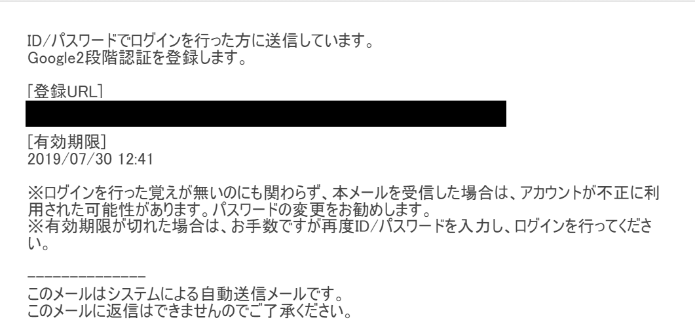

# Anmeldung (Zwei-Faktor-Authentifizierung)
So melden Sie sich mit der Zwei-Faktor-Authentifizierung bei Exment an.  
Die Einstellungen, die die Zwei-Faktor-Authentifizierung nutzbar machen, nimmt der Administrator vor ([Zwei-Faktor-Authentifizierung: Systemeinstellungen](/de/login_2factor_setting)).

## Methoden der Zwei-Faktor-Authentifizierung
Derzeit sind die folgenden 2 Methoden der Zwei-Faktor-Authentifizierung nutzbar.  
Welche Methode bei Ihnen gilt, erfahren Sie vom Administrator.

##### E-Mail
Nach der Anmeldung mit ID und Passwort kommt an die gespeicherte E-Mail-Adresse eine E-Mail mit dem Authentifizierungscode.  
Wenn Sie diesen Authentifizierungscode am Bildschirm eingeben, ist die Anmeldung abgeschlossen.

##### Google Authenticator
Nach der Anmeldung mit ID und Passwort erfolgt die Zwei-Faktor-Authentifizierung mit Google Authenticator.

### Schritte der Zwei-Faktor-Authentifizierung (E-Mail)

- Geben Sie im Anmeldebildschirm ID und Passwort ein und klicken Sie auf die Schaltfläche [Anmelden].
  

- Der Bildschirm der Zwei-Faktor-Authentifizierung erscheint, mit einem Eingabefeld für den Authentifizierungscode.
  

- Der Authentifizierungscode kommt an die E-Mail-Adresse des angemeldeten Benutzers. Sehen Sie dort nach.
  

### Schritte der Zwei-Faktor-Authentifizierung (Google Authenticator)

- Geben Sie im Anmeldebildschirm ID und Passwort ein und klicken Sie auf die Schaltfläche [Anmelden].
  

- Der Bildschirm der Zwei-Faktor-Authentifizierung erscheint, mit einem Eingabefeld für den Authentifizierungscode.
  

- Bei der ersten Anmeldung muss zuerst Google Authenticator eingerichtet werden.  
Wenn Sie auf die Schaltfläche [Absenden] klicken, wird eine E-Mail für die Registrierung von Google Authenticator an die gespeicherte E-Mail-Adresse gesendet.
  

- An die E-Mail-Adresse des angemeldeten Benutzers kommt die URL für die Registrierung von Google Authenticator. Klicken Sie darauf.  
  

- Nach dem Klick auf die URL erscheint der Bildschirm zur Installation der Zwei-Faktor-Authentifizierung. Führen Sie step1 bis 3 aus.  
Wenn Sie den Authentifizierungscode richtig eingeben und absenden, ist die Anmeldung mit Zwei-Faktor-Authentifizierung abgeschlossen.

  

> Wenn Sie bei der Zwei-Faktor-Authentifizierung den Authentifizierungscode öfter als eine bestimmte Zahl von Malen falsch eingeben, wird die Anmeldung von der Verbindung gesperrt, über die die Authentifizierung lief. Bitte beachten Sie das.
