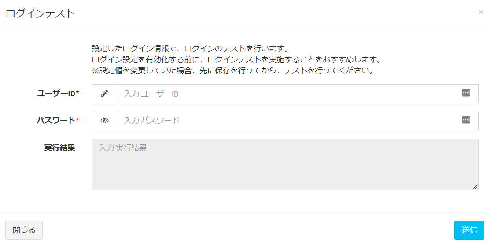

# Single Sign-On (LDAP)
Hier steht, wie Sie Single Sign-On (SSO) mit LDAP einrichten.  
In Exment können Sie in den [Anmeldeeinstellungen](/de/login_setting) Single Sign-On hinzufügen. Danach können sich die Benutzer mit der ID und dem Passwort des Anbieters (hier des LDAP-Servers) anmelden. Ein eigenes Anmeldepasswort für Exment müssen Sie dann nicht verwalten.

Die Einrichtung erfolgt in den folgenden 2 Schritten.

1. **Den Server vorbereiten** (die PHP-Erweiterung und die Bibliothek installieren) … „Server und Anbieter einrichten“
2. **Im Bildschirm einstellen** (im Bildschirm Anmeldeeinstellungen den Anbieter hinzufügen) … „Einstellungen im Bildschirm“

#### Hinweise
- **Diese Anleitung richtet sich an Personen, die sich mit LDAP auskennen. Wie Sie die einzelnen Anbieter einstellen, lesen Sie bitte in deren Unterlagen nach.**


## Server und Anbieter einrichten
Bevor Sie im Bildschirm Anmeldeeinstellungen einen Anbieter hinzufügen, müssen Sie auf dem Server Befehle ausführen und die Erweiterung installieren.

### Bei Windows

1. Öffnen Sie die Datei php.ini.  
※Wo die Datei php.ini liegt, hängt von der Installation des Servers ab.

2. Fügen Sie den folgenden Eintrag hinzu.

```
extension=ldap
```

3. Starten Sie PHP neu.

4. Führen Sie den folgenden Befehl aus.

```
composer require directorytree/ldaprecord
```
※Diese Bibliothek wird ab Exment v7.0.0 verwendet. Wenn Sie Exment v6.x oder älter verwenden, führen Sie stattdessen „composer require adldap2/adldap2-laravel“ aus.  


### Bei Linux (CentOS)

> Es muss ein Paket hinzugefügt werden. Deshalb ist die Einführung zum Beispiel auf Mietservern manchmal nicht möglich.

1. Führen Sie den folgenden Befehl aus, um das Paket zu installieren.  
※Erledigen Sie vorher die Aktualisierung von epel und die Installation von rpm, wie sie zum Beispiel unter [Umgebung mit Linux aufbauen](/de/install_linux) beschrieben sind.

```
sudo dnf install php-ldap
```

2. Öffnen Sie die Datei php.ini.  
※Wo die Datei php.ini liegt, hängt von der Installation des Servers ab.

3. Fügen Sie den folgenden Eintrag hinzu.

```
extension=ldap.so
```


4. Führen Sie die folgenden Befehle aus.

```
composer require directorytree/ldaprecord
sudo service httpd restart
```
※Diese Bibliothek wird ab Exment v7.0.0 verwendet. Wenn Sie Exment v6.x oder älter verwenden, führen Sie stattdessen „composer require adldap2/adldap2-laravel“ aus.  


## Einstellungen im Bildschirm
Wenn die Einstellungen am Server fertig sind, fügen Sie im [Bildschirm Anmeldeeinstellungen](/de/login_setting) den Anbieter hinzu.

1. Öffnen Sie mit einem Administratorkonto den Bildschirm Systemeinstellungen.  
Öffnen Sie über die Schaltfläche „Anmeldeeinstellungen“ oben rechts auf der Seite den Bildschirm Anmeldeeinstellungen.  
  

2. Drücken Sie die Schaltfläche Neu und erstellen Sie eine Anmeldeeinstellung. Die Eingabefelder sind unten beschrieben.

- **LDAP-Name (alphanumerisch)** : Geben Sie Buchstaben und Ziffern ein. Der Name darf nicht doppelt vorkommen.

### LDAP-Einstellungen
Geben Sie die Einstellungen von LDAP ein.  
(Bei Active Directory)
  

(Bei openLDAP)
  

### Zuordnungseinstellungen
Die Feldnamen, die der Anbieter zurückgibt, müssen den Feldnamen der Tabelle „Benutzer“ von Exment zugeordnet werden.  

  

Geben Sie die Feldnamen ein, die der Anbieter zurückgibt.

  

Es gibt 3 Schreibweisen.

| Schreibweise | Wann Sie sie verwenden | Beispiel |
|---|---|---|
| Den Feldnamen unverändert schreiben | Ein Feld wird unverändert verwendet | |
| Mehrere Namen durch Kommas getrennt schreiben | Es gibt mehrere Kandidaten; von vorn wird der erste verwendet, der einen Wert hat | seimei,username |
| Mehrere Namen in der Form ${Feldname} schreiben | Mehrere Felder werden kombiniert verwendet | ${last_name} ${first_name} |

#### Den Feldnamen unverändert eintragen
Schreiben Sie den Feldnamen, den der Anbieter zurückgibt, unverändert.
  

#### Mehrere Feldnamen durch Kommas getrennt eintragen
Wenn es mehrere Kandidaten für das gewünschte Feld gibt, schreiben Sie die Feldnamen, die der Anbieter zurückgibt, durch Kommas getrennt.  
Exment sucht von vorn nach einem Wert. Wenn ein Wert vorhanden ist, wird er verwendet.  
(Beispiel: Am liebsten soll das Feld für den vollen Namen „seimei“ verwendet werden. Es ist beim Anbieter aber kein Pflichtfeld. Deshalb wird als Benutzername der Wert von „seimei“ verwendet, wenn er vorhanden ist, und sonst „username“ → seimei,username eintragen)
  

#### Mehrere Feldnamen in der Form ${Feldname} eintragen
Diese Schreibweise verwenden Sie, wenn Sie mehrere Benutzerangaben, die der Anbieter zurückgibt, kombinieren und als Benutzerangabe von Exment verwenden möchten. Schreiben Sie mehrere Felder in der Form ${Feldname}.  
(Beispiel: Ein Feld „Name“ gibt es beim Anbieter nicht, aber es gibt je ein Feld „Nachname (last_name)“ und „Vorname (first_name)“. Sie werden als „Nachname Vorname“ kombiniert verwendet → ${last_name} ${first_name} eintragen)
  


### Benutzereinstellungen
Hier stellen Sie ein, wie mit angemeldeten Benutzern umgegangen wird.

  

#### Spalte für die Kontosuche
Hier stellen Sie ein, mit welcher Spalte des über SSO erhaltenen Kontos das Konto in Exment gesucht wird.

#### Benutzer erstellen
- Bei YES: Wenn der angemeldete Benutzer in Exment nicht vorhanden ist, wird mit den Anmeldeinformationen ein neuer Benutzer in Exment erstellt.
- Bei NO: Sie müssen den Benutzer vorher in Exment anlegen. Wenn der angemeldete Benutzer in Exment nicht vorhanden ist, wird ein Fehler angezeigt.

#### Rollengruppen-Einstellungen
Bei YES können Sie den Benutzer mit Rollengruppen verknüpfen, wenn er in Exment neu erstellt wird.  

#### Benutzerinformationen aktualisieren
Bei YES werden Benutzerinformationen wie der Benutzername bei einer erneuten Anmeldung aktualisiert.


- Wenn Sie die Daten mindestens einmal gespeichert haben, erscheinen die Schaltflächen „Aktivieren“ und „Anmeldetest“.

- Wenn „Aktiv“ auf YES steht, wird im Anmeldebildschirm eine Schaltfläche für die SSO-Authentifizierung angezeigt.  

(Bei Active Directory)

  

(Bei openLDAP)

  


### Einstellungen der Anmeldeschaltfläche
Hier stellen Sie die Anmeldeschaltfläche ein, die im Anmeldebildschirm angezeigt wird.  

  


### Aktivierung und Anmeldetest
- Wenn Sie die Daten mindestens einmal gespeichert haben, erscheinen die Schaltflächen „Aktivieren“ und „Anmeldetest“.

  

#### Aktivierung
- Wenn Sie die Aktivierung ausführen, wird im Anmeldebildschirm eine Schaltfläche für die SSO-Authentifizierung angezeigt.  
※Wenn Sie die normale Schaltfläche „Anmelden“ nicht anzeigen möchten, stellen Sie in den [Anmeldeeinstellungen](/de/login_setting) „Standardanmeldung anzeigen“ auf „NO“.  
  


#### Anmeldetest
- Wenn Sie auf die Schaltfläche „Anmeldetest“ klicken, können Sie die Anmeldung mit den eingestellten Anmeldeinformationen testen. Der Test ist auch möglich, wenn die Anmeldeeinstellung nicht aktiviert ist.  

  


- Wenn Sie auf die Schaltfläche „Anmelden“ klicken, können Sie testen, ob die Einstellungen richtig sind.  
Das Ergebnis wird im Feld „Ausführungsergebnis“ angezeigt.

  

  
  
[←Zurück zu den Anmeldeeinstellungen](/de/login_setting)
