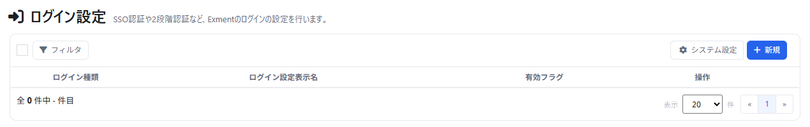

# Single Sign-On (OAuth)
Hier steht, wie Sie Single Sign-On (SSO) mit OAuth einrichten. Danach können sich die Benutzer mit einem Konto von Google, Microsoft und anderen bei Exment anmelden.  
In Exment können Sie in den [Anmeldeeinstellungen](/de/login_setting) Single Sign-On hinzufügen. Danach können sich die Benutzer mit der ID und dem Passwort des Anbieters (eines Dienstes wie Google, der die Anmeldung übernimmt) anmelden. Ein eigenes Anmeldepasswort für Exment müssen Sie dann nicht verwalten.

Die Einrichtung erfolgt in den folgenden 2 Schritten.

1. **Server und Anbieter vorbereiten** (beim Anbieter eine Anwendung anlegen und bei Bedarf eine Bibliothek installieren) … „Server und Anbieter einrichten“
2. **Im Bildschirm einstellen** (im Bildschirm Anmeldeeinstellungen den Anbieter hinzufügen) … „Einstellungen im Bildschirm“

Schritt 1 hängt vom verwendeten Anbieter ab.

| Verwendeter Anbieter | Wo Sie nachsehen |
|---|---|
| Google, Facebook, Twitter, GitHub, LinkedIn, Bitbucket | (1) Bei Anbietern, die Socialite standardmäßig bereitstellt |
| Office365, Microsoft Graph | (2) Bei Anbietern, die als Exment-Erweiterung bereitstehen |
| Alle anderen | (3) Wenn Sie den Anbieter selbst bereitstellen |

#### Hinweise
- Exment setzt die Verarbeitung von Single Sign-On mit [Socialite](https://github.com/laravel/socialite) um.
- **Diese Anleitung richtet sich an Personen, die sich mit OAuth auskennen. Wie Sie zum Beispiel Client ID und Client Secret bei den einzelnen Anbietern erstellen, lesen Sie bitte in deren Unterlagen nach.**
- <span class="red">Wenn bei v3.0.16 oder älter die Anmeldung mit Google nicht möglich ist, gehen Sie bitte nach [dieser Anleitung](/patch/sso_google) (Englisch) vor.</span>

#### Weiterführende Links
- [Mit der Open-Source-Webdatenbank „Exment“ SSO mit einem Google-Konto unterstützen](https://qiita.com/hirossyi73/items/70dcc35305a96abace08) (Japanisch)


## Server und Anbieter einrichten
Bevor Sie im Bildschirm Anmeldeeinstellungen einen Anbieter hinzufügen, müssen Sie auf dem Server Befehle ausführen und die Erweiterung installieren.

### (1) Bei Anbietern, die Socialite standardmäßig bereitstellt
- Socialite stellt standardmäßig die folgenden Anbieter bereit. (Die Zeichenfolge in Klammern verwenden Sie später, wenn Sie service angeben.)
    - Google (google)
    - Facebook (facebook)
    - Twitter (twitter)
    - GitHub (github)
    - LinkedIn (linkedin)
    - Bitbucket (bitbucket)

- Legen Sie beim jeweiligen Anbieter eine Anwendung für Exment an.  
※Die callback URL lautet wie folgt.  
http(s)://(URL von Exment)/auth/login/(provider-Name von socialite)/callback  

    - Beispiel 1, bei GitHub: http(s)://(URL von Exment)/auth/login/github/callback  
    - Beispiel 2, bei Facebook: http(s)://(URL von Exment)/auth/login/facebook/callback  
    - Beispiel 3, bei Google: http(s)://(URL von Exment)/auth/login/google/callback  

> ※Die URLs gelten für die Standardeinstellung ohne „/admin“ (eine Website, die mit v7.2.1 oder neuer neu installiert wurde). Wenn `ADMIN_ROUTE_PREFIX` in der `.env` einen Wert hat (bei einer Website, die mit einer früheren Version installiert wurde, ist es „admin“), fügen Sie diesen Wert hinter der URL der Website ein (Beispiel: `http(s)://(URL von Exment)/admin/auth/login/google/callback`). Einzelheiten finden Sie unter [Das „admin“ in der URL ändern oder entfernen](/de/additional_prefix).

- Führen Sie den folgenden Befehl im Stammverzeichnis von Exment aus.

~~~
composer require laravel/socialite=~5.1
~~~
※Ab Exment v7.0.0 wird „laravel/socialite“ automatisch als abhängige Bibliothek von Exment installiert. Sie müssen diesen Befehl dann nicht ausführen.

- Nehmen Sie die [Einstellungen im Bildschirm](/de/login_oauth?id=Einstellungen-im-Bildschirm) vor.


### (2) Bei Anbietern, die als Exment-Erweiterung bereitstehen
- Einige Anbieter stehen als Erweiterung von Exment bereit. (Die Zeichenfolge in Klammern verwenden Sie später, wenn Sie service angeben.)
    - Office365, Microsoft Graph (graph)

- Legen Sie beim jeweiligen Anbieter eine Anwendung für Exment an.  
※Die callback URL lautet wie folgt.  
http(s)://(URL von Exment)/auth/login/(provider-Name von socialite)/callback  

    - Beispiel, bei Office365: http(s)://(URL von Exment)/auth/login/graph/callback

- Führen Sie den folgenden Befehl im Stammverzeichnis von Exment aus.

~~~
composer require exceedone/microsoft-graph
~~~

- Nehmen Sie die [Einstellungen im Bildschirm](/de/login_oauth?id=Einstellungen-im-Bildschirm) vor.


### (3) Wenn Sie den Anbieter selbst bereitstellen
Für einen Anbieter, der nicht unter (1) oder (2) steht, fügen Sie über [Socialite Providers](https://socialiteproviders.github.io/) einen inoffiziellen Anbieter hinzu.  
Auch die inoffiziellen Anbieter enthalten keine Verarbeitung, die den Avatar (das Bild des Benutzers) abruft. Wenn Sie den Avatar abrufen möchten, fügen Sie die Verarbeitung hinzu. (Optional)  
  
※Es sind mehrere Schritte nötig. Einzelheiten finden Sie unter [Einen eigenen Anbieter erstellen](/de/login_oauth?id=Einen-eigenen-Anbieter-erstellen).

- Nehmen Sie nach diesen Schritten die [Einstellungen im Bildschirm](/de/login_oauth?id=Einstellungen-im-Bildschirm) vor.


## Einstellungen im Bildschirm
Wenn die Einstellungen am Server fertig sind, fügen Sie im [Bildschirm Anmeldeeinstellungen](/de/login_setting) den Anbieter hinzu.

1. Öffnen Sie mit einem Administratorkonto den Bildschirm Systemeinstellungen.  
Öffnen Sie über die Schaltfläche „Anmeldeeinstellungen“ oben rechts auf der Seite den Bildschirm Anmeldeeinstellungen.  
  

2. Drücken Sie die Schaltfläche Neu und erstellen Sie eine Anmeldeeinstellung. Die Eingabefelder sind unten beschrieben.

### Anbietertyp
  

- Wenn Sie unter „Server und Anbieter einrichten“ einen Anbieter aus (1) gewählt haben, wählen Sie den Namen dieses Anbieters.  

- Wenn Sie unter „Server und Anbieter einrichten“ einen Anbieter aus (2) oder (3) gewählt haben, wählen Sie „Sonstige“.  
Bei der Auswahl von „Sonstige“ erscheint „Anbietername (alphanumerisch)“. Geben Sie dort den Anbietertyp in Buchstaben und Ziffern ein, den Socialite vorgibt.  
Beispiel, bei Microsoft Graph: "graph"

  


### Client-ID, Client-Secret
Geben Sie die Zeichenfolgen ein, die Sie vom Anbieter erhalten haben.

### Scope
Wenn es nur um die Anmeldung geht, hat der Scope im Grunde keinen bestimmten Zweck. Wenn Sie mit [Zugriffstoken abrufen](/de/login_oauth?id=Zugriffstoken-abrufen) ein Zugriffstoken abrufen, empfehlen wir, ihn einzustellen.

### Optionseinstellungen
Hier nehmen Sie die Optionseinstellungen vor, die zum gewählten Anbietertyp passen.
(Wenn Sie einen Anbietertyp ohne Optionseinstellungen gewählt haben, werden sie nicht angezeigt.)

#### Wenn der Anbietertyp „Sonstige“ ist
 

##### Single Logout
Beim Abmelden von Exment wird der Benutzer auch von dem Anbieter abgemeldet, bei dem er sich über SSO angemeldet hat. <span class="red">※Okta wird derzeit nicht unterstützt.</span>

<!---
  Derselbe Text steht bei OAuth und Saml
-->
### Benutzereinstellungen
Hier stellen Sie ein, wie mit angemeldeten Benutzern umgegangen wird.

  

#### Spalte für die Kontosuche
Hier stellen Sie ein, mit welcher Spalte des über SSO erhaltenen Kontos das Konto in Exment gesucht wird.

#### Benutzer erstellen
- Bei YES: Wenn der angemeldete Benutzer in Exment nicht vorhanden ist, wird mit den Anmeldeinformationen ein neuer Benutzer in Exment erstellt.
- Bei NO: Sie müssen den Benutzer vorher in Exment anlegen. Wenn der angemeldete Benutzer in Exment nicht vorhanden ist, wird ein Fehler angezeigt.

#### Rollengruppen-Einstellungen
Bei YES können Sie den Benutzer mit Rollengruppen verknüpfen, wenn er in Exment neu erstellt wird.  

#### Benutzerinformationen aktualisieren
Bei YES werden Benutzerinformationen wie der Benutzername bei einer erneuten Anmeldung aktualisiert.


- Wenn Sie die Daten mindestens einmal gespeichert haben, erscheinen die Schaltflächen „Aktivieren“ und „Anmeldetest“.

- Wenn „Aktiv“ auf YES steht, wird im Anmeldebildschirm eine Schaltfläche für die SSO-Authentifizierung angezeigt.  
※Normalerweise wird auch das Standard-Anmeldeformular angezeigt, in das Benutzer-ID und Passwort eingegeben werden. In den [SSO-Einstellungen](/de/system_setting) können Sie es wie im Bild auch ausblenden.  


### Einstellungen der Anmeldeschaltfläche
Hier stellen Sie die Anmeldeschaltfläche ein, die im Anmeldebildschirm angezeigt wird.  
※Auch ohne diese Einstellung werden die Anbieter aus „(1) Bei Anbietern, die Socialite standardmäßig bereitstellt“ oben jeweils in ihrem eigenen Format angezeigt.

  


### Aktivierung und Anmeldetest
- Wenn Sie die Daten mindestens einmal gespeichert haben, erscheinen die Schaltflächen „Aktivieren“ und „Anmeldetest“.

  

#### Aktivierung
- Wenn Sie die Aktivierung ausführen, wird im Anmeldebildschirm eine Schaltfläche für die SSO-Authentifizierung angezeigt.  
  

#### Anmeldetest
- Wenn Sie auf die Schaltfläche „Anmeldetest“ klicken, können Sie die Anmeldung mit den eingestellten Anmeldeinformationen testen. Der Test ist auch möglich, wenn die Anmeldeeinstellung nicht aktiviert ist.  
**Fügen Sie dann die URL, die unter „Weiterleitungs-URL für den Test“ angezeigt wird, vorübergehend zur Callback-URL in den OAuth-Einstellungen des Anbieters hinzu, oder ändern Sie die Callback-URL darauf.**

  


- Wenn Sie auf die Schaltfläche „Anmelden“ klicken, können Sie testen, ob die Einstellungen richtig sind.  
Das Ergebnis wird im Feld „Ausführungsergebnis“ angezeigt.


### Zugriffstoken abrufen

- Wenn Sie nach der Anmeldung das Zugriffstoken und das Refresh-Token abrufen möchten, gehen Sie wie folgt vor.

~~~ php
use Exceedone\Exment\Services\Login\LoginService;

$access_token = LoginService::getAccessToken();
$refresh_token = LoginService::getRefreshToken();
~~~


## Einen eigenen Anbieter erstellen
Hier stehen die genauen Schritte für (3). Sie fügen das Paket hinzu, das unter [Socialite Providers](https://socialiteproviders.github.io/) angegeben ist.  
Außerdem erstellen Sie einen eigenen Anbieter, um den Avatar abzurufen. (Optional)

| Schritt | Nötig oder nicht |
|---|---|
| Anbieter einrichten und hinzufügen | Erforderlich |
| Entwicklung zum Abrufen des Avatars | Optional |
| Service-Provider hinzufügen | Erforderlich |
| Optionseinstellungen hinzufügen | Je nach Anbieter erforderlich |
| Einstellungen im Bildschirm vornehmen | Erforderlich |

### (Erforderlich) Anbieter einrichten und hinzufügen
- Legen Sie beim jeweiligen Anbieter eine Anwendung für Exment an.  
※Die callback URL lautet wie folgt.  
http(s)://(URL von Exment)/auth/login/(provider-Name von socialite)/callback  

    - Beispiel, bei Microsoft Graph: http(s)://(URL von Exment)/auth/login/graph/callback

- Führen Sie den folgenden Befehl im Stammverzeichnis von Exment aus.

~~~
composer require laravel/socialite=~5.1
~~~
※Ab Exment v7.0.0 wird „laravel/socialite“ automatisch als abhängige Bibliothek von Exment installiert. Sie müssen diesen Befehl dann nicht ausführen.

- Fügen Sie das Paket hinzu, das unter [Socialite Providers](https://socialiteproviders.github.io/) angegeben ist.  

    - Beispiel: bei Microsoft Graph

~~~
composer require socialiteproviders/microsoft-graph
~~~

### (Optional) Entwicklung zum Abrufen des Avatars
※Das Erstellen dieses eigenen Anbieters ist ein optionaler Schritt, um den Avatar abzurufen. Wenn Sie den Avatar nicht brauchen, müssen Sie ihn nicht erstellen.

- Um den Avatar abzurufen, erstellen Sie im Ordner „app/Socialite“ 2 Klassen, die von einem vorhandenen Anbieter erben. ※Wenn es den Ordner „app/Socialite“ nicht gibt, legen Sie ihn an.  
Die erste ist MicrosoftGraphProvider.php. Sie implementiert (implements) das Interface ProviderAvatar und setzt getAvatar um.  
Schreiben Sie in die Methode getAvatar die Verarbeitung der API, die den Avatar abruft. Die URL und den Endpunkt für den Abruf erfahren Sie beim jeweiligen OAuth-Anbieter.  
Das Beispiel unten zeigt die Schritte für Microsoft Graph.

~~~ php
<?php

namespace App\Socialite;

use Exceedone\Exment\Auth\ProviderAvatar;
use SocialiteProviders\Graph\Provider;

class MicrosoftGraphProvider extends Provider implements ProviderAvatar
{
    /**
     * Get avatar stream
     * @param mixed $token
     * @return string
     */
    public function getAvatar($token = null){
        try
        {
            $client = $this->getHttpClient();
            $response = $client->get('https://graph.microsoft.com/v1.0/me/photo/$value', [
                'headers' => [
                    'Authorization' => 'Bearer '.$token,
                    'Content-Type' => 'application/json;odata.metadata=minimal;odata.streaming=true'
                ],
                'http_errors' => false,
            ]);

            if($response->getStatusCode() == 404){
                return null;
            }

            return $response->getBody()->getContents();

        }
        catch (Exception $exception)
        {
            return null;
        }
        return null;
    }
}

~~~ 

- Die zweite ist GraphExtendSocialite.php. Dort geben Sie den erstellten MicrosoftGraphProvider an.

~~~ php
<?php

namespace App\Socialite;

use SocialiteProviders\Manager\SocialiteWasCalled;

class GraphExtendSocialite
{
    /**
     * Execute the provider.
     */
    public function handle(SocialiteWasCalled $socialiteWasCalled)
    {
        $socialiteWasCalled->extendSocialite(
            'graph', __NAMESPACE__.'\MicrosoftGraphProvider'
        );
    }
}

~~~ 

### (Erforderlich) Service-Provider hinzufügen
- Tragen Sie in der Datei app/Providers/EventServiceProvider.php den hinzugefügten Anbieter ein und fügen Sie so den Service-Provider hinzu.  
※Der Inhalt hängt davon ab, ob Sie die eigene Entwicklung zum Abrufen des Avatars gemacht haben.  
Der Klassenname, der bei „@handle“ steht, ist außerdem meistens in der Anleitung des Anbieters angegeben, den Sie über [Socialite Providers](https://socialiteproviders.github.io/) hinzugefügt haben. Bitte prüfen Sie ihn dort.

~~~ php

// Beispiel: bei Microsoft Graph

protected $listen = [
    ///// Wenn Sie die eigene Entwicklung zum Abrufen des Avatars gemacht haben
    'App\Events\Event' => [
        'App\Listeners\EventListener',
    ],
    
    /// Hinzufügen
    \SocialiteProviders\Manager\SocialiteWasCalled::class => [
        '\App\Socialite\GraphExtendSocialite@handle', ///// Wenn Sie die eigene Entwicklung zum Abrufen des Avatars gemacht haben
        // 'SocialiteProviders\\Graph\\GraphExtendSocialite@handle', ///// Beim normalen Abruf den Kommentar hier entfernen und diese Zeile verwenden
    ],
];

~~~
~~~php

// Beispiel: bei EntraID

protected $listen = [
    // ... other listeners
    \SocialiteProviders\Manager\SocialiteWasCalled::class => [
        // ... other providers
        \SocialiteProviders\Microsoft\MicrosoftExtendSocialite::class.'@handle',
    ],
];

~~~

※Bei einer Neuinstallation mit Exment v7.0.0 oder neuer (ein mit Laravel12 erstelltes Projekt) gibt es „app/Providers/EventServiceProvider.php“ nicht. Schreiben Sie in diesem Fall Folgendes in die Methode boot von „app/Providers/AppServiceProvider.php“.

~~~php

// Beispiel: bei EntraID

public function boot(): void
{
    \Illuminate\Support\Facades\Event::listen(
        \SocialiteProviders\Manager\SocialiteWasCalled::class,
        [\SocialiteProviders\Microsoft\MicrosoftExtendSocialite::class, 'handle']
    );
}

~~~


### (Je nach Anbieter erforderlich) Optionseinstellungen hinzufügen
Je nach Anbieter der OAuth-Anmeldung sind zusätzliche Einstellungen nötig.  

  
Beispiel: bei [OKTA](https://github.com/SocialiteProviders/Okta)
- Öffnen Sie config/services.php und fügen Sie den folgenden Eintrag hinzu.

``` php
'okta' => [    
  'base_url' => env('OKTA_BASE_URL'), 
],
```

- Öffnen Sie die Datei .env und fügen Sie den folgenden Eintrag hinzu.

```
OKTA_BASE_URL='https://<Domain von OKTA>'
```

> Eigentlich verlangt Socialite in config/services.php die Einstellungswerte "client_id", "client_secret" und "redirect". Bei der OAuth-Authentifizierung von Exment werden die im Bildschirm eingestellten Werte automatisch eingesetzt.  
Wenn Sie eigene Einstellungswerte des Anbieters eingeben möchten, fügen Sie die Werte wie oben in config/services.php hinzu.


### (Erforderlich) Einstellungen im Bildschirm vornehmen

- Wenn alle Einstellungen auf der Serverseite fertig sind, nehmen Sie die [Einstellungen im Bildschirm](/de/login_oauth?id=Einstellungen-im-Bildschirm) vor.

  
  
[←Zurück zu den Anmeldeeinstellungen](/de/login_setting)
