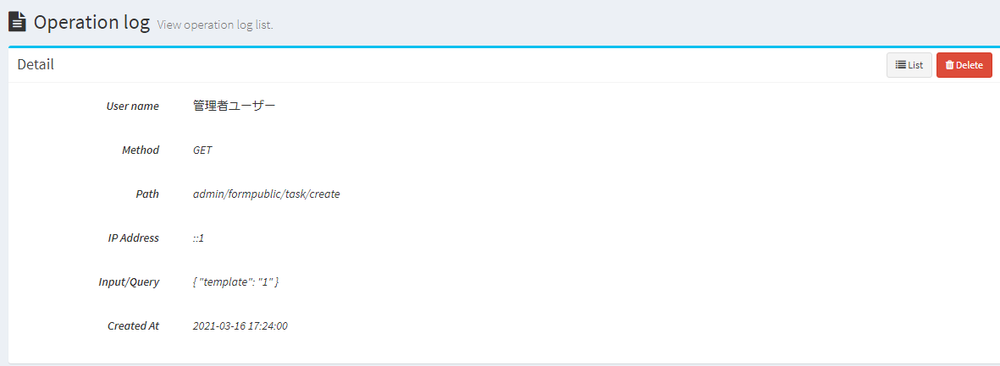

# Protokolle
Hier steht, wie Sie die Aufzeichnungen (Protokolle) von Exment ansehen und einstellen.  
Wenn Sie wissen möchten, „wer wann was getan hat“, sehen Sie in das Vorgangsprotokoll. Wenn Sie die Ursache eines Fehlers suchen, sehen Sie in die Protokolldatei.

## Arten von Protokollen
Exment hat zwei Arten von Protokollen.

| Art | Inhalt | Wo man es sieht |
| --- | --- | --- |
| **Vorgangsprotokoll** | Was die einzelnen Benutzer auf den Seiten getan haben. | Seite von Exment (Systemadministrator) |
| **Ausgabe in die Protokolldatei** | Vor allem Aufzeichnungen über aufgetretene Fehler. | Datei auf dem Server |


## Vorgangsprotokoll
Was die einzelnen Benutzer auf den Seiten getan haben, zeigt Exment auf einer Seite als Liste.  
Aufgezeichnet werden vor allem die folgenden Vorgänge.

- Anzeige von Seiten, neues Hinzufügen, Aktualisieren und Löschen von Daten usw.
- Authentifizierung und Aufrufe der API


### So sehen Sie das Protokoll an
Die Seite des Vorgangsprotokolls öffnet ein Systemadministrator. Es gibt zwei Wege.

- Geben Sie die folgende URL ein.  
http(s)://(URL von Exment)/auth/logs    

> ※Die URL gilt für die Standardeinstellung ohne „/admin“ (Websites, die ab v7.2.1 neu installiert wurden). Wenn `ADMIN_ROUTE_PREFIX` in der `.env` einen Wert hat (bei Websites aus älteren Versionen ist es „admin“), hängen Sie diesen Wert an die URL der Website an (Beispiel: `http(s)://(URL von Exment)/admin/auth/logs`). Einzelheiten stehen unter [„admin“ in der URL ändern oder entfernen](/de/additional_prefix).

- Oder fügen Sie „Vorgangsprotokoll“ zum Menü hinzu und öffnen Sie die Seite von dort.  
„Vorgangsprotokoll“ steht in der Standardeinstellung nicht im Menü. Zum Hinzufügen öffnen Sie die Seite „Administratoreinstellungen“ > „Menü“ und wählen den Menütyp „Systemmenü“. Unter „Ziel“ erscheint „Vorgangsprotokoll“. Wählen Sie es aus und speichern Sie.

Die Liste des Vorgangsprotokolls wird angezeigt.

  

Wenn Sie auf eine Zeile klicken, sehen Sie die Einzelheiten dieses Vorgangs.  

  

### Die einzelnen Felder

- ##### Benutzername  
Der Benutzer, der den Vorgang ausgeführt hat. ※Bei Vorgängen ohne Anmeldung bleibt das Feld leer.

- ##### Methode
Die Art der Methode der HTTP-Anfrage.

- ##### Pfad
Die Ziel-URI der HTTP-Anfrage.  
※Die Abfragezeichenfolge einer GET-Methode (der Teil der URL nach dem „?“) steht nicht in diesem Feld. Sie steht unter „Eingabe/Abfrage“.

- ##### IP-Adresse
Die IP-Adresse des Geräts, von dem der Vorgang kam.

- ##### Eingabe/Abfrage
Die Abfragezeichenfolge der HTTP-Anfrage oder die POST-Werte.  

- ##### Erstellt am
Datum und Uhrzeit des Vorgangs.


### Sonstiges
- Die Werte der folgenden Felder unter „Eingabe/Abfrage“ sind vertraulich. Sie werden beim Speichern durch die Zeichenfolge "***" ersetzt (maskiert).
    - password
    - password_confirmation
    - current_password
    - _token
    - verify_code
    - access_token
    - refresh_token
    - system_line_channel_token
    - system_line_channel_secret

※Diese Felder werden immer maskiert, unabhängig von der Einstellung in `config/exment.php`, die unten unter „Maskierung vertraulicher Informationen“ steht.  
※„system_line_channel_token“ und „system_line_channel_secret“ werden ab v7.0.0 maskiert.


### Maskierung vertraulicher Informationen
※Diese Einstellung gibt es ab Exment v7.0.0. In v6.x werden nur die oben unter „Sonstiges“ genannten Felder maskiert (ohne die beiden LINE-Felder).

Im Vorgangsprotokoll können Werte stehen, die Benutzer eingegeben haben, die über die API gesendet wurden oder die im Pfad der URL enthalten sind.

Damit vertrauliche Informationen wie Anmeldedaten nicht unverändert gespeichert werden, maskiert Exment beim Aufzeichnen des Vorgangsprotokolls die eingestellten Felder und die Werte im Pfad der URL (sie werden durch "***" ersetzt).

Die Einstellung der Maskierung ändern Sie im Abschnitt `operation_log` der folgenden Datei.

`config/exment.php`

Unten stehen die Standardwerte von `operation_log` aus `config/exment.php`. (Einige Kommentare sind weggelassen.)

```php
'operation_log' => [
    // Feldnamen, die auf allen Seiten maskiert werden
    'mask_columns' => [
        // SSO (OAuth / SAML)
        'oauth_client_id',
        'oauth_client_secret',
        'saml_sp_privatekey',
        // Systemeinstellungen (geheimer Schlüssel von reCAPTCHA, SMTP-Passwort)
        'recaptcha_secret_key',
        'system_mail_password',
        // API-Schlüssel von Meilisearch
        'meili_key',
        // Kanaldaten der LINE Messaging API
        'system_line_channel_token',
        'system_line_channel_secret',
        // Passwort der Datenbankverbindung eines Plugins
        'custom_password',
        // Anmeldedaten eines Plugins (CRUD-Seite)
        'crud_auth_key',
        'crud_auth_password',
    ],

    // Feldnamen, die nur auf bestimmten Seiten und in bestimmten APIs maskiert werden
    'mask_columns_by_uri' => [
        // Seite der API-Einstellungen
        'api_setting*' => ['id', 'secret', 'client_api_key'],
        // API zum Abrufen des OAuth-Tokens
        'oauth/*' => ['client_id', 'api_key', 'client_secret'],
        // Seite zum Zurücksetzen des Passworts
        'auth/reset*' => ['token'],
    ],

    // URI-Präfixe, bei denen das direkt folgende Pfadsegment maskiert wird
    'mask_path_prefixes' => [
        'api_setting' => true,
        'oauth/clients' => true,
        // Token zum Zurücksetzen des Passworts. Nicht löschen und nicht auf true ändern
        'auth/reset' => false,
    ],
],
```

<span class="red">※Wenn Sie `operation_log` in `config/exment.php` eintragen, wird das nicht mit den Standardwerten von Exment zusammengeführt. Ihr Eintrag ersetzt die gesamten Standardwerte.</span>  
Wenn Sie Maskierungen hinzufügen oder ändern, tragen Sie zuerst alle Standardwerte von oben ein und ergänzen oder ändern Sie dann die Felder.  
Löschen Sie vor allem nicht `'auth/reset' => false` in `mask_path_prefixes`. Sonst wird das Token zum Zurücksetzen des Passworts unmaskiert aufgezeichnet.

#### mask_columns

- Hier geben Sie Feldnamen an, die auf jeder Seite und in jeder API immer maskiert werden.
- Verwenden Sie dies für Werte, die immer vertraulich sind, zum Beispiel API-Schlüssel und Client-Secrets.
- Der Wert wird auch dann maskiert, wenn Sie einen hier angegebenen Feldnamen in einer benutzerdefinierten Tabelle für gewöhnliche Geschäftsdaten verwenden.

#### mask_columns_by_uri

- Hier geben Sie Feldnamen an, die nur auf bestimmten Seiten oder in bestimmten APIs maskiert werden.
- Als Schlüssel des Arrays geben Sie ein URI-Muster relativ zum Präfix `admin` an. Der Platzhalter `*` ist erlaubt.
- Verwenden Sie dies für Feldnamen wie `id`, `secret`, `client_id`, `api_key` und `token`, die auf anderen Seiten auch für gewöhnliche Geschäftsdaten vorkommen können.
- Passende Felder werden vollständig maskiert, auch in verschachtelten Werten.

#### mask_path_prefixes

- Verwenden Sie dies, wenn vertrauliche Informationen im Pfad der URL stehen. Sie geben ein URI-Präfix relativ zum Präfix `admin` an. Dann wird das direkt folgende Pfadsegment maskiert (der nächste durch „/“ getrennte Teil).
- Mit dem Wert im Array legen Sie fest, wie maskiert wird.
    - `true`: Hat der Wert 13 oder mehr Zeichen, bleiben nur die ersten 8 Zeichen stehen und der Rest wird durch `***` ersetzt. Hat er 12 oder weniger Zeichen, wird der ganze Wert durch `***` ersetzt. Das ist für Datensatz-IDs und Ähnliches gedacht, die man nachverfolgen muss.
    - `false`: Der ganze Wert wird durch `***` ersetzt. Das ist für Werte gedacht, die ganz verborgen bleiben müssen, zum Beispiel Token zum Zurücksetzen des Passworts.
- Wenn Sie zum Beispiel `auth/reset` auf `false` stellen, wird das ganze Token zum Zurücksetzen des Passworts in der URL durch `***` ersetzt.

#### Hinweise

- Die Maskierung gilt für neu erstellte Vorgangsprotokolle.
- <span class="red">Vorhandene Vorgangsprotokolle werden bei einem Upgrade von Exment nicht automatisch maskiert.</span> Wenn Sie die aktuelle Einstellung auch auf vorhandene Vorgangsprotokolle anwenden möchten, sichern Sie zuerst die Datenbank und führen Sie dann den folgenden Befehl aus. Maskierte Werte lassen sich nicht wiederherstellen.

```
php artisan exment:patchdata patch_log_opelation
```

※„opelation“ im Befehlsnamen ist kein Schreibfehler. Geben Sie den Befehl genau wie oben ein.
- `config/exment.php` wird bei einem Upgrade von Exment (`php artisan exment:update`) nicht überschrieben. Wenn eine neue Version weitere Felder standardmäßig maskiert, gilt das deshalb nicht für Umgebungen, in denen `operation_log` schon eingetragen ist. Vergleichen Sie beim Upgrade Ihre Einstellung von `operation_log` mit den Standardwerten oben und ergänzen Sie fehlende Maskierungen von Hand.
- Verwenden Sie `mask_columns` für Werte, die immer vertraulich sind. Verwenden Sie `mask_columns_by_uri` oder `mask_path_prefixes` für Werte, die nur auf bestimmten Seiten oder in bestimmten APIs vertraulich sind (damit gewöhnliche Geschäftsdaten nicht versehentlich maskiert werden).


### Vorgangsprotokolle automatisch löschen
Unten auf der Seite des Vorgangsprotokolls können Sie einstellen, dass alte Vorgangsprotokolle automatisch gelöscht werden.

  

#### Automatisches Löschen einschalten
- Schaltet das automatische Löschen der Vorgangsprotokolle ein oder aus.
- Wenn es eingeschaltet ist, werden Protokolle automatisch gelöscht, die älter als die Aufbewahrungsdauer sind.
- Wenn es ausgeschaltet ist, werden Protokolle nicht automatisch gelöscht.
- Der Standardwert ist „NO“.


#### Aufbewahrungsdauer der Protokolle (Tage)
- Hier geben Sie an, wie viele Tage die Vorgangsprotokolle aufbewahrt werden.
- Protokolle, die älter als die angegebene Zahl von Tagen sind, werden automatisch gelöscht.
- Geben Sie einen Wert ab 1 ein.
- Diese Einstellung erscheint nur, wenn „Vorgangsprotokolle automatisch löschen“ auf YES steht.
- Der Standardwert ist „180“.


#### Ausführungswochentag
- Hier geben Sie den Wochentag an, an dem das automatische Löschen läuft.
- Ohne Auswahl läuft es an jedem Wochentag.
- Der Platzhalter ist „Alle“.


#### Ausführungsmonat
- Hier geben Sie den Monat an, in dem das automatische Löschen läuft.
- Ohne Auswahl läuft es in jedem Monat.
- Der Platzhalter ist „Alle“.


#### Ausführungstag
- Hier geben Sie den Tag an, an dem das automatische Löschen läuft.
- Ohne Auswahl läuft es an jedem Tag.
- Wenn Sie Ausführungswochentag und Ausführungstag angeben, läuft es nur zu Zeiten, die beide Bedingungen erfüllen.
- Der Platzhalter ist „Alle“.


#### Ausführungsstunde
- Hier geben Sie die Uhrzeit (Stunde) an, zu der das automatische Löschen läuft.
- Ohne Auswahl läuft es zu jeder Stunde.
- Der Platzhalter ist „Alle“.


#### Ausführungsminute
- Hier geben Sie die Uhrzeit (Minute) an, zu der das automatische Löschen läuft.
- Ohne Auswahl läuft es zu jeder Minute.
- Der Platzhalter ist „Alle“.


#### Automatisches Löschen ausschalten
1. Stellen Sie „Vorgangsprotokolle automatisch löschen“ auf „NO“.
2. Klicken Sie auf „Speichern“.

Nach dem Speichern ist das automatische Löschen ausgeschaltet.


### Alte Daten des Vorgangsprotokolls löschen
Alte Vorgangsprotokolle können Sie auch mit einem Plugin (Batch) löschen.  
Vorgangsprotokolle, die älter als ein bestimmtes Datum sind (Standard: 14 Tage), werden endgültig gelöscht (das lässt sich nicht rückgängig machen).  
Installieren Sie das Plugin (Batch) über den folgenden Link.  
[Plugin: Vorgangsprotokoll – alte Protokolle löschen](https://github.com/exment-git/plugin-sample/tree/main/batch/OperationLogDelete)


## Ausgabe in die Protokolldatei  
Vor allem bei Fehlern schreibt Exment in die Protokolldatei auf dem Server.  
※Mit den Einstellungen unten unter „Weitere Einstellungswerte“ können Sie auch anderes als Fehler ausgeben.

### So sehen Sie die Protokolldatei an
1. Öffnen Sie auf dem Server, auf dem Exment installiert ist, den folgenden Ordner.  
(Stammordner von Exment)/storage/logs  

2. Sehen Sie in die Datei laravel.log.

### Weitere Einstellungswerte
- Wenn Sie die [Einstellungswerte](/de/config) ändern, können Sie auch die folgenden Inhalte in die Protokolldatei ausgeben. Wie Sie die Werte einstellen, steht unter [Einstellungswerte](/de/config).

- ##### Ausgabe der Anfragewerte
    - Einstellungsschlüssel: EXMENT_DEBUG_MODE_REQUEST
    - Standardwert: false
    - Aufgabe: Bei true werden die Werte der Anfragen an Exment ins Protokoll geschrieben.  

- ##### Ausgabe des SQL-Protokolls
    - Einstellungsschlüssel: EXMENT_DEBUG_MODE_SQL
    - Standardwert: false
    - Aufgabe: Bei true werden die SQL-Anweisungen, die Exment ausgeführt hat, ins Protokoll geschrieben.

- ##### Ausgabe des SQL-Protokolls – Funktionen anzeigen
    - Einstellungsschlüssel: EXMENT_DEBUG_MODE_SQLFUNCTION
    - Standardwert: false
    - Aufgabe: Wenn „EXMENT_DEBUG_MODE_SQL“ auf true steht und auch dieser Wert true ist, wird zusammen mit der SQL-Anweisung die Liste der aufrufenden Funktionen ins Protokoll geschrieben.

### Weitere Hinweise
- Laravel (das Framework, das Exment verwendet) hat neben der Ausgabe in die Protokolldatei auch die folgenden Funktionen.
    - Protokolle an andere Orte ausgeben, zum Beispiel an Slack
    - Das Format des Protokolls ändern
    - Die Ausgabedatei des Protokolls jeden Tag wechseln

- Nehmen Sie diese Einstellungen nach dem [Laravel-Handbuch zum Logging](https://readouble.com/laravel/12.x/ja/logging.html) (Japanisch) vor.
