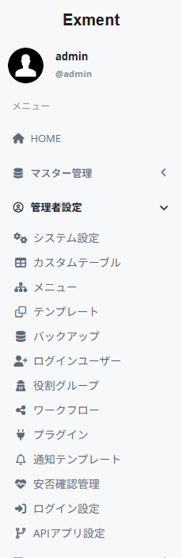
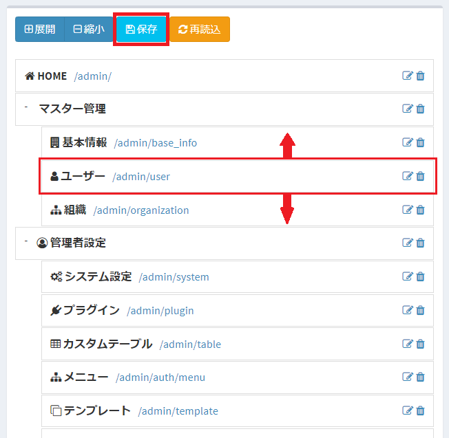

# Menü
Auf dieser Seite fügen Sie Einträge zum Menü links auf der Seite hinzu, sortieren sie um, bearbeiten und löschen sie.

| Was Sie tun möchten | Wo es steht |
|---|---|
| Einen Eintrag zum Menü hinzufügen | Menü neu hinzufügen |
| Die Reihenfolge des Menüs ändern | Reihenfolge ändern |
| Einen übergeordneten Knoten nur Personen bestimmter Rollengruppen zeigen | Sichtbar für Rollengruppen |
| Nach einem Update das Menü an die Standardreihenfolge ab v7.2.1 angleichen | In Standardreihenfolge anordnen |

## Überblick
Nach der Anmeldung erscheint links auf der Seite das Menü.  
Zum Menü können Sie Einträge hinzufügen, die „vom System bereitgestellte Seiten“, „Seiten von Plugins“, „Seiten der einzelnen Tabellen“ und „beliebige URLs“ öffnen.  
※ Es erscheinen nur die Menüeinträge für Seiten, die der angemeldete Benutzer anzeigen kann.



※ Ab v7.1.0 stehen „Sicherheitsabfrage“, „Anmeldeeinstellungen“, „API-Einstellungen“ und „Systemleistungsprotokoll“, die der Systemadministrator verwendet, unter „Administratoreinstellungen“. „LINE-Verknüpfung“ steht nicht im linken Menü, sondern im Benutzermenü oben rechts ([LINE-Verknüpfung](/de/line)). Bei einem Update von v7.0 wird ein Menü nur verschoben, wenn es auf der obersten Ebene steht. Menüs, die Sie selbst verschoben haben, bleiben, wie sie sind.


### Reihenfolge des Menüs ab v7.2.1
Ab v7.2.1 ist das linke Menü nach Arbeitsbereichen (übergeordneten Knoten) gegliedert. Die Reihenfolge ist dieselbe wie in der [Funktionsübersicht](https://exment.net/en/feature-map/).

```
Dashboard
Groupware ▸ Dateifreigabe, E-Mail (Groupware)
Anträge & Genehmigungen ▸ Offene Aufgaben, Genehmigungsantrag (Ringi), Spesenabrechnung … (mitgelieferte Vorlage „Antrags-Paket“)
Projekte ▸ Projektmanagement (offizielles Plugin)
Support-Desk ▸ Support-Desk (offizielles Plugin)
Stammdaten ▸ Basisinformationen, Organisation, Benutzer, Information
Einstellungen: Daten & Bildschirme ▸ Benutzerdefinierte Tabelle, Studio, Menü, Workflow, E-Mail-Vorlage, Benachrichtigung, Zellstil-Vorlagen, Vorlage
Einstellungen: Benutzer & Berechtigungen ▸ Login-Benutzer, Rollengruppe, Anmeldeeinstellungen, API-Einstellungen, Betriebsprotokoll
Einstellungen: System ▸ Systemeinstellungen, Funktionsverwaltung, Plugin, Sicherung, Optimierung, Wartungsmodus
```

- Eine neu installierte Website hat diese Form.
- Bei einer Website, die von v7.1 oder früher aktualisiert wurde, werden nur die Menüs verschoben, die noch dort stehen, wo Exment sie abgelegt hat (wenn der Inhalt der Administratoreinstellungen noch in der Reihenfolge von Exment steht, wenn „Stammdaten verwalten“ noch an 3. Stelle von oben steht, wenn die Dateifreigabe noch auf der obersten Ebene steht). Menüs, die Sie selbst verschoben haben, selbst vergebene Namen und Menüs von Plugins bleiben, wie sie sind. Bei Websites, bei denen in den Administratoreinstellungen andere Menüs liegen, werden die Administratoreinstellungen nicht aufgeteilt.
- Die offiziellen Plugins (Projektmanagement, Support-Desk, Groupware) und die mitgelieferten Vorlagen legen ihre Menüs unter ihrem jeweiligen Bereich ab (fehlt der Bereich, wird er angelegt). Nur Menüs auf der obersten Ebene werden verschoben.
- Ein Bereich, in dem kein Menü angezeigt werden kann, erscheint nicht (die Menüs von Funktionen, die in der [Funktionsverwaltung](/de/feature) ausgeschaltet sind, erscheinen nicht).

#### In Standardreihenfolge anordnen
Bei Websites, deren Reihenfolge sich beim Update nicht geändert hat (Websites mit umsortiertem Menü, Websites mit anderen Menüs in den Administratoreinstellungen), können Sie das Menü auf der Seite „Menü“ mit [In Standardreihenfolge anordnen] in die obere Form bringen.
- Nach dem Klick erscheint eine Liste, welches Menü wohin verschoben wird. Prüfen Sie sie und klicken Sie dann auf [Anordnen].
- Verschoben werden nur die Menüs von Exment und der offiziellen Plugins. Selbst erstellte Menüs, Menüs von Tabellen und alle anderen Menüs bleiben an ihrem Platz und in ihrer Reihenfolge (was in den Administratoreinstellungen lag, kommt ans Ende von „Einstellungen: System“). Es wird kein Menü gelöscht.
- Die Namen „HOME“, „Stammdaten verwalten“ und „Administratoreinstellungen“ werden nur dann in „Dashboard“, „Stammdaten“ und „Einstellungen: System“ geändert, wenn sie noch die von Exment vergebenen Namen sind.
- Das Menü vor dem Anordnen bleibt gespeichert. Mit [Rückgängig] auf derselben Seite stellen Sie es wieder her.
- Nur Systemadministratoren können diese Funktion verwenden.


## Menüverwaltung
So fügen Sie Menüs hinzu, sortieren sie um, bearbeiten und löschen sie.  

### Listenseite anzeigen
Klicken Sie im linken Menü auf „Menü“.  
Oder rufen Sie die folgende URL auf.  
Damit erscheint die Seite der Menüeinstellungen.  
http(s)://(URL von Exment)/auth/menu  
Sie sehen die Liste der Menüs, die im System registriert sind.


> ※ Die URL gilt für die Standardeinstellung ohne „/admin“ (Websites, die ab v7.2.1 neu installiert wurden). Wenn `ADMIN_ROUTE_PREFIX` in der `.env` einen Wert hat (bei Websites aus früheren Versionen „admin“), fügen Sie diesen Wert hinter der URL der Website ein (Beispiel: `http(s)://(URL von Exment)/admin/auth/menu`). Einzelheiten finden Sie unter [„admin“ in der URL ändern oder entfernen](/de/additional_prefix).

### Menü neu hinzufügen
Geben Sie auf der Listenseite „Menü“ im Feld „Neu“ rechts auf der Seite die nötigen Angaben ein.  


#### Übergeordnete ID
Wählen Sie den Eintrag, der dem neuen Menü übergeordnet ist. Um ein Menü auf der obersten Ebene hinzuzufügen, wählen Sie „ROOT“.


#### Menütyp
Wählen Sie den Typ des neuen Menüs aus den folgenden.
- <span class="heading_smaller_than_h5">Systemmenü</span>  
Wählen Sie diesen Typ, um einen von Exment bereitgestellten Menüeintrag hinzuzufügen.  

- <span class="heading_smaller_than_h5">Plugin</span>  
Wählen Sie diesen Typ, um ein von Benutzern hochgeladenes Plugin im Menü anzuzeigen.  

- <span class="heading_smaller_than_h5">Tabellendaten</span>  
Wählen Sie diesen Typ, um die Seite mit der Datenliste einer benutzerdefinierten Tabelle im Menü anzuzeigen.  

- <span class="heading_smaller_than_h5">Übergeordneter Knoten</span>  
Wählen Sie diesen Typ, um unter diesem Menü untergeordnete Einträge aufzulisten.  

- <span class="heading_smaller_than_h5">Benutzerdefinierte URL</span>  
Wählen Sie diesen Typ, um eine beliebige URL zum Menü hinzuzufügen.


#### Ziel
Wählen Sie den Eintrag des neuen Menüs. Was zur Auswahl steht, hängt vom „Menütyp“ ab.
- Menütyp „Systemmenü“: Es erscheint die Liste der von Exment bereitgestellten Seiten.


- Menütyp „Plugin“: Es erscheint die Liste der von Benutzern hochgeladenen Plugins.
- Menütyp „Tabellendaten“: Es erscheint die Liste der benutzerdefinierten Tabellen.


- Menütyp „Übergeordneter Knoten“ oder „Benutzerdefinierte URL“: Es ist keine Auswahl möglich.


#### URI
Die URI, die beim Klick geöffnet wird.
- Menütyp „Systemmenü“, „Plugin“, „Tabellendaten“ oder „Übergeordneter Knoten“: Das Feld wird nur angezeigt. Sie müssen nichts eintragen.  


- Menütyp „Benutzerdefinierte URL“: Tragen Sie die URI ein, die beim Klick geöffnet wird.  
※ Die URL der Seite, die tatsächlich geöffnet wird, lautet wie folgt.
http(s)://(URL von Exment)/(eingetragene URI)


> Bei Websites, deren Erstinstallation mit einer Version vor v3.0.2 erfolgte, war die Obergrenze für die Zeichenzahl der URI auf unter 50 Zeichen eingestellt. Um eine längere URI zu registrieren, gehen Sie nach [Fehlerbehebung: URL des Menüs auf 50 Zeichen begrenzt](/patch/menu_uri_length) (Englisch) vor.


#### Menüname
Tragen Sie den Namen des Menüs in alphanumerischen Zeichen (halbe Breite) ein. Derselbe Name wie bei einem anderen Menü ist nicht möglich.  
Dieser Punkt wird auf den Seiten nicht angezeigt.
- Menütyp „Systemmenü“, „Plugin“ oder „Tabellendaten“: Nach der Auswahl von „Ziel“ wird der Name automatisch eingetragen.  
※ Wenn derselbe Menüeintrag schon registriert ist, ist der Name doppelt und es kann nicht gespeichert werden. Ändern Sie den Wert.


- Menütyp „Übergeordneter Knoten“ oder „Benutzerdefinierte URL“: Tragen Sie beliebige alphanumerische Zeichen (halbe Breite) ein, die sich von anderen Werten unterscheiden.  


#### Anzeigename des Menüs
Tragen Sie den Namen ein, der im linken Menü angezeigt wird.  
※ Beim Menütyp „Systemmenü“, „Plugin“ oder „Tabellendaten“ wird er nach der Auswahl von „Ziel“ automatisch eingetragen.  

#### Symbol
Tragen Sie das Symbol ein, das im linken Menü angezeigt wird.  
※ Beim Menütyp „Systemmenü“, „Plugin“ oder „Tabellendaten“ wird es nach der Auswahl von „Ziel“ automatisch eingetragen.  

#### Sichtbar für Rollengruppen
(Ab v7.2.1. Nur beim Menütyp „Übergeordneter Knoten“)  
Dieser übergeordnete Knoten wird samt den Menüs darin nur den Personen der gewählten Rollengruppen angezeigt. Ist das Feld leer, wird er wie bisher allen angezeigt (die Menüs darin erscheinen je nach ihren Berechtigungen). Systemadministratoren sehen ihn immer.  
So können Sie zum Beispiel „Anträge & Genehmigungen“ nur Antragstellern und Genehmigern zeigen und den Bereich „Buchhaltung“ nur den Verantwortlichen der Buchhaltung.  
※ Es wird nur die Anzeige getrennt. Die Berechtigungen ändern sich nicht. Die Tabellen und Seiten darin lassen sich mit den jeweiligen Berechtigungen öffnen.  
※ Beim Export in eine Vorlage werden die Rollengruppen mit ihrem Namen geschrieben. Wenn es auf der importierenden Website eine Rollengruppe mit demselben Namen gibt, wird damit verbunden.

### Speichern
Wenn Sie die Einstellungen eingetragen haben, klicken Sie auf [Absenden].  
※ Nach dem Speichern erscheint der Eintrag im linken Menü, wenn Sie den Browser neu laden oder Exment erneut aufrufen.

### Reihenfolge ändern
Die Reihenfolge der gespeicherten Menüeinträge können Sie auf der Listenseite ändern.

1. Ziehen Sie die Einträge per Drag & Drop in die gewünschte Reihenfolge.
2. Klicken Sie danach auf [Speichern].
  



### Bearbeiten
Um ein Menü zu bearbeiten, klicken Sie in seiner Zeile auf den Link [Bearbeiten].  


### Löschen
Um ein Menü zu löschen, klicken Sie in seiner Zeile auf den Link [Löschen].  


> Bei Websites, die vor v7.2.1 installiert wurden, erscheint die **Liste des Betriebsprotokolls** nicht unter den Menüeinträgen. Richten Sie sie bei Bedarf über die Liste ein. Bei Websites, die ab v7.2.1 neu installiert wurden, steht sie unter „Einstellungen: Benutzer & Berechtigungen“.
