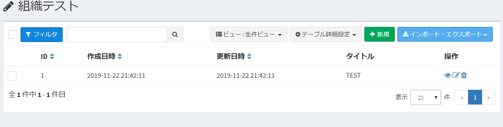
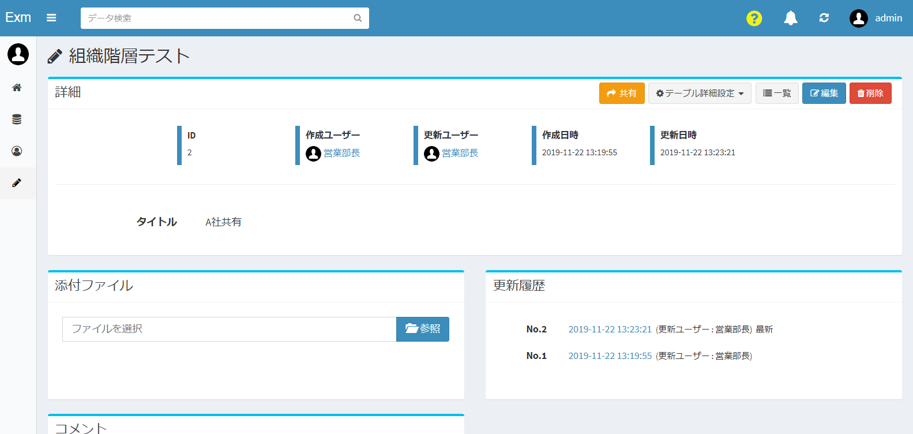

# Organisation
Auf dieser Seite erfahren Sie, wie Sie „Organisationen“ wie Abteilungen und Gruppen eines Unternehmens in Exment registrieren und verwalten.  
Wenn Organisationen registriert sind, können Sie Berechtigungen, Formulare, Workflows und die Datenfreigabe pro Organisation festlegen.

> Bevor Sie Organisationen einrichten, empfehlen wir, die Seite [Überblick über Rollen und Berechtigungen in Exment](/de/permission) zu lesen.

Diese Seite hat folgenden Inhalt.

| Was Sie wissen möchten | Wo es steht |
|---|---|
| Organisationen registrieren, ändern, löschen | Organisationsverwaltung |
| Wo registrierte Organisationen verwendet werden | Wo Organisationen verwendet werden |
| Wie weit über- und untergeordnete Organisationen einbezogen werden | Über die Organisationshierarchie |

## Organisationsverwaltung
So registrieren, bearbeiten und löschen Sie Organisationen.

### Listenseite anzeigen
Klicken Sie im linken Menü auf „Organisation“.  
Oder rufen Sie die folgende URL auf.  
Damit erscheint die Seite der Organisationsverwaltung.  
http(s)://(URL von Exment)/data/organization  
Sie sehen die Liste der Organisationen, die im System registriert sind.
  

> ※ Die URL gilt für die Standardeinstellung ohne „/admin“ (Websites, die ab v7.2.1 neu installiert wurden). Wenn `ADMIN_ROUTE_PREFIX` in der `.env` einen Wert hat (bei Websites aus früheren Versionen „admin“), fügen Sie diesen Wert hinter der URL der Website ein (Beispiel: `http(s)://(URL von Exment)/admin/data/organization`). Einzelheiten finden Sie unter [„admin“ in der URL ändern oder entfernen](/de/additional_prefix).
  
※ Wenn Sie in den [Einstellwerten](/de/config) „EXMENT_SHOW_ORGANIZATION_TREE=true“ setzen, wird die Hierarchie angezeigt.

### Organisation neu hinzufügen
1. Klicken Sie auf der Listenseite „Organisation“ oben rechts auf die Schaltfläche [Neu].
2. Die Seite zum Hinzufügen erscheint. Geben Sie die nötigen Angaben ein.  
※ Wählen Sie im Feld „Übergeordnete Organisation“ die übergeordnete Ebene dieser Organisation.

### Speichern
Wenn die Eingabe fertig ist, klicken Sie auf [Absenden].

### Bearbeiten
Um eine Organisation zu ändern, klicken Sie in ihrer Zeile auf den Link [Bearbeiten].  

### Löschen
Um eine Organisation zu löschen, klicken Sie in ihrer Zeile auf den Link [Löschen].  

## Wo Organisationen verwendet werden
Registrierte Organisationen können Sie an den folgenden Stellen verwenden.

| Wo | Was möglich ist |
|---|---|
| Rollengruppe | Legt fest, ob Benutzer der Organisation auf Seiten zugreifen können |
| Umschalten zwischen mehreren Formularen | Benutzer der Organisation verwenden ein festgelegtes Formular |
| Workflow | Benutzer der Organisation können Aktionen des Workflows ausführen |
| Freigabe benutzerdefinierter Daten | Benutzer der Organisation können freigegebene Daten bearbeiten und ansehen |

#### Rollengruppe 
In einer Rollengruppe können Sie Organisationen eintragen.

- Diese Einstellung steuert, ob Benutzer der Organisation auf Seiten zugreifen können oder nicht.  
Im Bild sehen Sie oben den Fall, dass der Benutzer zugreifen kann, und unten den Fall, dass er nicht zugreifen kann.

#### Umschalten zwischen mehreren Formularen 
In den Bedingungen für das Umschalten zwischen mehreren Formularen können Sie Organisationen eintragen.  
Gehört der Login-Benutzer zu dieser Organisation, wird das Formular verwendet.

#### Workflow 
In der Einstellung der bearbeitenden Benutzer eines Workflows können Sie Organisationen eintragen.  
Gehört der Login-Benutzer zu dieser Organisation, kann er die Aktionen des Workflows ausführen.

#### Freigabe benutzerdefinierter Daten 
Als Ziel der Freigabe benutzerdefinierter Daten können Sie Organisationen eintragen.  
Gehört der Login-Benutzer zu dieser Organisation, erhält er die Berechtigung für die benutzerdefinierten Daten und kann die Daten bearbeiten oder ansehen.

## Über die Organisationshierarchie
In Exment können Organisationen, wie im Bild unten, eine Hierarchie aus über- und untergeordneten Organisationen haben.

### (Für Fortgeschrittene) Arten der Hierarchie
Wenn Organisationen eine Hierarchie haben, wählen Sie aus den folgenden 4 Arten, wie weit „die Benutzer dieser Organisation“ reichen.  
Als Beispiel dient hier die Organisation „**Vertrieb**“.

| Art | Einbezogene Organisationen | Beispiel (ausgehend vom Vertrieb) |
|---|---|---|
| Organisation, zu der der Benutzer gehört | Nur die betreffende Organisation | Vertriebsleiter |
| Übergeordnete Organisationen einbeziehen | Die betreffende Organisation und ihre übergeordneten Organisationen | Vertriebsleiter, Geschäftsführer von Firma A |
| Untergeordnete Organisationen einbeziehen | Die betreffende Organisation und ihre untergeordneten Organisationen | Vertriebsleiter, Benutzer A von Vertrieb 1, Benutzer B von Vertrieb 2 |
| Über- und untergeordnete Organisationen einbeziehen | Die betreffende Organisation und ihre über- und untergeordneten Organisationen | Vertriebsleiter, Geschäftsführer von Firma A, Benutzer A von Vertrieb 1, Benutzer B von Vertrieb 2 |

#### Organisation, zu der der Benutzer gehört

Nur die Benutzer, die zur betreffenden Organisation selbst gehören.  
Im Beispiel gehört nur der „Vertriebsleiter“ zum Vertrieb.

#### Übergeordnete Organisationen einbeziehen

Die betreffende Organisation und ihre übergeordneten Organisationen.  
Im Beispiel sind das der „Vertriebsleiter“ im Vertrieb und der „Geschäftsführer von Firma A“ in der übergeordneten „Firma A“.

#### Untergeordnete Organisationen einbeziehen

Die betreffende Organisation und ihre untergeordneten Organisationen.  
Im Beispiel sind das der „Vertriebsleiter“ im Vertrieb sowie „Benutzer A von Vertrieb 1“ und „Benutzer B von Vertrieb 2“ in den untergeordneten Organisationen „Vertrieb 1“ und „Vertrieb 2“.

#### Über- und untergeordnete Organisationen einbeziehen

Die betreffende Organisation und ihre über- und untergeordneten Organisationen.  
Im Beispiel sind das der „Vertriebsleiter“ im Vertrieb, der „Geschäftsführer von Firma A“ in der übergeordneten „Firma A“ sowie „Benutzer A von Vertrieb 1“ und „Benutzer B von Vertrieb 2“ in den untergeordneten Organisationen „Vertrieb 1“ und „Vertrieb 2“.

<h4 id="kaisou_syurui">(Für Fortgeschrittene) Art der Hierarchie einstellen</h4>

Wie weit die Hierarchie einbezogen wird, stellen Sie unter „Systemeinstellungen“ > „Organisationseinstellungen“ ein.

- Die Hierarchie lässt sich nur für „Rollengruppe“ und „Freigabe benutzerdefinierter Daten“ einstellen.
- Bei „Einstellungen zu Anzeigebedingungen des Formulars“ und „Workflow“ zählt nur die Organisation, zu der der Benutzer gehört.

### Einstellung der Datenfreigabe
Mit der [Einstellung der Datenfreigabe für benutzerdefinierte Daten](/de/data_details) können auch andere Organisationen auf die Daten zugreifen.

#### Geltungsbereich bei der Freigabe benutzerdefinierter Daten
- Wenn Sie Daten für eine Organisation freigeben, können die Benutzer dieser Organisation darauf zugreifen.
- Ob Benutzer der über- und untergeordneten Organisationen zugreifen können, bestimmt oben „Art der Hierarchie einstellen > Einstellung der Organisationshierarchie (Daten)“.
- Organisationen aus einem anderen Zweig können nicht zugreifen.

<h4 id="kyouyu_jidou">(Für Fortgeschrittene) Automatische Freigabe beim Speichern von Daten</h4>

Wenn Sie benutzerdefinierte Daten neu erstellen, erhalten die erstellten Daten automatisch eine Freigabe.

- Im Standard wird nur für den „Login-Benutzer“ freigegeben.
- Wenn Sie die Einstellung ändern, wird auch für die Organisation des Login-Benutzers freigegeben.
- Diese Einstellung nehmen Sie unter „Systemeinstellungen“ > „Organisationseinstellungen“ vor.

Die einzelnen Einstellungen bedeuten Folgendes.

##### (1) Nur Login-Benutzer
Beim Erstellen neuer benutzerdefinierter Daten wird nur für den Login-Benutzer freigegeben.  
- **Beispiel**: Wenn „Benutzer A von Vertrieb 1“ Daten neu erstellt, kann nur der Benutzer „Benutzer A von Vertrieb 1“ darauf zugreifen.  

##### (2) Login-Benutzer und seine Organisation
Beim Erstellen neuer benutzerdefinierter Daten wird für den Login-Benutzer und für **seine Organisation** freigegeben.  
- **Beispiel**: Wenn „Benutzer A von Vertrieb 1“ Daten neu erstellt, wird für den Benutzer „Benutzer A von Vertrieb 1“ und für die Organisation „Vertrieb 1“ freigegeben.  
→ Dadurch kann auch der Benutzer „Benutzer B von Vertrieb 1“, der zur Organisation „Vertrieb 1“ gehört, zugreifen.

