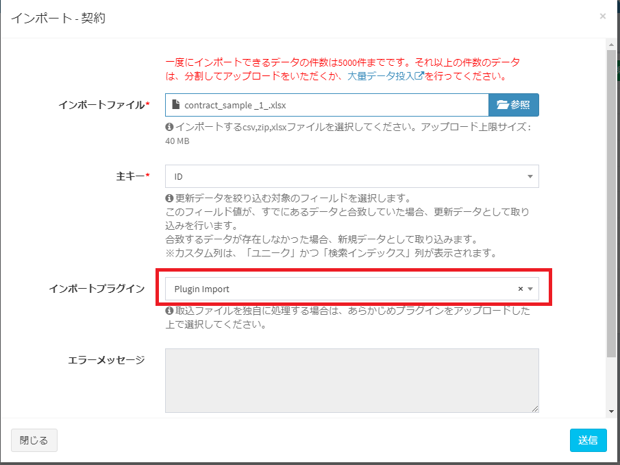
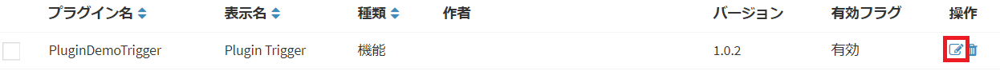
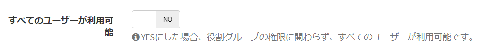

# Plugin
Ein Plugin ist ein Programm, das Exment um Funktionen erweitert.
Diese Seite erklärt die Arten von Plugins sowie das Hochladen, Einstellen, Löschen und die Berechtigungen.

- Wenn Sie gleich wissen möchten, wie man ein Plugin installiert, lesen Sie „[Verwaltung](/de/plugin?id=Verwaltung)“.
- Die offiziellen Plugins von Exceed One stehen unter [Offizielle Plugins](/de/plugin_official).
- Wenn Sie selbst ein Plugin entwickeln möchten, lesen Sie [Plugin-Entwicklung](/de/plugin_quickstart).

## Was ist ein Plugin
Wenn die Standardfunktionen von Exment für Ihre Arbeit nicht reichen, können Sie auf einer Seite ein Programm (ZIP-Datei) hochladen und so Funktionen hinzufügen. Das ist ein „Plugin“.  
Derzeit gibt es die folgenden Arten von Plugins.    

- [Schaltfläche](/de/plugin?id=Schaltfläche)
- [Ereignis](/de/plugin?id=Ereignis)
- [Seite](/de/plugin?id=Seite)
- [Dashboard](/de/plugin?id=Dashboard)
- [Ansicht](/de/plugin?id=Ansicht)
- [CRUD-Seite](/de/plugin?id=CRUD-Seite)
- [Batch](/de/plugin?id=Batch)
- [API](/de/plugin?id=API)
- [Validierung](/de/plugin?id=Validierung)
- [Skript](/de/plugin?id=Skript)
- [Stil](/de/plugin?id=Stil)
- [Import](/de/plugin?id=Import)
- [Export](/de/plugin?id=Export)
- [Dokumentausgabe](/de/plugin?id=Dokumentausgabe)
- [Docurain (PDF-Ausgabe)](/de/plugin?id=docurain)
- [Trigger ※nicht empfohlen](/de/plugin?id=Trigger)

#### Schaltfläche
Fügt der Listenseite oder der Formularseite von Exment eine Schaltfläche hinzu. Beim Klick wird eine Verarbeitung ausgeführt.  
※Die Umsetzung steht [hier](/de/plugin_quickstart_button).  
  
Schaltflächen können an den folgenden vier Stellen erscheinen.    
##### Menüschaltfläche in der Listenansicht
Fügt oben auf der Datenliste eine Schaltfläche hinzu. Beim Klick wird ein Ereignis ausgelöst.

##### Menüschaltfläche in der Datenanzeige
Fügt oben auf der Detailseite der Daten eine Schaltfläche hinzu. Beim Klick wird ein Ereignis ausgelöst.

##### Menüschaltfläche im Formular (Erstellen)
Fügt oben auf der Seite zum Erstellen neuer Daten eine Schaltfläche hinzu. Beim Klick wird ein Ereignis ausgelöst.

##### Menüschaltfläche im Formular (Bearbeiten)
Fügt oben auf der Seite zum Aktualisieren von Daten eine Schaltfläche hinzu. Beim Klick wird ein Ereignis ausgelöst.

   

#### Ereignis
Wird ausgeführt, wenn auf den Seiten von Exment ein bestimmter Vorgang stattfindet. So lassen sich zum Beispiel Werte aktualisieren.  
※Die Umsetzung steht [hier](/de/plugin_quickstart_event).  
  
Die bestimmten Vorgänge sind die folgenden.    

- ##### Vor dem Laden  
Die Verarbeitung startet am Anfang des Ladens der Seite. (Sie läuft nicht vor allen anderen Verarbeitungen.)  

- ##### Vor dem Speichern  
Die Verarbeitung startet direkt vor dem Speichern der Daten.  

- ##### Nach dem Speichern  
Die Verarbeitung startet nach dem Speichern der Daten.  

- ##### Nach dem Löschen  
Die Verarbeitung startet nach dem Löschen der Daten.  

- ##### Vor der Workflow-Aktion  
Die Verarbeitung startet direkt vor der Ausführung des Workflows.  

- ##### Nach der Workflow-Aktion  
Die Verarbeitung startet nach der Ausführung des Workflows.  

- ##### Vor der Benachrichtigung  
Die Verarbeitung startet direkt vor der Ausführung der Benachrichtigung.  

- ##### Nach der Benachrichtigung  
Die Verarbeitung startet nach der Ausführung der Benachrichtigung.  

#### Seite
Erstellt in Exment eine neue Seite.  
Verwenden Sie dies, wenn Sie eine Seite brauchen, die ganz anders ist als die Standardfunktionen.  
※Die Umsetzung steht [hier](/de/plugin_quickstart_page).    

   

#### Dashboard
Erstellt im Dashboard von Exment eine neue Anzeige.  
Verwenden Sie dies, wenn Sie eine eigene Seite als Element des Dashboards einsetzen möchten. 
※Die Umsetzung steht [hier](/de/plugin_quickstart_dashboard).

   

#### Ansicht
Erstellt für die Liste benutzerdefinierter Daten in Exment ein neues Design oder eigene Funktionen.  
Verwenden Sie dies, wenn Sie etwas ganz anderes brauchen als die Standardansichten (Liste, Auswertung, Kalender).  
※Die Umsetzung steht [hier](/de/plugin_quickstart_view).  

   

#### CRUD-Seite
Erstellt eine neue Seite mit fast demselben Aufbau wie Liste, Details, Erstellen, Aktualisieren und Löschen in Exment.  
So verwalten Sie externe Daten auf den Seiten von Exment, ohne sie in Exment zu übernehmen. Auch mehrere Endpunkte sind möglich.    
※Die Umsetzung steht [hier](/de/plugin_quickstart_crud).  

   

#### Batch
Für Verarbeitungen, die regelmäßig automatisch laufen sollen.  
Auch geeignet, um eine bestimmte Verarbeitung auf einmal auszuführen, zum Beispiel einen Status für viele Daten zu ändern.    
※Die Umsetzung steht [hier](/de/plugin_quickstart_batch).

#### API
Erstellt in Exment eine neue API.  
Verwenden Sie dies, wenn Sie eine Funktion hinzufügen möchten, die es in der [API-Referenz](https://exment.net/reference/ja/webapi.html) (Japanisch) nicht gibt.  
※Die Umsetzung steht [hier](/de/plugin_quickstart_api).

#### Skript
Führt ein eigenes Skript (JavaScript) aus.  
Derzeit ist das beim Anzeigen der Datenliste, der Detailseite, der Seite zum Erstellen und der Seite zum Aktualisieren möglich.  
※Die Umsetzung steht [hier](/de/plugin_quickstart_script).

   

#### Stil
Legt einen eigenen Stil (Stylesheet, CSS) fest und ändert so das Design.  
※Die Umsetzung steht [hier](/de/plugin_quickstart_style).

   

#### Validierung
Für eine eigene Validierung (Prüfung der eingegebenen Werte) einer benutzerdefinierten Tabelle.  
Verwenden Sie dies für komplizierte Prüfungen oder für Prüfungen, die mehrere Felder miteinander vergleichen.    
※Die Umsetzung steht [hier](/de/plugin_quickstart_validate).

   

#### Import
Für einen eigenen Import benutzerdefinierter Daten.  
Verwenden Sie dies, wenn Sie Dateien in einem eigenen Format einlesen oder besondere Umwandlungen umsetzen möchten.  
※Die Umsetzung steht [hier](/de/plugin_quickstart_import).

   

#### Export
Für einen eigenen Export der Liste benutzerdefinierter Daten.  
Verwenden Sie dies, wenn Sie Dateien in einem eigenen Format exportieren oder besondere Umwandlungen umsetzen möchten.  
Neben Excel sind auch andere Ausgabeformate möglich.  
※Die Umsetzung steht [hier](/de/plugin_quickstart_export).

   

#### Dokumentausgabe
Erstellt eigene Dokumente wie Angebote oder Formulare.  
Die Vorlage ist eine Excel-Datei, und auch die Ausgabe ist eine Excel-Datei.    
※Die Umsetzung steht [hier](/de/plugin_quickstart_document).
※Für die Ausgabe als PDF kommt das [Docurain-Plugin](/de/plugin_quickstart_docurain) in Frage.  

   

<h4 id="docurain"><a href="#/de/plugin?id=docurain" data-id="Docurain (PDF-Ausgabe)" class="anchor">Docurain (PDF-Ausgabe)</a></h4>

Gibt PDF-Dateien mit **Docurain** aus. Docurain ist eine Cloud-Engine für Formulare, mit der man Formulare nur mit Excel und JSON entwickelt.  
Die Vorlage ist eine Excel-Datei, die Ausgabe ist eine PDF-Datei.    
※Die Umsetzung steht [hier](/de/plugin_quickstart_docurain).

#### Trigger
※Seit v3.2.0 nicht mehr empfohlen.  
Setzen Sie künftig „Schaltfläche“ oder „Ereignis“ ein.

## Offizielle Plugins
Das sind die offiziellen Plugins, die Exceed One entwickelt und unterstützt. Sie können sie auf GitHub unter [exceedone/exment-plugins](https://github.com/exceedone/exment-plugins) herunterladen.  
Die Installation steht unter [Offizielle Plugins](/de/plugin_official).

| Plugin | Was es kann |
| --- | --- |
| [Projektverwaltung](/de/plugin_pm) | Verwaltung von Projekten und Aufgaben (Tickets). Baumanzeige der Aufgaben, Meilensteine, Board, Gantt-Diagramm, Wiki, Kommentare, Benachrichtigungen usw. |
| [Support-Desk](/de/plugin_support_desk) | Helpdesk. Anfragen per E-Mail, Anfrageformular und Telefon werden als Tickets verwaltet. Der Kunde sieht den Fortschritt ohne Anmeldung |
| [Groupware](/de/plugin_groupware) | Webmail sowie Office-Dateien der Dateifreigabe im Browser öffnen und bearbeiten |

## Verwaltung
### Seite anzeigen
- Wählen Sie im linken Menü „Plugin“.  
Oder rufen Sie die folgende URL auf.  
http(s)://(URL von Exment)/plugin  
Die Plugin-Seite wird angezeigt.    
  

> ※Die URL gilt für die Standardeinstellung ohne „/admin“ (Websites, die ab v7.2.1 neu installiert wurden). Wenn `ADMIN_ROUTE_PREFIX` in der `.env` einen Wert hat (bei Websites aus älteren Versionen ist es „admin“), hängen Sie diesen Wert an die URL der Website an (Beispiel: `http(s)://(URL von Exment)/admin/plugin`). Einzelheiten stehen unter [„admin“ in der URL ändern oder entfernen](/de/additional_prefix).

### Plugin hochladen
1. Klicken Sie auf [Datei auswählen] und wählen Sie die ZIP-Datei des Plugins.
2. Klicken Sie auf [Hochladen].
3. Wenn der Vorgang fertig ist, erscheinen die Angaben zum Plugin in der Liste unten auf der Seite.

    

### Plugin-Verwaltung
Hier ändern Sie, ob das Plugin aktiv ist, sowie Angaben wie die Auslöser des Plugins oder die URI der Seite.  
Klicken Sie in der Liste in der Zeile des Plugins, das Sie ändern möchten, auf den Link [Bearbeiten].  
  

Die Seite der Plugin-Verwaltung wird angezeigt.    
  

### Felder der Verwaltung

##### Aktiv
Schaltet um, ob das Plugin im System verwendet wird.  
Bei YES ist es aktiv. Bei NO ist es inaktiv und wird im System nicht ausgeführt.    
※Beim Hochladen eines Plugins steht der Wert standardmäßig auf YES. Beim Plugin-Typ „Batch“ steht er beim Hochladen aber standardmäßig auf NO.

##### Zieltabelle
Legt die benutzerdefinierte Tabelle fest, für die das Plugin ausgeführt wird.  
Das Plugin wird ausgeführt, wenn eine Seite der eingestellten Tabelle angezeigt wird.  

##### Auslöser
Legt fest, bei welchem Vorgang das Plugin ausgeführt wird.
Das Plugin wird ausgeführt, wenn der eingestellte Vorgang stattfindet.    

##### Beschriftung der Schaltfläche
Legt die Beschriftung fest, die auf der Schaltfläche steht, wenn eine „Menüschaltfläche in der Listenansicht“ oder eine „Menüschaltfläche im Formular“ angezeigt wird.

##### Symbol der Schaltfläche
Legt das Symbol fest, das auf der Schaltfläche steht, wenn eine „Menüschaltfläche in der Listenansicht“ oder eine „Menüschaltfläche im Formular“ angezeigt wird.

##### HTML-Klasse der Schaltfläche
Legt die class fest, die dem HTML der Schaltfläche hinzugefügt wird, wenn eine „Menüschaltfläche in der Listenansicht“ oder eine „Menüschaltfläche im Formular“ angezeigt wird.

## Plugin löschen
Um ein Plugin zu löschen, klicken Sie auf der Listenseite in der Zeile dieses Plugins auf den Link [Löschen].  
  
※Mit [Löschen] werden die Dateien des Plugins selbst gelöscht.  
Wenn Sie das Plugin nur vorübergehend anhalten möchten, löschen Sie es nicht, sondern stellen Sie „Aktiv“ auf NO.    

## Verwaltung der Rollenberechtigungen

Mit Berechtigungen können Sie trennen, welche Benutzer und Organisationen die Einstellungen eines Plugins ändern dürfen und welche das Plugin nutzen dürfen.  
Möglich sind zum Beispiel die folgenden Einstellungen.

- Nur eine bestimmte Abteilung oder nur Vorgesetzte können die Seite eines Plugins öffnen
- Nur eine bestimmte Abteilung oder nur Vorgesetzte können Dokumente ausgeben

### Vorgehen

#### Verwaltung über Rollengruppen
- Öffnen Sie die Seite [Rollengruppen-Einstellungen](/de/role_group).  
- Stellen Sie im Bereich „Plugin-Berechtigungen“ die Berechtigungen für das gewünschte Plugin ein.  

  

##### Liste der Berechtigungen
- **Einstellungen ändern** : Bei Plugins mit Einstellungen können die Einstellungen dieses Plugins geändert werden.  
※Löschen und Hochladen von Plugins sind damit nicht möglich. Zum Löschen fügen Sie „Alle Plugins verwalten“ hinzu.
- **Nutzung/Zugriff** : Das Plugin kann tatsächlich genutzt und seine Seiten können geöffnet werden. Was gesteuert wird, hängt von der Art des Plugins ab.    
    - **Schaltfläche, Dokumentausgabe** : Steuert, ob die Schaltfläche auf der Seite angezeigt wird.
    - **Seite, Dashboard** : Schaltet um, ob die Seite geöffnet werden kann.
    - **API** : Schaltet um, ob die API ausgeführt werden kann. (Ohne Zugriff tritt der Fehler 403 auf.)
    - **Import, Export** : Steuert, ob Daten importiert und exportiert werden können.
    - **Alle anderen** : Eine Steuerung über Rollengruppen ist nicht möglich. Das Plugin wird für alle Benutzer ausgeführt.
    
#### Verwaltung je Plugin
So lassen Sie ein Plugin ohne Rollengruppen von allen Benutzern verwenden.

- Öffnen Sie die Bearbeitungsseite des Plugins.

- Stellen Sie „Für alle Benutzer verfügbar“ auf YES und speichern Sie.    
(Das Feld erscheint nur bei den Plugin-Arten Schaltfläche, Dokumentausgabe, Seite, Dashboard, API, Import und Export.)

  

- Unabhängig von den Rollengruppen-Einstellungen können dann alle Benutzer das Plugin nutzen und darauf zugreifen.  

> Wegen der Abwärtskompatibilität steht „Für alle Benutzer verfügbar“ bei Plugins, die vor v3.2.0 hochgeladen wurden, auf YES.  
Bei Plugins, die ab v3.2.0 hochgeladen wurden, ist der Standardwert NO.

## Sonstiges
Wie Sie Plugins entwickeln, steht unter [Plugin-Entwicklung](/de/plugin_quickstart).
