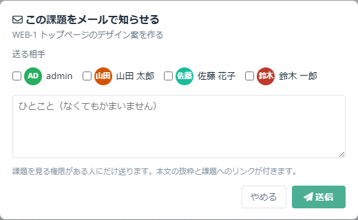

# Projektverwaltung (offizielles Plugin)

Die „Projektverwaltung“ („プロジェクト管理“) ist ein **offizielles Plugin** für Exment. Exceed One entwickelt, testet und unterstützt es.  
Damit verwalten Sie Projekte und Tickets (Aufgaben) auf den Tabellen von Exment. Das Plugin ist kostenlos.

- Quellcode und Beschreibung: [exceedone/exment-plugins (project-management)](https://github.com/exceedone/exment-plugins/tree/main/project-management)
- Lizenz: GPL-3.0 (wie Exment)
- Produktseite: [Projektverwaltung (exment.net)](https://exment.net/en/project-management/) (Englisch)
- Name in der Plugin-Liste: Exment Plugin PM（プロジェクト管理）. Die ZIP-Datei und der interne Name heißen `ExmentPM` (bis 1.2.0 `PmPortal`, in 1.3.0 `ExmentPluginPM`).


## Was es kann

| Funktion | Inhalt |
| --- | --- |
| Projekte | Jedes Projekt fasst Aufgaben, Board, Gantt-Diagramm, Wiki und Dateien zusammen. Es gibt drei Arten von Mitgliedern: Administratoren, Mitglieder und Betrachter (auf Basis der Rollengruppen von Exment). |
| Aufgaben | Liste (Filter und Schnellfilter), Baumanzeige von über- und untergeordneten Aufgaben, direktes Bearbeiten in der Liste, Massenaktualisierung, Anhänge. Der Text wird in Markdown geschrieben, und Bilder lassen sich einfügen. Nach dem Speichern werden Liste und Details an Ort und Stelle neu gezeichnet, ohne die ganze Seite neu zu laden (ab 1.6.5). |
| Rollen an einer Aufgabe | Neben dem Zuständigen gibt es stellvertretende Zuständige, Verwalter und Reviewer sowie einen Schwierigkeitsgrad (leicht, normal, schwer). In den Details der Aufgabe steht auch, wer sie angelegt hat. Stellvertretende Zuständige, Verwalter und Reviewer erhalten wie der Zuständige die Hinweise auf Änderungen (ab 1.6.0). |
| Meilensteine | Verwaltung der Aufgaben je Meilenstein und ein Burndown-Diagramm. |
| Board und Gantt-Diagramm | Zeigt die Aufgaben auf einem Board nach Status oder in einem Gantt-Diagramm. |
| Wiki und Dateien | Die Unterlagen des Projekts werden über Wiki und Dateien geteilt. |
| Word, Excel und PowerPoint | Mit „表示“ (Anzeigen) bei Dateien von Aufgaben, Kommentaren, Wiki und Projekt öffnen Sie die Datei auf der Seite, ohne sie herunterzuladen. Wer bearbeiten darf, kann sie dort auch bearbeiten und speichern (ab 1.7.0 und 1.7.1. Nötig sind [Groupware](https://github.com/exceedone/exment-plugins/tree/main/groupware) ab 0.4.0 und ein Browser mit WebGPU). Ohne Groupware werden die Dateien wie bisher heruntergeladen. |
| Kommentare | Zu einer Aufgabe lassen sich Kommentare schreiben. Sie können Benutzer nennen, die einen Hinweis bekommen sollen (Erwähnung), oder um eine Prüfung (Review) bitten. |
| Gelesen und ungelesen | Sie sehen, wer eine Aufgabe gelesen hat. Aufgaben, die Sie noch nicht angesehen haben, sind in der Liste farbig markiert. |
| Benachrichtigungen | Hinweise über die Glocke auf der Seite und E-Mails beim Anlegen einer Aufgabe, bei einem Kommentar und über die Schaltfläche „メールで知らせる“ (per E-Mail benachrichtigen). Die E-Mails werden mit den E-Mail-Einstellungen von Exment gesendet. |
| Einstellungen | Unter ⚙ „設定“ (Einstellungen) stehen die Einstellungen des Portals und die Aktualisierung der Datenstruktur. Systemadministratoren können die „データ移行“ (Datenmigration) nutzen: Projekte werden mit Kommentaren, Änderungsverlauf und Anhängen in eine ZIP-Datei exportiert und in ein anderes Exment importiert (zuerst nur prüfen, dann schreiben). Importierte Aufgaben zeigen auch Aufgabenschlüssel, URL und Ersteller der Quelle sowie die benutzerdefinierten Attribute (ab 1.5.0). |

## Voraussetzungen
- Exment 7.0 oder neuer (PHP 8.2 oder neuer)
- Für die Benachrichtigung per E-Mail müssen die Einstellungen für den E-Mail-Versand von Exment eingerichtet sein ([Einstellungen für den E-Mail-Versand](/de/mailsend_setting)). Für die Hinweise über die Glocke ist keine Einstellung nötig.
- Die Seiten gibt es nur auf Japanisch.

## Installation
※Ab Exment v7.2.1 wird die Projektverwaltung mit Exment ausgeliefert. Herunterladen und Hochladen sind nicht nötig. Klicken Sie unter „Administratoreinstellungen“ → „Funktionsverwaltung“ bei „Kostenlose offizielle Plugins“ auf „Verwenden (installieren)“. Machen Sie dann mit „[3. Ersteinrichtung](/de/plugin_pm?id=3.-Ersteinrichtung)“ weiter. Direkt nach der Installation über die Funktionsverwaltung steht „プロジェクト管理“ (Projektverwaltung) noch nicht im linken Menü (der Punkt erscheint nach der Ersteinrichtung). Einzelheiten stehen unter [Offizielle Plugins](/de/plugin_official).


### 1. Herunterladen
Laden Sie die neueste ZIP-Datei von den [Releases](https://github.com/exceedone/exment-plugins/releases) auf GitHub herunter. Entpacken Sie sie nicht.

- Die neueste Version ist `ExmentPM-(Version).zip` unter „ExmentPM-v(Version)“ in den [Releases](https://github.com/exceedone/exment-plugins/releases).

※Verwenden Sie nicht die grüne Schaltfläche „Code → Download ZIP“. Das ist die ZIP-Datei des ganzen Repositorys, und Exment kann sie nicht einlesen.

※Bei Exment SaaS (`*.exments.com`) müssen Sie nichts herunterladen. Lesen Sie [Bei Exment SaaS](/de/plugin_pm?id=Bei-Exment-SaaS).

### 2. Hochladen
- Melden Sie sich als Systemadministrator bei Exment an.
- Öffnen Sie „Administratoreinstellungen“ → „Plugin“, wählen Sie unter „Plugin hochladen“ die heruntergeladene ZIP-Datei und klicken Sie auf „Hochladen“. Einzelheiten stehen unter [Plugin](/de/plugin).


- Wenn „ExmentPM“ in der Liste unten erscheint, ist das Hochladen fertig. Zu diesem Zeitpunkt gibt es noch keine Tabellen und kein Menü.

### 3. Ersteinrichtung
- Öffnen Sie als Systemadministrator `/plugins/exment_pm` (bei Websites mit „/admin“ in der URL: `/admin/plugins/exment_pm`).
- Die Seite „初期セットアップ“ (Ersteinrichtung) erscheint. Prüfen Sie die Liste der Tabellen, die angelegt werden, und klicken Sie auf „テーブルを作成する“ (Tabellen anlegen).


- Wenn es schon eine Tabelle mit demselben Namen gibt, wird sie rot angezeigt. Mit „テーブル名の接頭辞“ (Präfix für Tabellennamen, Beispiel: `pm2_`) legen Sie die Tabellen unter anderen Namen an. Die Namen auf den Seiten ändern sich nicht.
- Am Ende öffnet sich das Dashboard der Projektverwaltung. Im linken Menü kommt ein Punkt „プロジェクト管理“ dazu (ab 1.4.1). Normalerweise öffnen Sie das Plugin von dort.
- Die Ersteinrichtung legt auch Folgendes an.
    - Rollengruppen: プロジェクト管理者グループ (Projektadministratoren), プロジェクトメンバーグループ (Projektmitglieder), プロジェクト閲覧者グループ (Projektbetrachter)
    - Benachrichtigung: 課題の登録・更新通知 (Aufgabe angelegt oder aktualisiert, Glocke)
    - Prioritäten (至急 dringend, 高 hoch, 中 mittel, 低 niedrig) und Abschlussgründe (対応済み erledigt, 対応しない wird nicht bearbeitet, 無効 ungültig, 重複 doppelt, 再現しない nicht reproduzierbar, 保留 zurückgestellt)

※Die Ersteinrichtung kann nur ein Systemadministrator ausführen.  
※Beispielprojekte und Beispielaufgaben werden nicht angelegt.

## Erste Einstellungen

Beim ersten Mal richten Sie das Plugin in dieser Reihenfolge ein.

1. Die Benutzer in Rollengruppen aufnehmen
2. Ein Projekt anlegen
3. Mitglieder in das Projekt aufnehmen
4. Status, Typen usw. an das Projekt anpassen (sie lassen sich auch unverändert verwenden)
5. Die Benachrichtigungen prüfen

### 1. Die Benutzer in Rollengruppen aufnehmen
Wer die Projektverwaltung nutzt, muss in einer der Rollengruppen sein. Wer in keiner ist, sieht „プロジェクト管理“ nicht im Menü, und beim Öffnen erscheint „権限がありません。“ (Keine Berechtigung). Systemadministratoren können das Plugin auch ohne Rollengruppe nutzen.

Nehmen Sie unter „Administratoreinstellungen“ → „Rollengruppe“ Benutzer oder Organisationen in die folgenden Gruppen auf, die die Ersteinrichtung angelegt hat. Einzelheiten stehen unter [Rollengruppe](/de/role_group).

| Rollengruppe | Name (alphanumerisch) | Was sie erlaubt |
| --- | --- | --- |
| プロジェクト管理者グループ (Projektadministratoren) | `pm_admin_group` | Alle Projekte und Aufgaben ansehen und ändern. Auch die Listen der Status, Typen, Prioritäten usw. lassen sich ändern. |
| プロジェクトメンバーグループ (Projektmitglieder) | `pm_member_group` | In den Projekten, an denen sie teilnehmen, Aufgaben hinzufügen und bearbeiten. |
| プロジェクト閲覧者グループ (Projektbetrachter) | `pm_viewer_group` | Die Projekte, an denen sie teilnehmen, nur ansehen. |


※Die Aufnahme in eine Rollengruppe allein macht noch kein Projekt sichtbar. Führen Sie auch „3. Mitglieder in das Projekt aufnehmen“ aus.

### 2. Ein Projekt anlegen
- Klicken Sie im Dashboard der Projektverwaltung auf „＋プロジェクトの追加“ (Projekt hinzufügen). Der Punkt steht auch im Menü „プロジェクト“ (Projekte) oben auf der Seite.
- Geben Sie „プロジェクト名“ (Projektname) und „プロジェクトキー“ (Projektschlüssel) ein und klicken Sie auf „作成する“ (Anlegen).
    - Der Projektschlüssel steht vor den Nummern der Aufgaben (Beispiel: `WEB` ergibt `WEB-1`). Er beginnt mit einem Großbuchstaben, besteht nur aus Großbuchstaben, Ziffern und `_` und hat höchstens 32 Zeichen.
    - Mit „親プロジェクト“ (übergeordnetes Projekt) ordnen Sie Projekte in einer Hierarchie an.


- Nach dem Anlegen öffnet sich der Tab „設定“ (Einstellungen) des Projekts. Wer das Projekt angelegt hat, wird Projektmanager (Verantwortlicher).

※Ein Projekt kann anlegen, wer der Tabelle der Projekte Daten hinzufügen darf (Systemadministratoren, die Gruppe der Projektadministratoren usw.).

### 3. Mitglieder in das Projekt aufnehmen
Legen Sie im Tab „設定“ (Einstellungen) des Projekts → „参加ユーザー“ (Teilnehmer) fest, wer teilnimmt, und klicken Sie auf „保存する“ (Speichern).

| Feld | Inhalt |
| --- | --- |
| プロジェクトマネージャ (Projektmanager) | Der Verantwortliche des Projekts. Kann Aufgaben hinzufügen und bearbeiten und die Einstellungen des Projekts ändern. |
| メンバー（編集） (Mitglieder, Bearbeiten) | Können Aufgaben hinzufügen und bearbeiten. |
| 参照メンバー（閲覧） (Betrachter, nur Ansehen) | Können nur ansehen. |
| メンバー組織（編集）・参照組織（閲覧） (Mitglieds- und Betrachterorganisationen) | Wenn Sie eine Organisation (ein Team) eintragen, nehmen alle Personen dieser Organisation mit denselben Rechten teil. |


- Wer aus der Liste entfernt wird, kann das Projekt (mit Aufgaben und Wiki) ab dem Speichern nicht mehr öffnen.
- Systemadministratoren und die Gruppe der Projektadministratoren können alle Projekte öffnen, auch wenn sie nicht in dieser Liste stehen.
- Die Einstellungen des Projekts können der Projektmanager und die Gruppe der Projektadministratoren ändern (und Systemadministratoren).

### 4. Listen für Status, Typen usw. (Stammdaten)
Die Listen der Felder, die in Aufgaben gewählt werden, lassen sich unverändert verwenden. Sie können Namen, Farben und Reihenfolge an das Projekt anpassen.

| Liste | Gilt für | Wo man sie ändert | Anfangswerte |
| --- | --- | --- | --- |
| 状態 (Status) | je Projekt | „設定“ → „状態“ des Projekts | 未対応 offen, 処理中 in Bearbeitung, レビュー中 im Review, 処理済み bearbeitet, 完了 abgeschlossen |
| 種別 (Typ) | je Projekt | „設定“ → „種別“ des Projekts | タスク Aufgabe, バグ Fehler, 要望 Wunsch, 改善 Verbesserung, その他 Sonstiges |
| カテゴリー (Kategorie) | je Projekt | „設定“ → „カテゴリー“ des Projekts | (keine) |
| マイルストーン (Meilenstein) | je Projekt | „設定“ → „マイルストーン“ des Projekts | (keine) |
| 優先度 (Priorität) | für alle Projekte gemeinsam | ⚙ プロジェクト管理の設定 → „課題の選択肢“ (Auswahlwerte der Aufgaben) | 至急, 高, 中, 低 |
| 完了理由 (Abschlussgrund) | für alle Projekte gemeinsam | ⚙ プロジェクト管理の設定 → „課題の選択肢“ | 対応済み, 対応しない, 無効, 重複, 再現しない, 保留 |

- Wenn bei einem Status „完了扱い“ (gilt als abgeschlossen) angekreuzt ist, zählen Aufgaben mit diesem Status im Burndown und bei der Prüfung auf Fristüberschreitung als „abgeschlossen“.
- Zeilen, die verwendet werden, lassen sich nicht löschen.


**⚙ プロジェクト管理の設定** (Einstellungen der Projektverwaltung) öffnen Sie über „⚙ 設定“ oben rechts auf den Seiten der Projektverwaltung. Dort stehen die Einstellungen, die für alle Projekte gemeinsam gelten. Nur Systemadministratoren können die Seite öffnen (andere sehen „⚙ 設定“ nicht).


### 5. Benachrichtigungen
Es gibt zwei Arten von Benachrichtigungen: die Glocke oben rechts auf der Seite und E-Mails.

**Glocke (kommt an, ohne dass Sie etwas tun)**
- Wenn eine Aufgabe angelegt oder aktualisiert wird oder einen Kommentar erhält, geht ein Hinweis an den Zuständigen, an die Personen unter „お知らせ先“ (Hinweis an) und an die Person, die die Aufgabe angelegt hat. Wer die Änderung selbst gemacht hat, erhält keinen Hinweis.
- Einen Hinweis erhalten auch die Personen, die beim Schreiben eines Kommentars unter „お知らせしたい人“ (zu benachrichtigende Personen) gewählt wurden, und alle, die die Aufgabe beobachten („ウォッチ“).
- Wenn Sie in einem Kommentar `@` und den Namen eines Mitglieds schreiben, erhält diese Person einen Hinweis (Erwähnung).
- Wenn Sie „確認を依頼する“ (um Prüfung bitten) ankreuzen, erhalten die gewählten Personen den Hinweis „【確認依頼】“ (Bitte um Prüfung). Wenn die Person auf „確認しました“ (geprüft) klickt, erhält der Verfasser des Kommentars einen Hinweis.
- Wer die Aufgabe nicht sehen darf, erhält nichts.


**E-Mail (wählen Sie beim Senden)**  
E-Mails werden nicht automatisch gesendet. Sie senden sie auf einem der folgenden Wege.
- Kreuzen Sie beim Anlegen einer Aufgabe oder eines Kommentars „メールでも知らせる“ (auch per E-Mail benachrichtigen) an. Wer den Hinweis der Glocke erhält, bekommt denselben Inhalt auch per E-Mail.
- Wählen Sie auf der Seite der Aufgabe unter „…その他“ (Mehr) → „メールで知らせる“ (per E-Mail benachrichtigen) die Empfänger und klicken Sie auf „送信“ (Senden). Gesendet wird nur an Personen, die die Aufgabe sehen dürfen. Die E-Mail enthält einen Auszug des Textes und einen Link zur Aufgabe.



- E-Mails werden mit den Einstellungen für den E-Mail-Versand von Exment gesendet. Richten Sie zuerst die [Einstellungen für den E-Mail-Versand](/de/mailsend_setting) ein.
- An Benutzer ohne E-Mail-Adresse wird nicht gesendet.
- Die Glocken-Benachrichtigung „課題の登録・更新通知“ sehen Sie auf der Seite der [Benachrichtigungseinstellungen](/de/notify) von Exment.

### 6. Anbindung von KI und Git (nur wenn Sie sie nutzen)
Beide sind am Anfang ausgeschaltet. Die Projektverwaltung lässt sich auch ohne sie ganz normal verwenden.

**Automatisches Ausfüllen mit KI**  
Auf der Seite der Aufgabe erscheint die Schaltfläche „AI で自動入力“ (mit KI automatisch ausfüllen). Ein Klick füllt die leeren Felder „種別“ (Typ), „カテゴリー“ (Kategorie) und „優先度“ (Priorität) mit KI aus. Vor dem Speichern kann ein Mensch die Werte prüfen und ändern.
- Als KI wird TypeSafe verwendet (ein externer Dienst). Betreff und Einzelheiten der Aufgabe werden an die Server von TypeSafe gesendet. E-Mail-Adressen und Telefonnummern werden vor dem Senden verdeckt.
- Ein Systemadministrator trägt den API-Schlüssel unter „Administratoreinstellungen“ → „Plugin“ → Einstellungsseite von „Exment Plugin PM“ im Bereich „AI 自動入力（TypeSafe）“ (automatisches Ausfüllen mit KI) ein (wenn es die Umgebungsvariable `TYPESAFE_KEY` des Servers gibt, wird diese verwendet).
- Kreuzen Sie in „設定“ → „AI 自動入力“ des Projekts „AI 自動入力を使う“ (automatisches Ausfüllen mit KI verwenden) an und speichern Sie. Mit „接続テスト“ (Verbindungstest) prüfen Sie, ob die Verbindung funktioniert.
- Wenn „担当者も自動入力する“ (auch den Zuständigen automatisch ausfüllen) eingeschaltet ist, wird auch ein leerer Zuständiger eingetragen. Den Zuständigen wählt nicht die KI, sondern eine Regel (der Standardzuständige der Kategorie, sonst das Mitglied mit den wenigsten offenen Aufgaben).


**Git-Repository**  
Für jedes Projekt können Sie ein Git-Repository (Gitea oder Forgejo) anlegen lassen und nutzen.
- Der Administrator des Servers stellt die Verbindung zum Git-Server in den Umgebungsvariablen des Servers ein (`PMPORTAL_GIT_PROVIDER`, `PMPORTAL_GIT_API_URL`, `PMPORTAL_GIT_API_TOKEN` usw.). Auf den Seiten lässt sich das nicht einstellen.
- Klicken Sie in „設定“ → „Git リポジトリ“ (Git-Repository) des Projekts auf „Git を有効にする“ (Git einschalten). Der Projektmanager gibt „リポジトリ名“ (Repository-Name) ein und klickt auf „リポジトリの作成をリクエスト“ (Anlegen des Repositorys anfordern). Wenn kein Git-Server eingestellt ist, bleibt die Anforderung bei „作成待ち“ (wartet auf Anlegen).
- Wenn das Repository angelegt ist, klickt jede Person selbst auf „HTTP クローン用パスワードを発行“ (Passwort für HTTP-Clone ausstellen) und erhält ein Passwort. Das Passwort wird nur einmal angezeigt.


## Aktualisierung
- Laden Sie die ZIP-Datei der neuen Version herunter und laden Sie sie wie bei der Installation hoch. Das Plugin wird ersetzt, die Daten bleiben erhalten.
- Öffnen Sie als Systemadministrator „⚙ 設定“ in der Projektverwaltung und sehen Sie unter „データ構造の更新“ (Aktualisierung der Datenstruktur) nach. Wenn eine Aktualisierung nötig ist, sehen nur Administratoren oben auf der Seite „データ構造の更新があります“ (ab 1.6.4). Ein Klick darauf öffnet die Einstellungsseite.
    - Bei „すでに最新の構造です。“ (Die Struktur ist bereits aktuell.) müssen Sie nichts tun.
    - Bei „データ構造の更新が必要です。“ (Eine Aktualisierung der Datenstruktur ist nötig.) sichern Sie die Datenbank und klicken dann auf „更新を実行する“ (Aktualisierung ausführen). Diese Aktualisierung lässt sich nicht rückgängig machen.


※Bei Exment SaaS lesen Sie auch [Bei Exment SaaS](/de/plugin_pm?id=Bei-Exment-SaaS).

### Wechsel auf 1.4.0 (wenn PmPortal oder ExmentPluginPM installiert ist)
Mit 1.4.0 wurde der interne Name zu `ExmentPM` und die Adresse zu `/plugins/exment_pm`. In einem Exment, in dem schon PmPortal (bis 1.2.0) oder ExmentPluginPM (1.3.0) installiert ist, bricht das Hochladen der ZIP-Datei mit „Die UUID existiert, aber der Plugin-Name ist falsch“ ab. Führen Sie einmal die Schritte unter [„Moving to ExmentPM“ in der README](https://github.com/exceedone/exment-plugins/blob/main/project-management/README.md#moving-to-exmentpm-from-pmportal-or-exmentpluginpm--exmentpm-への移行) aus. Links und Lesezeichen zur alten Adresse (`/plugins/pm_portal/...`) lassen sich danach nicht mehr öffnen.

※Bei Exment SaaS erledigt das der Betreiber für alle. Die Nutzer müssen nichts tun.

※Seit v1.2.0 ist die Datenmigration Teil dieses Plugins. Wenn Sie mit einer älteren Version das Plugin für die Datenmigration getrennt installiert hatten, können Sie es nach der Aktualisierung unter „Administratoreinstellungen“ → „Plugin“ löschen.

## Umzug aus einem anderen Exment
Sie können Projekte mit Aufgaben, Wiki, Kommentaren, Änderungsverlauf und Anhängen in ein anderes Exment übertragen.  
Dazu nutzen Sie „データ移行“ (Datenmigration) unter „⚙ プロジェクト管理の設定“ sowohl in der Quelle als auch im Ziel. **Nur Systemadministratoren** können sie nutzen.


### Bevor Sie anfangen
- Installieren Sie dieses Plugin in der Quelle und im Ziel und schließen Sie die Ersteinrichtung ab. Verwenden Sie möglichst dieselbe Version.
- Im Ziel müssen die Tabellen für Projekte, Aufgaben, Wiki, Meilensteine, Kategorien usw. **leer** sein (weil die Nummern unverändert übernommen werden). Gedacht ist dies für den Umzug in ein neu vorbereitetes Exment.
- Legen Sie die Benutzer im Ziel vorher an.
- Als Datenbank werden nur MySQL und MariaDB unterstützt.
- Sichern Sie die Datenbank des Ziels.

### 1. Exportieren (in der Quelle ausführen)
- Kreuzen Sie die Projekte an, die Sie übertragen möchten. Bei über- und untergeordneten Projekten wählen Sie auch das übergeordnete Projekt.
- Ein Klick auf „ZIP を書き出す“ (ZIP exportieren) lädt `pm-migrate-Datum-Uhrzeit.zip` herunter.
- Git-Passwörter und die Aufzeichnungen der KI werden nicht exportiert.

### 2. Importieren (im Ziel ausführen)
1. Wählen Sie unter „移行ファイル(ZIP)“ (Migrationsdatei) die exportierte ZIP-Datei.
2. Schreiben Sie in „ユーザー対応表“ (Benutzerzuordnung), welcher Benutzer des Ziels jedem Benutzer der Quelle entspricht. Schreiben Sie eine Person pro Zeile in der Form `alter Benutzercode=neuer Benutzercode`. Eine Zeile `*=Benutzercode` gilt für alle, die nicht aufgeführt sind.
    ```
    yamada=t.yamada
    sato=h.sato
    *=admin
    ```
    Zuständige, Mitglieder, Verfasser von Kommentaren, Ausführende im Änderungsverlauf usw. werden damit ersetzt. Ein Benutzercode, den es im Ziel nicht gibt, führt zu einem Fehler.
3. Wählen Sie unter „マスター（ステータス・課題種別・優先度・完了理由）“ (Stammdaten: Status, Aufgabentyp, Priorität, Abschlussgrund), was passiert, wenn es im Ziel Zeilen mit anderem Inhalt gibt.
    - „移行先に違う内容の行があれば止める“ (anhalten, wenn es im Ziel Zeilen mit anderem Inhalt gibt; der Anfangswert)
    - „移行先の行を削除して、移行元の内容で置き換える“ (die Zeilen im Ziel löschen und durch den Inhalt der Quelle ersetzen)
4. Klicken Sie auf „確認のみ（書き込まない）“ (nur prüfen, nicht schreiben). Es erscheinen die Zahl der Zeilen, die geschrieben würden, sowie Fehler und Warnungen.
5. Wenn alles in Ordnung ist, kreuzen Sie „移行先のデータベースのバックアップを取り、…確認しました“ (Ich habe die Datenbank des Ziels gesichert und … geprüft) an und klicken auf „実行（書き込む）“ (Ausführen, schreiben).
    - Bei einem Fehler wird nichts geschrieben.
    - Wenn der Vorgang unterwegs fehlschlägt, wird alles zurückgenommen.

※Ein `@Benutzername` im Text von Kommentaren wird nicht umgeschrieben.  
※Berechtigungen von Organisationen werden nicht übertragen. Prüfen Sie im Ziel „参加ユーザー“ (Teilnehmer) des Projekts.

## Bei Exment SaaS
Bei Exment SaaS (`*.exments.com`) sind Herunterladen und Hochladen der ZIP-Datei nicht nötig.

1. Der Systemadministrator des Mandanten klickt unter „Administratoreinstellungen“ → „[Funktionsverwaltung](/de/feature)“ bei „Kostenlose offizielle Plugins“ für die Projektverwaltung auf „Verwenden (installieren)“. Installation und Ersteinrichtung (Anlegen der Tabellen) laufen automatisch.
2. Öffnen Sie im linken Menü „プロジェクト管理“ (`/plugins/exment_pm`). Danach geht es weiter wie unter [Erste Einstellungen](/de/plugin_pm?id=Erste-Einstellungen).

- Die Adresse ist `https://(Mandantenname).exments.com/plugins/exment_pm` (ohne `/admin`).
- Neue Versionen spielt der Betreiber ein. Dabei führt der Betreiber auch die Aktualisierung der Datenstruktur aus. Der Administrator des Mandanten muss nicht auf „更新を実行する“ klicken.

## Häufige Fragen und Stolperstellen

### „プロジェクト管理“ steht nicht im Menü, oder es erscheint „権限がありません。“ (Keine Berechtigung)
Der Benutzer ist in keiner Rollengruppe der Projektverwaltung. Ein Systemadministrator nimmt ihn unter „Administratoreinstellungen“ → „Rollengruppe“ in eine der Gruppen プロジェクト管理者グループ, プロジェクトメンバーグループ oder プロジェクト閲覧者グループ auf ([Die Benutzer in Rollengruppen aufnehmen](/de/plugin_pm?id=1.-Die-Benutzer-in-Rollengruppen-aufnehmen)).

### Die Seite öffnet sich, aber das Projekt erscheint nicht
Der Benutzer steht nicht unter „参加ユーザー“ (Teilnehmer) des Projekts. Der Projektmanager oder ein Systemadministrator trägt ihn unter „設定“ → „参加ユーザー“ ein und speichert.

### „プロジェクト管理“ steht zweimal im Menü
Bei einer Neuinstallation bis 1.4.0 wurde auch ein Ordner „プロジェクト管理“ angelegt, der die Tabellen dahinter öffnet (Projekte, Aufgaben, Meilensteine, Kategorien). Wenn Sie auf 1.4.1 aktualisieren und „データ構造の更新“ ausführen, werden dieser Ordner und die Menüpunkte entfernt, die das Plugin angelegt hat (Menüpunkte, die ein Administrator hinzugefügt hat, bleiben). Die Seiten der Tabellen und die Daten bleiben erhalten.

### „⚙ 設定“ ist nicht zu finden
„⚙ 設定“ (Einstellungen der Projektverwaltung) sehen nur Systemadministratoren. Die Einstellungen eines einzelnen Projekts stehen im Tab „設定“ des Projekts.

### Nach der Aktualisierung sieht die Seite falsch aus oder neue Funktionen fehlen
Prüfen Sie „⚙ 設定“ → „データ構造の更新“. Wenn dort „データ構造の更新が必要です。“ steht, sichern Sie die Datenbank und klicken dann auf „更新を実行する“. Ab 1.6.4 sehen nur Administratoren oben auf der Seite „データ構造の更新があります“, wenn eine Aktualisierung nötig ist.

### E-Mails kommen nicht an
- E-Mails werden nicht automatisch gesendet. Kreuzen Sie „メールでも知らせる“ an oder senden Sie mit „メールで知らせる“.
- Prüfen Sie, ob die [Einstellungen für den E-Mail-Versand](/de/mailsend_setting) von Exment eingerichtet sind und ob der Benutzer eine E-Mail-Adresse hat.

### Bei der Ersteinrichtung werden Tabellen rot angezeigt
Es gibt schon Tabellen mit denselben Namen. Geben Sie „テーブル名の接頭辞“ (Präfix für Tabellennamen) ein und legen Sie die Tabellen unter anderen Namen an.

### Nach dem Wechsel auf 1.4.0 lassen sich alte Links nicht öffnen
Mit 1.4.0 hat sich die Adresse von `/plugins/pm_portal` zu `/plugins/exment_pm` geändert (bei Websites mit „/admin“ in der URL von `/admin/plugins/pm_portal` zu `/admin/plugins/exment_pm`). Links und Lesezeichen zur alten Adresse führen zu „404 not found“. Menü, Glocke und neu gesendete E-Mails verwenden die neue Adresse. Links im Text von Aufgaben, in Kommentaren und im Wiki lassen sich mit `tools/rewrite-old-links.php` aus der [README](https://github.com/exceedone/exment-plugins/blob/main/project-management/README.md) umschreiben.

### Das Plugin hat einen anderen Namen (PmPortal, ExmentPluginPM)
Es ist dasselbe Plugin. Der Name hat sich geändert: PmPortal (bis 1.2.0) → ExmentPluginPM (1.3.0) → ExmentPM (ab 1.4.0). Wenn Sie ein Exment, in dem noch der alte Name installiert ist, auf 1.4.0 bringen, lesen Sie [Wechsel auf 1.4.0](/de/plugin_pm?id=Wechsel-auf-1.4.0-(wenn-PmPortal-oder-ExmentPluginPM-installiert-ist)).

## Verwandte Themen
- [Plugin](/de/plugin)
- [Rollengruppe](/de/role_group)
- [Einstellungen für den E-Mail-Versand](/de/mailsend_setting)
- [Benachrichtigung](/de/notify)
- [README (GitHub)](https://github.com/exceedone/exment-plugins/blob/main/project-management/README.md)
