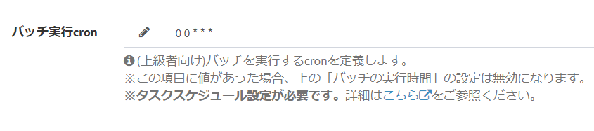

# Plugin (Batch)
Dieses Plugin führt eine eigene Verarbeitung in einem festen Rhythmus aus oder zu einem Zeitpunkt, den der Administrator festlegt.
Es eignet sich, wenn Sie zum Beispiel eine Verarbeitung hinzufügen möchten, die jeden Tag ausgeführt werden muss.

## Erstellung
Wir erklären die Schritte am Beispiel eines Batches, der „logisch gelöschte Daten physisch löscht“.
※ Im Standard von Exment werden Daten, die auf der Oberfläche gelöscht wurden, nur „logisch gelöscht“ und bleiben in der Datenbank erhalten.
Dieser Batch löscht diese Daten vollständig (physisches Löschen).

### config.json erstellen
- Erstellen Sie die folgende Datei config.json.  

~~~ json
{
    "uuid": "b5c0a5d2-2716-4161-98d0-b490c1ebc521",
    "plugin_name": "harddelete_data",
    "plugin_view_name": "Daten physisch löschen",
    "description": "Löscht alle logisch gelöschten Daten vollständig.",
    "author":  "Kajitori",
    "version": "1.0.0",
    "plugin_type": "batch",
    "batch_hour": 0,
    "batch_cron": "0 0 * * *"
}
~~~

- plugin_name : der Name des Plugins. Geben Sie ihn in alphanumerischen Zeichen halber Breite ein.
- uuid : eine Zeichenfolge, mit der Plugins unterschieden werden. Sie besteht aus 32 Zeichen und Bindestrichen, insgesamt 36 Zeichen. Achten Sie darauf, dass sie nicht denselben Wert hat wie bei einem anderen Plugin.  
Sie können sie zum Beispiel unter der folgenden URL erzeugen.  
https://www.famkruithof.net/uuid/uuidgen
- plugin_type : Geben Sie batch ein.  
- batch_hour (optional) : die Uhrzeit (Stunde), zu der das Plugin jeden Tag ausgeführt wird. Geben Sie eine ganze Zahl von 0 bis 23 ein.
- batch_cron (optional) : für Fortgeschrittene. Hier geben Sie den Zeitpunkt, zu dem das Plugin ausgeführt wird, in cron-Schreibweise an. So lässt sich flexibel festlegen, wann der Batch startet.

※ batch_hour und batch_cron können Sie später auf der Oberfläche ändern. Die Werte in config.json sind die Anfangswerte nach dem Hochladen.

### PHP-Datei erstellen
- Erstellen Sie eine PHP-Datei wie die folgende. Der Name muss „Plugin.php“ lauten.

~~~ php
<?php
namespace App\Plugins\HarddeleteData;

use Exceedone\Exment\Services\Plugin\PluginBatchBase;
use Exceedone\Exment\Model\CustomTable;

class Plugin extends PluginBatchBase{
    /**
     * execute
     */
    public function execute() {
        $tables = CustomTable::all();

        foreach($tables as $table){
            $modelname = getModelName($table);
            if(!isset($modelname)){
                continue;
            }

            $modelname::onlyTrashed()
                ->forceDelete();
        }
    }
    
}
~~~
- Der namespace muss **App\Plugins\\(Plugin-Name in Pascal Case)** lauten. [Einzelheiten finden Sie hier](/de/plugin_quickstart)

- Wenn die Bedingungen des Triggers erfüllt sind, der in der Plugin-Verwaltung eingetragen ist, wird das Plugin aufgerufen und die Funktion execute in Plugin.php ausgeführt.

- Die Klasse Plugin erweitert die Klasse PluginBatchBase.  

### Als zip komprimieren
Komprimieren Sie die beiden oben genannten Dateien als Mindestumfang zu einer zip-Datei.  
- HarddeleteData.zip
    - config.json
    - Plugin.php

### Hochladen
Laden Sie das Plugin hoch. Wie das geht, lesen Sie unter [Plugin](/de/plugin).

- Direkt nach dem Hochladen steht „Aktiv“ bei einem Batch auf „Deaktiviert“, und der Batch wird nicht automatisch ausgeführt. Damit er ausgeführt wird, schalten Sie „Aktiv“ unter [Plugin](/de/plugin) um.
- **Zusätzlich zu dieser Einstellung müssen Sie den Aufgabenplaner (Task Schedule) einrichten**. Einzelheiten finden Sie unter [Aufgabenplanung](/de/additional_task_schedule).

### So starten Sie den Batch
Es gibt die folgenden drei Möglichkeiten, einen hochgeladenen Batch zu starten.

| Methode | Zeitpunkt der Ausführung |
| ---- | ---- |
| Ausführungszeit des Batches (Stunde) angeben | Jeden Tag zur angegebenen Uhrzeit |
| Cron für die Batch-Ausführung angeben | Zu dem Zeitpunkt, der in cron-Schreibweise angegeben ist |
| Per Befehl ausführen | Wenn Sie den Befehl ausführen (manuell) |

#### Ausführungszeit des Batches (Stunde) angeben
Geben Sie auf der Einstellungsseite des Plugins einen Wert von 0 bis 23 ein.
Das Plugin wird jeden Tag zu dieser Uhrzeit ausgeführt. (Beispiel: Bei der Einstellung „5“ wird das Plugin jeden Tag um 5:00 Uhr ausgeführt.)
  

#### Cron für die Batch-Ausführung angeben
Für Fortgeschrittene. Sie können den Zeitpunkt, zu dem das Plugin ausgeführt wird, in cron-Schreibweise eingeben.
※ Wenn Sie diese Einstellung ausfüllen, gilt die obige „Ausführungszeit des Batches (Stunde)“ nicht mehr.
  

#### Per Befehl ausführen
Sie können den Batch auch von der Befehlszeile aus zu einem beliebigen Zeitpunkt manuell ausführen.
Führen Sie einen der folgenden Befehle aus.

~~~
# Angabe der Plugin-ID
php artisan exment:batch 1

# Angabe von plugin_name (Plugin-Name)
php artisan exment:batch --name=harddelete_data

# Angabe der uuid
php artisan exment:batch --uuid=b5c0a5d2-2716-4161-98d0-b490c1ebc521
~~~

### Beispiel-Plugins
[Plugin zum physischen Löschen von Daten](https://github.com/exment-git/plugin-sample/tree/main/batch/HarddeleteBatch)  
- Ein Batch, der logisch gelöschte Daten physisch löscht.  
  
[Anbindung einer externen Datenbank](https://github.com/exment-git/plugin-sample/tree/main/batch/PluginSyncBatch)  
- Ein Batch, der Informationen aus einer externen Datenbank auf einmal in eine Tabelle von Exment übernimmt.  
- Führen Sie zur Vorbereitung die folgenden Schritte aus.
    1. Importieren Sie die [Vorlage](https://exment.net/downloads/sample/template/city_template.zip) in Exment unter „Administratoreinstellungen“ → „Vorlage“.  
    2. Erstellen Sie die externe Datenbank. Dieses Plugin verwendet die MySQL-Beispieldatenbank „world“. Laden Sie die zip-Datei von der [offiziellen Website](https://dev.mysql.com/doc/index-other.html) herunter, entpacken Sie sie und führen Sie das enthaltene SQL in Ihrer MySQL-Umgebung (oder MariaDB-Umgebung) aus.
  
    3. Laden Sie das [Plugin](https://github.com/exment-git/plugin-sample/tree/main/batch/PluginSyncBatch) in Exment unter „Administratoreinstellungen“ → „Plugin“ hoch.  
    4. Öffnen Sie die Einstellungsseite des Plugins, geben Sie die Verbindungsdaten der in Schritt 2 erstellten externen Datenbank ein und speichern Sie.  
  
