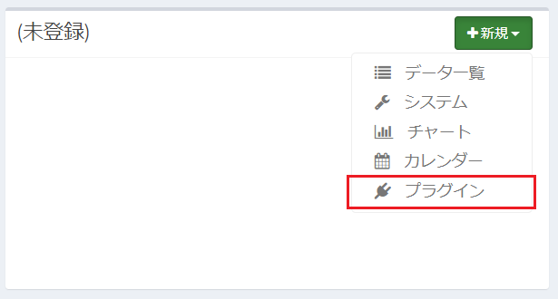

## Plugin (Dashboard)
Sie können auf dem Dashboard von Exment eine neue Ansicht erstellen.  
Verwenden Sie dieses Plugin, wenn Sie eine eigene Seite als Element des Dashboards nutzen möchten.  
Diese Seite erklärt die Erstellung eines Plugins (Dashboard) am Beispiel von Schaltflächen für die Zeiterfassung (Kommen und Gehen).  

## Einführung
Plugin-Seiten von Exment werden mit dem PHP-Framework [Laravel](http://laravel.jp/) und der Bibliothek für die Verwaltungsoberfläche [exment-admin-core](https://github.com/exceedone/exment-admin-core) entwickelt (eine Bibliothek auf Basis von laravel-admin / open-admin, bis v6.x laravel-admin).  
Wir empfehlen, dass Seiten von Personen entwickelt werden, die sich besonders mit Laravel auskennen.

## Erstellung

### Beispiel
Als Beispiel erstellen wir hier die folgende Seite.
- Eine Tabelle anlegen, die das Kommen und Gehen der Benutzer verwaltet.    
- Auf dem Dashboard Schaltflächen für Kommen, Gehen, Pausenbeginn und Pausenende anzeigen.   
- Beim Klick auf eine Schaltfläche die Uhrzeit des Klicks in die Daten schreiben.
  
   

※ Importieren Sie vorher [diese Vorlage](https://exment.net/downloads/sample/template/dakoku.zip).

- Beispiel-Plugin: [hier](https://github.com/exment-git/plugin-sample/tree/main/dashboard/Dakoku)  

### config.json erstellen
- Erstellen Sie die folgende Datei config.json.  

~~~ json

{
    "plugin_name": "Dakoku",
    "plugin_view_name" : "Zeiterfassung",
    "description": "Ein Plugin für die Zeiterfassung auf dem Dashboard.",
    "uuid":  "691a24f2-2c7a-42c5-8cff-23c5277f6f22",
    "author":  "Kajitori",
    "version": "1.0.0",
    "plugin_type": "dashboard",
    "route": [
        {
            "uri": "post",
            "method": [
                "post"
            ],
            "function": "post"
        }
    ]
}

~~~

- Schreiben Sie plugin_name mit alphanumerischen Zeichen halber Breite.
- uuid ist eine Zeichenfolge aus 32 Zeichen und Bindestrichen, zusammen 36 Zeichen. Sie macht das Plugin eindeutig.  
Erzeugen Sie sie zum Beispiel über die folgende URL.  
https://www.famkruithof.net/uuid/uuidgen
- Tragen Sie bei plugin_type dashboard ein.  
- route definiert als Liste die Endpunkte der URLs, die ausgeführt werden, ihre HTTP-Methoden und die Methoden im Controller.
    - uri: Die uri für die Anzeige der Seite. Die tatsächliche URL lautet „http(s)://(URL von Exment)/dashboardbox/plugin/(auf der Seite der Plugin-Verwaltung eingestellte URL)/(ID des Dashboard-Elements)/(angegebene uri)“.  
    - method: Die HTTP-Methode. Tragen Sie get, post, put oder delete ein.
    - function: Die Methode im Controller, die ausgeführt wird
- route muss immer einen Eintrag enthalten, dessen uri leer ist (""). Beim Wechsel vom Menü zur Seite des Plugins wird dieser Endpunkt aufgerufen.

> ※ Die URLs gelten für die Standardeinstellung ohne „/admin“ (Websites, die ab v7.2.1 neu installiert wurden). Wenn `ADMIN_ROUTE_PREFIX` in der `.env` einen Wert hat (bei Websites aus früheren Versionen ist es „admin“), fügen Sie diesen Wert hinter der URL der Website ein (Beispiel: `http(s)://(URL von Exment)/admin/dashboardbox/plugin/(auf der Seite der Plugin-Verwaltung eingestellte URL)/(ID des Dashboard-Elements)/(angegebene uri)`). Einzelheiten finden Sie unter [„admin“ in der URL ändern oder entfernen](/de/additional_prefix).

### Plugin-Datei erstellen

#### Hauptlogik erstellen
Erstellen Sie eine PHP-Datei wie die folgende. Die Datei muss „Plugin.php“ heißen.

~~~ php
<?php

//(1)
namespace App\Plugins\Dakoku;

use Exceedone\Exment\Services\Plugin\PluginDashboardBase;
use Exceedone\Exment\Model\CustomTable;

class Plugin extends PluginDashboardBase
{
    /**
     *
     * @return Content|\Illuminate\Http\Response
     */
    public function body()
    {
        if(is_null(CustomTable::getEloquent('dakoku'))){
            return 'Die Tabelle für die Zeiterfassung ist nicht installiert.';
        }
        
        $dakoku = $this->getDakoku();
        $status = $this->getStatus($dakoku);
        $params = $this->getStatusParams($status);

        // (3)
        return view('exment_dakoku::dakoku', [
            'dakoku' => $dakoku,
            'params' => $params,
            'action' => $this->getDashboardUri('post'),
        ]);
    }

    /**
     * Senden
     *
     * @return void
     */
    public function post()
    {
        $dakoku = $this->getDakoku();
        
        $now = \Carbon\Carbon::now();

        if(!isset($dakoku)){
            $dakoku = CustomTable::getEloquent('dakoku')->getValueModel();
            $dakoku->setValue('target_date', $now->toDateString());
        }

        $status = null;
        switch(request()->get('action')){
            // Kommen
            case 'syukkin':
                $dakoku->setValue('syukkin_time', $now);
                $status = 1;
                break;
            // Pausenbeginn
            case 'kyuukei_start':
                $dakoku->setValue('kyuukei_start_time', $now);
                $status = 11;
                break;
            // Pausenende
            case 'kyuukei_end':
                $dakoku->setValue('kyuukei_end_time', $now);
                $status = 21;
                break;
            // Gehen
            case 'taikin':
                $dakoku->setValue('taikin_time', $now);
                $status = 99;
                break;
        }
        if(isset($status)){
            $dakoku->setValue('status', $status);
        }
        $dakoku->save();

        admin_toastr(trans('admin.save_succeeded'));
        return back();
    }

    /**
     * Den aktuellen Stand der Anwesenheit holen
     *
     * @return void
     */
    protected function getDakoku(){
        $table = CustomTable::getEloquent('dakoku');
        if(!isset($table)){
            return null;
        }
        
        
        // Die aktuelle Uhrzeit holen
        $now = \Carbon\Carbon::now();

        // Vor der Bezugszeit gilt es als Vortag
        if($now->hour <= 4){
            $now = $now->addDay(-1);
        }

        // Den passenden Eintrag der Zeiterfassung holen
        $query = getModelName('dakoku')::query();
        $query->where('value->target_date', $now->toDateString())
            ->where('created_user_id', \Exment::user()->base_user_id);

        $dakoku = $query->first();

        return $dakoku;
    }

    /**
     * Den Status holen
     *
     * @param [type] $dakoku
     * @return int
     */
    protected function getStatus($dakoku){
        if(!isset($dakoku) || is_null($dakoku->getValue('syukkin_time'))){
            return 0;
        }

        return $dakoku->getValue('status');
    }

    protected function getStatusParams($status){
        switch($status){
            case 0:
                return 
                [
                    'status_text' => 'Noch nicht gekommen',
                    'buttons' => [
                        [
                        'button_text' => 'Kommen',
                        'action_name' => 'syukkin',
                        ]
                    ]
                ];
            // Kommen
            case 1:
                return  
                [
                    'status_text' => 'Anwesend',
                    'buttons' => [
                        [
                            'button_text' => 'Pause',
                            'action_name' => 'kyuukei_start',
                        ], 
                        [
                            'button_text' => 'Gehen',
                            'action_name' => 'taikin',
                        ], 
                    ]
                ];
        
            case 11:
                return 
                [
                    'status_text' => 'In der Pause',
                    'buttons' => [
                        [
                            'button_text' => 'Pause beenden',
                            'action_name' => 'kyuukei_end',
                        ], 
                    ]
                ];
            case 21:
                return 
                [
                    'status_text' => 'Anwesend',
                    'buttons' => [
                        [
                            'button_text' => 'Pause beenden',
                            'action_name' => 'kyuukei_syuryo',
                        ], 
                    ]
                ]; 
                
            case 99:
                return 
                [
                    'status_text' => 'Gegangen',
                    'buttons' => [
                    ]
                ];
        }
    }
}
~~~
- (1) Der namespace muss **App\Plugins\\(Plugin-Name in Pascal Case)** lauten. [Einzelheiten finden Sie hier](/de/plugin_quickstart)  
Der Klassenname muss „Plugin“ sein, und die Klasse muss von PluginDashboardBase erben.

- (2) Die Namen der public-Methoden in der Klasse sind die Namen, die in config.json bei function stehen.  

- (3) Wenn Sie eine view verwenden, stellen Sie dem Namen der view das Präfix „exment_(Plugin-Name in Snake Case)::“ voran.  

- (4) Den Endpunkt des Plugins erhalten Sie mit der Funktion „$this->getDashboardUri('Name des Endpunkts')“.  
※ Den vollständigen URL-Pfad erhalten Sie mit admin_url($this->getDashboardUri('Name des Endpunkts')).

#### (Optional) Views
Wenn Sie die view auslagern, speichern Sie die blade-Dateien unterhalb des Ordners „resources/views“.  

#### (Optional) css, js und andere statische Dateien
- Legen Sie css-Dateien im Ordner „public/css“ ab.  
- Legen Sie js-Dateien im Ordner „public/js“ ab.  
- Legen Sie andere Dateien (Bilddateien usw.) im Ordner „public/assets“ ab.  

### Als ZIP komprimieren
Komprimieren Sie die beiden Dateien oben als Mindestumfang zu einer ZIP-Datei.  
Die ZIP-Datei muss „(plugin_name).zip“ heißen.  
- Dakoku.zip
    - config.json
    - Plugin.php
    - (weitere benötigte PHP-Dateien, Bilddateien usw.)

### Sonstiges
- Wenn Sie die Datendetails zu einem bestimmten ID-Wert anzeigen möchten, fügen Sie der route in config.json einen Eintrag wie den folgenden hinzu.  
Die uri lässt sich in der Form „{id}“ angeben.  

~~~ json

{
    "route": [
        {
            "uri": "show_details/{id}",
            "method": [
                "get"
            ],
            "function": "show_details"
        }
    ]
}

~~~

## Im Dashboard anzeigen
Damit das hochgeladene Plugin auf dem Dashboard erscheint, gehen Sie wie folgt vor.  

1. Klicken Sie im Dashboard auf „Neu“.  
Wenn ein Plugin der Art „Dashboard“ hochgeladen wurde, steht „Plugin“ zur Auswahl.    
   

2. Geben Sie den Anzeigenamen und das Ziel-Plugin ein und senden Sie ab.
   

3. Das gewählte Element wird auf dem Dashboard angezeigt.  
   

### Beispiel-Plugin
[Zeiterfassung](https://github.com/exment-git/plugin-sample/tree/main/dashboard/Dakoku)  
※ Importieren Sie [diese Vorlage](https://exment.net/downloads/sample/template/dakoku.zip).
