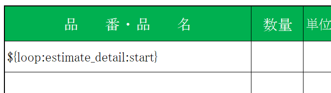
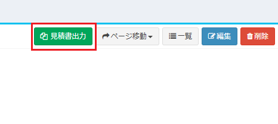

# Plugin (Dokumentausgabe)
Dieses Plugin gibt eigene Dokumente aus, zum Beispiel Angebote oder Formulare.
Die zugrunde liegende Vorlage erstellen Sie im Excel-Format. Auch die ausgegebene Datei hat das Excel-Format.

   

> Zur Ausgabe im PDF-Format lesen Sie bitte [Dokumentausgabe (Docurain)](/de/plugin_quickstart_docurain).

## Erstellung

### config.json erstellen
- Erstellen Sie die folgende Datei config.json.  

~~~ json
{
    "plugin_name": "PluginDemoDocument",
    "uuid": "1e7881d0-324f-11e9-b56e-0800200c9a66",
    "plugin_view_name": "Plugin Document",
    "description": "Ein Test für die Dokumentausgabe.",
    "author": "(Your Name)",
    "version": "1.0.0",
    "plugin_type": "document",
    "filename": "Angebot_${ymdhms}",
    "target_tables": "estimate",
    "label": "Angebot ausgeben",
    "icon": "fa-files-o",
    "button_class": "btn-success"
}
~~~

- Geben Sie plugin_name in alphanumerischen Zeichen halber Breite ein.
- uuid ist eine Zeichenfolge, mit der Plugins unterschieden werden. Sie besteht aus 32 Zeichen und Bindestrichen, insgesamt 36 Zeichen. Achten Sie darauf, dass sie nicht denselben Wert hat wie bei einem anderen Plugin.  
Sie können sie zum Beispiel unter der folgenden URL erzeugen.  
https://www.famkruithof.net/uuid/uuidgen
- Geben Sie bei plugin_type den Wert document ein.  
- file_name ist der Dateiname bei der Ausgabe. Sie können [Parametervariablen](/de/params) verwenden.
- target_tables sind die Tabellen, für die ausgegeben wird. Bei mehreren Tabellen trennen Sie die Namen durch Kommas.
- label ist die Beschriftung der Schaltfläche für die Dokumentausgabe.
- icon ist das Symbol der Schaltfläche für die Dokumentausgabe.
- button_class ist die Klasse der Schaltfläche für die Dokumentausgabe.

※ target_tables, label, icon und button_class können Sie später auf der Einstellungsseite des Plugins ändern.

### Excel-Vorlagendatei erstellen
Erstellen Sie die Vorlagendatei, die dem Dokument zugrunde liegt.  
Die Vorlagendatei hat das Excel-Format (xlsx). Auch die ausgegebene Datei hat das Excel-Format (xlsx).  
※ Der Dateiname der Excel-Vorlagendatei muss „document.xlsx“ lauten.  
※ Die Parameter, die Sie in die Vorlagendatei schreiben, finden Sie unten unter „Parameter“.

#### Parameter
Das sind die Parameter, die Sie in der Excel-Datei der Vorlage setzen.
Wenn Sie in eine Excel-Zelle eine Variable in festgelegter Form eintragen, wird bei der Dokumentausgabe der im System gespeicherte Wert ausgegeben.
##### Grundregeln
- Tragen Sie die Variable nach der Regel „**${Variablenname}**“ in die Excel-Zelle ein.  
Beispiel: „${year}“ „${month}“ „${value:estimate_code}“  
  

- In einer Zelle können Sie mehrere Parameter setzen.  

- In Excel können Sie Funktionen hinterlegen. ※ Einige Funktionen arbeiten möglicherweise nicht richtig. Prüfen Sie unbedingt die Funktion.  

- Welche Parametervariablen Sie setzen können, lesen Sie auf der folgenden Seite.  
[Parametervariablen](/de/params)

##### So geben Sie die Daten einer untergeordneten Tabelle als Liste aus
Je nach Art des Dokuments müssen die Daten der untergeordneten Tabelle des Zieldatensatzes in einer Liste ausgegeben werden.
Beispiel: „Angebot“, in dem Angebotsdatum und Kundeninformationen gespeichert sind, und „Angebotspositionen“, in denen die Liste der angebotenen Produkte gespeichert ist  
  
So geben Sie die Datenliste in dieser Tabelle aus.

1. Setzen Sie in der 1. Zeile der auszugebenden Tabelle in der 1. Spalte den folgenden Parameter.
**„${loop:(Tabellenname der untergeordneten Tabelle):start}“**  
Beispiel: ${loop:estimate_detail:start}  
  

2. Setzen Sie in der 2. Zeile der auszugebenden Tabelle in jeder Spalte, die ausgegeben werden soll, den folgenden Parameter.
**„${loop-item:(Tabellenname der untergeordneten Tabelle):(Spaltenname der untergeordneten Tabelle)}“**  
Beispiel: ${loop-item:estimate_detail:product_detail_name}  
  

3. Setzen Sie in der letzten Zeile der auszugebenden Tabelle in der 1. Spalte den folgenden Parameter.
**„${loop:(Tabellenname der untergeordneten Tabelle):end}“**  
Beispiel: ${loop:estimate_detail:end}  
  

##### Weitere Einschränkungen
- Die neueste Version von PhpSpreadSheet (Stand 25.02.2022), 1.22.0, unterstützt die folgenden Inhalte nicht. Bitte nehmen Sie sie nicht in die Vorlage auf.  
    - Eingefügte Formen
    - Diagramme
    - Tabellen, die mit „Als Tabelle formatieren“ formatiert sind

- Wenn die ausgegebene Datei keine Bilder enthält, lesen Sie unter [Fehlerbehebung](/de/troubleshooting) den Punkt zum Fehlschlagen der Bildausgabe bei der Dokumentausgabe mit Excel als Vorlage.

### PHP-Datei erstellen (optional)
- Für eine normale Dokumentausgabe genügt es, eine document.xlsx mit Parametervariablen bereitzustellen.
Erstellen Sie eine PHP-Datei nur dann, wenn Sie Daten auf besondere Weise aufbereiten oder Daten ausgeben möchten, die nicht aus Exment stammen. Der Name lautet „Plugin.php“.
**※ Wenn keine besondere Verarbeitung nötig ist, brauchen Sie diese Datei Plugin.php nicht.**

~~~ php
<?php
namespace App\Plugins\PluginDemoDocument; // (PluginDemoDocument: Plugin-Name)

use Exceedone\Exment\Model\Define;
use Exceedone\Exment\Model\System;
use Exceedone\Exment\Services\Plugin\PluginDocumentBase;

class Plugin extends PluginDocumentBase
{
    /**
     * Funktion, die vor dem Ersetzen der Variablen des Dokuments aufgerufen wird
     *
     * @param SpreadSheet $spreadsheet
     * @return void
     */
    protected function called($spreadsheet)
    {
        // Hier steht die eigene Verarbeitung, die vor dem Ersetzen der Variablen des Dokuments laufen soll
    }

    /**
     * Funktion, die nach dem Ersetzen der Variablen des Dokuments aufgerufen wird
     *
     * @param SpreadSheet $spreadsheet
     * @return void
     */
    protected function saving($spreadsheet)
    {
        // Das erste Blatt auswählen
        $sheet = $spreadsheet->getSheet(0);
        // Den Website-Namen in Zelle B1 setzen
        $sheet->setCellValue('B1', System::site_name());

        // Die Neuigkeiten von Exment holen
        $items = $this->getItems();

        foreach ($items as $idx => $item) {
            // Ausgabe ab Zeile 4
            $row = $idx + 4;
            // Das Datum in Zelle A? ausgeben
            $date = \Carbon\Carbon::parse(array_get($item, 'date'))->format(config('admin.date_format'));
            $sheet->setCellValue("A$row", $date);
            // Den Link in Zelle B? ausgeben
            $link = array_get($item, 'link');
            $sheet->setCellValue("B$row", $link);
            // Den Titel in Zelle C? ausgeben
            $title = array_get($item, 'title.rendered');
            $sheet->setCellValue("C$row", $title);
        }
    }

    /**
     * Die Neuigkeiten von Exment über die API holen
     *
     * @return array exment news items array
     */
    protected function getItems()
    {
        $client = new \GuzzleHttp\Client();
        $response = $client->request('GET', Define::EXMENT_NEWS_API_URL, [
            'http_errors' => false,
            'query' => $this->getQuery(),
            'timeout' => 3, // Response timeout
            'connect_timeout' => 3, // Connection timeout
        ]);

        $contents = $response->getBody()->getContents();
        if ($response->getStatusCode() != 200) {
            return [];
        }
        return json_decode_ex($contents, true);
    }

    /**
     * Abfragebedingungen, die an die API übergeben werden
     *
     * @return array query string array
     */
    protected function getQuery()
    {
        $request = request();

        // get querystring
        $query = [
            'categories' => 6,
            'per_page' => System::datalist_pager_count() ?? 5,
            'page' => $request->get('page') ?? 1,
        ];

        return $query;
    }

    /**
    * (ab v3.4.3) Entscheidet, ob die Schaltfläche auf der Seite angezeigt wird. Standard ist true
    * 
    * @return bool true: anzeigen, false: nicht anzeigen
    */
    public function enableRender(){
        // Die Schaltfläche anzeigen, wenn der Wert der benutzerdefinierten Spalte „view_flg“ gleich „1“ ist
        return $this->custom_value->getValue('view_flg')  == 1;
    }
}

~~~

- Der namespace muss **App\Plugins\\(Plugin-Name in Pascal Case)** lauten. [Einzelheiten finden Sie hier](/de/plugin_quickstart)

- Eigene Verarbeitung fügen Sie in den folgenden beiden Funktionen ein. Diese Funktionen erhalten das Spreadsheet als Argument. Sie können auf dieses Spreadsheet zugreifen und Werte in Zellen setzen.  
※ Wie Sie das Spreadsheet im Einzelnen verwenden, lesen Sie in der [Dokumentation von PhpSpreadsheet](https://phpspreadsheet.readthedocs.io/en/latest/).
    - Verarbeitung vor dem Ersetzen der Parametervariablen: Implementieren Sie die Methode „called“.
    - Verarbeitung nach dem Ersetzen der Parametervariablen: Implementieren Sie die Methode „saving“.

- Die Klasse Plugin erweitert die Klasse PluginDocumentBase.  
PluginDocumentBase besitzt Eigenschaften wie die aufrufende benutzerdefinierte Tabelle $custom_table und den Tabellenwert $custom_value.  
Sobald die Funktion execute aufgerufen wird, sind diesen Eigenschaften Werte zugewiesen.  
Einzelheiten zu den Eigenschaften finden Sie in der [Plugin-Referenz](/de/plugin_reference).  

- (ab v3.4.3) Wenn Sie anhand der gespeicherten Daten steuern möchten, ob die Schaltfläche angezeigt wird, implementieren Sie die Methode "enableRender".  
Geben Sie true zurück, wenn die Schaltfläche angezeigt werden soll, und false, wenn sie ausgeblendet werden soll. (Der Standard ist true.)

### Als zip komprimieren
Komprimieren Sie die oben genannten Dateien als Mindestumfang zu einer zip-Datei.  
Der Name der zip-Datei muss „(plugin_name).zip“ lauten.  
- PluginDemoDocument.zip
    - config.json
    - document.xlsx
    - Plugin.php (optional)
    - (weitere benötigte PHP-Dateien, Bilddateien usw.)

### Hochladen
Laden Sie das Plugin hoch.  
※ Wie das geht, lesen Sie unter [Plugin](/de/plugin).  

### Dokumentausgabe ausführen
Wenn alle Einstellungen richtig abgeschlossen sind, erscheint auf der Anzeigeseite der Daten eine Schaltfläche.
  
  
Wenn Sie auf die Schaltfläche klicken, erscheint die Datei in der Liste unter „Anhang“.
 

### Beispiel-Plugin
[Ausgabe der Benutzerinformationen](https://github.com/exment-git/plugin-sample/tree/main/document/document_demo_user)  
※ Auf der Seite der Benutzerinformationen erscheint die Schaltfläche „Ausgabe der Benutzerinformationen“.  

### Produkt-Plugin
[PDF-Ausgabe von Rechnungen](https://github.com/exment-git/plugin-product/tree/main/document/PluginInvoiceDocument)  
※ Gibt die Rechnung anhand der Vorlage im EXCEL-Format aus. Zusätzlich wird die EXCEL-Datei in PDF umgewandelt.
