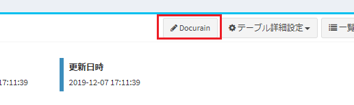

# Dokumentausgabe (Docurain)
So geben Sie Formulare mit der Cloud-Formular-Engine **Docurain** als PDF aus. Mit Docurain lassen sich Formulare allein mit Excel und json entwickeln.

> Zur Ausgabe im Excel-Format lesen Sie bitte [Plugin (Dokumentausgabe)](/de/plugin_quickstart_document).

## Was ist Docurain?
Docurain ist eine Cloud-Formular-Engine, mit der sich Formulare allein mit Excel und json entwickeln lassen.  
Formulare in den verschiedensten Layouts können Sie aus der Vorlage einer Excel-Datei erstellen. Auch die Ausgabe im PDF-Format wird unterstützt.
[Zur Website von Docurain](https://docurain.jp/)

> Docurain ist ein Dienst, den die Root42 Inc. entwickelt und betreibt.
Für die Nutzung brauchen Sie ein Lizenz-Token. Abgerechnet wird nutzungsabhängig nach der Zahl der Formularausgaben. (Ein Test-Token kann ausgestellt werden.)
Die Kajitori Co., Ltd., die Exment entwickelt und betreibt, ist Vertriebspartner von Docurain. Für Testwünsche, Bestellungen und Anfragen nutzen Sie bitte [diese Seite](https://exment.net/docurain).

## Ausführung
1. Laden Sie das [Docurain-Plugin](https://github.com/exment-git/plugin-sample/tree/main/docurain/Docurain) herunter.

2. Laden Sie es als Plugin von Exment hoch.
Die Schritte finden Sie unter [Plugin hochladen](/de/plugin).

3. Klicken Sie nach dem Hochladen auf die Zeile des Docurain-Plugins und öffnen Sie die Einstellungsseite des Plugins.

  

4. Geben Sie Folgendes ein.

- Zieltabelle: die Tabelle, für die Docurain ausgeführt wird

  

- Token: das Ausführungs-Token von Docurain. Für die Ausstellung eines Tokens wenden Sie sich bitte über die [Anfrageseite](https://exment.net/inquiry) an uns

  

- Liste der Tabellennamen und Formulardateinamen: Geben Sie den Namen der Tabelle ein, für die Formulare ausgegeben werden, den Namen der Vorlagendatei, den Namen der auszugebenden Formulardatei und die Beschriftung der Schaltfläche, jeweils durch Kommas getrennt. Mehrere Einträge trennen Sie durch Zeilenumbrüche.
※ Im Namen der Vorlagendatei kann kein Japanisch verwendet werden. (Im Namen der Formulardatei und in der Beschriftung der Schaltfläche ist es möglich.)  
※ Wenn Sie den Namen der Formulardatei weglassen, wird der Name der Vorlagendatei verwendet.  
※ Wenn Sie die Beschriftung der Schaltfläche weglassen, wird die für das Plugin gemeinsam eingestellte Beschriftung verwendet.  
※ Der Name der Formulardatei kann [Parameter](/de/params) wie das Datum enthalten.

  

5. Legen Sie im entpackten Ordner im Ordner „documents“ die Excel-Datei ab, die dem Formular zugrunde liegt.
Wenn Sie mit Docurain mehrere Formulare erstellen, legen Sie mehrere Excel-Dateien in documents ab.
※ Der Ordnerpfad lautet „(Stammordner des Projekts)/storage/app/plugins/Docurain/documents“.
※ Wie Sie ein Formular erstellen, lesen Sie unten unter „Excel-Vorlagendatei erstellen“.

  
  

6. Wenn die Einstellungen bis hierher abgeschlossen sind, erscheint bei der unter „Zieltabelle“ gewählten Tabelle eine Schaltfläche.

  

7. Wenn Sie auf die Schaltfläche klicken, wird das Formular erstellt.

  

### Excel-Vorlagendatei erstellen
Erstellen Sie die Excel-Datei, die dem Formular zugrunde liegt.  
※ Im Namen der Excel-Datei kann kein Japanisch verwendet werden. Die Dateiendung muss unbedingt xlsx sein.  
※ Die Parameter der Vorlagendatei werden anders geschrieben als die normalen Parameter von Exment. Nötig ist die eigene Schreibweise von Docurain.

#### Parameter
Das sind die Parameter, die Sie in der Excel-Datei der Vorlage setzen.
Wenn Sie in eine Excel-Zelle eine Variable in festgelegter Form eintragen, wird sie bei der Formularausgabe in verschiedene Werte umgewandelt.

##### Systemwerte
| Element | Beschreibung |
| ---- | ---- |
| %{system.site_name} | Website-Name des Systems |
| %{system.site_name_short} | Website-Name des Systems (kurz) |
| %{system.system_mail_from} | Absender des Systems |
| %{system.system_url} | Start-URL des Systems |
| %{system.login_url} | Anmelde-URL des Systems |

##### Daten
| Element | Beschreibung |
| ---- | ---- |
| %{id} | Die ID des Zieldatensatzes wird gesetzt. (Beispiel: 123) |
| %{suuid} | Die suuid des Zieldatensatzes (Short UUID, eine zufällige Zeichenfolge mit 20 Stellen) wird gesetzt. |
| %{value_url} | Der Link zum Anzeigen des Zieldatensatzes wird gesetzt. |
| %{value.(Spaltenname)} | Der Wert der Spalte des Zieldatensatzes wird gesetzt. (Beispiel: Wenn Sie bei Benutzerdaten %{value.user_code} eintragen, wird der Benutzercode gesetzt.) |
| %{select_table.(Spaltenname).(Spaltenname der referenzierten Tabelle)} | Wenn die Spalte „Spaltenname“ vom Typ „Auswahl (aus Tabelle)“, „Benutzer“ oder „Organisation“ ist, wird der Wert der referenzierten Spalte gesetzt. (Beispiel: Die Tabelle „Vertragsinformationen (contract)“ hat die Spalte „Kunde (client)“, die auf die Tabelle „Kundeninformationen (client)“ verweist. Mit %{select_table.client.client_code} können Sie dann den Kundencode (client_code) der Tabelle „Kundeninformationen (client)“ anzeigen.) |
| %{parent.(Spaltenname der referenzierten Tabelle)} | Der Wert der Spalte der übergeordneten Tabelle wird gesetzt. (Beispiel: Wenn Sie aus der Tabelle „Vertragspositionen (contract_detail)“ auf den Vertragscode (contract_code) der übergeordneten Tabelle „Vertragsinformationen (contract)“ verweisen und %{parent.contract_code} eintragen, wird der Vertragscode gesetzt.) |
| $ENTITY.children.(Name der untergeordneten Tabelle) | Die Informationen der untergeordneten Tabelle setzen Sie mit Blocksyntax wie „#foreach“. Da es mehrere Datensätze der untergeordneten Tabelle geben kann, ist eine Angabe wie %{children.(Name der untergeordneten Tabelle).(Spaltenname der untergeordneten Tabelle)} nicht möglich. Unten wird ein Beispiel erklärt. |

#### Einstellungsbeispiel
##### Grundregeln
- Übliche EXCEL-Funktionen und Formatierungen können verwendet werden.  
- Spalte A ist allein der Logik vorbehalten. Dort schreiben Sie Blocksyntax wie #if, #foreach und #set.

##### ※ Ein Beispiel für eine Vorlage   

- Das PDF, das die Ausgabe der obigen Vorlage ergibt.   

#### Beispielvorlagen herunterladen
[Benutzerinformationen](https://exment.net/downloads/product/plugin/Docurain/user.xlsx)  
[Informationen zu Produktversionen](https://exment.net/downloads/product/plugin/Docurain/product_version.xlsx)  
[Vertragsinformationen](https://exment.net/downloads/product/plugin/Docurain/contract.xlsx)  
※ Um die Informationen zu Produktversionen und die Vertragsinformationen zu verwenden, muss vorher die „Vorlage für Produktvertriebsunternehmen“ importiert werden.

### Zu Fehlern
- Nach dem Ausführen der Ausgabe kann ein Fehler angezeigt werden.
Prüfen Sie in diesem Fall den Inhalt des Fehlers und reagieren Sie entsprechend.

- Bei einem Fehler mit dem „HTTP-Statuscode“ „413“ muss auf der Seite des Cloud-Dienstes von Docurain der zulässige Grenzwert des Dienstes geändert werden.
Wenden Sie sich in diesem Fall bitte über [diese Seite](https://exment.net/docurain) an uns.
