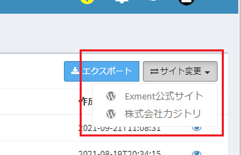
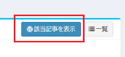

# Plugin-Referenz (CRUD-Seite)
Diese Seite ist für alle, die ein Plugin (CRUD-Seite) entwickeln.  
Sie fasst die Funktionen und Eigenschaften zusammen, die in der Klasse der CRUD-Seite verfügbar sind.

**Bedeutung der Zeichen bei den Funktionen**

| Zeichen | Bedeutung |
| ---- | ---- |
| ★ | Muss fast immer definiert werden |
| ☆ | Muss je nach Fall definiert werden |

- Diese Seite gilt nur für die CRUD-Seite. Andere Arten von Plugins finden Sie in der [Plugin-Referenz](/de/plugin_reference).
- Die Funktionen für benutzerdefinierte Tabellen, benutzerdefinierte Spalten und benutzerdefinierte Daten finden Sie in der [Funktionsreferenz](/de/func_reference).
- Hier steht vor allem, was der Entwickler des Plugins definiert. Was das System verwendet und was Entwickler nicht ändern sollen, ist weggelassen.
- Die Klassen der Bibliothek für die Verwaltungsoberfläche sind mit dem Namespace ab Exment v7.0.0 geschrieben („ExmentAdminCore\Admin“). Wenn Sie v6.x oder älter verwenden, lesen Sie dafür „Encore\Admin“. Einzelheiten finden Sie unter [Update-Verfahren v7.0.0](/update/v7_0_0) (Englisch).

## PluginCrudBase
Abstrakte Klasse für Plugins (CRUD-Seite). Wenn Sie ein CRUD-Seiten-Plugin entwickeln, erben Sie von dieser Klasse.  

- namespace Exceedone\Exment\Services\Plugin
- trait Exceedone\Exment\Services\Plugin\PluginBase
- trait Exceedone\Exment\Services\Plugin\PluginPageTrait

##### Eigenschaften

| Name | Typ | Beschreibung |
| ---- | ---- | ---- |
| title | string | Titel, der auf jeder Seite angezeigt wird |
| description | string | Beschreibung, die auf jeder Seite angezeigt wird |
| icon | string | Symbol, das auf jeder Seite angezeigt wird |


### Liste der Funktionen

#### ★getFieldDefinitions
Diese Funktion holt die Spaltendefinitionen als assoziatives Array.  
- Fügen Sie unbedingt genau einen Schlüssel mit "primary" => true hinzu. (Zusammengesetzte Schlüssel werden derzeit nicht unterstützt)  
- "key" ist der Name des Elements, der beim Holen der Daten und als name der HTML-Elemente verwendet wird. Geben Sie ihn alphanumerisch ein.  
- "label" wird auf der Listenseite usw. als Name des Elements verwendet.  
- "grid" legen Sie für Elemente fest, die auf der Listenseite angezeigt werden. Tragen Sie eine ganze Zahl für die Anzeigereihenfolge ein.
- "show" legen Sie für Elemente fest, die auf der Detailseite angezeigt werden. Tragen Sie eine ganze Zahl für die Anzeigereihenfolge ein.
- "create" legen Sie für Elemente fest, die auf der Seite zum Erstellen angezeigt werden. Tragen Sie eine ganze Zahl für die Anzeigereihenfolge ein.
- "edit" legen Sie für Elemente fest, die auf der Bearbeitungsseite angezeigt werden. Tragen Sie eine ganze Zahl für die Anzeigereihenfolge ein.


##### Argumente
Keine


##### Rückgabewert
| Typ | Beschreibung |
| ---- | ---- |
| array | Array der Spaltendefinitionen |


##### Beispiel
``` php
/**
     * (2) Spaltendefinitionen holen
     * Get fields definitions
     *
     * @return array|Collection
     */
    public function getFieldDefinitions()
    {
        return [
            ['key' => 'id', 'label' => 'ID', 'primary' => true, 'grid' => 1, 'show' => 1],
            ['key' => 'title', 'label' => 'Titel', 'grid' => 2, 'show' => 2, 'create' => 1, 'edit' => 1],
            ['key' => 'date', 'label' => 'Erstellt am', 'grid' => 3, 'show' => 3, 'create' => 2, 'edit' => 2],
            ['key' => 'content', 'label' => 'Text', 'show' => 4, 'create' => 3, 'edit' => 3],
        ];
    }
```

---


#### getAuthType
Gibt die Zeichenfolge für die Authentifizierungsart der CRUD-Seite zurück.  
Hinweis: Zusätzlich zur Anmeldung bei Exment können Sie eine Authentifizierung für den Zugriff auf diese CRUD-Seite festlegen. Legen Sie die Authentifizierungsart je nach Art des Dienstes fest, auf den Sie zugreifen möchten.


##### Authentifizierungsarten
| Zurückgegebene Zeichenfolge | Typ | Beschreibung |
| ---- | ---- | ---- |
| (null) | Keine Authentifizierung | Für den Fall, dass keine eigene Authentifizierung der CRUD-Seite stattfindet. Das ist der Standardwert. |
| key | Zugriffsschlüssel | Auf der Einstellungsseite des Plugins legen Sie den Zugriffsschlüssel fest. Wenn kein Zugriffsschlüssel eingegeben ist, wird ein Fehler angezeigt. |
| id_password | ID und Passwort | Auf der Einstellungsseite des Plugins legen Sie ID und Passwort fest. Wenn ID und Passwort nicht eingegeben sind, wird ein Fehler angezeigt. |
| oauth | OAuth | Auf der Seite der Anmeldeeinstellungen nehmen Sie die OAuth-Einstellungen vor. Wenn ein Benutzer auf die CRUD-Seite zugreift, meldet er sich mit OAuth an. Nur wenn die OAuth-Anmeldung gelungen ist, kann er auf die CRUD-Seite zugreifen. Außerdem kann das Zugriffstoken verwendet werden. |


##### Argumente
Keine

##### Rückgabewert
| Typ | Beschreibung |
| ---- | ---- |
| ?string | Zeichenfolge, die die Authentifizierungsart angibt |


##### Beispiel
``` php
    /**
     * Get auth type.
     * Please set null or "key" or "id_password" or "oauth".
     *
     * @return string|null
     */
    public function getAuthType() : ?string
    {
        return 'oauth';
    }
```

---


#### enablePaginate
Legt fest, ob die Liste der Daten in Form einer Paginierung angezeigt wird.  
Geben Sie true zurück, wenn der Dienst, von dem die Daten geholt werden, die Paginierung unterstützt (Gesamtzahl der Daten, Holen der Daten mit Angabe der Seitennummer, Holen der Daten je Seite). Geben Sie false zurück, wenn er sie nicht unterstützt.

##### Argumente
Keine


##### Rückgabewert
| Typ | Beschreibung |
| ---- | ---- |
| boolean | Gibt an, ob die Paginierung unterstützt wird. Standardwert: true |


##### Beispiel
``` php
     /**
     * Whether use paginate
     * Default: true
     *
     * @return bool
     */
    public function enablePaginate() : bool
    {
        return true;
    }
```

---


#### ★getPaginate
Diese Funktion holt die Liste der Daten in Form einer Paginierung.  
Geben Sie die geholten Daten im Format \Illuminate\Pagination\LengthAwarePaginator zurück.  
Jedes Element der Liste muss ein assoziatives Array sein. Die Schlüssel dieses assoziativen Arrays müssen dieselben sein wie die Schlüssel, die in getFieldDefinitions festgelegt sind.  
Hinweis: Implementieren Sie diese Funktion, wenn die Funktion enablePaginate true zurückgibt.


##### Argumente
| Name | Typ | Beschreibung |
| ---- | ---- | ---- |
| $options | array | Optionen, die bei der Anzeige der Listenseite verwendet werden |
| $options['per_page'] | int | Anzahl der Einträge pro Seite |
| $options['page'] | int | Seitennummer |
| $options['query'] | string | Suchtext, wenn gesucht wird |


##### Rückgabewert
| Typ | Beschreibung |
| ---- | ---- |
| LengthAwarePaginator | Modell mit dem Suchergebnis |


##### Beispiel
``` php
    /**
     * (3) Datenliste (Paginate) holen
     * Get data paginate
     *
     * @return LengthAwarePaginator
     */
    public function getPaginate(array $options = []) : ?LengthAwarePaginator
    {
        $client = new Client([
            'base_uri' => $this->getSiteUrl(),
        ]);

        $query = [
            'per_page' => $options['per_page'] ?? 20,
            'page' => $options['page'] ?? 1
        ];

        if(array_has($options, 'query')){
            $query['search'] = array_get($options, 'query');
        }

        $response = $client->get('wp-json/wp/v2/posts', ['query' => $query]);

        $json = json_decode((string)$response->getBody());

        $result = collect($json)->map(function($j){
            $j = json_decode(json_encode($j), true);
            return (object)[
                'id' => array_get($j, 'id'),
                'title' => array_get($j, 'title.rendered'),
                'content' => array_get($j, 'content.rendered'),
                'date' => array_get($j, 'date'),
            ];
        });
        
        return new LengthAwarePaginator(
            $result, 
            array_get($response->getHeaders(), 'X-WP-Total')[0], 
            $query['per_page'],
            $query['page'],
            [
                'path' => $this->getFullUrl(),
            ]
        );
    }
```


---

#### ☆getList
Diese Funktion holt die Liste der Daten.  
Geben Sie die geholten Daten im Format Collection zurück.  
Jedes Element der Liste muss ein assoziatives Array sein. Die Schlüssel dieses assoziativen Arrays müssen dieselben sein wie die Schlüssel, die in getFieldDefinitions festgelegt sind.  
Hinweis: Implementieren Sie diese Funktion, wenn die Funktion enablePaginate false zurückgibt.


##### Argumente
| Name | Typ | Beschreibung |
| ---- | ---- | ---- |
| $options | array | Optionen, die bei der Anzeige der Listenseite verwendet werden |
| $options['query'] | string | Suchtext, wenn gesucht wird |


##### Rückgabewert
| Typ | Beschreibung |
| ---- | ---- |
| \Illuminate\Support\Collection | Ergebnisliste |


##### Beispiel
``` php
    /**
     * (3) Datenliste holen
     * Get data list
     *
     * @return Collection
     */
    public function getList(array $options = []) : Collection
    {
        $client = new Client([
            'base_uri' => $this->getSiteUrl(),
        ]);

        if(array_has($options, 'query')){
            $query['search'] = array_get($options, 'query');
        }

        $token = $this->getOauthAccessToken();
        $response = $client->get('v1.0/me/todo/lists', [
            'query' => $query, 
            'headers' => [
                'Authorization' => "Bearer $token",
                'Accept'        => 'application/json',
            ]
        ]);

        $json = json_decode((string)$response->getBody());

        $result = collect($json->value)->map(function($j){
            $j = json_decode(json_encode($j), true);
            return (object)[
                'id' => array_get($j, 'id'),
                'displayName' => array_get($j, 'displayName'),
            ];
        });

        return $result;
    }
```


---


#### getChunkCount
Gibt zurück, wie viele Einträge auf einmal geholt werden, wenn die Liste der Daten in Form einer Paginierung geholt wird.  

##### Argumente
Keine


##### Rückgabewert
| Typ | Beschreibung |
| ---- | ---- |
| int | Anzahl der Einträge, die auf einmal geholt werden. Standardwert: 1000 |


##### Beispiel
``` php
    /**
     * Get max chunk count.
     *
     * @return int
     */
    public function getChunkCount() : int
    {
        return 1000;
    }
```


---

#### ★getData
Holt einen Datensatz mit der angegebenen ID und gibt ihn zurück.  
Jedes Element der Daten muss ein assoziatives Array sein. Die Schlüssel dieses assoziativen Arrays müssen dieselben sein wie die Schlüssel, die in getFieldDefinitions festgelegt sind.  

##### Argumente
| Name | Typ | Beschreibung |
| ---- | ---- | ---- |
| $id | string | Schlüsselwert der Daten |
| $options | array | Derzeit nicht verwendet. Reserviertes Argument. |


##### Rückgabewert
| Typ | Beschreibung |
| ---- | ---- |
| array oder Collection | Die geholten Daten |


##### Beispiel
``` php
    /**
     * (3) Datendetails (einen Datensatz) holen
     * read single data
     *
     * @return array|Collection
     */
    public function getData($id, array $options = [])
    {
        $client = new Client([
            'base_uri' => $this->getSiteUrl(),
        ]);
        $response = $client->request('GET', "wp-json/wp/v2/posts/{$id}");
        $json = json_decode((string)$response->getBody());
        
        $j = json_decode(json_encode($json), true);
        return (object)[
            'id' => array_get($j, 'id'),
            'title' => array_get($j, 'title.rendered'),
            'content' => array_get($j, 'content.rendered'),
            'date' => array_get($j, 'date'),
        ];
    }
```


---

#### ★postCreate
Erstellt neue Daten.  
Geben Sie als Rückgabewert den Schlüsselwert der erstellten Daten zurück.  

##### Argumente
| Name | Typ | Beschreibung |
| ---- | ---- | ---- |
| $posts | array | Daten, die der Benutzer eingegeben hat. Assoziatives Array. |
| $options | array | Derzeit nicht verwendet. Reserviertes Argument. |


##### Rückgabewert
| Typ | Beschreibung |
| ---- | ---- |
| string | Geben Sie den Schlüsselwert der erstellten Daten zurück |


##### Beispiel
``` php
    /**
     * post create value
     *
     * @return mixed
     */
    public function postCreate(array $posts, array $options = [])
    {
        $client = new Client([
            'base_uri' => $this->getSiteUrl(),
        ]);

        // create Authorization header 
        $id_password = $this->getAuthIdPassword();
        $Authorization = "Basic " . base64_encode("{$id_password['id']}:{$id_password['password']}");

        $response = $client->request('POST', "wp-json/wp/v2/posts", [
            'headers' => [
                'Authorization' => $Authorization,
                //'Content-Type' => 'application/json',
            ],
            'form_params' => [
                'title' => array_get($posts, 'title'),
                'content' => array_get($posts, 'content'),
                'status' => 'publish',
            ],
        ]);
        $json = json_decode((string)$response->getBody());
        $j = json_decode(json_encode($json), true);
        return array_get($j, 'id');
    }

```


---

#### ★putEdit
Bearbeitet Daten.  
Geben Sie als Rückgabewert den Schlüsselwert der bearbeiteten Daten zurück.  

##### Argumente
| Name | Typ | Beschreibung |
| ---- | ---- | ---- |
| $id | string | Schlüsselwert der Daten, die bearbeitet werden |
| $posts | array | Daten, die der Benutzer eingegeben hat. Assoziatives Array. |
| $options | array | Derzeit nicht verwendet. Reserviertes Argument. |


##### Rückgabewert
| Typ | Beschreibung |
| ---- | ---- |
| string | Geben Sie den Schlüsselwert der aktualisierten Daten zurück |


##### Beispiel
``` php
    /**
     * edit posted value
     *
     * @return mixed
     */
    public function putEdit($id, array $posts, array $options = [])
    {
        $client = new Client([
            'base_uri' => $this->getSiteUrl(),
        ]);

        // create Authorization header 
        $id_password = $this->getAuthIdPassword();
        $Authorization = "Basic " . base64_encode("{$id_password['id']}:{$id_password['password']}");

        $response = $client->request('POST', "wp-json/wp/v2/posts/{$id}", [
            'headers' => [
                'Authorization' => $Authorization,
                //'Content-Type' => 'application/json',
            ],
            'form_params' => [
                'title' => array_get($posts, 'title'),
                'content' => array_get($posts, 'content'),
                'status' => 'publish',
            ],
        ]);
        $json = json_decode((string)$response->getBody());
        $j = json_decode(json_encode($json), true);
        return array_get($j, 'id');
    }

```


---

#### ★delete
Löscht Daten.  

##### Argumente
| Name | Typ | Beschreibung |
| ---- | ---- | ---- |
| $id | string | Schlüsselwert der Daten, die gelöscht werden |
| $options | array | Derzeit nicht verwendet. Reserviertes Argument. |


##### Rückgabewert
Keiner


##### Beispiel
``` php
    /**
     * delete value
     *
     * @param $id string
     * @return mixed
     */
    public function delete($id, array $options = [])
    {
        $client = new Client([
            'base_uri' => $this->getSiteUrl(),
        ]);

        // create Authorization header 
        $id_password = $this->getAuthIdPassword();
        $Authorization = "Basic " . base64_encode("{$id_password['id']}:{$id_password['password']}");

        $response = $client->request('DELETE', "wp-json/wp/v2/posts/{$id}", [
            'headers' => [
                'Authorization' => $Authorization,
                //'Content-Type' => 'application/json',
            ],
        ]);
    }
```


---

#### enableCreate
Prüft, ob Daten neu erstellt werden können, und gibt das Ergebnis als boolean zurück.  
Geben Sie false zurück, wenn der angebundene Dienst das Neuerstellen nicht unterstützt oder wenn Benutzer nicht neu erstellen sollen.

##### Argumente
| Name | Typ | Beschreibung |
| ---- | ---- | ---- |
| $options | array | Derzeit nicht verwendet. Reserviertes Argument. |


##### Rückgabewert
| Typ | Beschreibung |
| ---- | ---- |
| boolean | Gibt true zurück, wenn das Neuerstellen möglich ist. Standardwert: true |

---


#### enableEditAll
Prüft, ob Daten bearbeitet werden können, und gibt das Ergebnis als boolean zurück.  
Geben Sie false zurück, wenn der angebundene Dienst das Bearbeiten nicht unterstützt oder wenn Benutzer nicht bearbeiten sollen.

##### Argumente
| Name | Typ | Beschreibung |
| ---- | ---- | ---- |
| $options | array | Derzeit nicht verwendet. Reserviertes Argument. |


##### Rückgabewert
| Typ | Beschreibung |
| ---- | ---- |
| boolean | Gibt true zurück, wenn das Bearbeiten möglich ist. Standardwert: true |

---


#### enableEdit
Prüft für die angegebenen Daten, ob sie bearbeitet werden können, und gibt das Ergebnis als boolean zurück.  
Geben Sie false zurück, wenn der angebundene Dienst das Bearbeiten nicht unterstützt oder wenn Benutzer nicht bearbeiten sollen.

##### Argumente
| Name | Typ | Beschreibung |
| ---- | ---- | ---- |
| $value | mixed | Wert, der der ID entspricht. |
| $options | array | Derzeit nicht verwendet. Reserviertes Argument. |


##### Rückgabewert
| Typ | Beschreibung |
| ---- | ---- |
| boolean | Gibt true zurück, wenn das Bearbeiten möglich ist. Standardwert: true |

---


#### enableDeleteAll
Prüft, ob Daten gelöscht werden können, und gibt das Ergebnis als boolean zurück.  
Geben Sie false zurück, wenn der angebundene Dienst das Löschen nicht unterstützt oder wenn Benutzer nicht löschen sollen.

##### Argumente
| Name | Typ | Beschreibung |
| ---- | ---- | ---- |
| $options | array | Derzeit nicht verwendet. Reserviertes Argument. |


##### Rückgabewert
| Typ | Beschreibung |
| ---- | ---- |
| boolean | Gibt true zurück, wenn das Löschen möglich ist. Standardwert: true |

---

#### enableDelete
Prüft für die angegebenen Daten, ob sie gelöscht werden können, und gibt das Ergebnis als boolean zurück.  
Geben Sie false zurück, wenn der angebundene Dienst das Löschen nicht unterstützt oder wenn Benutzer nicht löschen sollen.

##### Argumente
| Name | Typ | Beschreibung |
| ---- | ---- | ---- |
| $value | mixed | Wert, der der ID entspricht. |
| $options | array | Derzeit nicht verwendet. Reserviertes Argument. |


##### Rückgabewert
| Typ | Beschreibung |
| ---- | ---- |
| boolean | Gibt true zurück, wenn das Löschen möglich ist. Standardwert: true |

---


#### enableExport
Prüft, ob Daten exportiert werden können, und gibt das Ergebnis als boolean zurück.  
Der Datenexport holt je nach Fall alle Daten des Dienstes. Achten Sie deshalb auf das Holen großer Datenmengen.

##### Argumente
| Name | Typ | Beschreibung |
| ---- | ---- | ---- |
| $options | array | Derzeit nicht verwendet. Reserviertes Argument. |


##### Rückgabewert
| Typ | Beschreibung |
| ---- | ---- |
| boolean | Gibt true zurück, wenn der Datenexport möglich ist. Standardwert: false |

---


#### enableFreewordSearch
Prüft, ob Daten gesucht werden können, und gibt das Ergebnis als boolean zurück.  

##### Argumente
| Name | Typ | Beschreibung |
| ---- | ---- | ---- |
| $options | array | Derzeit nicht verwendet. Reserviertes Argument. |


##### Rückgabewert
| Typ | Beschreibung |
| ---- | ---- |
| boolean | Gibt true zurück, wenn die Datensuche möglich ist. Standardwert: false |

---


#### callbackGridTool
Definieren Sie diese Funktion zum Beispiel, wenn Sie auf der GRID-Seite (Datenliste) oben rechts eine eigene Schaltfläche anzeigen möchten.

##### Argumente

| Name | Typ | Beschreibung |
| ---- | ---- | ---- |
| $tools | \ExmentAdminCore\Admin\Widgets\Grid\Tools | Werkzeuge |


##### Rückgabewert
Keiner


##### Beispiel
``` php
    /**
     * Callback tools. If add event, definition.
     * Hinweis: In diesem Beispiel wird eine Schaltfläche mit der Liste der WordPress-Websites angezeigt. Damit wechseln Sie die WordPress-Website, von der die Daten geholt werden
     *
     * @param $tools
     * @return void
     */
    public function callbackGridTool($tools)
    {
        $menulist = [];

        foreach ($this->getSiteDefinitions() as $site) {
            $menulist[] = [
                'href' => admin_urls('plugins', $this->plugin->getOption('uri'), array_get($site, 'endpoint')),
                'label' => array_get($site, 'label'),
                'icon' => 'fa-wordpress',
            ];
        }
        $tools->prepend(view('exment::tools.menu-button', [
            'button_label' => 'Website wechseln',
            'menulist' => $menulist,
        ])->render(), 'right');
    }

```

  

---


#### callbackShowTool
Definieren Sie diese Funktion zum Beispiel, wenn Sie auf der SHOW-Seite (Datendetails) oben rechts eine eigene Schaltfläche anzeigen möchten.

##### Argumente

| Name | Typ | Beschreibung |
| ---- | ---- | ---- |
| $id | string | Schlüsselwert |
| $box | \ExmentAdminCore\Admin\Widgets\Box | Box |


##### Rückgabewert
Keiner


##### Beispiel
``` php
    /**
     * Callback show page tools. If add event, definition.
     *
     * @param Box $box
     * @return void
     */
    public function callbackShowTool($id, Box $box)
    {
        $box->tools(view('exment::tools.button', [
            'href' => $this->getSiteUrl() . "?p={$id}",
            'label' => 'Diesen Beitrag anzeigen',
            'icon' => 'fa-wordpress',
            'btn_class' => 'btn-primary',
            'target' => '_blank',
        ])->render());
    }
```

  

---


#### callbackFormTool
Definieren Sie diese Funktion zum Beispiel, wenn Sie auf der CREATE-Seite (Daten neu erstellen) oder der EDIT-Seite (Daten bearbeiten) oben rechts eine eigene Schaltfläche anzeigen möchten.

##### Argumente

| Name | Typ | Beschreibung |
| ---- | ---- | ---- |
| $id | string | Schlüsselwert |
| $box | \ExmentAdminCore\Admin\Widgets\Box | Box |


##### Rückgabewert
Keiner


##### Beispiel
``` php
    /**
     * Callback create or edit page tools. If add event, definition.
     *
     * @param Box $box
     * @return void
     */
    public function callbackFormTool($id, Box $box)
    {
        $box->tools(view('exment::tools.button', [
            'href' => $this->getSiteUrl() . "?p={$id}",
            'label' => 'Diesen Beitrag anzeigen',
            'icon' => 'fa-wordpress',
            'btn_class' => 'btn-primary',
            'target' => '_blank',
        ])->render());
    }
```

  

---


#### setForm
Erstellen Sie diese Funktion, wenn Sie das Eingabeformular der Daten auf der CREATE-Seite (Daten neu erstellen) oder der EDIT-Seite (Daten bearbeiten) selbst aufbauen.  
Hinweis: Die Schreibweise ist im Grunde die, mit der man in der Bibliothek für die Verwaltungsoberfläche „exment-admin-core“ [Formularfelder](https://github.com/exceedone/exment-admin-core/blob/master/docs/en/model-form-fields.md) hinzufügt (sie ist dieselbe wie bei den [Formularen von laravel-admin](https://laravel-admin.org/docs/en/model-form-fields), aus denen sie entstanden ist). Wie Sie die Felder schreiben, lesen Sie bitte auf der jeweiligen Seite nach.  
Hinweis: Wenn Sie diese Funktion nicht definieren (wenn null zurückgegeben wird), werden die Spalten als einzeiliger Text angezeigt, für die in der Funktion getFieldDefinitions auf der CREATE-Seite das Element "create" und auf der EDIT-Seite das Element "edit" definiert ist.


##### Argumente
| Name | Typ | Beschreibung |
| ---- | ---- | ---- |
| $form | \ExmentAdminCore\Admin\Widgets\Form | Eingabeformular |
| $isCreate | bool | true beim Neuerstellen |
| $options | array | Derzeit nicht verwendet. Reserviertes Argument. |


##### Rückgabewert
| Typ | Beschreibung |
| ---- | ---- |
| ?\ExmentAdminCore\Admin\Widgets\Form | Das erstellte Formular. Wenn null zurückgegeben wird, wird das Eingabeformular aus der Definition der Funktion getFieldDefinitions erstellt. |


##### Beispiel
``` php
    /**
     * set form info
     *
     * @return Form|null
     */
    public function setForm(Form $form, bool $isCreate, array $options = []) : ?Form
    {
        if(!$isCreate){
            $form->display('ID');    
        }
        $form->text('Name');

        // Liste der Länder holen
        $countries = \DB::connection('world')->table('country') ->pluck('Name', 'Code');
        $form->select('CountryCode')->options($countries);
        
        $form->number('Population');

        return $form;
    }
```

---


#### validate
Diese Funktion definieren Sie, wenn Sie auf der CREATE-Seite (Daten neu erstellen) oder der EDIT-Seite (Daten bearbeiten) vor dem Speichern der Daten eine Validierung festlegen.

##### Argumente

| Name | Typ | Beschreibung |
| ---- | ---- | ---- |
| $form | \ExmentAdminCore\Admin\Widgets\Form | Eingabeformular |
| $values | array | Eingabewerte des Benutzers |
| $isCreate | bool | true beim Neuerstellen |
| $id | string | Schlüsselwert |


##### Rückgabewert
| Typ | Beschreibung |
| ---- | ---- |
| Eines der folgenden<br/>array<br/>\Illuminate\Support\MessageBag<br/>\Exceedone\Exment\Validator\ExmentCustomValidator | Ergebnis der Validierung |


##### Beispiel
``` php
    // Beispiel 1. So fügen Sie dem Formular in der Funktion setForm eine Validierung hinzu.
    // Hinweis: Der Einfachheit halber steht das Beispiel bei der Funktion validate. In diesem Fall definieren Sie die Funktion validate aber bitte nicht.
    /**
     * set form info
     *
     * @return Form|null
     */
    public function setForm(Form $form, bool $isCreate, array $options = []) : ?Form
    {
        if(!$isCreate){
            $form->display('ID');    
        }
        $form->text('Name')
            ->rules(['max:10']); // Hinzugefügt

        // Liste der Länder holen
        $countries = \DB::connection('world')->table('country')->pluck('Name', 'Code');
        $form->select('CountryCode')->options($countries);
        
        $form->number('Population')
            ->rules([new \Exceedone\Exment\Validator\NumberMinRule(10)]);  // Hinzugefügt

        return $form;
    }


    // Beispiel 2. So verwenden Sie die Validierung von Laravel.
    /**
     * Validate form
     *
     * @param WidgetForm $form
     * @return array|MessageBag|ExmentCustomValidator
     */
    public function validate(WidgetForm $form, array $values, bool $isCreate, $id)
    {
        $validator = \Validator::make($values, 
        // Regeln für jedes Feld definieren
        [
            'Name' => 'max:10',
            'Population' => new \Exceedone\Exment\Validator\NumberMinRule(10),
        ], 
        // (Optional) Wenn Sie die Meldung der einzelnen Regeln ändern
        [
            'max' => ':attribute darf höchstens 10 Zeichen lang sein.',
            'min' => 'Geben Sie für :attribute einen Wert von 10 oder mehr ein',
        ], 
        // (Optional) Wenn Sie den Namen der einzelnen Felder ändern
        [
            'Name' => 'Name',
            'Population' => 'Einwohnerzahl (geschätzt)',
        ]);
        return $validator;
    }
    

    // Beispiel 3. So validieren Sie einzeln.
    // Bei Fehlern wird ein Array zurückgegeben, dessen Schlüssel die Feldnamen und dessen Werte die Fehlermeldungen sind.
    /**
     * Validate form
     *
     * @param WidgetForm $form
     * @return array|MessageBag|ExmentCustomValidator
     */
    public function validate(WidgetForm $form, array $values, bool $isCreate, $id)
    {
        $errors = [];

        // Prüfen, ob höchstens 10 Zeichen
        $Name = array_get($values, 'Name');
        if(!is_nullorempty($Name) && mb_strlen($Name) > 10){
            $errors['Name'] = 'Der Name darf höchstens 10 Zeichen lang sein.';
        }
        
        // Prüfen, ob 10 oder mehr
        $Population = array_get($values, 'Population');
        if(!is_nullorempty($Population) && intval($Population) < 10){
            $errors['Population'] = 'Geben Sie für die Einwohnerzahl (geschätzt) einen Wert von 10 oder mehr ein';
        }
        
        return $errors;
    }
```

---

