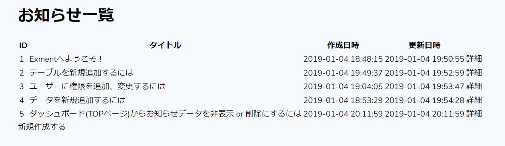

# Aufbau einer Website für Endbenutzer

Diese Seite ist für Entwickler.  
In Exment können Sie den Endpunkt (den Einstieg der URL) ändern. So können Sie neben der Exment-Website eine Website für allgemeine Benutzer bauen, die Sie als Entwickler selbst erstellen (eine Website für Endbenutzer).

Auf dieser Seite erstellen wir als Beispiel die folgenden Seiten. Sie arbeiten mit den Daten der Exment-Tabelle „Information“.

- Liste der Informationsdaten
- Detailanzeige der Informationsdaten
- Neu erstellen von Informationsdaten
- Bearbeiten von Informationsdaten
- Löschen von Informationsdaten

Die Reihenfolge ist wie folgt.

1. Prüfen, ob der Zugriff möglich ist
2. Die Listenseite erstellen (Routing → Controller → View)
3. Die Seiten für Details, Neu erstellen, Bearbeiten und Löschen nacheinander hinzufügen

## Zugriff prüfen
Auf die Website für Endbenutzer können Sie auch zugreifen, nachdem Exment aufgebaut ist.

| Ende der URL | Geöffnete Website |
|---|---|
| „/admin“ | Administrator-Website (Exment) |
| „/“ | Website für Endbenutzer |

- Um die Website für Endbenutzer unter „/“ zu legen, setzen Sie `ADMIN_ROUTE_PREFIX` in der `.env` auf „admin“. Der Grund: Bei einer neuen Installation ab v7.2.1 liegt Exment standardmäßig unter „/“. Einzelheiten finden Sie unter [„admin“ in der URL ändern oder entfernen](/de/additional_prefix).

■ Endpunkt „/“

■ Endpunkt „/admin“

## Seiten erstellen
Die Website für Endbenutzer erstellen Sie im Grunde mit demselben Aufbau und denselben Schritten wie bei einer gewöhnlichen Systementwicklung mit Laravel.  
Das Bild unten zeigt den Aufbau des Laravel-Stammordners. Davon legen Sie vor allem in den folgenden Ordnern PHP-Dateien an.

| Ordner | Inhalt |
|---|---|
| app/Http/Controllers | Controller |
| routes | Endpunktinformationen |
| resources/views | Views. Sie werden in Blade-Syntax geschrieben |
| public | CSS, JS, Bilder usw. |

#### routes: Routing
Schreiben Sie in routes/web.php das Routing der Listenseite wie folgt.  
Hinweis: Andere Schreibweisen für das Routing finden Sie in der [Laravel-Beschreibung des Routings](https://readouble.com/laravel/8.x/ja/routing.html) (Japanisch).

~~~
<?php

use Illuminate\Support\Facades\Route;

/*
|--------------------------------------------------------------------------
| Web Routes
|--------------------------------------------------------------------------
|
| Here is where you can register web routes for your application. These
| routes are loaded by the RouteServiceProvider within a group which
| contains the "web" middleware group. Now create something great!
|
*/

//Route::get('/', function () {
//    return view('welcome');
//});

///// Listenseite
Route::get('/', [\App\Http\Controllers\IndexController::class, 'index']);
~~~

#### Controller: Controller
Erstellen Sie im Ordner app/Http/Controllers die Datei IndexController.php und schreiben Sie Folgendes.

- CustomTable: das Model, das der „benutzerdefinierten Tabelle“ von Exment entspricht.
- CustomTable::getEloquent('information')->getValueModel(): das Model für die Daten einer Exment-Tabelle. Es steht für die einzelnen Daten, die Benutzer eingegeben haben.

Hinweis: Andere Schreibweisen für Controller finden Sie in der [Laravel-Beschreibung der Controller](https://readouble.com/laravel/8.x/ja/controllers.html) (Japanisch).

~~~
<?php

namespace App\Http\Controllers;

use Illuminate\Routing\Controller as BaseController;
use Illuminate\Http\Request;
use Exceedone\Exment\Model\CustomTable;

class IndexController extends BaseController
{
    //Listenseite
    public function index(Request $request){
        $items = CustomTable::getEloquent('information')->getValueModel()->get();
        return view('index', [
            'items' => $items,
        ]);
    }
}
~~~

#### view: View
Für die View erstellen Sie 2 Dateien: den gemeinsamen Rahmen (_layout.blade.php) und den Inhalt der Liste (index.blade.php).

Erstellen Sie in resources/views die Datei _layout.blade.php und schreiben Sie Folgendes.  
~~~
<!DOCTYPE html>
<html lang="{{ str_replace('_', '-', app()->getLocale()) }}">
    <head>
        <meta charset="utf-8">
        <meta name="viewport" content="width=device-width, initial-scale=1">

        <title>Laravel</title>

        <!-- Fonts -->
        <link href="https://fonts.googleapis.com/css2?family=Nunito:wght@400;600;700&display=swap" rel="stylesheet">

        <!-- Styles -->
        

        
    </head>
    <body class="antialiased">
        

            @if (Route::has('login'))
                

                    @auth
                        <a href="{{ url('/home') }}" class="text-sm text-gray-700 dark:text-gray-500 underline">Home</a>
                    @else
                        <a href="{{ route('login') }}" class="text-sm text-gray-700 dark:text-gray-500 underline">Log in</a>

                        @if (Route::has('register'))
                            <a href="{{ route('register') }}" class="ml-4 text-sm text-gray-700 dark:text-gray-500 underline">Register</a>
                        @endif
                    @endauth
                

            @endif

            <main>
                @yield('content')
            </main>
        

    </body>
</html>

~~~

Erstellen Sie in resources/views die Datei index.blade.php und schreiben Sie Folgendes.  
Hinweis: Andere Schreibweisen für Blade finden Sie in der [Laravel-Beschreibung von Blade](https://readouble.com/laravel/8.x/ja/blade.html) (Japanisch).

~~~
@extends('_layout')

@section('content')
    <h1>Informationsliste</h1>
    <table>
        <thead>
            <tr>
                <th>ID</th>
                <th>Titel</th>
                <th>Erstellt am</th>
                <th>Aktualisiert am</th>
                <th></th>
            </tr>
        </thead>

        <tbody>
        @foreach($items as $item)
            <tr>
                <td>{{$item->id}}</td>
                <td>{{$item->getValue('title', 'html')}}</td>
                <td>{{$item->created_at}}</td>
                <td>{{$item->updated_at}}</td>
                <td><a href="{{asset($item->id)}}">Details</a></td>
            </tr>
        @endforeach
        </tbody>
    </table>

    

        <a href="{{asset('/create')}}">Neu erstellen</a>
    

@endsection
~~~

#### Ergebnis
Wenn bis hierher alles richtig ist, wird die Liste der Daten der Exment-Tabelle „Information“ wie folgt angezeigt.  
Hinweis: Die Links „Neu erstellen“ und „Details“ lassen sich zu diesem Zeitpunkt noch nicht öffnen. Sie werden danach erstellt.

#### Seite für Datendetails erstellen
Erstellen Sie die Seite für die Datendetails. Ergänzen Sie die folgenden 3 Dateien.

routes/web.php
~~~
///// Detailseite
Route::get('/{id}', [\App\Http\Controllers\IndexController::class, 'show']);
~~~

app/Http/Controllers/IndexController.php (unter der Funktion index ergänzen)
~~~
  //Detailseite
    public function show(Request $request, $id){
        $item = CustomTable::getEloquent('information')->getValueModel()->find($id);
        if(!$item){
            return redirect('');
        }
        return view('show', [
            'item' => $item,
        ]);
    }
~~~

resources/views/show.blade.php (neu erstellen)
~~~
@extends('_layout')

@section('content')
    <h1>Datendetails</h1>
    <table>
        <tbody>
            <tr>
                <th>ID</th>
                <td>{{$item->id}}</td>
            </tr>
            <tr>
                <th>Titel</th>
                <td>{{$item->getValue('title', 'html')}}</td>
            </tr>
            <tr>
                <th>Text</th>
                <td>{!! $item->getValue('body', 'html') !!}</td>
            </tr>
            <tr>
                <th>Anzeigen</th>
                <td>{!! $item->getValue('view_flg', 'html') !!}</td>
            </tr>
            <tr>
                <th>Anzeigereihenfolge</th>
                <td>{!! $item->getValue('order', 'html') !!}</td>
            </tr>
            <tr>
                <th>Priorität</th>
                <td>{!! $item->getValue('priority', 'html') !!}</td>
            </tr>
            <tr>
                <th>Erstellt am</th>
                <td>{{$item->created_at}}</td>
            </tr>
            <tr>
                <th>Aktualisiert am</th>
                <td>{{$item->updated_at}}</td>
            </tr>
        </tbody>
    </table>

    

        <a href="{{asset('/')}}">Zurück zur Liste</a>
    

@endsection
~~~

#### Ergebnis
Wenn alles richtig ist, werden die Details der Daten mit der angegebenen ID aus der Exment-Tabelle „Information“ wie folgt angezeigt.

#### Seite zum Erstellen von Daten
Erstellen Sie die Seite zum Erstellen von Daten. Ergänzen Sie die folgenden 3 Dateien.

routes/web.php (oberhalb der Detailseite eintragen)
~~~
///// Seite zum Erstellen
Route::get('/create', [\App\Http\Controllers\IndexController::class, 'create']);
Route::post('/', [\App\Http\Controllers\IndexController::class, 'store']);
~~~

app/Http/Controllers/IndexController.php (unter der Funktion show ergänzen)
~~~
    //Seite zum Erstellen
    public function create(Request $request){
        return view('create');
    }

    //Neuen Datensatz speichern
    public function store(Request $request){
        //Model zum Speichern der Daten erstellen
        $custom_value = CustomTable::getEloquent('information')->getValueModel();

        //Werte setzen
        $custom_value->setValueStrictly([
            'title' => $request->get('title'),
            'body' => $request->get('body'),
            'view_flg' => $request->get('view_flg'),
            'order' => $request->get('order'),
            'priority' => $request->get('priority'),
        ]);

        //Daten speichern
        $custom_value->save();

        //Zum betreffenden Datensatz weiterleiten
        return redirect($custom_value->id);
    }
~~~

resources/views/create.blade.php (neu erstellen)
~~~
@extends('_layout')

@section('content')
    <h1>Daten neu erstellen</h1>

    <form method="post" action="{{asset('/')}}">
        @csrf
        <table>
            <tbody>
                <tr>
                    <th>Titel</th>
                    <td><input type="text" name="title" value="{{old('title')}}" /></td>
                </tr>
                <tr>
                    <th>Text</th>
                    <td><textarea name="body">{{old('body')}}</textarea></td>
                </tr>
                <tr>
                    <th>Anzeigen</th>
                    <td>
                        <select name="view_flg">
                            <option value="0" selected>NO</option>
                            <option value="1">YES</option>
                        </select>
                    </td>
                </tr>
                <tr>
                    <th>Anzeigereihenfolge</th>
                    <td><input type="number" name="order" value="{{old('order')}}"></input></td>
                </tr>
                <tr>
                    <th>Priorität</th>
                    <td>
                        <select name="priority">
                            <option value="{{old('priority')}}" selected></option>
                            <option value="1">Sehr niedrig</option>
                            <option value="2">Niedrig</option>
                            <option value="3">Normal</option>
                            <option value="4">Hoch</option>
                            <option value="5">Sehr hoch</option>
                        </select>
                    </td>
                </tr>
            </tbody>
        </table>

        <button type="submit">Absenden</button>
          
        
        

            <a href="{{asset('/')}}">Zurück zur Liste</a>
        

    </form>
@endsection
~~~

#### Ergebnis
Wenn alles richtig ist, wird die Seite zum Hinzufügen von Daten zur Exment-Tabelle „Information“ wie folgt angezeigt.

#### Seite zum Bearbeiten von Daten
Erstellen Sie die Seite zum Bearbeiten von Daten. Ergänzen (oder ändern) Sie die folgenden 5 Dateien.

routes/web.php (oberhalb der Detailseite eintragen)
~~~
///// Bearbeitungsseite
Route::get('/edit/{id}', [\App\Http\Controllers\IndexController::class, 'edit']);
Route::put('/{id}', [\App\Http\Controllers\IndexController::class, 'update']);
~~~

app/Http/Controllers/IndexController.php (unter der Funktion store ergänzen)
~~~
 // Bearbeitungsseite
    public function edit(Request $request, $id){
        $item = CustomTable::getEloquent('information')->getValueModel()->find($id);
        if(!$item){
            return redirect('');
        }
        return view('edit', [
            'item' => $item,
        ]);
    }

    // Bearbeitung ausführen
    public function update(Request $request, $id){
        // Model zum Speichern der Daten erstellen
        $custom_value = CustomTable::getEloquent('information')->getValueModel()->find($id);

        // Werte setzen
        $custom_value->setValueStrictly([
            'title' => $request->get('title'),
            'body' => $request->get('body'),
            'order' => $request->get('order'),
            'view_flg' => $request->get('view_flg'),
            'priority' => $request->get('priority'),
        ]);

        // Daten speichern
        $custom_value->save();

        // Zum betreffenden Datensatz weiterleiten
        return redirect($custom_value->id);
    }
~~~

resources/views/edit.blade.php (neu erstellen)
~~~
@extends('_layout')

@section('content')
    <h1>Daten bearbeiten</h1>

    <form method="post" action="{{asset('/' . $item->id)}}">
        @csrf
    <table>
        <tbody>
            <tr>
                <th>ID</th>
                <td>{{$item->id}}</td>
            </tr>
            <tr>
                <th>Titel</th>
                <td><input type="text" name="title" value="{{old('title', $item->getValue('title', 'html'))}}" /></td>
            </tr>
            <tr>
                <th>Text</th>
                <td>
                    <textarea name="body">{{old('body', $item->getValue('body', 'html'))}}</textarea>
                </td>
            </tr>
            <tr>
                <th>Anzeigen</th>
                <td>
                    <select name="view_flg">
                    <option value="{{old('view_flg', $item->getValue('view_flg', 'html'))}}" selected>{{old('view_flg', $item->getValue('view_flg', 'html'))}}</option>
                            <option value="0">NO</option>
                            <option value="1">YES</option>
                    </select>
                </td>
            </tr>
            <tr>
                <th>Anzeigereihenfolge</th>
                <td>
                    <input type="number" name="order" value="{{old('order', $item->getValue('order', 'html'))}}"></input>
                </td>
            </tr>
            <tr>
                <th>Priorität</th>
                <td>
                    <select name="priority">
                            <option value="{{old('priority', $item->getValue('priority', 'html'))}}" selected>{{old('priority', $item->getValue('priority', 'html'))}}</option>
                            <option value="1">Sehr niedrig</option>
                            <option value="2">Niedrig</option>
                            <option value="3">Normal</option>
                            <option value="4">Hoch</option>
                            <option value="5">Sehr hoch</option>
                        </select>
                </td>
            </tr>
            <tr>
                <th>Erstellt am</th>
                <td>{{$item->created_at}}</td>
            </tr>
            <tr>
                <th>Aktualisiert am</th>
                <td>{{$item->updated_at}}</td>
            </tr>
        </tbody>
    </table>

        <button type="submit">Absenden</button>
          
        @method('PUT')
    </form>

    
    

        <a href="{{asset('/')}}">Zurück zur Liste</a>
    

@endsection
~~~

resources/views/show.blade.php (oberhalb des div-Tags von „Zurück zur Liste“ hinzufügen)
~~~
    

        <a href="{{asset('/edit/' . $item->id)}}">Bearbeiten</a>  
    

~~~

resources/views/index.blade.php (Inhalt des td-Tags ändern)
~~~
<td><a href="{{asset($item->id)}}">Details</a>&nbsp;&nbsp;<a href="{{asset('edit/'.$item->id)}}">Bearbeiten</a></td>
~~~

#### Ergebnis

#### Seite zum Löschen von Daten
Machen Sie das Löschen von Daten möglich. Ergänzen (oder ändern) Sie die folgenden 4 Dateien.

routes/web.php
~~~
///// Löschen
Route::get('/delete/{id}', [\App\Http\Controllers\IndexController::class, 'delete']);
~~~

app/Http/Controllers/IndexController.php (unter der Funktion update ergänzen)
~~~
// Löschen ausführen
    public function delete(Request $request, $id){
        // Zu löschende Daten holen
        $custom_value = CustomTable::getEloquent('information')->getValueModel()->find($id);

        // Daten löschen
        $custom_value->delete();

        // Zur Liste weiterleiten
        return redirect('/');
    }
~~~

resources/views/show.blade.php (Inhalt des ersten div-Tags ändern)
~~~
    

        <a href="{{asset('/edit/' . $item->id)}}">Bearbeiten</a>
        &nbsp;&nbsp;<a href="{{asset('/delete/' . $item->id)}}">Löschen</a>
    

~~~

resources/views/index.blade.php (Inhalt des td-Tags ändern)
~~~
<td><a href="{{asset($item->id)}}">Details</a>&nbsp;&nbsp;<a href="{{asset('edit/'.$item->id)}}">Bearbeiten</a>&nbsp;&nbsp;<a href="{{asset('/delete/' . $item->id)}}">Löschen</a></td>
~~~

#### Ergebnis
