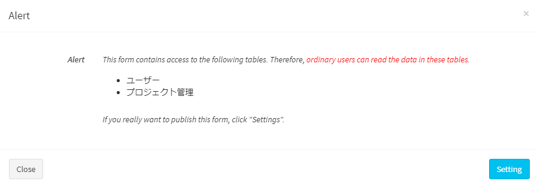
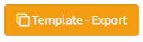
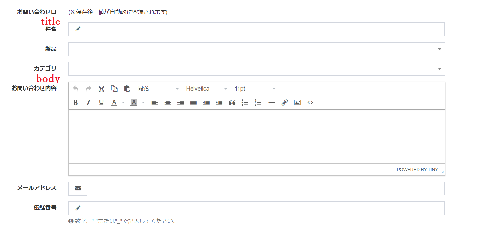

# Einstellungen für öffentliche Formulare
Auf dieser Seite richten Sie ein „öffentliches Formular“ ein, über das Personen ohne Anmeldung (allgemeine Benutzer) Daten eingeben können.  
Sie können Umfragen, Kontaktformulare, Antragsformulare usw. erstellen, die URL weitergeben und sie so breit nach außen veröffentlichen.

- Für die normale [Seite des Datenformulars](/de/data_form) müssen vorher Benutzer angelegt werden, die sich mit ID und Passwort anmelden.
- Ein öffentliches Formular kann jeder ohne Anmeldung ausfüllen.

## Verhalten der Einstellungen für öffentliche Formulare

<span class="red bold">Bei Daten, die über ein öffentliches Formular eingegeben werden, wird der Benutzer, der die Einstellung des öffentlichen Formulars registriert hat, als Ersteller und als Bearbeiter eingetragen.</span>  
Auch die Rollen und Berechtigungen, mit denen auf der Eingabeseite Auswahlwerte anderer Tabellen geholt oder gesucht werden, sind die des Benutzers, der die Einstellung des öffentlichen Formulars registriert hat.  
  
Vermeiden Sie deshalb, dass ein Systemadministrator ein öffentliches Formular registriert.  
Wir empfehlen, nach den Schritten unter „<a href="#/de/publicform?id=role_user">Benutzer und Rollengruppe für die Einstellung öffentlicher Formulare einrichten</a>“ weiter unten einen neuen Benutzer und eine neue Rollengruppe einzurichten.   
  
Außerdem können für die folgenden Tabellen keine öffentlichen Formulare eingerichtet werden.  
- Stammdatentabellen wie „Benutzer“ und „Organisation“
- Tabellen, bei denen in den Tabelleneinstellungen „Nur einen Datensatz speichern“ eingestellt ist


## Ablauf der Einstellung
Stellen Sie in der folgenden Reihenfolge ein. Die genauen Schritte finden Sie unten unter „Schritte der Einstellung“.

1. Befehl ausführen. (Nur wenn Sie Google reCAPTCHA verwenden)
2. Auf der Seite der Systemeinstellungen öffentliche Formulare nutzbar machen.
3. In den [Einstellungen für benutzerdefinierte Formulare](/de/form) die Felder, Überschriften usw. festlegen, die im Formular erscheinen.
4. Den Benutzer und die Rollengruppe registrieren, die öffentliche Formulare einstellen.
5. Mit diesem Benutzer anmelden und das öffentliche Formular einstellen (Design, Bestätigungsseite, Google Analytics usw.).
6. Das öffentliche Formular aktivieren. Die URL wird ausgegeben.

## Schritte der Einstellung

### 1. Befehl ausführen
Führen Sie diesen Schritt nur aus, wenn Sie im öffentlichen Formular Google reCAPTCHA verwenden (ein Verfahren, das das Absenden durch Roboter verhindert).  
Führen Sie im Stammordner des Projekts den Befehl aus, der zu Ihrer Exment-Version passt.  
※ Ab v7.0.0 wird als Bibliothek für Google reCAPTCHA „google/recaptcha“ verwendet. Bis Exment v6.x wird „arcanedev/no-captcha“ verwendet.  

- Ab Exment v7.0.0

```
composer require google/recaptcha=^1.3.1
```

- Bis Exment v6.x

```
composer require arcanedev/no-captcha=^10.1
```

### 2. Seite der Systemeinstellungen
- Öffnen Sie auf der [Seite der Systemeinstellungen](/de/system_setting) „STEP2 Detaileinstellungen“ und stellen Sie „Öffentliche Formulare verwenden“ auf YES.  
※ Der Standardwert ist NO. So wird die Nutzung öffentlicher Formulare ausdrücklich gewählt.  


- Wenn Sie Google reCAPTCHA verwenden, stellen Sie den Punkt „Google reCAPTCHA“ auf V2 oder V3.  
Nach der Auswahl erscheinen die Felder für den Websiteschlüssel und den Geheimschlüssel. Tragen Sie die Werte ein, die Sie von der [Verwaltungsseite von Google reCAPTCHA](http://www.google.com/recaptcha/admin) kopiert haben.  
※ Danach wählen Sie auf der Einstellseite jedes öffentlichen Formulars, ob Google reCAPTCHA verwendet wird.  
※ Den Schwellenwert für die Bewertung bei V3 können Sie in den [Einstellwerten](/de/config) ändern (Standardwert 0.5).


### 3. Einstellungen für benutzerdefinierte Formulare
- In den [Einstellungen für benutzerdefinierte Formulare](/de/form) legen Sie die Felder, Überschriften usw. fest, die im Formular erscheinen. Die Schritte sind im Grunde dieselben wie bei der normalen Formulareinstellung.  
※ Diese Einstellung darf auch jemand anderes vornehmen als der Benutzer für öffentliche Formulare, zum Beispiel ein Administrator.

<h3 id="role_user"><a href="#/de/publicform#role_user" data-id="role_user" class="anchor"><span>4. Benutzer und Rollengruppe für die Einstellung öffentlicher Formulare einrichten</span></a></h3>
Registrieren Sie den Benutzer und die Rollengruppe, die öffentliche Formulare einstellen.  
Daten, die über das öffentliche Formular gesendet werden, gelten als von diesem Benutzer registriert und aktualisiert.

- Erstellen Sie eine neue [Rollengruppe](/de/role_group).
    - Fügen Sie die Berechtigung „Verwaltung öffentlicher Formulare“ hinzu.
	- Fügen Sie für die Tabelle, für die Sie ein öffentliches Formular einrichten möchten, die Bearbeitungsberechtigung hinzu.
    - Fügen Sie außerdem die Leseberechtigung für die Tabellen hinzu, auf die das öffentliche Formular zugreift.  

- Beispiel: Sie möchten ein öffentliches Formular für die Tabelle „Anfragen“ einrichten, und die Tabelle „Anfragen“ verweist auf alle Daten der Tabellen „Produkte“ und „Kategorien“:  
    - Berechtigungen „Verwaltung öffentlicher Formulare“ und „Eigene Daten bearbeiten“ für die Tabelle „Anfragen“
    - Berechtigung „Alle Daten anzeigen“ für die Tabellen „Produkte“ und „Kategorien“


- Fügen Sie den Benutzer hinzu, der die öffentlichen Formulare verwaltet.
    - Wählen Sie als Rollengruppe die oben erstellte Rollengruppe.

- Melden Sie sich mit dem oben erstellten Benutzer an, öffnen Sie die Einstellseite für öffentliche Formulare und registrieren Sie das öffentliche Formular.


### 5. Öffentliches Formular einstellen

- Setzen Sie in der Liste der benutzerdefinierten Tabellen 1 Häkchen bei der gewünschten Tabelle und klicken Sie oben rechts auf „Tabellen-Detaileinstellungen“.  

> ※ Sie können die Seite auch von der Datenliste oder der Eingabeseite der betreffenden benutzerdefinierten Tabelle öffnen. Klicken Sie auch dort oben rechts auf „Tabellen-Detaileinstellungen“.  

- Klicken Sie auf der Seite der Tabellen-Detaileinstellungen auf das Symbol der Formulareinstellungen.


- Weiter unten auf der Listenseite der Formulare gibt es das Feld „Einstellungen für öffentliche Formulare“.  
Klicken Sie oben rechts in diesem Feld auf die Schaltfläche „+Neu“.


- Die Einstellseite für öffentliche Formulare öffnet sich. Stellen Sie die nötigen Punkte ein. Der Inhalt der Einstellungen ist wie folgt.

#### Einstellungen - Grundeinstellungen


- ##### Zielformular
Wählen Sie das Formular, das als öffentliches Formular eingerichtet wird. Wählen Sie das Formular, das Sie oben unter „Einstellungen für benutzerdefinierte Formulare“ erstellt haben.

- ##### Anzeigename des öffentlichen Formulars
Geben Sie den Namen ein, der zum Beispiel auf der Listenseite angezeigt wird.

- ##### Ablaufdatum der Veröffentlichung
Wenn Sie den Zeitraum der Veröffentlichung festlegen möchten, geben Sie Beginn und Ende (Datum und Uhrzeit) ein.  
※ Sie können auch nur den Beginn oder nur das Ende eingeben. Wenn beides leer ist, ist das Formular immer gültig.  
※ Außerhalb des Zeitraums kann dieses öffentliche Formular nicht verwendet werden.


#### Einstellungen - Designeinstellungen


Hier stellen Sie Designelemente ein: ob Kopf- und Fußzeile verwendet werden, Logobild und Texte, Hintergrundfarbe des Formulars usw.  


#### Einstellungen - Einstellungen zu Bestätigung / Abschluss
Die Einstellungen für die „Bestätigungsseite“ und die „Abschlussseite“, die erscheinen, nachdem der Benutzer das Formular ausgefüllt hat. Sie legen fest, ob sie verwendet werden, sowie Titel und Texte.


- ##### Eingabebestätigung verwenden
Bei YES durchläuft der Benutzer die Seiten in dieser Reihenfolge.

```
Eingabeseite → Bestätigungsseite → Abschlussseite (Daten werden registriert)
```

※ Bei NO durchläuft der Benutzer die Seiten in dieser Reihenfolge.

```
Eingabeseite → Abschlussseite (Daten werden registriert)
```

- ##### Titel der Bestätigung
Geben Sie den Titel der Bestätigungsseite ein.

- ##### Text der Bestätigung
Geben Sie den Text oder das HTML ein, das oben auf der Bestätigungsseite erscheint.  
※ [Parameter](/de/params) können verwendet werden. Skripte werden nicht ausgeführt.


- ##### Titel des Abschlusses
Geben Sie den Titel der Abschlussseite ein.

- ##### Text des Abschlusses
Geben Sie den Text oder das HTML ein, das oben auf der Abschlussseite erscheint.  
※ [Parameter](/de/params) können verwendet werden. Skripte werden nicht ausgeführt.

- ##### Link-URL nach Abschluss
Auf der Abschlussseite kann ein Link angezeigt werden. Wenn der Benutzer nach der Eingabe auf eine andere Seite gehen soll, geben Sie die URL des Ziels ein.  
※ Wenn „Linktext nach Abschluss“ leer ist, wird die eingegebene URL selbst als Text des Links angezeigt.

- ##### Linktext nach Abschluss
Auf der Abschlussseite kann ein Link angezeigt werden. Wenn der Benutzer nach der Eingabe auf eine andere Seite gehen soll, geben Sie den Text ein, der als Link auf der Seite erscheint.  


#### Abschlussbenachrichtigung (allgemeiner Benutzer)
Dem allgemeinen Benutzer, der Daten eingegeben hat, kann nach der Registrierung eine E-Mail gesendet werden.

- Da die Benachrichtigung an nicht angemeldete allgemeine Benutzer geht, ist nur der Versand per E-Mail möglich.
- Empfänger ist nur die E-Mail-Adresse, die der allgemeine Benutzer eingetragen hat.
- Für diese Funktion braucht die benutzerdefinierte Tabelle eine Spalte mit dem Spaltentyp E-Mail.

- ##### Allgemeine Benutzer über den Abschluss benachrichtigen
Mit YES wird die Abschlussbenachrichtigung aktiv. 

- ##### Benachrichtigungsvorlage
Wählen Sie die Benachrichtigungsvorlage, die an allgemeine Benutzer gesendet wird. Vorher müssen Sie in den [Einstellungen der Benachrichtigungsvorlagen](/de/mail) eine neue Vorlage erstellen.  
※ In Benachrichtigungen können Sie [Variablen (Parameter)](/de/params) verwenden. Mit Variablen fügen Sie registrierte Daten, den Systemnamen, die Eingaben des Benutzers usw. in Betreff und Text ein.  

- ##### Benachrichtigungsziel
Wählen Sie die benutzerdefinierte Spalte, in der die E-Mail-Adresse für die Benachrichtigung steht.  
Beispiel: Wenn es unter den Eingabefeldern die Spalte „E-Mail-Adresse für die Antwort“ gibt und Sie diese Spalte als Benachrichtigungsziel wählen, wird nach der Eingabe eine Benachrichtigung an diese E-Mail-Adresse gesendet.  


#### Abschlussbenachrichtigung (Administrator)
Nach der Eingabe der Daten kann eine Benachrichtigung an den Administrator gesendet werden.  
※ Hier steht „Administrator“, aber außer Administratoren können auch in Exment registrierte Benutzer, Slack usw. benachrichtigt werden.

- ##### Administrator über den Abschluss benachrichtigen
Mit YES wird die Abschlussbenachrichtigung aktiv. 

- ##### Benachrichtigungsvorlage
Wählen Sie die Benachrichtigungsvorlage, die an den Administrator gesendet wird. Vorher müssen Sie in den [Einstellungen der Benachrichtigungsvorlagen](/de/mail) eine neue Vorlage erstellen.  
※ In Benachrichtigungen können Sie [Variablen (Parameter)](/de/params) verwenden. Mit Variablen fügen Sie registrierte Daten, den Systemnamen, die Eingaben des Benutzers usw. in Betreff und Text ein.  

- ##### Benachrichtigungsziel
Wählen Sie das Benachrichtigungsziel.  
※ Die Punkte des Benachrichtigungsziels und ihre Einstellung finden Sie unter [Einstellungen für Benachrichtigungsaktionen](/de/notify).


#### Einstellungen - Fehlereinstellungen
Hier steuern Sie, was bei einem Fehler geschieht.


- ##### Fehlertitel
Geben Sie den Titel der Fehlerseite ein.

- ##### Fehlertext
Geben Sie den Text oder das HTML ein, das oben auf der Fehlerseite erscheint.  

- ##### Link-URL bei Fehler
Auf der Fehlerseite kann ein Link angezeigt werden. Wenn der Benutzer bei einem Fehler auf eine andere Seite gehen soll, geben Sie die URL des Ziels ein.  
※ Wenn „Linktext bei Fehler“ leer ist, wird die eingegebene URL selbst als Text des Links angezeigt.

- ##### Linktext bei Fehler
Auf der Fehlerseite kann ein Link angezeigt werden. Wenn bei einem Fehler ein Link zu einer anderen Seite erscheinen soll, geben Sie den Text ein, der auf der Seite erscheint.  

#### Fehlerbenachrichtigung
Bei einem Fehler kann der Administrator benachrichtigt werden.  
※ Hier steht „Administrator“, aber außer Administratoren können auch in Exment registrierte Benutzer, Slack usw. benachrichtigt werden.

- ##### Fehler benachrichtigen
Bei YES wird der Administrator benachrichtigt, wenn ein Fehler auftritt.

- ##### Benachrichtigungsvorlage
Wählen Sie die Vorlage, die an den Administrator gesendet wird. Vorher müssen Sie in den [Einstellungen der Benachrichtigungsvorlagen](/de/mail) eine neue Vorlage erstellen.  
※ In Benachrichtigungen können Sie [Variablen (Parameter)](/de/params) verwenden. Mit Variablen fügen Sie registrierte Daten, den Systemnamen, die Eingaben des Benutzers, den Inhalt des Fehlers usw. in Betreff und Text ein.  

- ##### Benachrichtigungsziel
Wählen Sie das Benachrichtigungsziel.  
※ Die Punkte des Benachrichtigungsziels und ihre Einstellung finden Sie unter [Einstellungen für Benachrichtigungsaktionen](/de/notify).


#### CSS / Javascript
Sie können eigenes CSS und Javascript hinzufügen.


- ##### Benutzerdefiniertes CSS
Tragen Sie das gewünschte CSS direkt ein.  
※ Das Tag &lt;style&gt; ist nicht nötig. Tragen Sie nur den Inhalt des CSS ein.

- ##### Plugin (CSS)
Wenn ein installiertes Plugin (CSS) auch im öffentlichen Formular wirken soll, wählen Sie den Namen des Plugins.

- ##### Benutzerdefiniertes Javascript
Tragen Sie das gewünschte Javascript direkt ein.  
※ Das Tag &lt;script&gt; ist nicht nötig. Tragen Sie nur den Inhalt des Javascript ein.  
※ Das Javascript wird in das folgende jQuery eingefügt.

``` javascript
<script data-exec-on-popstate>
    $(function () {
        (hinzugefügter Code)
    });
</script>
```

- ##### Plugin (Javascript)
Wenn ein installiertes Plugin (Javascript) auch im öffentlichen Formular wirken soll, wählen Sie den Namen des Plugins.


#### Einstellungen - Optionseinstellungen
Hier nehmen Sie weitere optionale Einstellungen vor.


- ##### Anfangswerte über die URL festlegbar machen
Bei YES können die Werte der Abfragezeichenfolge der URL als Anfangswerte des Formulars dienen. Einzelheiten finden Sie unter [Anfangswerte über die URL festlegen](/de/publicform?id=Anfangswerte-über-die-URL-festlegen).

- ##### Google Analytics
Wenn Sie Google Analytics für das Formular einrichten, geben Sie das Tag von Google Analytics ein, das mit „UA-“ oder „G-“ beginnt.

- ##### Google reCAPTCHA verwenden
Wenn Sie Google reCAPTCHA verwenden, wählen Sie YES.  
※ Wirkt nur, wenn auf der Seite der Systemeinstellungen die Schlüssel von Google reCAPTCHA eingetragen sind.


#### Vorschau
- Sie können eine Vorschau des öffentlichen Formulars mit dem eingestellten Inhalt anzeigen.  
※ Die Vorschau ist auch möglich, wenn das Formular noch nicht gespeichert ist.

- Mit einem Klick auf die Schaltfläche „Vorschau“ oben rechts erscheint die Vorschau des öffentlichen Formulars in einem neuen Fenster.  
※ Das neue Fenster wird per Javascript geöffnet. Je nach Einstellung des Browsers wird das Pop-up blockiert. Heben Sie dann die Blockierung auf und klicken Sie noch einmal auf die Schaltfläche.


#### Öffentliches Formular aktivieren
- Damit allgemeine Benutzer das Formular sehen, müssen Sie es „aktivieren“. Speichern Sie einmal, öffnen Sie dann die Bearbeitungsseite erneut und klicken Sie oben rechts auf die Schaltfläche „Aktivieren“.  


- Wenn das Formular, das Sie veröffentlichen, auf andere Tabellen verweist, können allgemeine Benutzer die Daten dieser Tabellen lesen.  
Es erscheint eine Rückfrage wie unten. Prüfen Sie sorgfältig, ob der Zugriff auf diese Tabellen in Ordnung ist.  



- „Zugriff auf andere Tabellen“ bedeutet vor allem Folgendes.
    - Wenn das öffentliche Formular Felder mit dem Spaltentyp „Auswahl (aus Tabelle)“, „Benutzer“ usw. hat, werden Daten als Auswahlwerte angezeigt und durchsucht.
    - Wenn das öffentliche Formular zu einer untergeordneten Tabelle einer 1:n-Beziehung gehört, werden die Daten der übergeordneten Tabelle als Auswahl angezeigt und durchsucht.


#### Anzeige der URL usw. nach dem Aktivieren
- Nach dem Aktivieren des öffentlichen Formulars kommen in den Grundeinstellungen die folgenden Punkte hinzu.

- ##### URL des öffentlichen Formulars
Hier steht die URL des öffentlichen Formulars. Kopieren Sie diese URL und geben Sie sie per E-Mail, über Ihre eigene Website usw. an allgemeine Benutzer weiter.  
※ Mit einem Klick auf das Feld können Sie die URL kopieren.

- ##### Ausgeführt von
Der Benutzer, der das öffentliche Formular registriert hat. Alle Registrierungen und Abfragen von Daten über dieses öffentliche Formular erfolgen mit den Berechtigungen dieses Benutzers.  
※ Auch wenn ein anderer Benutzer die Einstellung des öffentlichen Formulars aktualisiert, ändert sich dieser Benutzer nicht. Um ihn zu ändern, melden Sie sich mit einem anderen Benutzer an und erstellen Sie eine neue Einstellung für ein öffentliches Formular.


### 6. Öffentliches Formular verwenden
- Wenn Sie die oben kopierte URL aufrufen, erscheint das öffentliche Formular.  


- Wenn die Einstellung des öffentlichen Formulars nicht „aktiviert“ ist, der Gültigkeitszeitraum nicht passt oder die URL falsch ist, erscheint der folgende Fehler.  


### 7. Vorlagen verwenden
Mit einer Vorlage können Sie ein neues öffentliches Formular erstellen, das die Einstellwerte eines schon erstellten öffentlichen Formulars übernimmt.
>Die folgenden Punkte müssen Sie von Hand einstellen.<br />· Kopfzeilenlogo<br />· Google Analytics<br />· Google reCAPTCHA verwenden

#### Export
Mit einem Klick auf [Vorlage: Export] auf der Einstellseite für öffentliche Formulare wird das geöffnete öffentliche Formular als Vorlage exportiert.



#### Aus Vorlage erstellen
Klicken Sie auf der Seite der Einstellungen für benutzerdefinierte Formulare bei den Einstellungen für öffentliche Formulare auf [+Aus Vorlage erstellen].


##### Zielformular
Wählen Sie das Formular, für das mit der Vorlage ein öffentliches Formular erstellt wird.

##### Anzeigename des öffentlichen Formulars
Geben Sie den Anzeigenamen des öffentlichen Formulars ein, das erstellt wird.

##### Hochladen
Wählen Sie die Vorlage, mit der das öffentliche Formular erstellt wird.


## Weitere Detaileinstellungen

### Anfangswerte über die URL festlegen
- Wenn die Einstellung „Anfangswerte über die URL festlegbar machen“ auf YES steht, können Sie in die URL des öffentlichen Formulars Anfangswerte für Felder schreiben.  
Wenn Sie Werte wie Firmenname oder Kategorie schon kennen, die zum Empfänger der URL passen, tragen Sie sie vorher in die URL ein. Das spart Eingabearbeit.

#### So fügen Sie die Werte an
Setzen Sie eine Abfragezeichenfolge wie die folgende.

```
http://(URL bis zum öffentlichen Formular)?value.(Name der benutzerdefinierten Spalte)=(Anfangswert)

Für mehrere Spalten verbinden Sie das 2. und alle weiteren value mit &.
http://(URL bis zum öffentlichen Formular)?value.(Name der benutzerdefinierten Spalte)=(Anfangswert)&value.(Name der benutzerdefinierten Spalte)=(Anfangswert)


# Beispiel
http://localhost/publicform/c4f31330-7a75-11eb-a8b0-279816836d79?value.title=Hallo

http://localhost/publicform/c4f31330-7a75-11eb-a8b0-279816836d79?value.client_name=ABC AG&value.category=Ersteinführung
```

- Beispiel: Es gibt das folgende Formular  



- Wenn Sie an die URL dieses Formulars die folgende Abfragezeichenfolge anhängen, sind beim Öffnen des Formulars die Anfangswerte gesetzt.

```
http://localhost/publicform/ab3d55e4-1afc-d1de-ac1b-bc64c51d4d7d?value.title=Zu einer Anfrage&value.body=Dies ist der Text.
```


#### Wenn Anfangswerte der benutzerdefinierten Spalten „Auswahl (aus Tabelle)“, „Benutzer“ und „Organisation“ nur per suuid (zufällige Zeichenfolge mit 20 Zeichen) gesetzt werden sollen
Die Anfangswerte der benutzerdefinierten Spalten „Auswahl (aus Tabelle)“, „Benutzer“ und „Organisation“ (im Folgenden kurz nur „Auswahl (aus Tabelle)“) geben Sie normalerweise per ID (fortlaufende ganze Zahl) an.  
Weil die ID aber fortlaufend ist, kann der Empfänger des Formulars den Parameter der URL ändern und andere Werte leicht erraten.  
Wenn die Anfangswerte dieser Spalten nicht per ID, sondern per suuid (zufällige Zeichenfolge mit 20 Zeichen) angegeben werden sollen, stellen Sie Folgendes ein.  

- Nehmen Sie in der [Liste der Exment-Einstellwerte](/de/config) die Einstellung „Bei ‚Anfangswerte über die URL festlegen‘ des öffentlichen Formulars nicht die ID, sondern nur die suuid zulassen“ vor.  

``` .env
EXMENT_PUBLICFORM_URLPARAM_SUUID=true
```

- Mit dieser Einstellung wird für die Anfangswerte der Spalten „Auswahl (aus Tabelle)“ nur noch die suuid zugelassen.

- Die suuid der einzelnen Daten finden Sie auf einem dieser Wege.
    - In der Ansicht unter „Anzeigespalten auswählen“ die „System-ID (20-stellig)“ wählen
    - Die Daten exportieren

### „publicform“ in der URL ändern
- So ändern Sie die Zeichenfolge "publicform", die in der URL öffentlicher Formulare steht.  
※ Diese Zeichenfolge ist für alle öffentlichen Formulare gleich. Sie lässt sich nicht pro Formular ändern.

#### Schritte der Änderung

- Für die Änderung nehmen Sie eine [Änderung der Einstellwerte](/de/config) vor.

- Öffnen Sie im Stammverzeichnis von Exment die Datei „.env“.

- Fügen Sie den folgenden Wert hinzu.

~~~
### Wenn „publicform“ in einen anderen Namen geändert wird
EXMENT_PUBLICFORM_ROUTE_PREFIX=afiewqbfwehghwb
# http://localhost/afiewqbfwehghwb/(UUID) wird zur URL des öffentlichen Formulars
~~~

※ Bitte beachten Sie: Dieses Handbuch geht überall von „publicform“ aus.


### Besonderheiten öffentlicher Formulare
Weitere Besonderheiten, die nur für öffentliche Formulare gelten.  

- Die Schaltfläche „Suchen“, die bei den benutzerdefinierten Spalten „Auswahl (aus Tabelle)“, „Benutzer“, „Organisation“ usw. erscheint, wird in öffentlichen Formularen nicht angezeigt.  

- Benachrichtigungen mit dem Auslöser „Daten neu erstellen“, die sich in den „Benachrichtigungseinstellungen“ der Tabellen-Detaileinstellungen registrieren lassen, werden bei öffentlichen Formularen nicht gesendet.  
Der Grund: In den Einstellungen für öffentliche Formulare gibt es eigene Benachrichtigungen „für allgemeine Benutzer“ und „für Administratoren“, und es soll nicht doppelt gesendet werden.
