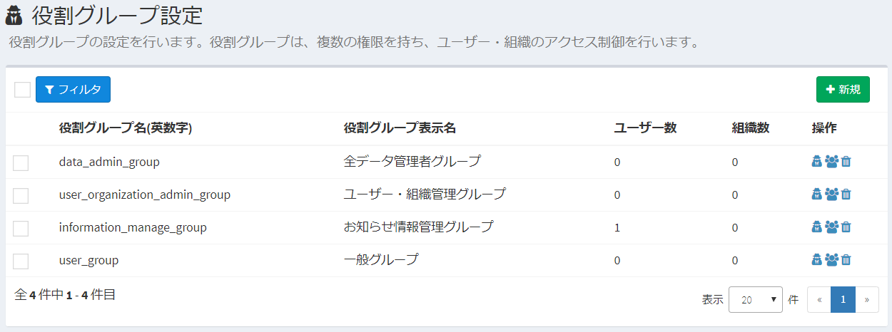

# Rollengruppen und Berechtigungen

Eine „Rollengruppe“ legt fest, wer was tun darf (Berechtigungen).  
Diese Seite erklärt, wie Sie eine Rollengruppe anlegen, ihre Berechtigungen festlegen und Benutzer und Organisationen aufnehmen.

- Mit Rollengruppen können Sie erreichen, dass nur bestimmte Benutzer mit bestimmten Daten oder Seiten arbeiten können.
- Ein neu hinzugefügter Benutzer kann sich zwar anmelden, aber ohne weitere Einstellung fast keine Funktion nutzen. Der Systemadministrator weist dem Benutzer die passende Rollengruppe zu.

> Bevor Sie Rollengruppen einrichten, empfehlen wir, die Seite [Überblick über Rollen und Berechtigungen in Exment](/de/permission) zu lesen.

## Schaubild der Rollengruppen
Sie können passend zur Abteilung und Position eines Benutzers festlegen, was er tun darf.  
Zum Beispiel weisen Sie, wie im Bild unten, die Berechtigungen pro Abteilung und Position zu.

## Liste der vorinstallierten Rollengruppen
Hier werden die Rollengruppen erklärt, die seit der Installation vorhanden sind.

### Gruppe Datenverwaltung (alle Daten)
Eine Rollengruppe, die die Daten aller von Benutzern registrierten Tabellen bearbeiten und ansehen kann.

### Gruppe Benutzer- und Organisationsverwaltung
Eine Rollengruppe, die die Benutzer- und Organisationsdaten sowie die Einstellungen der Login-Benutzer verwaltet.  
Sie kann auch die Benutzer und Organisationen ändern, die zu einer Rollengruppe gehören.

### Gruppe Informationsverwaltung
Eine Rollengruppe, die in der Tabelle „Information“, die mit Exment installiert wird, Daten neu erstellen, bearbeiten und löschen kann.  

### Benutzergruppe
Eine Gruppe für Benutzer, auf die keine der oberen Gruppen zutrifft.  
※ Bei der Erstinstallation sind keine besonderen Berechtigungen eingestellt.

## Aufbau der Daten einer Rollengruppe
Eine Rollengruppe besteht aus 2 Teilen: „(1) Berechtigungseinstellungen“ und „(2) Benutzer und Organisationen“.

### (1) Berechtigungseinstellungen
Eine Berechtigung (Permission) legt fest, ob eine bestimmte Bedienung in Exment erlaubt ist.  
Es gibt zum Beispiel folgende Berechtigungen.
##### Login-Benutzer verwalten   
Die Berechtigung, Benutzern das Recht zur Anmeldung zu geben und Passwörter zurückzusetzen
##### Alle Daten bearbeiten  
Die Berechtigung, alle Daten einer bestimmten Tabelle hinzuzufügen, zu bearbeiten und zu löschen
##### Eigene Daten anzeigen
Die Berechtigung, die Daten anzusehen, bei denen man selbst als Verantwortlicher eingetragen ist
Die Berechtigungseinstellungen gehören jeweils zu einer Rollengruppe.

### (2) Benutzer und Organisationen
Hier legen Sie die Benutzer und Organisationen fest, die zur Rollengruppe gehören.  
Die hier eingetragenen Benutzer können nach der Anmeldung alles tun, was die Berechtigungen dieser Rollengruppe erlauben.

## Einstellung

### Gesamter Ablauf der Einstellung
1. Rollengruppe anlegen (Name der Rollengruppe usw.).
1. Festlegen, was diese Rollengruppe tun darf (Berechtigungen).
1. Benutzer und Organisationen eintragen, die zu dieser Rollengruppe gehören.

※ Den Systemadministrator legen Sie auf der [Seite Systemeinstellungen](/de/system_setting) fest.

### Liste
Klicken Sie im Menü auf „Rollengruppe“.  
Die Listenseite der angelegten Rollengruppen erscheint.  

### Rollengruppe neu erstellen
1. Klicken Sie auf der Listenseite oben rechts auf die Schaltfläche [Neu].

2. Die Seite zum Erstellen einer Rollengruppe erscheint. Geben Sie die nötigen Angaben ein und klicken Sie auf [Absenden].  

3. Nach dem Speichern kehren Sie zur Listenseite zurück. Dort steht die erstellte Rollengruppe.

### Berechtigungseinstellungen ändern
1. Klicken Sie auf der Listenseite der Rollengruppen auf die Zeile der erstellten Rollengruppe.  
Oder klicken Sie auf den Link [Berechtigungseinstellungen].

2. Die Seite der Berechtigungseinstellungen erscheint. Stellen Sie die Berechtigungen ein. Die Arten der Berechtigungen finden Sie unten unter „Arten und Liste der Berechtigungen“.

### Arten und Liste der Berechtigungen
Es gibt folgende Arten von Berechtigungen.

| Art | Was sich festlegen lässt |
|---|---|
| Gesamtes System | Bedienung von Exment insgesamt |
| Rollengruppe | Bedienung der Rollengruppen |
| Plugin-Berechtigungen | Einstellungen von Plugins ändern, Plugins nutzen |
| Stammdaten-Berechtigungen | Bedienung der Tabellen, die Stammdaten verwalten |
| Tabellenberechtigungen | Bedienung pro Tabelle |

#### Gesamtes System
Berechtigungen, die die Bedienung von Exment insgesamt festlegen.  

##### Liste der Berechtigungen
- ##### Alle Tabellen verwalten  
Sie können benutzerdefinierte Tabellen hinzufügen sowie alle benutzerdefinierten Tabellen ändern und löschen. Außerdem können Sie alle Daten in benutzerdefinierten Tabellen hinzufügen, ändern und löschen.
- ##### Alle Daten bearbeiten  
Sie können alle Daten in benutzerdefinierten Tabellen hinzufügen, ändern und löschen.
- ##### Login-Benutzer verwalten  
Sie können die Benutzer verwalten, die sich bei Exment anmelden. Sie können zum Beispiel das Recht zur Anmeldung vergeben und Passwörter zurücksetzen.
- ##### Workflow-Einstellungen  
Sie können die Workflow-Einstellungen ändern.
- ##### Alle API-Anwendungen verwalten  
Sie können alle API-Anwendungen hinzufügen, ändern und löschen.
- ##### API-Anwendungen verwalten  
Sie können nur selbst erstellte API-Anwendungen hinzufügen, ändern und löschen. ※ API-Anwendungen anderer Benutzer können Sie weder ansehen noch hinzufügen, ändern oder löschen.
- ##### Alle Plugins verwalten
Sie können alle Plugins hinzufügen, ändern und löschen. Außerdem können Sie die Plugins verwenden.

#### Rollengruppe
Berechtigungen, die die Bedienung der Rollengruppen festlegen.  

##### Liste der Berechtigungen
- ##### Alle Rollengruppen verwalten  
Sie können die Einstellungen aller Rollengruppen ändern. Sie können Gruppen hinzufügen, ändern und löschen, die Berechtigungseinstellungen der Gruppen ändern sowie die Einstellungen der Benutzer und Organisationen ändern.
- ##### Berechtigungseinstellungen ändern  
Sie können die Berechtigungseinstellungen der Rollengruppe ändern.
- ##### Benutzer/Organisationen verwalten  
Sie können die Einstellungen der Benutzer und Organisationen ändern, die in der Rollengruppe registriert sind.

#### Plugin-Berechtigungen
Hier weisen Sie die Zugriffsberechtigungen für die Plugins von Exment zu.  
  
##### Liste der Berechtigungen
- ##### Einstellungen ändern
Bei Plugins mit Einstellungen können Sie die Einstellungen dieses Plugins ändern.  
※ Plugins löschen oder hochladen können Sie damit nicht. Zum Löschen fügen Sie „Alle Plugins verwalten“ hinzu.

- ##### Nutzung/Zugriff
Sie können das Plugin tatsächlich verwenden und auf seine Seiten zugreifen. Was gesteuert wird, hängt von der Art des Plugins ab.

- **Schaltfläche, Dokumentausgabe**: Steuert, ob die Schaltfläche auf der Seite angezeigt wird oder nicht.
- **Seite, Dashboard**: Schaltet um, ob der Zugriff auf die Seite möglich ist.
- **API**: Schaltet um, ob die API ausgeführt werden kann. (Ohne Zugriff tritt der Fehler 403 auf.)
- **Import, Export**: Steuert, ob der Import und Export von Daten ausgeführt werden kann.
- **Alle anderen**: Eine Steuerung über Rollengruppen ist nicht möglich. Das Plugin wird für alle Benutzer ausgeführt.
    

#### Stammdaten-Berechtigungen
Hier weisen Sie die Berechtigungen für die Tabellen zu, die die Stammdaten von Exment verwalten.  
  
##### Liste der Berechtigungen
- ##### Stammdatenverwaltung  
Sie können die Definition der Stammdaten ändern. Außerdem können Sie Stammdaten hinzufügen, bearbeiten und löschen.
- ##### Systemansicht  
Sie können die Systemansichten der angegebenen benutzerdefinierten Tabelle verwalten.  
- ##### Daten bearbeiten  
Sie können Stammdaten hinzufügen, bearbeiten und löschen.
- ##### Daten anzeigen  
Sie können Stammdaten ansehen. ※ Daten bearbeiten oder löschen können Sie nicht.

#### Tabellenberechtigungen
In Exment können Sie Tabellen anlegen, um Daten zu verwalten.  
Für jede dieser Tabellen können Sie Berechtigungen zuweisen.  
Das nutzen Sie zum Beispiel so.  
- Die Benutzer des Vertriebs können alle Daten der Tabelle „Vertriebsaktivitäten“ bearbeiten und ansehen.
- Die Benutzer der Technik können alle Daten der Tabelle „Technikverwaltung“ bearbeiten und ansehen.
- Die Benutzer eines Partnerunternehmens können in der Tabelle „Bestellanfragen“ nur die Daten ansehen, für die sie selbst eine Berechtigung haben.  
  
##### Liste der Berechtigungen
- ##### Tabellenverwaltung  
Für die angegebene benutzerdefinierte Tabelle können Sie die Tabellendefinition, die Formulare usw. ändern.  
Außerdem können Sie alle Daten der angegebenen benutzerdefinierten Tabelle hinzufügen, bearbeiten und löschen.
- ##### Formulareinstellungen  
Für die angegebene benutzerdefinierte Tabelle können Sie Formulare hinzufügen, bearbeiten und löschen.  
- ##### Verwaltung öffentlicher Formulare  
Für die angegebene benutzerdefinierte Tabelle können Sie Einstellungen öffentlicher Formulare hinzufügen, bearbeiten und löschen.  
※ Wird nur angezeigt, wenn in den Systemeinstellungen „Öffentliche Formulare verwenden“ auf YES steht.  
※ Die Formulare selbst können Sie damit nicht hinzufügen, bearbeiten oder löschen.  
- ##### Systemansicht  
Sie können die Systemansichten der angegebenen benutzerdefinierten Tabelle verwalten.  
- ##### Alle Daten bearbeiten  
Die Berechtigung, alle Daten der angegebenen benutzerdefinierten Tabelle hinzuzufügen, zu bearbeiten und zu löschen.
- ##### Alle Daten anzeigen  
Die Berechtigung, alle Daten der angegebenen benutzerdefinierten Tabelle anzusehen.  
※ Daten bearbeiten oder löschen können Sie nicht.
- ##### Eigene Daten bearbeiten  
Die Berechtigung, in der angegebenen benutzerdefinierten Tabelle die Daten hinzuzufügen, zu bearbeiten und zu löschen, bei denen der Login-Benutzer selbst als Verantwortlicher eingetragen ist.  
- ##### Eigene Daten anzeigen  
Die Berechtigung, in der angegebenen benutzerdefinierten Tabelle die Daten anzusehen, bei denen der Login-Benutzer selbst als Verantwortlicher eingetragen ist.  
※ Daten bearbeiten oder löschen können Sie nicht.
- ##### Datenfreigabe  
Die Berechtigung, Daten, für die Sie die Bearbeitungsberechtigung haben, für andere Benutzer und Organisationen freizugeben.  
- ##### Import  
Sie können Daten aus einer Datei im CSV- oder Excel-Format in die angegebene benutzerdefinierte Tabelle importieren.  
- ##### Export  
Sie können die Daten der angegebenen benutzerdefinierten Tabelle in eine Datei im CSV- oder Excel-Format exportieren.  
- ##### Gelöschte Daten anzeigen  
Sie können logisch gelöschte Daten wieder anzeigen. ※ Zum Wiederherstellen von Daten brauchen Sie die Bearbeitungsberechtigung für diese Daten.  

### Benutzer und Organisationen einstellen
So ändern Sie die Benutzer und Organisationen, die zu einer Rollengruppe gehören.

- Klicken Sie auf der Listenseite auf den Benutzer-Link.
  
Oder klicken Sie auf der Seite der Berechtigungseinstellungen oben rechts auf die Schaltfläche [Benutzer-/Organisationseinstellungen].  
  

- Die Seite der Benutzer-/Organisationseinstellungen erscheint. Registrieren Sie die Benutzer und Organisationen, die zu dieser Rollengruppe gehören.  

### Löschen
- Klicken Sie auf der Listenseite der Rollengruppen auf den Link [Löschen].

### Sonstiges

#### Wenn mehrere Rollengruppen zugewiesen sind
Wenn 1 Benutzer oder 1 Organisation mehrere Rollengruppen hat, gelten die Berechtigungen aller dieser Rollengruppen zusammen.

- Beispiel: Benutzer A
    - Rollengruppe X
        - Tabelle 1
            - Eigene Daten bearbeiten
        - Tabelle 2
            - Eigene Daten anzeigen
        - Tabelle 3
            - Alle Daten anzeigen
        
    - Rollengruppe Y
        - Tabelle 1
            - Alle Daten anzeigen
        - Tabelle 4
            - Eigene Daten bearbeiten

    - → Endgültige Berechtigungen von Benutzer A
        - Tabelle 1
            - Alle Daten anzeigen
            - Eigene Daten bearbeiten
        - Tabelle 2
            - Eigene Daten anzeigen
        - Tabelle 3
            - Alle Daten anzeigen
        - Tabelle 4
            - Eigene Daten bearbeiten
